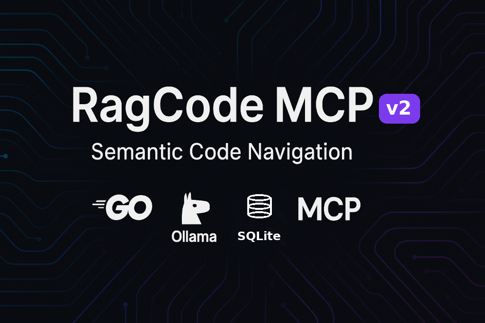
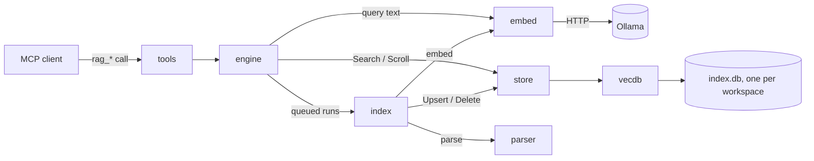

<div align="center">
  

  <p align="center">
    <a href="./LICENSE"></a>
    <a href="https://go.dev/"></a>
    <a href="https://goreportcard.com/report/github.com/doITmagic/rag-code-mcp"></a>
    <a href="https://modelcontextprotocol.io"></a>
    
    
    
    <a href="https://github.com/doITmagic/rag-code-mcp"></a>
  </p>
</div>

# RagCode MCP - Make Your Codebase AI-Ready

> **The privacy-first MCP server that indexes your code on your own machine and answers code questions for AI assistants.**

RagCode is a **Model Context Protocol (MCP) server**. It indexes a code
workspace and gives AI clients such as **Claude Code**, **Cursor**,
**Windsurf**, **VS Code + Copilot**, **Zed** and **Gemini CLI** seven tools:
semantic search, usages, call hierarchy, package exports, file context,
indexing and server status. Everything runs locally: an embedded SQLite index
per workspace and one small Ollama embedding model.

This is **RagCode v2** (Go module `github.com/doITmagic/rag-code-mcp/v2`), a
rewrite of v1 that needs no database server and no chat model. It is built
with the official [MCP Go SDK](https://github.com/modelcontextprotocol/go-sdk).
The last v1 release is
[v1.1.21](https://github.com/doITmagic/rag-code-mcp/releases/tag/v1.1.21).

## ⚡ One-Command Installation

**No Go and no build tools needed.** The installer needs Docker for its
default Ollama setup, or an Ollama 0.40+ you already run (`-ollama local`).

v2 is a pre-release, tag `v2.0.0-rc2`, so the links below name that tag.
`releases/latest` still points to v1; after the final v2 release the
`releases/latest/download/<archive>` links will work too.

### Linux

```bash
# amd64
curl -fsSL https://github.com/doITmagic/rag-code-mcp/releases/download/v2.0.0-rc2/rag-code-mcp_linux_amd64.tar.gz | tar xz && ./rag-code-install -y

# arm64
curl -fsSL https://github.com/doITmagic/rag-code-mcp/releases/download/v2.0.0-rc2/rag-code-mcp_linux_arm64.tar.gz | tar xz && ./rag-code-install -y
```

### macOS

```bash
# Apple Silicon
curl -fsSL https://github.com/doITmagic/rag-code-mcp/releases/download/v2.0.0-rc2/rag-code-mcp_darwin_arm64.tar.gz | tar xz && ./rag-code-install -y

# Intel
curl -fsSL https://github.com/doITmagic/rag-code-mcp/releases/download/v2.0.0-rc2/rag-code-mcp_darwin_amd64.tar.gz | tar xz && ./rag-code-install -y
```

### Windows (PowerShell)

```powershell
Invoke-WebRequest -Uri "https://github.com/doITmagic/rag-code-mcp/releases/download/v2.0.0-rc2/rag-code-mcp_windows_amd64.zip" -OutFile "ragcode.zip"; Expand-Archive ragcode.zip -DestinationPath . -Force; .\rag-code-install.exe -y
```

### WSL

Install inside WSL when your MCP client runs in WSL; install natively on
Windows for Windows IDEs. A project under `/mnt/c/...` indexes slowly from
WSL and is not watched for changes: edits reach the index only through
`rag_index_workspace` or the next server start. Keep projects in the Linux
file system when you work from WSL.

**What the installer does:**

- ✅ Removes a RagCode v1 install first (its indexes are not compatible, so projects are indexed again)
- ✅ Copies `rag-code-mcp` to `~/.ragcode/bin` and writes `~/.ragcode/config.yaml`
- ✅ Starts Ollama (a `ragcode-ollama` Docker container by default) and pulls `embeddinggemma-2:270m`
- ✅ Registers the server in the IDE and AI-client configs it finds ([list](#-ide-integration))
- ✅ Puts `~/.ragcode/bin` on `PATH` (Linux, macOS); on Windows it prints a one-line PowerShell command to run, and changes nothing itself

Each archive (`rag-code-mcp_<os>_<arch>.tar.gz`, `.zip` on Windows) holds both
binaries, `rag-code-mcp` and `rag-code-install`. All archives are on the
[releases page](https://github.com/doITmagic/rag-code-mcp/releases).

### Installer flags

| Flag | Default | Meaning |
|---|---|---|
| `-y` | off | Answer yes to every prompt |
| `-ollama docker\|local\|skip` | `docker` | `docker` runs a `ragcode-ollama` container, `local` uses the Ollama already running, `skip` leaves Ollama and the model to you |
| `-gpu` | `true` | Start the container with `--gpus all`, retrying on CPU when that fails; `-gpu=false` goes straight to CPU |
| `-skip-ide` | off | Do not write IDE MCP configs |
| `-models-dir <dir>` | empty | Host directory for the Ollama models instead of the Docker volume |
| `-uninstall` | off | Remove RagCode instead of installing it |
| `-docker` | off | With `-uninstall`: also remove the `ragcode-ollama` container and volume |

Details: [cmd/rag-code-install](cmd/rag-code-install/README.md),
[internal/install](internal/install/README.md).

### Build from source

```bash
CGO_ENABLED=0 go build -o dist/ ./cmd/...
dist/rag-code-install -y
```

### 🔄 Upgrading from v1

Run `rag-code-install` as above. v1's `rag-code-mcp --update` and
`brew upgrade` replace only the binary and leave the v1 setup (Qdrant, old
config, IDE entries) behind.

### 🔄 Updates

A server started from `~/.ragcode/bin` installs a newer release on its own (at
most one GitHub check a day), after checking the archive against
`checksums.txt`; the MCP clients use it once they restart the server.
`rag-code-mcp -update` does it at once; `auto_update: false` in `config.yaml`
turns the automatic update off. See [internal/update](internal/update/README.md).

### Uninstall

```bash
./rag-code-install -uninstall -y          # from the archive; add -docker to also remove the ragcode-ollama container
```

---

## 🎯 Zero-Config Usage

Once installed, there is nothing to configure:

1. **Open your project** in your IDE or AI client.
2. **Ask your AI assistant** a question about your code.
3. RagCode registers the workspace, indexes it in the background and keeps the
   index up to date with a file watcher.

```
💬 "How does the authentication system work?"
💬 "Who calls PaymentService.charge?"
💬 "List the exported symbols of the models package"
```

While the first run is going, the tools answer `indexing` with partial
results; `rag_search` still finds code by name and text before the index
exists. Later runs index only the files that changed.

The client passes the project as `workspace_root`; when it is empty and the
client lists exactly one root, that root is used, otherwise the call asks for
it. A directory that does not look like one project (a folder of several
projects, a subdirectory of a repository) is not indexed until you confirm
it. A workspace with more than 20,000 indexable files is not indexed either:
raise `max_files` in `~/.ragcode/config.yaml` (`0` = no limit) and restart
the server to index it anyway.

---

## 📋 Table of Contents

| Section | Description |
|---------|-------------|
| [🔒 Privacy-First](#-privacy-first-100-local) | Everything runs on your machine |
| [🚀 Why RagCode?](#-why-ragcode) | Comparisons with cloud search and generic RAG |
| [🛠️ MCP Tools](#️-mcp-tools) | The seven tools |
| [🌐 Supported Languages](#-multi-language-code-intelligence) | Go, PHP/Laravel, Python, JS/TS/Vue, GDScript, HTML, docs |
| [💻 IDE Integration](#-ide-integration) | The 14 clients the installer configures |
| [📦 System Requirements](#-system-requirements) | Ollama, memory, tested machines |
| [📚 Documentation](#-documentation) | Package READMEs, where data lives, code map |

---

## 🔒 Privacy-First: 100% Local

**Your code never leaves your machine.**

- ✅ **Local embeddings** - one small Ollama model (`embeddinggemma-2:270m`) on your hardware; no chat model, no LLM API
- ✅ **Embedded index** - one SQLite file per workspace under `~/.ragcode/index`; no database server, no Docker needed for the index
- ✅ **No API costs** - no account, no usage limits, no subscription
- ✅ **Works offline** - after the model is pulled; the only outbound call is the daily release check, which `auto_update: false` turns off
- ✅ **Secrets stay out** - secret files are skipped by the indexer and refused by `rag_read_file_context`

**Good fit for:** proprietary code, client projects, security-conscious teams.

---

## 🚀 Why RagCode?

AI assistants waste time and context reading whole files to find one
function. RagCode gives them the symbol they need, with its file and lines,
plus the usages and the call graph, so they read less and answer from the
real code.

### RagCode vs Cloud-Based Code Search

| Feature | RagCode (Local) | Cloud AI Search |
|---------|-----------------|-----------------|
| **Privacy** | ✅ Code stays on your machine | ❌ Code sent to a vendor |
| **Cost** | ✅ $0 | ❌ Subscription or per-request pricing |
| **Offline** | ✅ Works offline after setup | ❌ Requires internet |
| **Data Control** | ✅ The index is a file you own | ❌ Vendor stores the index |

### RagCode vs Generic RAG

| Aspect | Generic RAG | RagCode |
|--------|-------------|---------|
| **Chunking** | Arbitrary text splits | Code symbols (functions, methods, classes, routes, ...); docs split by section or key |
| **Metadata** | File name only | Name, qualified name, kind, signature, file, line range, relations |
| **Lookup** | Similarity only | Exact match by (qualified) name first, semantic search otherwise |
| **Structure** | None | Usages and call hierarchy from parsed calls, imports, extends and implements |
| **Freshness** | Manual re-import | File watcher; only changed files are re-indexed |

---

## 🛠️ MCP Tools

| Tool | What it does | Use when |
|------|--------------|----------|
| `rag_search` | Exact match by name or qualified name, semantic search for a description; filters by language, path and kind | **First choice** for exploration |
| `rag_find_usages` | Every indexed reference to a symbol (calls, extends, implements, uses), grouped by file with the line | Before changing or removing a symbol |
| `rag_call_hierarchy` | Callers and callees of a function as a tree, up to 4 levels | Following a flow through the code |
| `rag_list_package_exports` | Exported symbols of a package, module or directory, grouped by kind | Exploring an unfamiliar package |
| `rag_read_file_context` | A file's outline, a line range or one symbol; parsed on the spot, needs neither the index nor Ollama | You have a file and line |
| `rag_index_workspace` | Index the workspace: `incremental` (changed files) or `recreate` | Forcing a run (indexing is otherwise automatic) |
| `rag_server_info` | Version, Ollama status, update availability, languages, known workspaces | Checking the setup |

Every tool answers with one JSON block `{status, message, data, index}`;
`dependency_down` and `low_memory` say what to fix instead of hanging. Full
reference: [tools/README.md](tools/README.md).

---

## 🌐 Multi-Language Code Intelligence

| Language | Extensions | What is indexed | Docs |
|----------|-----------|-----------------|------|
| **Go** | `.go` | Functions, methods, types, vars, consts; calls, type uses, embedding; Echo, Gin, Chi and net/http routes | [parser/golang](parser/golang/README.md) |
| **PHP + Laravel** | `.php`, `.blade.php` | Classes, interfaces, traits, enums, functions, methods; Laravel routes (with names and groups), Blade views and components, Livewire, WordPress hooks | [parser/php](parser/php/README.md) |
| **Python** | `.py`, `.pyi` | Functions, classes, methods, module-level assignments, decorators; calls and base classes, `__init__.py` re-exports | [parser/python](parser/python/README.md) |
| **JavaScript / TypeScript / Vue** | `.js`, `.mjs`, `.cjs`, `.jsx`, `.ts`, `.tsx`, `.vue` | Functions, classes, methods, interfaces, type aliases, enums, CommonJS exports, Vue components and templates; `tsconfig` path aliases | [parser/javascript](parser/javascript/README.md) |
| **GDScript (Godot)** | `.gd`, `.tscn` | Script classes, functions, signals, variables, inner classes; scene nodes, attached scripts and signal connections | [parser/gdscript](parser/gdscript/README.md) |
| **HTML / Go templates** | `.html`, `.htm`, `.gohtml`, `.tmpl`, `.tpl` | Elements with an `id`, sectional tags, `{{define}}`/`{{block}}`, linked scripts and stylesheets, inline event handlers (CSS files are not indexed) | [parser/web](parser/web/README.md) |
| **Docs and config** | `.md`, `.mdx`, `.markdown`, `.rst`, `.txt`, `.json`, `.yaml`, `.yml`, `.toml` | Markdown/reST sections, JSON/YAML/TOML keys, text windows | [parser/docs](parser/docs/README.md) |

Each workspace has its own isolated index; one server serves several
workspaces. See [engine](engine/README.md).

### 🗺️ Planned for v2.1

Full WordPress support beyond `add_action` / `add_filter` hooks: custom post
types, taxonomies, shortcodes, Gutenberg blocks, widgets, admin pages and REST
routes, **WooCommerce** and **Oxygen Builder**.

---

## 💻 IDE Integration

The installer adds a `ragcode` entry to every client it finds installed
(other keys in the file are kept); `rag-code-install -uninstall` removes it.

| Client | Client | Client |
|--------|--------|--------|
| Claude Code | Claude Desktop | Cursor |
| Windsurf | VS Code (Copilot) | Zed |
| Cline | Roo Code | Continue |
| Gemini CLI | OpenAI Codex | Antigravity |
| GitHub Copilot CLI | OpenHands | |

Config file paths per OS and manual setup:
[internal/idepaths](internal/idepaths/README.md). The entry starts
`~/.ragcode/bin/rag-code-mcp --config ~/.ragcode/config.yaml`; MCP over
stdio by default, Streamable HTTP with `--http`
([cmd/rag-code-mcp](cmd/rag-code-mcp/README.md)).

`rag_index_workspace` also writes `<workspace>/.ragcode/RAGCODE.md`, the
instructions AI clients read, and one pointer line to it in the agent rule
files the project already has (see [Where data lives](#where-data-lives)).

---

## 📦 System Requirements

| Component | Requirement | Notes |
|-----------|-------------|-------|
| **Ollama** | 0.40 or later, model `embeddinggemma-2:270m` | The only dependency; Docker (installer default) or native |
| **Free memory** | about 750 MB for the model | With less, the tools answer `low_memory` and say how much to free (`min_free_memory_mb`) |
| **CPU / RAM** | 4 cores, 8 GB RAM minimum; 8 cores, 16 GB recommended | |
| **Disk** | SSD | |
| **GPU** | optional | Speeds up indexing |
| **OS** | Linux, macOS, Windows (amd64, arm64; Windows amd64) | WSL: see [Installation](#wsl) |
| **Go** | 1.26.0 or later | Only to build from source |

### Tested on

First full indexing of a real project, model `embeddinggemma-2:270m`:

| Machine | Ollama | Project | Files | Time |
|---|---|---|---|---|
| Ubuntu 24.04, Intel i9-14900K, 62 GB RAM, NVIDIA RTX 4060 Ti 16 GB, NVMe SSD | Docker, GPU | Go + PHP + JS | 2,790 | 2 min 29 s |
| Windows 11, Intel i9-12900H, 16 GB RAM, NVIDIA RTX 3050 Ti 4 GB, SSD | native 0.40.16, GPU | PHP + JS | 1,663 | about 10 min |

Later runs index only the files that changed.

---

## 📚 Documentation

Every package directory has its own README. Good starting points:

- **[tools](tools/README.md)** - the seven tools, inputs, answers, status values
- **[internal/config](internal/config/README.md)** - every `config.yaml` key and environment override
- **[internal/install](internal/install/README.md)** - what the installer does, step by step
- **[internal/idepaths](internal/idepaths/README.md)** - IDE config files per OS
- **[engine](engine/README.md)** - workspaces, root validation, watcher, known limitations
- **[index](index/README.md)** - the indexing pipeline and skip rules

### Where data lives

| Path | Content |
|---|---|
| `~/.ragcode/config.yaml` | settings (Ollama URL and model, exclude patterns, watch, log level) |
| `~/.ragcode/bin/rag-code-mcp` | the server binary the installer copies |
| `~/.ragcode/logs/ragcode.log` | the server log; rotated to `ragcode.log.1` |
| `~/.ragcode/index/<collection>/` | the workspace index: `index.db` (plus SQLite's `index.db-wal` and `index.db-shm`), `state.json`, `index_status.json`, `index.lock`, `watch.lock` |
| `~/.ragcode/roots.json` | the workspaces the server knows; `roots.json.lock` guards its updates; an unreadable file is kept as `roots.json.bad` |
| `~/.ragcode/cache/update.json` | the cached result of the release check |
| `~/.ragcode/cache/update.lock` | held while one server installs an update |
| `<workspace>/.ragcode/RAGCODE.md` | the instructions the AI clients read |
| `<workspace>/.ragcode/.gitignore` | `*`, so git ignores `.ragcode` |
| `<workspace>/CLAUDE.md`, `AGENTS.md`, `GEMINI.md`, `.github/copilot-instructions.md`, `.windsurfrules`, `.clinerules`, `.cursor/rules/ragcode.mdc` | one pointer line to `RAGCODE.md`, added only to files that already exist (`ragcode.mdc` is created when `.cursor/rules` exists) and that git does not track |

`<collection>` is `ragcode-` plus the first 16 hex digits of the SHA-1 of the
cleaned, symlink-resolved workspace path (below a WSL drive mount
`/mnt/<letter>/`, spelled as the directories list it). Set `RAGCODE_HOME` to
move `~/.ragcode`.

### Code map

| Directory | What it does |
|---|---|
| [cmd](cmd/README.md) | the two binaries |
| [cmd/rag-code-mcp](cmd/rag-code-mcp/README.md) | the server binary: MCP over stdio by default, Streamable HTTP with `--http`; logs go to `$RAGCODE_HOME/logs/ragcode.log` |
| [cmd/rag-code-install](cmd/rag-code-install/README.md) | the installer binary; `-uninstall` removes RagCode |
| [internal](internal/README.md) | packages private to this module: wiring, config, install and uninstall |
| [internal/app](internal/app/README.md) | wires config, embedder, store, engine and the MCP tools into one server |
| [internal/config](internal/config/README.md) | loads `~/.ragcode/config.yaml` and provides the process logger |
| [internal/idepaths](internal/idepaths/README.md) | where each supported IDE keeps its MCP config; writes or removes the `ragcode` entry |
| [internal/install](internal/install/README.md) | sets RagCode up: binary, `config.yaml`, Ollama container, model, IDE configs, PATH |
| [internal/update](internal/update/README.md) | the release check, and the update that installs a newer release over `~/.ragcode/bin/rag-code-mcp` |
| [internal/uninstall](internal/uninstall/README.md) | removes processes, IDE entries, per-root `.ragcode` directories, `~/.ragcode` and the PATH line |
| [engine](engine/README.md) | orchestrates workspaces: root validation, known roots, one index queue per root through a single global slot, a file watcher per root (one watching server per root across processes) |
| [index](index/README.md) | the indexing pipeline for one root: walk, skip rules, parse, workspace-wide relation resolution, embed, upsert |
| [embed](embed/README.md) | turns text into vectors through Ollama's `/api/embed`; a deterministic fake for tests |
| [parser](parser/README.md) | the symbol and relation contract every language analyzer produces |
| [parser/docs](parser/docs/README.md) | Markdown sections, JSON/YAML/TOML keys and plain text as searchable chunks |
| [parser/gdscript](parser/gdscript/README.md) | Godot scripts (`.gd`) and text scenes (`.tscn`) |
| [parser/golang](parser/golang/README.md) | Go, one symbol per top-level declaration |
| [parser/javascript](parser/javascript/README.md) | JavaScript, TypeScript and Vue single-file components |
| [parser/php](parser/php/README.md) | PHP and Blade |
| [parser/python](parser/python/README.md) | Python |
| [parser/web](parser/web/README.md) | HTML with Go template actions |
| [store](store/README.md) | the symbol store: `Store` interface, SQLite implementation on `vecdb`, in-memory implementation for tests |
| [vecdb](vecdb/README.md) | the embedded vector database: one SQLite file per collection, exact cosine search, no CGO |
| [tools](tools/README.md) | the seven `rag_*` MCP tools and their JSON answers |

How a request flows:



### External resources

- **[Model Context Protocol](https://modelcontextprotocol.io)** - the MCP specification
- **[Ollama](https://ollama.com)** - local embedding models

---

## 🤝 Contributing

Contributions are welcome:

- 🐛 **[Report bugs](https://github.com/doITmagic/rag-code-mcp/issues/new)**
- 💡 **Request features** - new tools or languages
- 🔧 **Submit PRs** - see [CONTRIBUTING.md](CONTRIBUTING.md) and [SECURITY.md](SECURITY.md)
- ⭐ **[Star the project](https://github.com/doITmagic/rag-code-mcp)**

### Development setup

```bash
git clone https://github.com/doITmagic/rag-code-mcp.git
cd rag-code-mcp
go test ./...
go run ./cmd/rag-code-mcp
```

---

## 📄 License

RagCode MCP is open source software licensed under the **[MIT License](./LICENSE)**.

---

## 🏷️ Keywords

`semantic-code-search` `rag` `retrieval-augmented-generation` `mcp-server` `model-context-protocol` `ai-code-assistant` `vector-search` `code-navigation` `call-hierarchy` `find-usages` `ollama` `sqlite` `embeddings` `github-copilot` `claude-code` `cursor-ai` `windsurf` `zed` `go` `php` `laravel` `wordpress` `python` `javascript` `typescript` `vue` `nuxt` `godot` `gdscript` `html` `code-intelligence` `tree-sitter` `llm-tools` `local-ai` `privacy-first` `offline-ai` `self-hosted` `zero-cost` `no-cloud` `private-code-search`

---

<div align="center">

**Built with ❤️ for developers who want smarter AI code assistants**

⭐ **[Star us on GitHub](https://github.com/doITmagic/rag-code-mcp)** if RagCode helps your workflow!

Built and maintained by **[DO IT MAGIC SOFTWARE](https://doitmagic.ro/)**, custom software and applied AI from Pitești, Romania.

**Questions?** [Open an Issue](https://github.com/doITmagic/rag-code-mcp/issues) • [Read the Docs](./tools/README.md) • [Join Discussions](https://github.com/doITmagic/rag-code-mcp/discussions)

</div>
