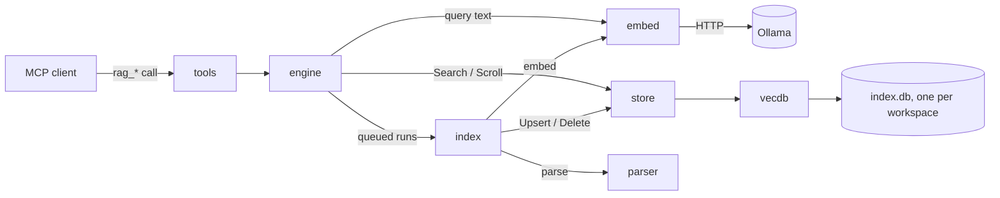

# RagCode MCP v3

An MCP server that indexes a code workspace and answers code questions for AI
clients: semantic search, usages, call hierarchy, package exports and file
context. Clean rewrite of v2 with the same features and about half the code.

Separate Go module (`github.com/doITmagic/rag-code-mcp/v3`). It does not import
v2 packages; v2 stays frozen and shippable until v3 replaces it.

## Requirements

- **Go 1.26.0 or later** to build (`go.mod`).
- **Ollama 0.40 or later** with the `embeddinggemma-2:270m` model. It is the
  only dependency. The installer can run it in Docker (`-ollama docker`, the
  default), use one already running (`-ollama local`), or leave it to you
  (`-ollama skip`).
- **Hardware:** at least 4 CPU cores, 8 GB RAM and an SSD; 8 cores and 16 GB
  are recommended. A GPU for Ollama speeds up indexing but is not required.

No database server is needed: the index is an embedded SQLite file per
workspace.

## Install

```bash
cd v3
CGO_ENABLED=0 go build -o dist/ ./cmd/...
dist/rag-code-install -y            # add -ollama local|skip, -skip-ide, -gpu=false
```

The installer copies `rag-code-mcp` to `~/.ragcode/bin`, writes
`~/.ragcode/config.yaml`, starts Ollama, pulls the model and registers the
server in the IDE configs it finds. A RagCode v1 install is removed first; its
indexes are not compatible, so projects are indexed again.

`dist/rag-code-install -uninstall -y` removes everything; add `-docker` to also
remove the `ragcode-ollama` container.

## Where data lives

| Path | Content |
|---|---|
| `~/.ragcode/config.yaml` | settings (Ollama URL and model, exclude patterns, watch, log level) |
| `~/.ragcode/bin/rag-code-mcp` | the server binary the installer copies |
| `~/.ragcode/logs/ragcode.log` | the server log; rotated to `ragcode.log.1` |
| `~/.ragcode/index/<collection>/` | the workspace index: `index.db` (plus SQLite's `index.db-wal` and `index.db-shm`), `state.json`, `index_status.json`, `index.lock` |
| `~/.ragcode/roots.json` | the workspaces the server knows; `roots.json.lock` guards its updates |
| `~/.ragcode/cache/update.json` | the cached result of the release check |
| `<workspace>/.ragcode/RAGCODE.md` | the instructions the AI clients read |
| `<workspace>/.ragcode/.gitignore` | `*`, so git ignores `.ragcode` |
| `<workspace>/CLAUDE.md`, `AGENTS.md`, `GEMINI.md`, `.github/copilot-instructions.md`, `.windsurfrules`, `.clinerules`, `.cursor/rules/ragcode.mdc` | one pointer line to `RAGCODE.md`, added only to files that already exist (`ragcode.mdc` is created when `.cursor/rules` exists) and that git does not track |

`<collection>` is `ragcode-` plus the first 16 hex digits of the SHA-1 of the
cleaned, symlink-resolved workspace path. Set `RAGCODE_HOME` to move `~/.ragcode`.

## Tools

`rag_search`, `rag_find_usages`, `rag_call_hierarchy`,
`rag_list_package_exports`, `rag_read_file_context`, `rag_index_workspace`,
`rag_server_info`. `rag_server_info` takes no parameter. The others take
`workspace_root`; when it is empty and the client lists exactly one root, that
root is used, otherwise the call fails and asks for it.

## Code map

Every package directory has its own README; start here and follow the links.

| Directory | What it does |
|---|---|
| [cmd](cmd/README.md) | the two binaries |
| [cmd/rag-code-mcp](cmd/rag-code-mcp/README.md) | the server binary: MCP over stdio by default, Streamable HTTP with `--http`; logs go to `$RAGCODE_HOME/logs/ragcode.log` |
| [cmd/rag-code-install](cmd/rag-code-install/README.md) | the installer binary; `-uninstall` removes RagCode |
| [internal](internal/README.md) | packages private to this module: wiring, config, install and uninstall |
| [internal/app](internal/app/README.md) | wires config, embedder, store, engine and the MCP tools into one server |
| [internal/config](internal/config/README.md) | loads `~/.ragcode/config.yaml` and provides the process logger |
| [internal/idepaths](internal/idepaths/README.md) | where each supported IDE keeps its MCP config; writes or removes the `ragcode` entry |
| [internal/install](internal/install/README.md) | sets RagCode up: binary, `config.yaml`, Ollama container, model, IDE configs, PATH |
| [internal/uninstall](internal/uninstall/README.md) | removes processes, IDE entries, per-root `.ragcode` directories, `~/.ragcode` and the PATH line |
| [engine](engine/README.md) | orchestrates workspaces: root validation, known roots, one index queue per root through a single global slot, a file watcher per root (one watching server per root across processes) |
| [index](index/README.md) | the indexing pipeline for one root: walk, skip rules, parse, workspace-wide relation resolution, embed, upsert |
| [embed](embed/README.md) | turns text into vectors through Ollama's `/api/embed`; a deterministic fake for tests |
| [parser](parser/README.md) | the symbol and relation contract every language analyzer produces |
| [parser/docs](parser/docs/README.md) | Markdown sections, JSON/YAML/TOML keys and plain text as searchable chunks |
| [parser/gdscript](parser/gdscript/README.md) | Godot scripts (`.gd`) and text scenes (`.tscn`) |
| [parser/golang](parser/golang/README.md) | Go, one symbol per top-level declaration |
| [parser/javascript](parser/javascript/README.md) | JavaScript, TypeScript and Vue single-file components |
| [parser/php](parser/php/README.md) | PHP and Blade |
| [parser/python](parser/python/README.md) | Python |
| [parser/web](parser/web/README.md) | HTML with Go template actions |
| [store](store/README.md) | the symbol store: `Store` interface, SQLite implementation on `vecdb`, in-memory implementation for tests |
| [vecdb](vecdb/README.md) | the embedded vector database: one SQLite file per collection, exact cosine search, no CGO |
| [tools](tools/README.md) | the seven `rag_*` MCP tools and their JSON answers |

How a request flows:


