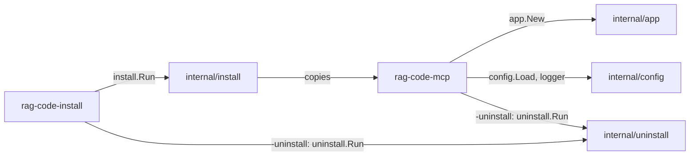

[RagCode v3](../README.md) › cmd

# Commands

This directory holds the two programs RagCode v3 ships. Each sub-directory is
a `package main` that builds into one binary. They are deliberately thin: they
parse flags, set up signals and hand over to the packages in
[`internal/`](../internal/README.md), which hold the real logic and are easy to
test without starting a process.

## Sub-packages

| Directory | Binary | What it does |
|:---|:---|:---|
| [`rag-code-mcp`](./rag-code-mcp/README.md) | `rag-code-mcp` | The MCP server. Speaks MCP over stdio (default) or Streamable HTTP (`-http`). Also carries `-version` and `-uninstall`. |
| [`rag-code-install`](./rag-code-install/README.md) | `rag-code-install` | The installer. Copies `rag-code-mcp` into `~/.ragcode/bin`, writes the config, starts Ollama, pulls the model and registers the server in IDEs. `-uninstall` removes everything. |

## How they relate



The installer does not embed the server: it expects the `rag-code-mcp` binary
to sit in the same directory as `rag-code-install` and copies it from there.
Build both together:

```bash
cd v3
CGO_ENABLED=0 go build -o dist/ ./cmd/...
dist/rag-code-install -y
```

`CGO_ENABLED=0` works because the whole v3 tree is pure Go (the SQLite store
uses a CGO-free driver).

To stamp a version into the server:

```bash
go build -ldflags "-X main.Version=v3.0.0" -o dist/ ./cmd/rag-code-mcp
```

## Testing

```bash
cd v3
go test ./cmd/...
```

Only `rag-code-mcp` has tests; `rag-code-install` is a flag parser whose logic
is tested in [`internal/install`](../internal/install/README.md) and
[`internal/uninstall`](../internal/uninstall/README.md).

## See also

- [RagCode v3 overview](../README.md)
- [internal packages](../internal/README.md)
- [internal/app](../internal/app/README.md): what the server binary builds
