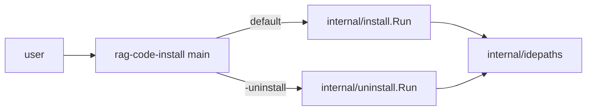

[RagCode v3](../../README.md) › [cmd](../README.md) › rag-code-install

# rag-code-install (the installer binary)

`rag-code-install` sets RagCode up on a machine, or removes it with
`-uninstall`. It is a small flag parser: all the work is done by
[`internal/install`](../../internal/install/README.md) and
[`internal/uninstall`](../../internal/uninstall/README.md).

The installer copies the server from **its own directory**: the
`rag-code-mcp` binary (`rag-code-mcp.exe` on Windows) must sit next to
`rag-code-install`, which is how a release archive or `go build -o dist/
./cmd/...` lays them out.

## Where it sits



## Files

| File | Contents |
|:---|:---|
| `main.go` | Flag definitions, the `SIGINT` context and the call to `install.Run` or `uninstall.Run`. Exits 1 and prints the error to stderr on failure. |

There are no tests in this package; the behaviour is tested in
[`internal/install`](../../internal/install/README.md#testing) and
[`internal/uninstall`](../../internal/uninstall/README.md#testing).

## Flags

| Flag | Default | Meaning |
|:---|:---|:---|
| `-ollama` | `docker` | How to get Ollama: `docker` runs a `ragcode-ollama` container, `local` uses the one already running, `skip` does nothing (no wait, no model pull). Any other value is an error. |
| `-gpu` | `true` | Start the container with `--gpus all` first; on failure retry on CPU. Use `-gpu=false` to go straight to CPU. |
| `-y` | `false` | Answer yes to every prompt. For install: replace an existing binary without asking. For uninstall: remove every `<workspace>/.ragcode` without asking. |
| `-models-dir` | empty | Host directory mounted as the Ollama model store (`/root/.ollama`) instead of the `ragcode-ollama` Docker volume. Created if missing. |
| `-skip-ide` | `false` | Do not write IDE MCP configs. |
| `-uninstall` | `false` | Remove RagCode instead of installing it. |
| `-docker` | `false` | With `-uninstall`: also remove the `ragcode-ollama` container and volume (and a leftover v1 `ragcode-qdrant`). |

`-ollama`, `-gpu`, `-models-dir` and `-skip-ide` are ignored with
`-uninstall`; `-docker` is ignored without it.

The installer takes flags only: a positional argument (for example a stray glob
match) is refused with exit code 2 before anything is done, because Go's flag
parser stops at it and would silently ignore every flag after it.

## Usage

```bash
cd v3
CGO_ENABLED=0 go build -o dist/ ./cmd/...

dist/rag-code-install -y                      # Docker Ollama, GPU if available
dist/rag-code-install -y -ollama local        # use a native Ollama
dist/rag-code-install -y -ollama skip -skip-ide
dist/rag-code-install -uninstall -y -docker   # remove everything
```

Ctrl+C cancels the context passed to `install.Run` / `uninstall.Run`; Docker
commands, HTTP polls and the model pull stop with it.

## See also

- [cmd](../README.md)
- [internal/install](../../internal/install/README.md): every install step
- [internal/uninstall](../../internal/uninstall/README.md): every removal step
- [internal/idepaths](../../internal/idepaths/README.md): which IDE configs are touched
- [rag-code-mcp](../rag-code-mcp/README.md): the binary being installed
