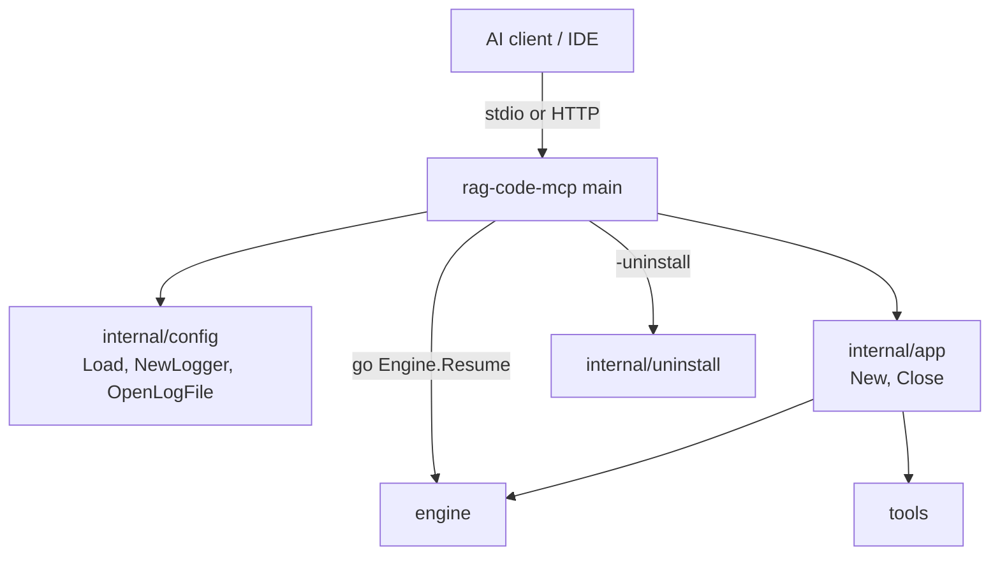
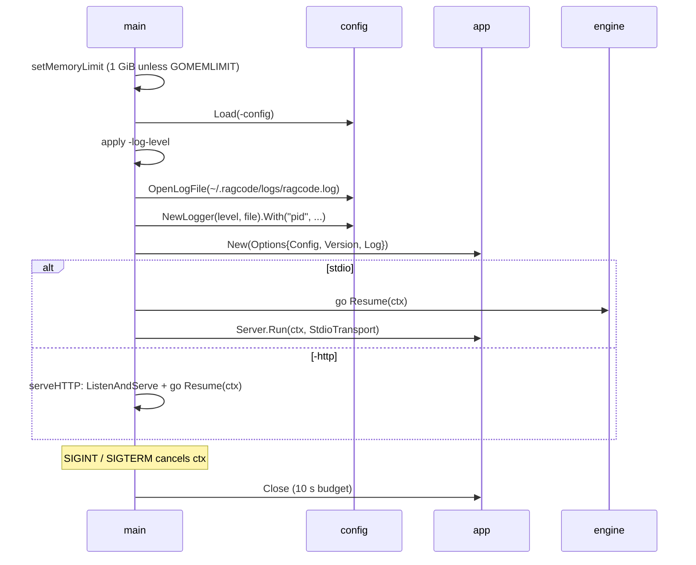

[RagCode](../../README.md) › [cmd](../README.md) › rag-code-mcp

# rag-code-mcp (the MCP server binary)

`rag-code-mcp` is the program AI clients (Claude Code, Cursor, VS Code, Zed,
...) start to talk to RagCode. It loads the configuration, opens the log file,
builds the server with [`internal/app`](../../internal/app/README.md) and then
serves MCP until it is stopped.

It exists as its own tiny `main` package so that everything worth testing
lives in importable packages; this file only decides *how* to serve
(stdio or HTTP) and handles process-level concerns: flags, signals, memory
limit, logging destination and shutdown.

## Where it sits



- **Called by:** the IDE (the command and `--config` argument are written into
  its MCP config by [`internal/idepaths`](../../internal/idepaths/README.md)),
  or by hand.
- **Calls:** [`internal/config`](../../internal/config/README.md),
  [`internal/app`](../../internal/app/README.md),
  [`internal/uninstall`](../../internal/uninstall/README.md), the
  [`engine`](../../engine/README.md) (`Resume`) and the MCP go-sdk transports.

## Files

| File | Contents |
|:---|:---|
| `main.go` | Flags, `main`, `run`, `setMemoryLimit`, `httpHandler`, `serveHTTP`, `versionLine` and the build-time `Version` variable. |

Tests:

| File | Covers |
|:---|:---|
| `main_test.go` | `versionLine` output; `GET /health` returns the version and the PID as JSON. |
| `memlimit_test.go` | `setMemoryLimit` sets 1 GiB when `GOMEMLIMIT` is unset and leaves the runtime limit alone when it is set. |
| `zz_verify_test.go` | Verification tests: `serveHTTP` fails fast on an unusable address, serves `/health` and the MCP endpoint (not 404), and stops cleanly on context cancel; `run` returns a config error (bad `ollama_base_url`) without touching the network; a mistyped `-log-level` flag is an error naming `log_level`, not a silent fall back to `info`. |

## Flags

| Flag | Default | Meaning |
|:---|:---|:---|
| `-config` | `~/.ragcode/config.yaml` (`config.DefaultPath()`) | Configuration file. Created from the built-in default when missing. |
| `-http` | empty | Serve Streamable HTTP on this address (for example `127.0.0.1:39000`) instead of stdio. |
| `-log-level` | empty | `debug`, `info`, `warn` or `error`; overrides `log_level` from the config. |
| `-version` | `false` | Print `rag-code-mcp <Version>` and exit. |
| `-uninstall` | `false` | Run the uninstaller (interactive: it asks before deleting each workspace's `.ragcode`) and exit. |

Go's `flag` package accepts both `-flag` and `--flag`; IDE configs use
`--config`. A positional argument is refused with exit code 2 (the flag parser
would otherwise stop at it and ignore every flag after it).

## Startup sequence



## Behaviour details

### stdout is reserved

With the stdio transport, stdout carries the MCP protocol. Nothing else writes
to it: logs go to `$RAGCODE_HOME/logs/ragcode.log` (default
`~/.ragcode/logs/ragcode.log`). If the log directory cannot be created the
logger falls back to stderr; if the file cannot be opened it prints
`logging to stderr: <err>` to stderr and continues.

### One shared log file

Every server process (one per IDE window, usually) appends to the same file.
Each line carries `pid=<n>`, and [`internal/app`](../../internal/app/README.md)
logs a `client connected` line naming the client per session. Size rotation
(`log_max_size_mb`, to `ragcode.log.1`) is done by
[`config.OpenLogFile`](../../internal/config/README.md#log-file-and-rotation).

### Memory limit

`setMemoryLimit` calls `debug.SetMemoryLimit(1 GiB)` unless the `GOMEMLIMIT`
environment variable is set (the Go runtime then applies that value itself).
Without it, parallel tree-sitter parsing during indexing could leave
1.3 to 5 GB of resident memory for minutes. This is a soft limit for the
garbage collector, not a hard cap. After the runs of a root the engine
returns the freed heap to the OS (`debug.FreeOSMemory`, see
[engine](../../engine/README.md), "Job queue").

### Catch-up indexing

After the server is built, `Engine.Resume` runs in a goroutine. It walks the
workspaces recorded in `~/.ragcode/roots.json` and, for those that were
indexed before and when `auto_index` is on, queues an incremental index. See
the [engine README](../../engine/README.md).

### HTTP mode

`-http addr` serves:

| Route | Response |
|:---|:---|
| `GET /health` | `{"version": "<Version>", "pid": <pid>}` as JSON |
| `/` (any method) | The MCP Streamable HTTP endpoint, in **stateless** mode (no server-side session) |

`ReadHeaderTimeout` is 10 s. There is no authentication and no TLS: bind it to
a loopback address. A listen error (bad address, port taken) is returned at
once and the process exits with status 1.

### Shutdown

`SIGINT` and `SIGTERM` cancel the root context. The HTTP server gets 10 s
(`closeTimeout`) to drain; then `app.Close` gets another 10 s to stop the
engine before the store is closed. A cancelled context is a normal stop, not
an error: the process logs `rag-code-mcp stopped` and exits 0. Any other
serve error is logged and returned (exit status 1).

### Version

`Version` defaults to `dev`. Release builds set it with
`-ldflags "-X main.Version=v2.x.y"`. It is reported by `-version`,
`/health`, the MCP `initialize` result and `rag_server_info`.

## Usage

```bash
# What an IDE runs:
~/.ragcode/bin/rag-code-mcp --config ~/.ragcode/config.yaml

# HTTP for clients that prefer a URL:
rag-code-mcp -http 127.0.0.1:39000 -log-level debug
curl -s http://127.0.0.1:39000/health
```

## Testing

```bash
go test ./cmd/rag-code-mcp/
```

No build tags. The tests use an in-memory store and a fake embedder, set
`RAGCODE_HOME` to a temp directory and never dial Ollama.

## See also

- [cmd](../README.md)
- [internal/app](../../internal/app/README.md): the server this binary runs
- [internal/config](../../internal/config/README.md): configuration and log file
- [internal/uninstall](../../internal/uninstall/README.md): `-uninstall`
- [tools](../../tools/README.md): the MCP tools the server exposes
