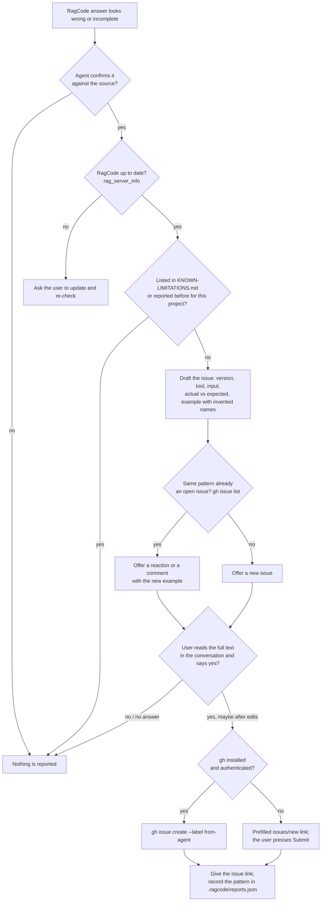

# Agent-assisted issue reports

**Status:** proposal, 2026-11-07, extended 2026-11-12 (runtime problem reports). Not implemented. Target: v2.1.

## Why

Testing on real projects keeps finding cases the parsers do not cover yet: a
Vue `<template>` reference, a Godot signal connected from another file, a
Laravel route group prefix. Every framework has its own idioms, so this list
does not end, and only the people using RagCode on their own code can tell
us which gaps matter.

We do not want to write those issues ourselves, and we do not want the
program to send anything on its own: a report built from a user's project can
carry private code. The report should come from the user, with the user's
explicit consent, after the user has read every word of it.

## Principles

1. **Nothing leaves without consent.** The user sees the full text of the
   report and says yes before it is sent. No answer means no report.
2. **No project code.** The report describes the pattern with a minimal
   example written with invented names. No file paths, project names,
   identifiers or snippets from the user's code.
3. **No new program logic.** The RagCode server does not collect, store or
   send reports. The user's coding agent (Claude Code, Codex, Cursor, ...)
   does the work, guided by text we already ship.
4. **The user's own identity.** The issue is opened from the user's GitHub
   account, so it is the user's report.

## How it works

1. **The agent notices a wrong or incomplete answer.** A RagCode tool missed
   a usage, linked the wrong symbol, or returned a misleading message, and
   the agent confirmed it against the source code. A guess is not reported.
2. **The agent tells the user, in the conversation.** It says what RagCode
   missed and asks whether to report it. It shows the full issue text,
   exactly as it would be sent:
   - RagCode version (`rag_server_info`), language and file type;
   - the tool, the input, what it answered and what was expected;
   - a minimal example with invented names that reproduces the pattern.
3. **The agent looks for duplicates.**
   `gh issue list --repo doITmagic/rag-code-mcp --search "<pattern>"`. If the
   pattern is already reported, it offers a comment on that issue instead.
4. **Only after an explicit yes, it sends.** The user may also edit the text
   first ("drop line X"). With `gh` installed and authenticated:
   `gh issue create --repo doITmagic/rag-code-mcp --label from-agent ...`.
   Otherwise the agent gives a prefilled `issues/new` link and the user
   presses Submit.
5. **The agent gives the user the issue link.**

## Known limitations page

A single page, `KNOWN-LIMITATIONS.md`, will list what we already know, so
nobody reports it again: **Known issues** (errors not fixed yet) and **Not
supported yet** (missing features, with language, a short example, where it
was found, and the issue link once there is one). Package READMEs keep the
technical limits of their code and point to it. The agent checks the page
before offering a report (the diagram above). Not built yet: for now the gaps
live in the package READMEs under "Known limitations".

## Where the user sees it

- **Before sending:** the full text, in the conversation with the agent.
  Consent is given there.
- **After sending:** the issue link the agent gives, and GitHub notifications
  when we answer.
- **All of the user's reports:** the project's issue list filtered by
  `label:from-agent author:@me`.

## What changes when this is built

| File | Change |
|---|---|
| `engine/iderules.go` (the generated `<root>/.ragcode/RAGCODE.md`) | A short "Reporting a RagCode gap" section with the steps above: verify, show the full text, ask, search duplicates, send only after yes, give the link. |
| `.github/ISSUE_TEMPLATE/agent-report.yml` | A form with version, language, tool, input, actual and expected answer, minimal example, and a warning not to paste project code. |
| `.github/workflows/agent-reports.yml` | The Action that closes `from-agent` issues missing required fields or duplicating an open title. |
| GitHub repository settings | A `from-agent` label. |
| `engine/README.md` | Document the new `RAGCODE.md` section. |

No change to the server, the tools, the index or the network access of the
program.

## Spam protection

Agents can write issues faster than we can read them, so the limits are part
of the design, on both sides.

**In the agent instructions (`RAGCODE.md`):**

- **Current version only.** If `rag_server_info` says an update is available,
  the agent asks the user to update and re-check first; gaps already fixed are
  never reported.
- **Verified gaps only.** The agent reports only what it confirmed against the
  source code, never a guess, never "RagCode found nothing".
- **Duplicates first.** The duplicate search is mandatory. An existing issue
  gets a 👍 reaction or a short comment with a new example, not a new issue.
- **One at a time.** At most one report per conversation, never a batch; if
  the agent saw several gaps, it asks which one matters most.
- **Memory of what was sent.** The agent records each reported pattern in
  `<root>/.ragcode/reports.json` (already git-ignored) and does not offer the
  same pattern again for that project.

**On GitHub:**

- **A strict issue form.** Version, language, tool, input, actual and expected
  answer, and a minimal example are required fields; an issue without them
  is closed by a GitHub Action with a short note.
- **A separate label.** Everything from agents carries `from-agent`, so it can
  be triaged in one pass and never mixes with the main queue.
- **Automatic duplicate closing.** The same Action closes a `from-agent`
  issue whose title matches an open one and links it.
- **Emergency brake.** GitHub's interaction limits (repository settings) can
  restrict issues to prior contributors for 24 hours to 6 months if a flood
  happens anyway.
- **Option to decide later:** send reports to a GitHub Discussions category
  ("Gap reports") instead of issues, and promote the real ones to issues by
  hand. Issues stay clean, at the cost of one more manual step for us.

## Risks

- **Low-quality or duplicate issues.** Mitigated by the verification step,
  the duplicate search, one issue per pattern, and the `from-agent` label so
  they can be filtered and triaged together.
- **An agent that ignores the instructions.** We cannot enforce what a
  third-party agent does; explicit consent in the conversation is the rule
  the instructions put first, and the issue opens under the user's account,
  where the user can see and close it.
- **Leaked code despite the rules.** The user reads the full text before
  sending; the issue form repeats the warning.

## Out of scope

- Any telemetry or automatic sending by the RagCode server.
- Collecting reports locally. An agent may keep a copy in
  `<root>/.ragcode/` (already git-ignored) if the user asks, but it is not
  part of the design.

## Extension (proposed 2026-11-12): runtime problem reports

The flow above covers wrong answers. The other kind of report comes from a
developer on whose machine RagCode does not run well: the server does not
start, Ollama is not reached, indexing is slow or stops, the watcher sees no
edits (Windows, WSL and network drives are a large share of the installs).
For these the maintainers need facts about the machine and the run, not a
code example, and the server may be the very thing that is broken, so
`rag_server_info` cannot be the only source.

The same principles hold: nothing is sent by the program, the user reads the
full text, the issue is opened from the user's account. Principle 3 gets one
exception: a small local command, because what is left out of the summary
must be decided by code we test, not by each agent.

### The diagnostic summary

`rag-code-mcp -diagnose` prints a plain-text summary to standard output and
exits. It reads only RagCode's own files (`config.yaml`, `roots.json`, the
saved index statuses, the tail of `ragcode.log`) and asks Ollama for its
version and model list. It writes nothing and opens no connection other than
the configured Ollama.

| Included | Form |
|---|---|
| RagCode | version, how the binary was started (stdio or HTTP), uptime of other running servers and their count |
| System | OS and version, architecture, CPU count, total and free memory, whether it runs under WSL (and WSL 1 or 2), whether Docker is present |
| Ollama | version, reachable or the error class (refused, timeout, HTTP status), whether the configured model is pulled, local or remote host (never the URL) |
| Configuration | only the keys that differ from the defaults, with their values; path and URL values are replaced by their kind (`<path>`, `<local url>`, `<remote url>`) |
| Each workspace | a number (`root 1`), the file system type of the root (ext4, NTFS, 9p, drvfs, a UNC share), whether it is watched, state, file count, files per language, duration and failed count of the last run, the error class of the last run |
| Log | the last 50 `WARN` and `ERROR` lines, with every path cut to `<root N>/…/<extension>` or `<home>/…`, and the count of each distinct message |

Never included: paths, file and directory names, the user and host names,
symbol names, search queries, file content, environment variables,
credentials (a password in a URL is dropped with the URL). The rule is an
allow list: a value that is not in the table above is not printed. A test
feeds the command a home, roots and a log full of marker strings and fails if
any marker reaches the output.

### How it is used

1. The developer, or their agent when the server still answers, runs
   `rag-code-mcp -diagnose`. The generated `RAGCODE.md` and the README
   "Troubleshooting" section name the command.
2. The summary is shown in full. The user may delete lines.
3. The duplicate search and the consent step are the ones of the flow above;
   the issue carries the label `runtime` (with `from-agent` when an agent
   opened it). Without `gh`, the prefilled `issues/new` link is used.
4. One report per problem: the agent does not open a runtime issue for a state
   the summary itself explains (Ollama not started, model not pulled, an update
   available); it tells the user the fix instead.

### Issue form `runtime-problem.yml`

| Field | Required | Content |
|---|---|---|
| What happened | yes | one or two sentences, and what was expected |
| When | yes | choice: install, server start, first indexing, later indexing, search or another tool, update, uninstall |
| Steps | no | what to do to see it again |
| Client | yes | the IDE or agent and its version |
| How RagCode was installed | yes | choice: release archive, built from source, updated by itself |
| Diagnostic summary | yes | the output of `rag-code-mcp -diagnose`, pasted as it is |
| Confirmation | yes | checkbox: "I read the summary and it holds nothing private" |

The Action that checks `from-agent` issues also closes a `runtime` issue
without a summary, with a note that names the command.

### What changes when this is built

| File | Change |
|---|---|
| `cmd/rag-code-mcp` (flag), a new `internal/diagnose` package | The summary and its redaction, with the marker test. |
| `.github/ISSUE_TEMPLATE/runtime-problem.yml` | The form above. |
| `.github/workflows/agent-reports.yml` | Also checks `runtime` issues. |
| `engine/iderules.go`, `README.md` | Name the command and when to use it. |
| GitHub repository settings | A `runtime` label. |

### Open questions

- Whether the summary should also be a tool (`rag_server_info` with a
  `diagnose` input), so an agent gets it without a shell. It adds nothing when
  the server is down, which is the common case here.
- Whether 50 log lines are enough for indexing problems on Windows; the
  alternative is the lines of the last run only.

## Related decision (2026-11-07)

Broad testing on new projects is closed for v2. From now on:

- **Errors are fixed:** answers that are false (a wrong link, wrong line
  numbers, a crash, a misleading message).
- **Coverage gaps are documented:** a case the parsers do not see yet goes to
  the package README under "Known limitations" and, where it can mislead, the
  tool answer says so (as `rag_find_usages` does for reads of constants). The
  list is the v2.1 backlog; user reports through this feature decide its
  order.
