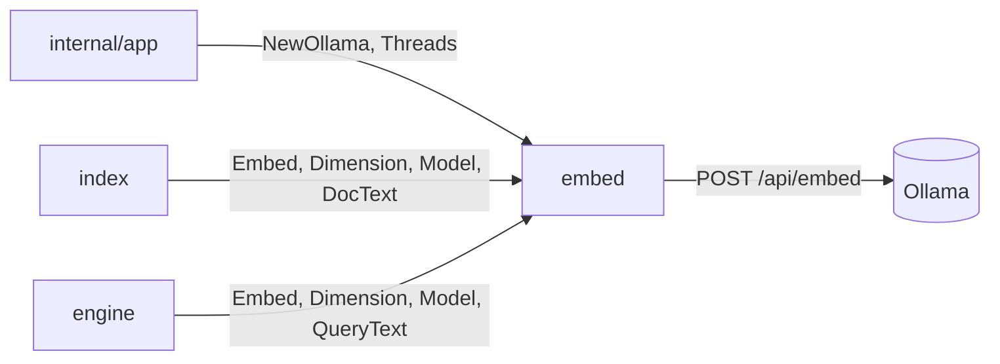

[RagCode](../README.md) › embed

# Embed Package

The `embed` package **turns text into vectors**. It defines the small
`Embedder` interface the rest of RagCode depends on, implements it against
Ollama's `/api/embed` endpoint over plain HTTP, formats queries and documents
the way each embedding model's authors recommend, and provides a
deterministic `Fake` embedder so tests never need a running Ollama.

## Objectives

- **One small interface**: `Embed`, `Dimension`, `Model`; the indexer and the
  engine know nothing about HTTP.
- **Gentle on CPU-only machines**: small batches, so a search query queued
  behind indexing is not delayed, and an optional cap on Ollama's threads.
- **Clear failures**: every transport or protocol failure wraps
  `ErrUnavailable`, so callers can say "embedder down" without inspecting
  the cause.
- **Model-aware prompts**: query and document prefixes per model family.

---

## Where it sits



| Direction | Package | What for |
|-----------|---------|----------|
| Created by | [internal/app](../internal/app/README.md) | `embed.NewOllama(cfg.OllamaBaseURL, cfg.OllamaEmbed, nil)` and `Threads = cfg.EmbedThreads`; tests pass `&embed.Fake{}` instead. |
| Called by | [index](../index/README.md) | Embeds symbol texts during a run (with `DocText`), reads `Dimension` to create the collection and `Model` to detect a model change. |
| Called by | [engine](../engine/README.md) | Embeds search queries (with `QueryText`); `Dimension` for `Ready` and to detect a vector size change. |
| Calls | Ollama | `POST <ollama_base_url>/api/embed`. Only the Go standard library is used. |

---

## Files

| File | Contents |
|------|----------|
| `embed.go` | Package doc, the `Embedder` interface and `ErrUnavailable`. |
| `mem.go`, `mem_linux.go`, `mem_windows.go`, `mem_other.go` | `ErrLowMemory`, `checkMemory` and the per-platform `availableMB` (see "Low memory") |
| `ollama.go` | `Ollama`, `NewOllama`, batching in `Embed`, the cached `Dimension` probe, `embedBatch` (request body, one retry), `post`/`do` (HTTP, status handling), `transportError`. |
| `prefix.go` | `QueryText`, `DocText` and the model `family` detection. |
| `fake.go` | `Fake`, the deterministic test embedder, and compile-time checks that `Fake` and `Ollama` implement `Embedder`. |

### Tests

| File | Covers |
|------|--------|
| `ollama_test.go` | Embedding through an `httptest` server, batching by count and by size, cached dimension, error cases (HTTP status, bad JSON, wrong count, closed server), `Threads` -> `options.num_thread`, and `TestOllamaLive` against a real Ollama (skipped unless `RAGCODE_TEST_OLLAMA` is set). |
| `prefix_test.go` | Prefixes per model family, and the hint on HTTP 412 from an Ollama too old for the model. |
| `fake_test.go` | `Fake` vectors are deterministic and unit-length; `Fail` makes the first N calls fail. |
| `zz_verify_test.go` | Verification tests: bad response bodies, empty input, exactly one retry, cancel during the retry wait, dimension re-probe after failure and under concurrency, failure in the middle of a multi-batch call, `Fake` edge cases. |

---

## Key types and functions

### Embedder

```go
type Embedder interface {
    // Embed returns one vector per text, in order.
    Embed(ctx context.Context, texts []string) ([][]float32, error)
    // Dimension returns the vector size, probing the model once and caching.
    Dimension(ctx context.Context) (int, error)
    // Model names the embedding model, for status output.
    Model() string
}
```

Implementations must be safe for concurrent use and must honour `ctx`.

### Ollama

```go
func NewOllama(baseURL, model string, client *http.Client) *Ollama

type Ollama struct {
    // Threads caps the CPU threads Ollama computes with (num_thread);
    // 0 lets Ollama pick. Set before use and keep it constant.
    Threads int
    // ...
}
```

A nil `client` means `http.DefaultClient`. A trailing `/` on `baseURL` is
trimmed.

### Prefix helpers

```go
func QueryText(model, q string) string // wrap a search query
func DocText(model, d string) string   // wrap an indexed text
```

### Fake

```go
type Fake struct {
    Dim  int          // vector size; 0 means 8
    Fail atomic.Int32 // Embed fails this many more calls with ErrUnavailable
    Name string       // Model() result; empty means "fake"
}
```

`Fake.Vector(text)` is a pseudo-random unit vector seeded by the FNV-64a hash
of the text, so the same text always gets the same vector. `Embed` honours a
cancelled context.

---

## The Ollama client

```mermaid
flowchart TD
    A[Embed texts] --> B[cut next batch:<br/>up to 16 texts and 8 KiB,<br/>a longer text goes alone]
    B --> C[embedBatch: JSON body<br/>model, input, options.num_thread?]
    C --> D[POST /api/embed<br/>no timeout: the caller context ends it]
    D -->|connection error, first attempt| E[wait 1 s, retry once]
    E --> D
    D -->|non-200| F[ErrUnavailable with status and body;<br/>412 adds 'upgrade Ollama' hint]
    D -->|200| G{one non-empty vector<br/>per input?}
    G -->|no| H[ErrUnavailable]
    G -->|yes| I[append vectors]
    I -->|more texts| B
    I -->|done| J[return all vectors in order]
```



### Request

```json
{"model": "embeddinggemma-2:270m", "input": ["text 1", "text 2"], "options": {"num_thread": 2}}
```

`options` is sent only when `Threads > 0`, so a GPU setup (or
`embed_threads: 0`) leaves Ollama's own choice untouched. Keep `Threads`
constant: Ollama reloads the model whenever it changes.

### Batching

`Embed` sends one request per batch of at most **16 texts** and **8 KiB** of
text. A text longer than 8 KiB is sent alone. The small byte cap exists
because a CPU-only Ollama embeds inputs one by one: a big request would only
delay a search query queued behind it. A failure in any batch fails the whole
call; no partial result is returned. An empty input returns an empty result
without a request.

(The [index](../index/README.md) package calls `Embed` with 16 texts at a
time, each cut to 2000 bytes before the prefix.)

### Retry and timeouts

- A request has **no clock of its own**. It ends when Ollama answers, when
  the connection drops, when Ollama's own load limit gives up, or when the
  caller's context ends. A fixed 60 s cap used to cancel a slow model load,
  which made Ollama abort it and start again on every retry.
- A **connection-level** failure (`client.Do` error) is retried **once**
  after 1 s, unless the context is done. The wait itself honours the context.
- HTTP errors (non-200) and bad responses are **not** retried.
- Errors: a non-200 reply returns `ErrUnavailable` with the status and up to
  512 bytes of the body. HTTP 412 adds a hint that the model needs Ollama
  0.40 or later. Undecodable JSON, a wrong number of embeddings or an empty
  vector also return `ErrUnavailable`. Transport errors unwrap to both
  `ErrUnavailable` and the underlying error.

### Dimension

`Dimension` embeds the text `"dimension probe"` once and caches the vector
length (atomically). A failed probe is not cached and is retried on the next
call.

---

## Query and document prefixes

The model family is the lowercased last path element of the model name, up
to the `:` tag; `hf.co/google/EmbeddingGemma-2:latest` and
`embeddinggemma-2:270m` are both `embeddinggemma`.

| Family | `QueryText(model, q)` | `DocText(model, d)` |
|--------|-----------------------|---------------------|
| `embeddinggemma` | `task: code retrieval \| query: <q>` | `title: none \| text: <d>` |
| `qwen3-embedding` | `Instruct: Given a description of what a piece of code does, retrieve the code that implements it\nQuery: <q>` | `<d>` (unchanged) |
| anything else | `<q>` | `<d>` |

The code comment records that these query prefixes gave +2 to +3 points in
top-5 on 2,054 Go queries for both families. Changing `DocText` for a model
already in use needs a reindex, since stored vectors were made without the
new prefix.

---

## Configuration

Keys from [internal/config](../internal/config/README.md), applied in
[internal/app](../internal/app/README.md):

| Key | Env override | Default | Effect |
|-----|--------------|---------|--------|
| `ollama_base_url` | `OLLAMA_BASE_URL` | `http://localhost:11434` | Base URL of Ollama (must be http/https). |
| `ollama_embed` | `OLLAMA_EMBED` | `embeddinggemma-2:270m` | The embedding model; needs Ollama 0.40 or later. Changing it makes the next index run recreate the collection. |
| `embed_threads` | none | `max(2, NumCPU/3)` | `Ollama.Threads` -> `options.num_thread`. `0` lets Ollama use every performance core; negative values are rejected by config validation. |
| `min_free_memory_mb` | none | `750` | `Ollama.MinFreeMB`. See "Low memory" below. |

### Low memory

Before a request, when Ollama is on this machine (`localhost`, `127.0.0.1`,
`::1`) and no call succeeded in the last 4 minutes (so the model may have to
be loaded), `checkMemory` reads the available memory (`mem_linux.go`:
`MemAvailable` in `/proc/meminfo`; `mem_windows.go`: `GlobalMemoryStatusEx`).
Below `MinFreeMB` the call returns `ErrLowMemory` with the free and the needed
megabytes, and no embed request is sent, unless `GET /api/ps` shows the
model already loaded: another server or client loaded it, so no new memory is
needed. Seen on a 16 GB Windows laptop with 570 MB
free: the model load took longer than the 60 s call timeout, the cancelled
request made Ollama abort the load, and every retry started it again. macOS
and the BSDs have no reading (`mem_other.go`), so the check never fires there.
`mem_test.go` covers it.

The package writes no files.

---

## Testing

```bash
go test ./embed/

# also run against a live Ollama (pulls nothing; the model must exist)
RAGCODE_TEST_OLLAMA=http://localhost:11434 go test -run TestOllamaLive ./embed/
```

No build tags. `TestOllamaLive` uses the model `qwen3-embedding:0.6b`; every
other test runs against `httptest` servers or `Fake`.

---

## See also

- [index](../index/README.md): embeds symbols during a run.
- [engine](../engine/README.md): embeds search queries.
- [internal/app](../internal/app/README.md): builds the Ollama embedder from config.
- [internal/config](../internal/config/README.md): `ollama_base_url`, `ollama_embed`, `embed_threads`.
