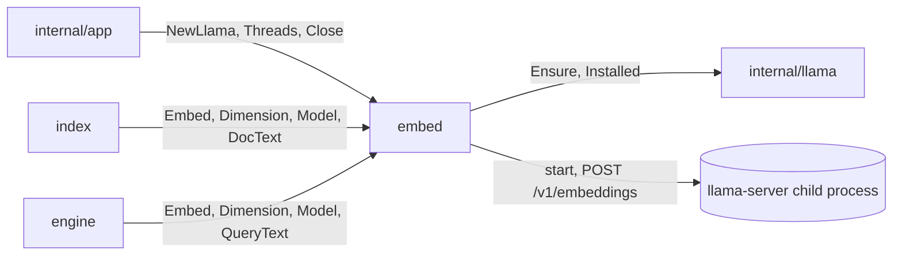
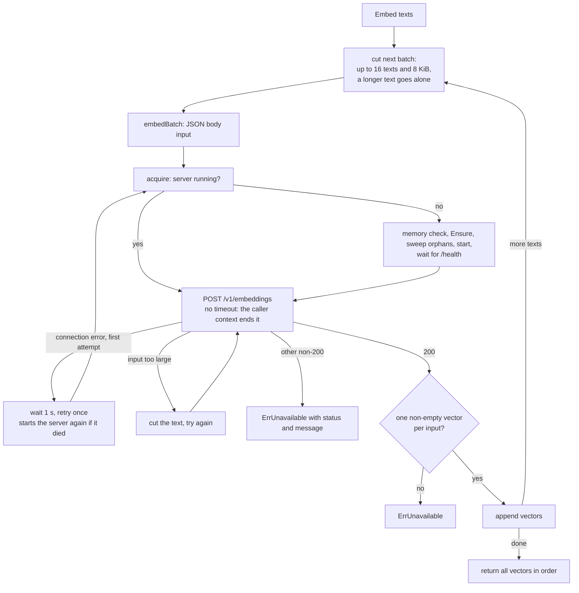

[RagCode](../README.md) › embed

# Embed Package

The `embed` package **turns text into vectors**. It defines the small
`Embedder` interface the rest of RagCode depends on, implements it against
llama.cpp's `llama-server`, which it starts itself as a child process and
talks to over loopback HTTP, formats queries and documents the way each
embedding model's authors recommend, and provides a deterministic `Fake`
embedder so tests never need a model.

## Objectives

- **One small interface**: `Embed`, `Dimension`, `Model`; the indexer and the
  engine know nothing about HTTP.
- **Nothing to install by hand**: the server is started on the first call and
  stopped after 5 idle minutes and on `Close`; no Docker, no separate service.
- **Gentle on CPU-only machines**: small batches, so a search query queued
  behind indexing is not delayed, and an optional cap on the model's threads.
- **Clear failures**: every transport or protocol failure wraps
  `ErrUnavailable`, so callers can say "embedder down" without inspecting
  the cause.
- **Model-aware prompts**: query and document prefixes per model family.

---

## Where it sits



| Direction | Package | What for |
|-----------|---------|----------|
| Created by | [internal/app](../internal/app/README.md) | `embed.NewLlama(model, runtime, ~/.ragcode/run)` with the runtime from `llama.FromConfig`, then `Threads` and `MinFreeMB` from the config; `Close` when the app closes. Tests pass `&embed.Fake{}` instead. |
| Called by | [index](../index/README.md) | Embeds symbol texts during a run (with `DocText`), reads `Dimension` to create the collection and `Model` to detect a model change. |
| Called by | [engine](../engine/README.md) | Embeds search queries (with `QueryText`); `Dimension` for `Ready` and to detect a vector size change. |
| Calls | [internal/llama](../internal/llama/README.md) (through the small `Runtime` interface) | `Ensure` returns the paths of `llama-server` and the model, downloading what is missing; `Installed` and `RuntimeName` feed the status. |
| Calls | `llama-server` | `GET /health` and `POST /v1/embeddings` on `127.0.0.1`. Only the Go standard library is used, and no CGO. |

---

## Files

| File | Contents |
|------|----------|
| `embed.go` | Package doc, the `Embedder` interface and `ErrUnavailable`. |
| `llama.go` | `Llama`, `NewLlama`, `Runtime`, `Status`, batching in `Embed`, the cut of an input that is too long, the cached `Dimension` probe, `embedBatch` (one retry), `call` (HTTP, status handling), `transportError`. |
| `server.go` | The child process: `acquire` and `release` (start, wait for `/health`, idle stop), `start` (flags, API key, record file), `stop`, `sweep` of orphans, `freePort`, the output tail used in error messages. |
| `proc_linux.go`, `proc_windows.go`, `proc_other.go` | `procAttr`: on Linux the kernel kills the child with its parent (`Pdeathsig`); on Windows the child gets no console window, and the file also holds that platform's `pidAlive`; no attributes elsewhere. |
| `alive_unix.go`, `alive_other.go` | `pidAlive` (signal 0) for Unix; where the owner cannot be checked every owner counts as running, so nothing is swept. Used by `sweep`. |
| `mem.go`, `mem_linux.go`, `mem_windows.go`, `mem_other.go` | `ErrLowMemory`, `checkMemory` and the per-platform `availableMB` (see "Low memory") |
| `prefix.go` | `QueryText`, `DocText` and the model `family` detection. |
| `fake.go` | `Fake`, the deterministic test embedder, and compile-time checks that `Fake` and `Llama` implement `Embedder`. |

### Tests

| File | Covers |
|------|--------|
| `llama_test.go` | `Llama` against a stand-in `llama-server` (the test binary re-run as the server): order and batching by count and size, cached dimension, `Status`, one start for concurrent callers, idle stop and its single reused timer, `Close` stops the server and removes the record, restart after the server was killed, an input over the context is cut, a server that exits at start (with the `embed_runtime: cpu` hint for Vulkan), low memory checked only on start, `Status` answers `starting` while `Ensure` blocks, `starting` ends when a download finishes or fails after its caller gave up, `Close` returns while a call waits for a model that never loads, and `sweep` (dead owner is removed, live owner or wrong key is left alone). |
| `prefix_test.go` | Prefixes per model family. |
| `fake_test.go` | `Fake` vectors are deterministic and unit-length; `Fail` makes the first N calls fail. |
| `mem_test.go` | `checkMemory`: off when `MinFreeMB` is 0, and the low-memory error. |
| `zz_verify_test.go` | `Fake` edge cases. |

---

## Key types and functions

### Embedder

```go
type Embedder interface {
    // Embed returns one vector per text, in order.
    Embed(ctx context.Context, texts []string) ([][]float32, error)
    // Dimension returns the vector size, probing the model once and caching.
    Dimension(ctx context.Context) (int, error)
    // Model names the embedding model, for status output.
    Model() string
}
```

Implementations must be safe for concurrent use and must honour `ctx`.

### Llama

```go
func NewLlama(model string, rt Runtime, runDir string) *Llama

type Llama struct {
    Threads   int           // CPU threads (-t, -tb); 0 lets llama.cpp pick. Set before use.
    MinFreeMB int           // free memory needed to start the server; 0 turns the check off
    IdleStop  time.Duration // how long the server outlives the last call; 0 means 5 minutes
    // ...
}

// Runtime is what internal/llama provides.
type Runtime interface {
    Ensure(ctx context.Context) (server, model string, err error)
    Installed() bool
    RuntimeName() string
}
```

`Status()` reports `{model, runtime, state, error}` without starting or
downloading anything, and never waits for a start in progress: `running` (the
model is loaded), `starting` (the files are being fetched or the model is
loading, also after the call that began it gave up), `stopped` (the next call
starts it) or `not_installed` (the next call downloads it first); `error` is
why the last start failed. A download that ends with no call waiting for it
ends `starting` by itself, and its failure becomes the `error`; the next call
asks for the files again. `Close` stops the server and ends the calls that
wait for a download or a model load; calls after it fail with
`ErrUnavailable`.

### Prefix helpers

```go
func QueryText(model, q string) string // wrap a search query
func DocText(model, d string) string   // wrap an indexed text
```

### Fake

```go
type Fake struct {
    Dim  int          // vector size; 0 means 8
    Fail atomic.Int32 // Embed fails this many more calls with ErrUnavailable
    Name string       // Model() result; empty means "fake"
}
```

`Fake.Vector(text)` is a pseudo-random unit vector seeded by the FNV-64a hash
of the text, so the same text always gets the same vector. `Embed` honours a
cancelled context.

---

## The llama-server client



### The child process

The first call starts `llama-server` from the files `Runtime.Ensure` returns
(downloading them if missing), on a free `127.0.0.1` port, with the model
loaded in embedding mode, a context of 4096 tokens (`-c`, `-b`, `-ub`), one
slot, no web UI, `--offline`, and `-t`/`-tb` when `Threads > 0`. It also gets
`--sleep-idle-seconds 600`, so a server whose RagCode process was killed drops
the model from memory by itself. A random 32-byte API key is passed in the
environment variable `LLAMA_API_KEY` (not on the command line, where other
users could read it) and sent as a bearer token. The call then waits for
`GET /health`, with no clock of its own: a model load takes what the machine
needs, and the caller's context ends the wait. A caller that gives up leaves the
load running, and the next call waits for the same server.

The download of the runtime and model runs under the embedder's own context,
not the caller's: a call that gives up stops waiting, the download goes on, and
the next call waits for the same download. Only `Close` cancels it.

The server runs while calls use it. After the last call ends, one timer (reused, not one per call) of
`IdleStop` (5 minutes) stops it, and the next call starts it again. The timer
is also armed when a caller gives up while the server is still loading, so a
server nobody comes back for is stopped too. A stop
sends an interrupt, then a kill after 3 s (Windows kills at once). `Close` stops
it too. The server's last lines of output go into the error when it exits while
starting. If a Vulkan server exits while starting, the error adds the hint
`set embed_runtime: cpu in config.yaml to run without the GPU`.

Dying with the owner: on Linux the kernel kills the child when the process that
started it dies (`Pdeathsig`; the goroutine that starts it stays locked to its
thread, since the signal is tied to the thread). Elsewhere, and as a second
guard, each running server is recorded in `~/.ragcode/run/llama-<pid>.json`
(owner pid, server pid, port, key; mode `0600`) and removed on a clean stop.
Before starting a server, `sweep` reads the records, skips the ones whose owner
still runs, and for the others kills the server pid only when its port still
answers `/props` with the recorded key (so a reused pid is never killed), then
removes the record.

### Request

```json
{"input": ["text 1", "text 2"]}
```

with `Authorization: Bearer <key>` on `POST /v1/embeddings`. The reply holds one
embedding per input, each with its `index`; a missing, duplicated or empty
vector is an error.

### Batching

`Embed` sends one request per batch of at most **16 texts** and **8 KiB** of
text. A text longer than 8 KiB is sent alone. The small byte cap exists
because the server embeds inputs one by one: a big request would only delay a
search query queued behind it. A failure in any batch fails the whole call; no
partial result is returned. An empty input returns an empty result without a
request.

(The [index](../index/README.md) package calls `Embed` with 16 texts at a
time, each cut to 2000 bytes before the prefix.)

### Inputs longer than the context

The server refuses an input over its 4096-token context. `Embed` then embeds the
batch's texts one by one and cuts each refused text (to half its length, or to
less when the token count the server reports asks for it: the share that should
fit, aiming at 4032 tokens; never inside a UTF-8 character) until it is taken. The 2000-byte texts of the index always fit.

### Retry and timeouts

- A request has **no clock of its own**. It ends when the server answers, when
  the connection drops, or when the caller's context ends.
- A **connection-level** failure is retried **once** after 1 s, unless the
  context is done. The wait itself honours the context. The second attempt
  starts the server again if it was stopped or died.
- HTTP errors (non-200) and bad responses are **not** retried.
- Errors: a non-200 reply returns `ErrUnavailable` with the status and the
  server's message (up to 2 KiB read). Undecodable JSON, a wrong number of
  embeddings or an empty vector also return `ErrUnavailable`. Transport errors
  unwrap to both `ErrUnavailable` and the underlying error.

### Dimension

`Dimension` embeds the text `"dimension probe"` once and caches the vector
length (atomically). A failed probe is not cached and is retried on the next
call.

## Query and document prefixes

The model family is the lowercased last path element of the model name, up
to the `:` tag, matched by prefix; `embeddinggemma-2-Q8_0` (the built-in
model) and `hf.co/google/EmbeddingGemma-2:latest` are both `embeddinggemma`.

| Family | `QueryText(model, q)` | `DocText(model, d)` |
|--------|-----------------------|---------------------|
| `embeddinggemma` | `task: code retrieval \| query: <q>` | `title: none \| text: <d>` |
| `qwen3-embedding` | `Instruct: Given a description of what a piece of code does, retrieve the code that implements it\nQuery: <q>` | `<d>` (unchanged) |
| anything else | `<q>` | `<d>` |

The code comment records that these query prefixes gave +2 to +3 points in
top-5 on 2,054 Go queries for both families. Changing `DocText` for a model
already in use needs a reindex, since stored vectors were made without the
new prefix.

---

## Configuration

Keys from [internal/config](../internal/config/README.md), applied in
[internal/app](../internal/app/README.md) and
[internal/llama](../internal/llama/README.md):

| Key | Env override | Default | Effect |
|-----|--------------|---------|--------|
| `embed_runtime` | `RAGCODE_EMBED_RUNTIME` | `auto` | Which llama.cpp build runs: `auto`, `cpu` or `vulkan`. |
| `embed_model` | `RAGCODE_EMBED_MODEL` | empty | Absolute path of a `.gguf` model instead of the built-in one. The model name the index stores is the file name without `.gguf`, then `@` and a 12-character fingerprint of the file (its size and its first and last MiB), e.g. `my-embed@3fa9c01b77d2`; another file, even under the same name, makes the next index run recreate the collection. |
| `llama_server` | `RAGCODE_LLAMA_SERVER` | empty | Absolute path of a `llama-server` instead of the downloaded one. |
| `embed_threads` | none | `max(2, NumCPU/3)` | `Llama.Threads` -> `-t` and `-tb`. `0` lets llama.cpp use every performance core; negative values are rejected by config validation. |
| `min_free_memory_mb` | none | `750` | `Llama.MinFreeMB`. See "Low memory" below. |

### Speed on one machine

Measured on one laptop only (i9-12900H, RTX 3050 Ti), for 16 texts of 1500
bytes: the CPU build with 4-6 threads took 44-49 s; the Vulkan build took
1.0-1.4 s once warm, with one-time pauses of about 50-65 s the first time some
input lengths were seen (the GPU driver caches them afterwards). Loading the
model took 2.5 s on CPU and 4.5-10 s with Vulkan; the server used about
435-520 MB of memory on CPU. Other machines will differ.

### Low memory

When a call has to **start** the server (none is running), `checkMemory` reads
the available memory (`mem_linux.go`: `MemAvailable` in `/proc/meminfo`;
`mem_windows.go`: `GlobalMemoryStatusEx`). Below `MinFreeMB` the call returns
`ErrLowMemory` with the free and the needed megabytes, and nothing is started or
downloaded. A server that is already running holds the model, so it is never
checked. Seen on a 16 GB Windows laptop with 570 MB free: the load did not
finish and every retry started it again. macOS and the BSDs have no reading
(`mem_other.go`), so the check never fires there. `mem_test.go` covers it.

The package writes one file per running server, `~/.ragcode/run/llama-<pid>.json`, and removes it when the server stops.

---

## Testing

```bash
go test ./embed/
```

No build tags. The tests use `Fake`, httptest servers or a stand-in for
`llama-server`; no model is needed.

---

## See also

- [index](../index/README.md): embeds symbols during a run.
- [engine](../engine/README.md): embeds search queries.
- [internal/app](../internal/app/README.md): builds the embedder from config.
- [internal/llama](../internal/llama/README.md): the runtime and model files.
- [internal/config](../internal/config/README.md): `embed_runtime`, `embed_model`, `llama_server`, `embed_threads`, `min_free_memory_mb`.
