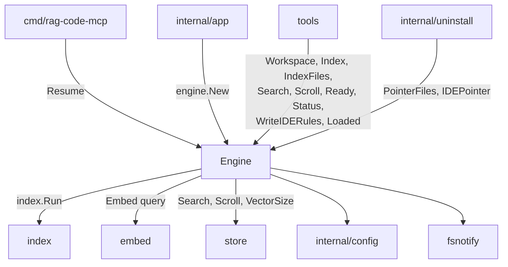
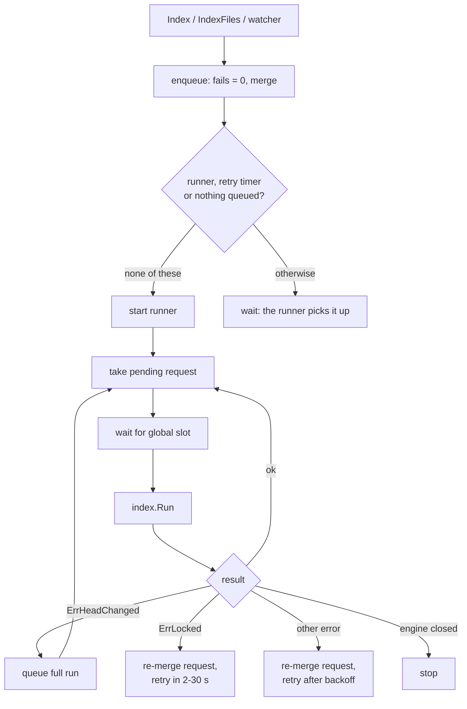

[RagCode](../README.md) › engine

# Engine Package

The `engine` package **orchestrates workspaces** for the whole process. It
validates workspace roots, remembers them in `roots.json`, keeps one index
job queue per root, runs those jobs one at a time through a single global
slot, retries failed runs, watches each root's files and feeds changes back
into the queue, and wraps search so a missing index becomes a clear
"not indexed yet" answer that also starts indexing.

It also writes the IDE rules file (`.ragcode/RAGCODE.md`) and the pointer
line that tells AI agents to use the RagCode tools.

## Objectives

- **Safe roots**: only an absolute, existing, non-system directory can become
  a workspace; no guessing.
- **One run at a time**: workspaces index one after another, so a laptop is
  not swamped by parallel embedding.
- **No lost requests**: requests made during a run are merged and run right
  after it; a failed run keeps its request and retries it.
- **Stay current**: a file watcher queues small "files" runs on edits and full
  runs on branch switches; on start-up every known root gets a catch-up run.
- **Clean shutdown**: `Close` stops watchers and timers, cancels the running
  job and waits for every goroutine; once it has begun, no catch-up run or
  watcher starts, and watches failing because the instance closed are not
  logged as warnings.

---

## Where it sits



| Direction | Package | What for |
|-----------|---------|----------|
| Created by | [internal/app](../internal/app/README.md) | `engine.New(cfg, store, embedder, log)` with the SQLite store and the Ollama embedder. |
| Called by | [cmd/rag-code-mcp](../cmd/rag-code-mcp/README.md) | `go a.Engine.Resume(ctx)` at start-up. |
| Called by | [tools](../tools/README.md) | Every MCP tool opens a workspace with `Workspace(root)`; `rag_index_workspace` calls `WriteIDERules` and `Index`. |
| Called by | [internal/uninstall](../internal/uninstall/README.md) | `PointerFiles` and `IDEPointer` to strip the pointer line. |
| Calls | [index](../index/README.md) | `index.Run`, `ReadStatus`, `IsLinkedWorktree`, `LinkedWorktreeOf`, `WriteAtomic`, `LockFile` (the `roots.json.lock`), `StateModel` (the model check in `Search`), `ErrLocked`, `ErrHeadChanged`. |
| Calls | [embed](../embed/README.md) | Embeds search queries, with `embed.QueryText` for the model's prefix. |
| Calls | [store](../store/README.md) | `Search`, `Scroll`, `CollectionExists`, `VectorSize`, `CollectionName`. |
| Calls | [internal/config](../internal/config/README.md) | `config.Config` and `config.HomeDir()`. |
| External | `github.com/fsnotify/fsnotify` | File system events. |
| External | `git` binary | `git ls-files --error-unmatch` to skip tracked instruction files. |

---

## Files

| File | Contents |
|------|----------|
| `engine.go` | Package doc, `Engine`, `New`, errors (`ErrNotIndexed`, `ErrLocked`, `ErrClosed`), `RootError`, `Loaded`, `Workspace`, `validateRoot`, `roots.json` (`registerRoot`, `ReadRoots`), `Resume`, `Close`, and the job queue (`enqueue`, `merge`, `kick`, `runJobs`, `runOne`, `retryDelay`). |
| `workspace.go` | `Workspace` and its job fields, `Status`, `Index`, `IndexFiles`, `Search`, `Scroll`, `mapErr`/`dimChanged` (the `ErrNotIndexed` mapping), `resyncIfReopened`, `Ready`. |
| `watch.go` | The per-root `watcher`: `startWatcher` (leader lock `watch.lock`), `follow`/`takeOver` (a follower's takeover poll, `takeoverPoll`), `addTree`, `watchGit`, event `handle`, `dropDir`, debounce (`add`, `flush`), `full`, `Stop`. |
| `nonotify_linux.go`, `nonotify_other.go` | `noNotify`: names a root whose file system reports no changes to inotify (9p, the WSL2 `/mnt` drives); always empty off Linux. |
| `iderules.go` | `WriteIDERules`, `IDEPointer`, `PointerFiles`, the list of agent instruction files, `tracked`, `within`, `appendPointer`. |

### Tests

| File | Covers |
|------|--------|
| `engine_test.go` | Root validation, auto-index on first contact, request coalescing, `ErrHeadChanged` re-queue, retry of failed runs, a failed recreate that resumes without dropping again, no watcher without `auto_index`, recreate, embedding model change, concurrent root registration from several engines, a search refused on an index of another model with the same vector size, a lock held by another engine, `Resume`, no goroutines left after `Close`, `WriteIDERules` (tracked files, symlinks, symlinked parent directories, continuing after a refused file), backoff, a run waiting for the slot counts as queued, the end of a run logged with its counts and duration, another process's run shown as running and a dead run's phase shown as `interrupted` (`TestStatusOfAnotherProcessRun`), the first retry after another process's lock within seconds (`TestLockedRetrySoon`), parents of home and broad system directories refused as roots (`TestValidateRootRefusesBroadDirs`), the watcher's full run logged once while queued, a request queued while the runner exits is still picked up, a run failing because the root was deleted is not retried and the root is caught up when it is back, a query after the store reopened a replaced collection file queues an incremental run (`TestQueryAfterReopenQueuesResync`). `TestMain` points `RAGCODE_HOME` at a temp dir. |
| `watch_test.go` | The watcher end to end, a `.gitignore` edit queues a full run, a directory that becomes a linked worktree after it was watched is dropped with a full run (`TestWatcherLinkedWorktreeAdded`), a `.git` created after start queues a full run and is watched with its refs (`TestWatcherGitInitAfterStart`), a ref moved through its `.lock` file queues one full run (`TestWatcherRefUpdateQueuesOneFullRun`), RagCode's own home inside a root neither watched nor accepted as a root (`TestWatcherIgnoresOwnHome`), root removed, root that comes back, unreadable subdirectory, watcher restart retried, `Close` beginning during `Resume`'s watcher setup (no catch-up, no warning), only one of two servers on a root watches and indexes a save (`TestWatcherOneLeaderPerRoot`), the follower takes over with a catch-up run when the leader exits (`TestWatcherFollowerTakesOver`), `Resume` in a follower queues no catch-up (`TestResumeFollowerSkipsCatchUp`). |
| `nonotify_linux_test.go` | A root on 9p is named by `noNotify`, warned once per process and reported in `Status.Unwatched`; other file systems are not. Build: Linux. |
| `watch_linux_test.go` | All roots share one inotify instance (nested roots both see an event, `Close` releases it); a watcher that cannot start is retried; an event overflow re-walks the tree so new directories are watched again. |
| `prefix_test.go` | `Search` adds the model's query prefix. |
| `roots_bom_test.go` | A `roots.json` with a UTF-8 BOM is read and kept; an invalid one is moved to `roots.json.bad` before the new list is written. |
| `windows_root_test.go` | Windows system directories refused as roots: `windowsSystemDir` and `wslWindowsSystemDir` as pure functions on every OS, and through `validateRoot` on Windows only. |
| `zz_verify_test.go` | Verification tests: concurrent `Workspace` calls, cancelled contexts, enqueue during a lock retry, recreate while locked, a directory moved out and the forced debounce flush, status read from disk before any run, home symlink guard, `Close` cancelling a blocked run, junk `roots.json`, a files run with only deletions, junk paths, `Ready` remediation text, a failed query embed does not enqueue, recreate absorbing queued files, catch-up with and without `auto_index`, double `Close`, `.git/refs` plus hidden and excluded directories, kernel file systems refused. |

---

## Key types and functions

### Engine

```go
func New(cfg config.Config, st store.Store, em embed.Embedder, log *slog.Logger) *Engine
func (e *Engine) Workspace(root string) (*Workspace, error)
func (e *Engine) Loaded(root string) *Workspace
func (e *Engine) Resume(ctx context.Context)
func (e *Engine) Close()
```

The `Engine` owns every `Workspace` of the process (keyed by the resolved
root), the background context that every run uses, and `slot`, a channel of
capacity 1 that lets only one workspace index at a time. `run` is
`index.Run`; tests swap it. `Loaded` returns the workspace this process
already opened for a resolved root, or nil (also on a nil or closed
`Engine`), without validating, registering or starting anything;
`rag_server_info` uses it to show a running or queued root's live state.

### Workspace

```go
type Workspace struct {
    Root       string // cleaned and symlink-resolved
    Collection string // "ragcode-" + 16 hex characters of sha1(Root)
    // job state guarded by the engine mutex, among it:
    watch    *watcher    // set while this server leads the root (holds watch.lock)
    takeover *time.Timer // a follower's poll of watch.lock (takeoverPoll); nil when leading or not watching
    gone     bool        // root removed or renamed; the next Workspace call re-watches it
}

func (w *Workspace) Index(recreate bool)                 // queue a full (or recreate) run
func (w *Workspace) IndexFiles(changed, deleted []string) // queue a files run
func (w *Workspace) Search(ctx, query string, f store.Filter, limit int) ([]store.Hit, error)
func (w *Workspace) Scroll(ctx, f store.Filter, limit int) ([]store.Hit, error)
func (w *Workspace) Ready(ctx) (bool, string)
func (w *Workspace) Status() Status
```

`Status` embeds `index.Status` and adds `Queued` (a run is waiting, including
a runner waiting for the slot), `Running` (a run holds the slot) and
`LastError`, and `Unwatched` (why edits are not indexed automatically: the
watcher's start error, or a 9p file system; empty when a watcher sees them).
Before any run in this process, and after a run that found
nothing to do (no file indexed, failed or deleted), the index part comes from
`index_status.json` on disk, so the counters stay those of the last run that
changed the index (the branch is still the current run's). While another process's run holds `index.lock`, `Running`
is true and the index part is that run's live status from disk, so every
server on the root reports the run. A phase on disk with no `ended_at` and
no lock holder is a run that died; it reads as `interrupted`. `LastError` is
cleared when a new run starts.

### Errors

| Error | When |
|-------|------|
| `*RootError` | `Workspace` refused the path; the message says why and asks for the absolute project path as `workspace_root`. |
| `ErrNotIndexed` | `Search`/`Scroll` found no collection, or one with another vector size; `Search` also when the index was made with another model. |
| `ErrLocked` | Wraps `index.ErrLocked`; shown in `Status.LastError` while another process indexes the root. |
| `ErrClosed` | `Workspace` after `Close`. |

---

## Workspaces and root validation

`Workspace(root)` trims the path, cleans it and resolves symlinks, then
refuses it with a `*RootError` when it:

| Reason | Check |
|--------|-------|
| is empty | after trimming spaces |
| is not absolute | relative paths are never guessed |
| does not exist / is not a directory | `EvalSymlinks` and `Stat` |
| is a filesystem root | `/`, `C:\` |
| is the home directory | compared after resolving symlinks |
| is the temp directory | `os.TempDir()`, resolved |
| is inside RagCode's own data directory | the root is `index.OwnHome()` (`RAGCODE_HOME`, resolved) or below it |
| contains the home directory | a parent of `os.UserHomeDir()` (`/home`, `/Users`) |
| is a system directory | `/proc`, `/sys`, `/dev` and below; exactly `/etc`, `/usr`, `/var`, `/bin`, `/sbin`, `/lib`, `/lib64`, `/boot`, `/opt`, `/srv` and the `/usr/bin`, `/usr/sbin`, `/usr/lib`, `/usr/lib64` that merged-`/usr` systems link the first ones to, checked before and after resolving symlinks (projects below them, such as `/var/www/site`, are accepted). On Windows: `%SystemRoot%` and below, exactly `%ProgramFiles%`, `%ProgramFiles(x86)%` and `%ProgramData%` (each falls back to `%SystemDrive%`, then `C:`), compared case-insensitively; the Linux server refuses the same directories on a WSL drive mount (`/mnt/c/Windows`, ...). A known root that is now refused is skipped at start but stays in `roots.json` |
| is outside `allowed_workspace_paths` | only when that list is set; an entry matches itself and everything below it |

On Windows the home, temp and exact `allowed_workspace_paths` matches compare
case-insensitively; the "everything below it" match of an
`allowed_workspace_paths` entry is a plain prefix test and stays
case-sensitive.

The first call for a root creates the `Workspace`, adds the root to
`roots.json` and, when both `watch_enabled` and `auto_index` are on, starts
its watcher. Later calls return the same workspace. If the watcher had
stopped because the root was removed or renamed, a later call restarts it
and queues a full run to catch up.

### roots.json

`~/.ragcode/roots.json` is a sorted JSON array of every root ever opened. It
is rewritten with `index.WriteAtomic` under a mutex and, across server
processes, the file lock `roots.json.lock` (`index.LockFile`, retried for up
to 2 s), so two first contacts at once both keep their root. `Resume` reads it at
start-up through `ReadRoots`: a missing or blank file is no roots and a
leading UTF-8 BOM (Windows PowerShell 5 writes one) is skipped. An invalid
file is never overwritten: `Resume` logs a WARN and resumes nothing, and the
next new root moves it to `roots.json.bad` (WARN) before writing a fresh
list. The [tools](../tools/README.md) package (`rag_server_info`) and the
uninstaller read it through the same `ReadRoots`.

---

## Job queue

Each workspace has one pending request, of one of three kinds:

| Kind | Meaning | `index.Options` |
|------|---------|-----------------|
| `kindFiles` | `IndexFiles`: only the listed files | `Files` (always non-nil) and `Deleted` |
| `kindFull` | `Index(false)`: walk the tree, mtime/size diff | `Files = nil` |
| `kindRecreate` | `Index(true)`: drop the collection, then full | `Recreate = true` |

**Merging.** Kinds are ordered `files < full < recreate`; a new request
raises the pending kind to the larger of the two. A pending full or recreate
run absorbs file requests (their lists are dropped, the walk covers them);
pending file requests accumulate their changed and deleted sets.

**Runner.** `kick` starts one runner goroutine per workspace when there is a
request and no runner or retry timer. The runner takes the pending request,
waits for the global slot, runs `index.Run` with the engine's context, then
loops: a request made during the run starts right after it. Runs of
different workspaces serialize on the slot. `Progress` updates the
workspace's status as the run goes. When the queue is empty the runner
calls `debug.FreeOSMemory` before it exits: the runtime otherwise keeps a
run's heap for minutes, and every client starts its own server (measured on
a 1,800-file root: 384 MB resident while idle before, 70 MB after).



### Retry, backoff and lock retry

When a run fails and the engine is not closing, the request is merged back
into the queue and a timer restarts the runner later, so neither another
process's lock nor an embedder or store outage drops its files.

- **`index.ErrLocked`**: another process indexes this root (with several
  MCP clients on one root only the leader watches, but an explicit
  `rag_index_workspace`, an auto-index after `ErrNotIndexed` or a resync can
  still meet the leader's run).
  The retry waits `lockRetryDelay`: 2 s, doubled per consecutive `ErrLocked`
  up to 30 s (2, 4, 8, 16, 30 s), reset once a run takes place. It is not a
  failure: no failure backoff, no WARN, and the last status is kept (nothing
  ran).
- **Any other error**: `retryDelay(fails)` = 30 s doubled per consecutive
  failure, capped at 10 minutes (30 s, 1 m, 2 m, 4 m, 8 m, 10 m). A success
  or a new request resets the count.
- **Recreate that already dropped**: if the failed run had `Recreated` set,
  the retry becomes a full run, so what was re-indexed is not thrown away.
- **`index.ErrHeadChanged`**: not a failure; a full run is queued at once.
- **The root is gone**: when the root is no longer a directory after a failed
  run (deleted while the server runs), nothing is retried. One warning
  ("workspace root is gone, not retrying") is logged, the watcher is stopped
  and its queue dropped; the next call re-validates the root (an error while
  it is missing; a watcher restart and a catch-up run when it is back, if
  watching is on), and the next start skips it.

### Catch-up on start (Resume)

`Resume` opens every root in `roots.json` that still validates (others are
logged and skipped). When `auto_index` is on and the root has an
`index_status.json` (it was indexed before), it queues a full incremental
run, so edits made while the server was down are picked up; the mtime/size
diff keeps it cheap. An interrupted run is completed this way, since
`index.Run` widens to a full walk after a run that did not end `done`.
A follower (another server holds the root's `watch.lock`, see
[File watcher](#file-watcher)) skips this run: the leader keeps the index
current, and it catches up itself when it takes over.
`Resume` stops at the first root that returns `ErrClosed` (the session ended
during start-up), and logs "catch-up index" only when the run was queued.
`Workspace` returns `ErrClosed` when `Close` begins while it sets up the
root's watcher (the watch fails with `fsnotify.ErrClosed`), instead of
warning that the watcher did not start.

---

## File watcher

One watcher per root (only when `watch_enabled` and `auto_index` are both
on), all sharing one `fsnotify` instance per process: the per-user inotify
instance limit is small (128 by default on Linux) and every client starts its
own server. A watcher that cannot start is retried, with a
catch-up run, on every later call for that root, and warned once per distinct
error (`engine: root not watched, edits are indexed only by rag_index_workspace
or the catch-up run at the next server start; retrying on later calls`): a
`\\wsl.localhost` share opened by the Windows binary fails every time with
`ReadDirectoryChanges: Incorrect function.` It watches the root and every directory below it, except
hidden directories, directories named in `exclude_patterns` and linked git
worktrees; it also watches `.git` and the `.git/refs` tree, from start or from
the moment they are created (`git init` after start). A subdirectory
that cannot be watched is logged and skipped.

**One watcher per root across processes.** Every MCP client session starts
its own server, and the index of a root is shared by all of them. Only the
server holding `index.Dir(root)/watch.lock` (`index.LockFile`, non-blocking)
watches the root: the leader. The others are followers: no watches, they
answer queries from the shared index (`Status` shows the leader's run through
`index.Running`), and explicit `rag_index_workspace`, the `ErrNotIndexed`
auto-index, resyncs and model-change runs still run in them, serialized by
`index.lock`. A follower retries the lock every `takeoverPoll` (5 s); when the
leader exits (or its watcher stops) it takes over, logs `engine: watcher taken
over` and queues a full incremental run for what changed meanwhile. The lock
is released whenever the watcher stops: `Stop` (root removed), the root-gone
path of a failed run, `Close`. The poll stops on `Close` and when the root is
gone. Where locking is a no-op (no flock), every server leads, as before.

| Event | Action |
|-------|--------|
| `Chmod` only, or a path outside the root | ignored |
| `.git` created at the root | `.git` and its refs are watched, full run ("git repository created"): files the new repository ignores are purged |
| a directory created under `.git/refs` | watched with its subtree, full run ("git HEAD changed") |
| `.git/HEAD` or anything under `.git/refs/` | full run ("git HEAD changed"); `*.lock` files are ignored, so a ref git moves by writing `<ref>.lock` and renaming it gives one run |
| anything else under `.git` | ignored |
| a path inside a hidden or excluded directory | ignored |
| a path inside a linked worktree (`index.LinkedWorktreeOf`) | its watches are dropped, full run ("linked worktree added"): `git worktree add` writes the `.git` after the directory was created and watched, and the walk purges what was indexed from it |
| a `.gitignore` at any depth | full run (".gitignore changed"): only the walk applies ignore rules to files already indexed or newly eligible |
| remove/rename of a watched directory | its watches are dropped, full run ("directory removed"); the walk reconciles its files |
| any file no analyzer handles (`parser.ForFile` is nil: PDFs, images, rsync temp files) | ignored: never indexed, so nothing to add or purge |
| remove/rename of a file | queued as deleted |
| create of a directory | watched with its subtree, and every file already in it is queued as changed (a directory moved in emits no events for its contents) |
| create/write of a file | queued as changed |
| event overflow | the tree is re-walked so directories created meanwhile are watched (a failure logs `engine: cannot re-watch after overflow`), then a full run ("event overflow") |
| remove/rename of the root itself | watcher stops; `LastError` says so; the next `Workspace` call restarts it |

**Debounce.** Changed and deleted files collect in two sets behind one timer
that is reset to `watch_debounce` on each event. A stream of events can hold
a batch back at most 10 debounce periods after its first event, so a file
written without pause cannot block every other edit. On flush the sets
become one `IndexFiles(changed, deleted)` call. The index run then applies
the usual skip rules to each file.

Directory removals are detected from the watcher's own set of watched
directories, because the inotify backend has already dropped a moved
directory from its watch list when the parent's rename event arrives.

---

## Search and ErrNotIndexed

`Search` embeds the query once, wrapped with `embed.QueryText` for the model,
and calls `store.Search` on the workspace's collection. `Scroll` lists
symbols matching a filter without a vector.

Both map store errors through `mapErr`: when the collection does not exist
(`store.ErrNotFound`), or exists with a vector size that differs from the
embedder's (the embedding model changed), the error becomes `ErrNotIndexed`
and, with `auto_index`, a full run is queued; `index.Run` then creates or
recreates the collection. A cancelled context returns its own error. A
failed query embed returns the embed error and queues nothing.

After each query both also check whether the store reopened the collection's
file because it was deleted or replaced on disk (`resyncIfReopened`, through
an optional `Reopens(collection) uint64` method that `store.SQLite` has). A
changed count queues an incremental run with `auto_index`: the file now open
may be an older copy, and the run diffs `state.json` against the files.

Before embedding, `Search` compares the model recorded in the root's
`state.json` (`index.StateModel`) with the embedder's: an index made with
another model, even of the same vector size, returns `ErrNotIndexed` (and
queues a run with `auto_index`), so `rag_search` falls back to name matching
instead of ranking incomparable vectors. A match is remembered for the
process. `Scroll` needs no vector and is not affected.

`Ready` checks, in order, that the embedder answers (`Dimension`), that the
store answers and that the collection exists; when not, the text says what
to do (start Ollama and pull the model, or index the workspace).

---

## IDE rules files

`WriteIDERules(root)` is called by the `rag_index_workspace` tool when
`auto_create_ide_rules` is on, not by the engine itself. It writes:

- `<root>/.ragcode/RAGCODE.md`: a short guide listing the `rag_*` tools and
  asking agents to always pass `workspace_root`.
- `<root>/.ragcode/.gitignore` containing `*`, which keeps `.ragcode` out of
  git without touching the repository's own ignores.
- The one-line `IDEPointer`
  (`RagCode MCP: read .ragcode/RAGCODE.md and always pass workspace_root to the rag_* tools.`)
  appended once to:
  - `.cursor/rules/ragcode.mdc`, created with an `alwaysApply: true` front
    matter, only when `.cursor/rules` exists;
  - each of `CLAUDE.md`, `AGENTS.md`, `GEMINI.md`,
    `.github/copilot-instructions.md`, `.windsurfrules`, `.clinerules` that
    **already exists**.

The pointer is only added to files **git does not track**
(`git ls-files --error-unmatch`): a pointer in a tracked file would leave the
working tree dirty and can block a checkout or pull. Without git, no file
counts as tracked.

A cloned repository controls these paths, so no write follows a symlink: a
target directory that resolves outside the real root is refused, and a
pointer file that is a symlink is refused. A refused file is reported in the
joined error but does not stop the others. `PointerFiles(root)` lists every
path that may hold the pointer, for the uninstaller.

---

## Configuration

Keys from [internal/config](../internal/config/README.md):

| Key | Default | Effect |
|-----|---------|--------|
| `auto_index` | `true` | Watchers may start; `Resume` queues catch-up runs; `ErrNotIndexed` queues a run. Off: only an explicit `rag_index_workspace` indexes. |
| `watch_enabled` | `true` | Start a watcher per root (also needs `auto_index`). |
| `watch_debounce` | `1s` | Debounce period of the watcher. |
| `exclude_patterns` | `node_modules`, `vendor`, `target`, `build`, `dist`, `__pycache__` | Directory names not watched, passed to `index.Run` as `Exclude`. |
| `allowed_workspace_paths` (env `RAGCODE_ALLOWED_PATHS`) | empty | When set, roots must be under one of these. |
| `auto_create_ide_rules` | `true` | Read by the index tool before it calls `WriteIDERules`. |
| `ollama_base_url` | `http://localhost:11434` | Only named in the `Ready` message. |

### Files written

| Path | Writer |
|------|--------|
| `~/.ragcode/roots.json`, `~/.ragcode/roots.json.lock`, `~/.ragcode/roots.json.bad` (an unreadable `roots.json`, moved aside) | `registerRoot` |
| `<root>/.ragcode/RAGCODE.md`, `<root>/.ragcode/.gitignore` | `WriteIDERules` |
| pointer line in the instruction files above | `WriteIDERules` |
| `~/.ragcode/index/<collection>/watch.lock` | `startWatcher` (the watching leader holds it) |
| `~/.ragcode/index/<collection>/…` | [index](../index/README.md) and [store](../store/README.md), through the runs the engine starts |

`~/.ragcode` is `$RAGCODE_HOME` when set.

---

## Known limitations

Found in the test rounds; none gives a wrong symbol, they delay or blur a
status.

- Two WSL placements have no working watcher, so edits reach the index only
  through `rag_index_workspace` or the catch-up run of the next server start:
  a Windows drive under `/mnt` seen by the Linux server (9p: inotify reports
  nothing; detected with `statfs`, one WARN per root per process) and a
  `\\wsl.localhost` share seen by the Windows server (the watcher cannot
  start). Both are reported as `Status.Unwatched`, which the tools show as
  `index.watch`. Other network file systems (NFS, SMB) are not detected.
- Catch-up runs of known roots are queued at start in `roots.json` order and
  share the one global slot with every other run, first come first served: a
  request made right after start waits for the catch-up runs queued before it.

- The watcher follows `.git/HEAD` and `.git/refs/**` of the root only. A HEAD
  kept elsewhere is not watched: a linked worktree's (`.git/worktrees/<n>/HEAD`
  of the main repository), a `--separate-git-dir` repository's, and a reftable
  repository's refs (`.git/reftable/`). A branch switch there that changes
  files is still indexed through the file events; one that changes no file
  leaves the old branch name in the status until the next run.
- A HEAD move during a run that changes nothing saves that run's zero
  counters.
- A permission change alone (`chmod`) on an indexed file queues no run: a file
  made unreadable stays indexed with its last content.
- `ErrNotIndexed` says "or wait for the automatic index to finish" even with
  `auto_index: false`, where only `rag_index_workspace` indexes.
- A deleted index directory: until a server reopens the file, the run it had
  in flight holds `index.lock` on the unlinked copy, so a second process may
  run at the same time once. The result stays consistent.

## Testing

```bash
go test ./engine/
go test -race ./engine/
```

No build tags. The tests use `store.NewMemory()`, `embed.Fake` and a fake
analyzer, swap `Engine.run` where they need to control a run, need the `git`
binary for the IDE rules tests, and set `RAGCODE_HOME` to a temp directory.

---

## See also

- [index](../index/README.md): what one run does.
- [tools](../tools/README.md): the MCP tools built on the engine.
- [internal/app](../internal/app/README.md): wiring of engine, store and embedder.
- [internal/config](../internal/config/README.md): the configuration keys.
- [internal/uninstall](../internal/uninstall/README.md): removes the pointer lines.
