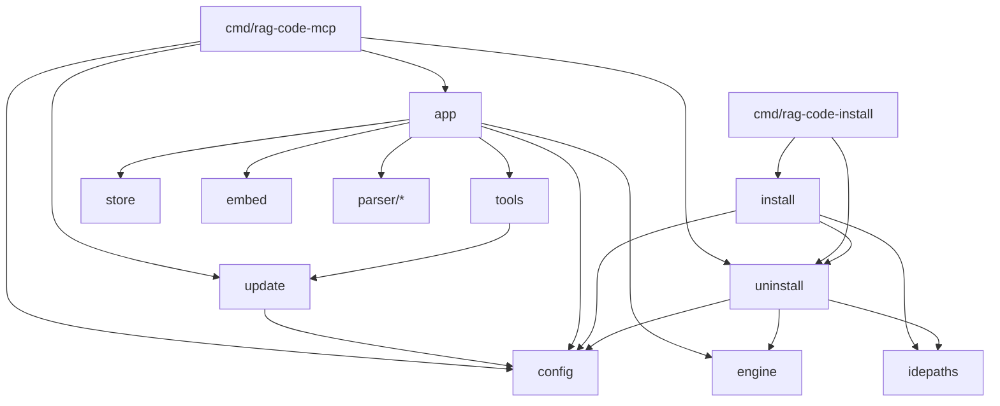

[RagCode](../README.md) › internal

# Internal Packages

Application-level packages that only the two RagCode binaries need. Go's
`internal/` rule means nothing outside the `github.com/doITmagic/rag-code-mcp/v2`
module can import them.

The split is simple:

- **Top-level packages** (`parser`, `index`, `engine`, `embed`, `store`,
  `vecdb`, `tools`) are the indexing and search machinery.
- **`internal/`** is everything around it: reading the user's configuration,
  wiring the machinery into an MCP server, and putting the program on (or
  taking it off) a machine.

## Sub-packages

| Package | What it does | Used by |
|:---|:---|:---|
| [`app`](./app/README.md) | Wires config, embedder, store, engine, parsers and MCP tools into one `*mcp.Server`. | [`cmd/rag-code-mcp`](../cmd/rag-code-mcp/README.md), tests |
| [`config`](./config/README.md) | Loads `~/.ragcode/config.yaml` (written from `default.yaml` on first run), applies environment overrides, validates; builds the logger and the rotating log file. | almost everything |
| [`idepaths`](./idepaths/README.md) | The table of 14 IDE MCP config files and the code that adds or removes the `ragcode` entry in them. | `install`, `uninstall` |
| [`install`](./install/README.md) | The installer: binary copy, config, Ollama container, model pull, IDE configs, PATH, removal of a RagCode v1 install. | [`cmd/rag-code-install`](../cmd/rag-code-install/README.md) |
| [`update`](./update/README.md) | The release check (cached a day), version order, and the update that installs a newer release over `~/.ragcode/bin/rag-code-mcp` after checking its SHA-256. | [`cmd/rag-code-mcp`](../cmd/rag-code-mcp/README.md), [`tools`](../tools/README.md) |
| [`uninstall`](./uninstall/README.md) | The uninstaller: stop running servers, remove IDE entries, per-workspace data, `~/.ragcode`, the PATH line and optionally the Docker containers. | `cmd/rag-code-install -uninstall`, `cmd/rag-code-mcp -uninstall`, `install` (for `Binary` and `StopProcess`) |

## Dependency graph



`config` imports nothing from the module, so any package (including
[`engine`](../engine/README.md) and [`tools`](../tools/README.md)) can depend
on it without cycles. `uninstall` imports `engine` only for
`engine.ReadRoots` (the workspaces to clean), `engine.PointerFiles` and
`engine.IDEPointer`, so it removes exactly what `engine.WriteIDERules` added.

## Files on disk owned by these packages

| Path | Written by | Removed by |
|:---|:---|:---|
| `~/.ragcode/config.yaml` | `config.Load` (when missing) | `uninstall` |
| `~/.ragcode/logs/ragcode.log`, `ragcode.log.1` | `config.OpenLogFile` | `uninstall` |
| `~/.ragcode/bin/rag-code-mcp[.exe]` | `install`; replaced by `update` | `uninstall` |
| `~/.ragcode/cache/update.json`, `update.lock`, `bin/rag-code-mcp.exe.old` (Windows) | `update` | `uninstall` |
| IDE MCP configs (see [idepaths](./idepaths/README.md)) | `install` via `idepaths` | `uninstall` via `idepaths` |
| `~/.bashrc` or `~/.zshrc` PATH line | `install` | `uninstall` |

`~/.ragcode` is `$RAGCODE_HOME` when that variable is set. The index under
`~/.ragcode/index/` and `~/.ragcode/roots.json` are written by the
[`store`](../store/README.md) and [`engine`](../engine/README.md); the
uninstaller deletes them with the rest of `~/.ragcode`.

## Testing

```bash
go test ./internal/...
```

Each package has `zz_verify_test.go` files with independent verification
tests next to the regular `*_test.go` files. The installer and uninstaller
tests use a temporary `HOME`, a fake `docker` shell script on `PATH` and an
`httptest` Ollama; they skip on Windows. A fake `codex` script is used only by
the idepaths tests.

## See also

- [RagCode overview](../README.md)
- [cmd](../cmd/README.md): the binaries built on these packages
- [engine](../engine/README.md), [tools](../tools/README.md): what `app` wires together
