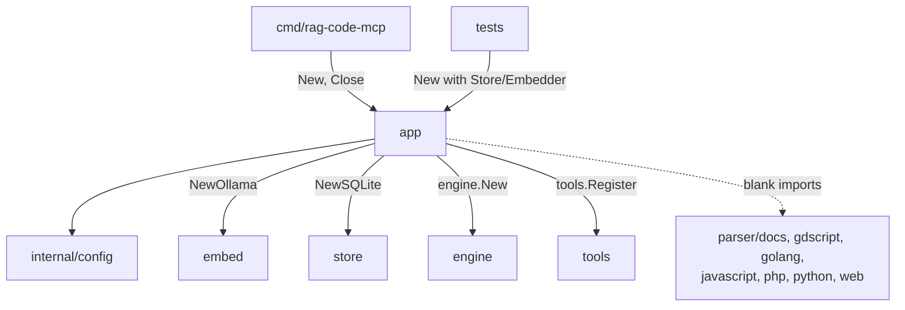

[RagCode v3](../../README.md) › [internal](../README.md) › app

# app

Package `app` builds the complete RagCode MCP server from a configuration:
it creates the embedder and the store, starts the
[`engine`](../../engine/README.md), creates the `*mcp.Server` and registers
the [`tools`](../../tools/README.md) on it. It also blank-imports every
language parser so they register themselves.

It exists so that the server can be assembled the same way by the real binary
and by tests. [`cmd/rag-code-mcp`](../../cmd/rag-code-mcp/README.md) serves
`App.Server` over stdio or HTTP; tests connect to the same server over
in-memory transports, with an in-memory store and a fake embedder.

## Where it sits



- **Called by:** [`cmd/rag-code-mcp`](../../cmd/rag-code-mcp/README.md) and
  the tests of `cmd/rag-code-mcp`.
- **Calls:** [`config`](../config/README.md), [`embed`](../../embed/README.md),
  [`store`](../../store/README.md), [`engine`](../../engine/README.md),
  [`tools`](../../tools/README.md) and the [`parser`](../../parser/README.md)
  packages.

## Files

| File | Contents |
|:---|:---|
| `app.go` | `Options`, `App`, `New`, `App.Close`, the `logClient` middleware and the `sdkLog` handler wrapper; the blank imports of the parser packages. |

Tests:

| File | Covers |
|:---|:---|
| `app_test.go` | Smoke test over in-memory transports (server name `ragcode`, version, the seven tool names); `New` with defaults does not dial Ollama; a stop by signal logs no `level=ERROR`; the default store is SQLite and writes `RAGCODE_HOME/index/<collection>/index.db`; one `client connected` line per client, both on the `initialize` handshake and on per-request client metadata (protocol 2026-07-28), and once over stateless HTTP where every request is a new session. |
| `zz_verify_test.go` | Verification tests: `Close` with an already-expired context returns promptly; `Engine.Resume` with a cancelled context returns at once; a nil `Log` is tolerated. |

## Key types and functions

### `Options`

```go
type Options struct {
    Config   config.Config
    Version  string        // reported in initialize and rag_server_info
    Log      *slog.Logger  // nil: logs are discarded
    Store    store.Store   // nil: store.NewSQLite(HomeDir()/index)
    Embedder embed.Embedder // nil: embed.NewOllama(cfg.OllamaBaseURL, cfg.OllamaEmbed)
}
```

When `Embedder` is nil, `New` creates the Ollama embedder from
`ollama_base_url` and `ollama_embed` and sets its `Threads` from
`embed_threads`. When `Store` is nil it uses one SQLite index per workspace
under `$RAGCODE_HOME/index` (default `~/.ragcode/index`).

### `App`

```go
type App struct {
    Server *mcp.Server    // serve it with Run(ctx, transport) or an HTTP handler
    Engine *engine.Engine // main calls Engine.Resume after start
    // unexported: store, log
}
```

### `New(o Options) (*App, error)`

Builds everything but **does no I/O**: it does not dial Ollama and opens no
index file. Those happen lazily when a tool first needs a workspace. It also:

- calls `slog.SetDefault(o.Log)`, making that logger the one process-wide
  logger the tools log through;
- names the MCP implementation `ragcode` with `o.Version`;
- installs the receiving middleware `logClient` and the SDK log filter
  `sdkLog` (below).

### `(*App) Close(ctx)`

Stops the engine (`Engine.Close`) in a goroutine and waits for it until `ctx`
is done; if it does not stop in time it logs
`app: engine did not stop in time` and closes the store anyway. A store close
error is logged, not returned.

## Usage

```go
cfg, _ := config.Load(config.DefaultPath())
a, err := app.New(app.Options{Config: cfg, Version: "v3.0.0", Log: log})
if err != nil {
    return err
}
defer a.Close(context.Background())
go a.Engine.Resume(ctx)
return a.Server.Run(ctx, &mcp.StdioTransport{})
```

In a test:

```go
a, _ := app.New(app.Options{Config: config.Default(), Store: store.NewMemory(), Embedder: &embed.Fake{}})
ct, st := mcp.NewInMemoryTransports()
a.Server.Connect(ctx, st, nil)
cs, _ := mcp.NewClient(&mcp.Implementation{Name: "c", Version: "0"}, nil).Connect(ctx, ct, nil)
```

## Behaviour details

### Parser registration

The language parsers register themselves in `init`. `app.go` blank-imports
`parser/docs`, `parser/gdscript`, `parser/golang`, `parser/javascript`,
`parser/php`, `parser/python` and `parser/web`. A new parser package under
`v3/parser/` is not active until it is added to this import list.

### Client logging (`logClient`)

Several clients usually share one log file, so the middleware logs
`client connected client=<name> client_version=<v> protocol=<p>` once per
client and process. The client info comes from the `initialize` request, or
from per-request metadata on the 2026-07-28 protocol. Seen clients are kept in
a `sync.Map` keyed by name, version and protocol, not by session: stateless
HTTP creates a session per request, and keeping those would grow without
bound (and log every request).

### SDK log filter (`sdkLog`)

The go-sdk logs `server run cancelled` at ERROR every time the server is
stopped by a signal. `sdkLog` wraps the handler and turns that one record
into INFO, so a normal shutdown does not look like a failure in
`ragcode.log`. All other SDK records pass through unchanged.

## Testing

```bash
cd v3
go test ./internal/app/
```

No build tags. Tests set `RAGCODE_HOME` to a temp directory and disable the
watcher (`cfg.WatchEnabled = false`) where they do not need it.
`TestAppDefaultStoreIsSQLite` runs a real index of a one-file workspace with
the fake embedder.

## See also

- [internal](../README.md)
- [cmd/rag-code-mcp](../../cmd/rag-code-mcp/README.md): serves `App.Server`
- [engine](../../engine/README.md): workspaces, indexing, watching
- [tools](../../tools/README.md): the seven `rag_*` tools
- [config](../config/README.md): the `Config` passed in
