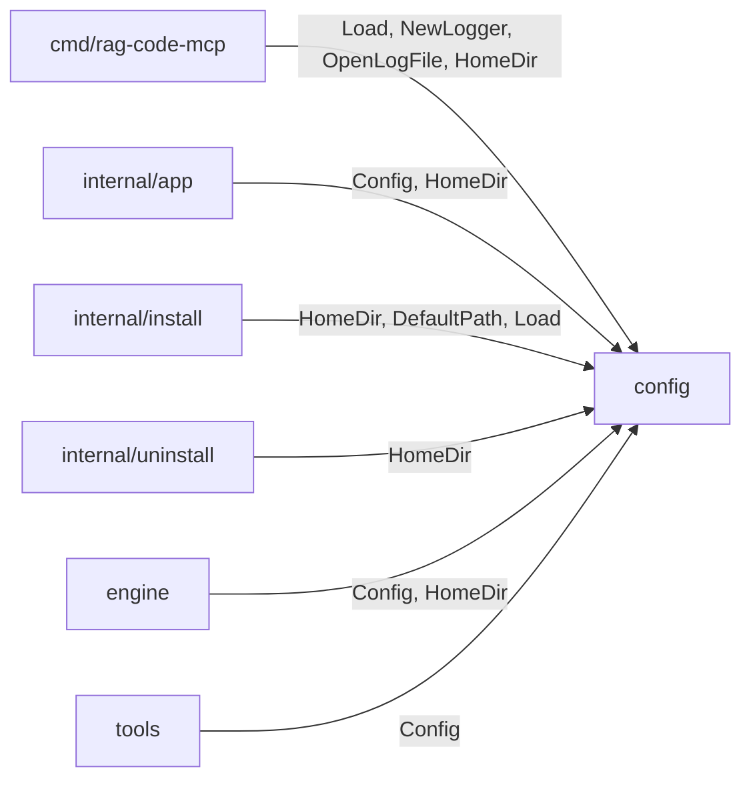

[RagCode](../../README.md) › [internal](../README.md) › config

# config

Package `config` owns the one user-facing configuration file of RagCode,
`~/.ragcode/config.yaml`, and the process logger. It:

- defines `Config` and its built-in defaults;
- finds the global RagCode directory (`$RAGCODE_HOME` or `~/.ragcode`);
- loads the YAML on top of the defaults, writes the file from the embedded
  `default.yaml` when it is missing, applies environment overrides and
  validates the result;
- creates the `slog` text logger and an append-only log file with size-based
  rotation that several server processes can share.

There is one configuration for the whole machine. Nothing per workspace lives
here; per-workspace data is written by the [`engine`](../../engine/README.md)
and the [`store`](../../store/README.md).

## Where it sits



- **Called by:** [`cmd/rag-code-mcp`](../../cmd/rag-code-mcp/README.md),
  [`app`](../app/README.md), [`install`](../install/README.md),
  [`uninstall`](../uninstall/README.md), [`engine`](../../engine/README.md),
  [`tools`](../../tools/README.md).
- **Calls:** only the standard library and `gopkg.in/yaml.v3`. It imports no
  other package of the module, so anything can depend on it.

## Files

| File | Contents |
|:---|:---|
| `config.go` | `Config`, `Default`, `HomeDir`, `DefaultPath`, `Load`, environment overrides (`applyEnv`), `Validate`. Embeds `default.yaml`. |
| `default.yaml` | The commented configuration written to `config.yaml` on first run. Mirrors `Default()` (a test checks it). |
| `log.go` | `NewLogger` and `OpenLogFile` with the rotating `logFile` writer. |

Tests:

| File | Covers |
|:---|:---|
| `config_test.go` | `default.yaml` equals `Default()`; loading a file; a missing file is written from the default; invalid YAML; environment overrides; every `Validate` rule; `HomeDir`/`DefaultPath` with and without `RAGCODE_HOME`; logger levels; log rotation on open, every 1000 writes, failed rotation keeps writing, following a rotation done by another process; old Qdrant keys from v1 are ignored; `embed_threads` default and `0`. |
| `zz_verify_test.go` | Verification tests: odd inputs (empty file, wrong types, ...) error or load but never panic; path is a directory; missing file with an unwritable parent; environment values on a fresh file are validated; empty environment values do not override; YAML tags are snake_case; exact defaults; logger levels; `OpenLogFile` errors; concurrent writes across rotations; the logger through the log file. |

## Configuration keys

All keys are optional; a missing key keeps the default. Unknown keys are
ignored (so a v1 `config.yaml` with Qdrant settings still loads).

| YAML key | Go field | Default | Meaning / used by |
|:---|:---|:---|:---|
| `ollama_base_url` | `OllamaBaseURL` | `http://localhost:11434` | Ollama URL; must be `http` or `https` with a host. [`embed`](../../embed/README.md), installer, `rag_server_info`. |
| `ollama_embed` | `OllamaEmbed` | `embeddinggemma-2:270m` | Embedding model; required. Needs Ollama 0.40 or later. |
| `embed_threads` | `EmbedThreads` | `max(2, NumCPU/3)` | CPU threads Ollama may use for embeddings (`num_thread`). `0` lets Ollama choose (every performance core). Must not be negative. |
| `log_level` | `LogLevel` | `info` | `debug`, `info`, `warn` or `error`. |
| `log_max_size_mb` | `LogMaxSizeMB` | `10` | Size at which `ragcode.log` is rotated. Must be positive. |
| `exclude_patterns` | `ExcludePatterns` | `node_modules`, `vendor`, `target`, `build`, `dist`, `__pycache__` | Directory names skipped while indexing and watching. Hidden directories are always skipped. Setting the key replaces the whole list. |
| `allowed_workspace_paths` | `AllowedWorkspacePaths` | empty | When set, only workspaces under one of these directories can be used. Entries must be absolute. Checked by the [`engine`](../../engine/README.md). |
| `auto_index` | `AutoIndex` | `true` | Index a workspace on its own (first use, catch-up at start, watcher). `false` leaves indexing to an explicit `rag_index_workspace`, and no watcher starts. |
| `watch_enabled` | `WatchEnabled` | `true` | Watch indexed workspaces for file changes (only when `auto_index` is also on). |
| `watch_debounce` | `WatchDebounce` | `1s` | Go duration the watcher waits for changes to settle. Must not be negative. |
| `auto_create_ide_rules` | `AutoCreateIDERules` | `true` | Let `rag_index_workspace` write `<workspace>/.ragcode/RAGCODE.md` and the IDE pointer lines. |

`embed_threads` is commented out in `default.yaml` on purpose: the written
file does not pin a CPU count, so the default keeps following the machine.

### Environment overrides

Applied after the file, before validation. An empty variable does not
override.

| Variable | Overrides |
|:---|:---|
| `OLLAMA_BASE_URL` | `ollama_base_url` |
| `OLLAMA_EMBED` | `ollama_embed` |
| `MCP_LOG_LEVEL` | `log_level` |
| `RAGCODE_ALLOWED_PATHS` | `allowed_workspace_paths`, as an OS path list (`:` on Linux/macOS, `;` on Windows); blank entries are dropped |
| `RAGCODE_HOME` | not a key: moves the whole global directory (see `HomeDir`) |

Priority, highest first: environment, `config.yaml`, `Default()`. The server's
`-log-level` flag is applied after `Load`, so it wins over all of them.

## Key functions

### `HomeDir() string` and `DefaultPath() string`

`HomeDir` returns `$RAGCODE_HOME` when set, otherwise `<user home>/.ragcode`
(falling back to `./.ragcode` if the user home cannot be determined).
`DefaultPath` is `HomeDir()/config.yaml`. Every other package builds its paths
(`bin/`, `index/`, `logs/`, `roots.json`) from `HomeDir`.

### `Load(path string) (Config, error)`

```go
cfg, err := config.Load(config.DefaultPath())
if err != nil {
    return err // "config: ..." with the file and field
}
```

1. Start from `Default()`.
2. If `path` does not exist, create its directory (`0755`) and write the
   embedded `default.yaml` there (`0644`); the defaults are used as is.
   Otherwise unmarshal the YAML over the defaults.
3. Apply the environment overrides.
4. `Validate`.

Errors are prefixed `config:`: `create dir`, `write default`, `read <path>`,
`parse <path>`, or the first invalid field. On error the partially filled
`Config` is returned too.

### `Validate() error`

Returns the first invalid field: `ollama_base_url` not an http(s) URL with a
host, empty `ollama_embed`, unknown `log_level`, negative `embed_threads`,
non-positive `log_max_size_mb`, negative `watch_debounce`, or a relative
`allowed_workspace_paths` entry.

### `NewLogger(level string, w io.Writer) *slog.Logger`

A `slog` text handler at `level`. An unknown level falls back to `info`
(`Load` has already rejected unknown levels from the file and environment).

## Log file and rotation

`OpenLogFile(path, maxMB)` returns an `io.WriteCloser` used by
[`cmd/rag-code-mcp`](../../cmd/rag-code-mcp/README.md) for
`$RAGCODE_HOME/logs/ragcode.log`.

- On open: if the file is larger than `maxMB`, it is renamed to
  `path + ".1"` (one backup; an older `.1` is replaced), then `path` is
  opened for appending (`0644`).
- Every 1000 writes the current size is checked; over the limit the file is
  closed, rotated and reopened.
- **Several processes share the file.** Before each write the writer checks
  that `path` is still the file it holds open (`os.SameFile`). If another
  server rotated it, this one reopens `path`, so it never keeps appending to
  an unlinked file.
- **Windows:** renaming a file another process holds open fails. During
  writes the rename error is ignored and writing continues to the oversized
  file; the rotation is retried 1000 writes later. The rotation at open is
  not forgiving: `OpenLogFile` returns the error, and the server then logs
  to stderr (`logging to stderr: ...`).
- Writes are serialised with a mutex, so the writer is safe for concurrent
  use within one process.

## Testing

```bash
go test ./internal/config/
```

No build tags. Tests use `t.TempDir()` and `t.Setenv`, so they do not touch
the real `~/.ragcode`.

## See also

- [internal](../README.md)
- [cmd/rag-code-mcp](../../cmd/rag-code-mcp/README.md): loads the config and opens the log
- [engine](../../engine/README.md): `auto_index`, `watch_*`, `allowed_workspace_paths`, `exclude_patterns`
- [embed](../../embed/README.md): `ollama_*`, `embed_threads`
- [install](../install/README.md): writes the config on install
