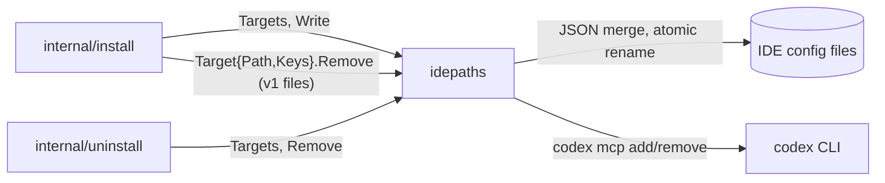

[RagCode v3](../../README.md) › [internal](../README.md) › idepaths

# idepaths

Package `idepaths` knows where every supported IDE or AI client keeps its MCP
server configuration, and adds or removes the `ragcode` entry there. The
[installer](../install/README.md) and the [uninstaller](../uninstall/README.md)
share this one table, so the two can never disagree about which files they
touch.

The entry it writes tells the IDE to start the installed server:

```json
{
  "mcpServers": {
    "ragcode": {
      "command": "/home/me/.ragcode/bin/rag-code-mcp",
      "args": ["--config", "/home/me/.ragcode/config.yaml"]
    }
  }
}
```

Every other key in the file is preserved.

## Where it sits



- **Called by:** [`install`](../install/README.md) (also builds ad-hoc
  `Target` values to clean up RagCode v1 entries) and
  [`uninstall`](../uninstall/README.md).
- **Calls:** only the standard library, plus the external `codex` CLI for
  OpenAI Codex.

## Files

| File | Contents |
|:---|:---|
| `idepaths.go` | `Target`, `Targets`, `ErrNotInstalled`, `Target.Write`, `Target.Remove`, the generic JSON editor (`edit`, `readJSON`, `writeAtomic`), the Zed writer and the Codex CLI integration. |

Tests:

| File | Covers |
|:---|:---|
| `idepaths_test.go` | Linux paths of all 14 targets and `CODEX_HOME`; write/merge/remove for each JSON shape, keeping other keys; v1's env keys dropped, user keys and v3 overrides kept (`TestWriteDropsV1Env`); `ErrNotInstalled` creates no file; invalid JSON and a non-object servers key are refused and the file left untouched; Codex through a fake `codex` script (add, remove, missing CLI). |
| `zz_verify_test.go` | Verification tests: odd files on `Write` (truncated, binary, top-level array or `null` are refused and left untouched; whitespace-only and BOM-only files load as empty); `Remove` on a file without the servers key leaves it byte-for-byte unchanged; Zed path on macOS; table sanity (14 targets, unique keys, all fields set, `Dir` that is a plain file counts as not installed, IDE-side flags such as `disabled` survive a rewrite); a symlinked config stays a symlink and keeps its mode. |

## The targets

`Targets()` returns the same 14 entries on every OS; only the paths change.
`~` is the user home; `<cfg>` is `~/.config` on Linux and
`~/Library/Application Support` on macOS.

| Key | Name | Config file (Linux / macOS) | Servers key |
|:---|:---|:---|:---|
| `cursor` | Cursor | `~/.cursor/mcp.json` | `mcpServers` |
| `windsurf` | Windsurf | `~/.codeium/windsurf/mcp_config.json` | `mcpServers` |
| `claude-code` | Claude Code | `~/.claude.json` (installed when `~/.claude/` exists) | `mcpServers` |
| `claude-desktop` | Claude Desktop | `<cfg>/Claude/claude_desktop_config.json` | `mcpServers` |
| `vscode` | VS Code | `<cfg>/Code/User/mcp.json` | `servers` |
| `zed` | Zed | `~/.config/zed/settings.json` (also on macOS) | `context_servers` |
| `cline` | Cline | `<cfg>/Code/User/globalStorage/saoudrizwan.claude-dev/settings/cline_mcp_settings.json` | `mcpServers` |
| `roo` | Roo Code | `<cfg>/Code/User/globalStorage/rooveterinaryinc.roo-cline/settings/cline_mcp_settings.json` | `mcpServers` |
| `continue` | Continue | `~/.continue/mcpServers/ragcode.json` (installed when `~/.continue/` exists) | `mcpServers` |
| `gemini` | Gemini CLI | `~/.gemini/settings.json` | `mcpServers` |
| `codex` | OpenAI Codex | `$CODEX_HOME/config.toml` (default `~/.codex`) | edited by the `codex` CLI |
| `antigravity` | Antigravity | `~/.gemini/config/mcp_config.json` | `mcpServers` |
| `copilot` | GitHub Copilot CLI | `~/.copilot/mcp-config.json` | `mcpServers` |
| `openhands` | OpenHands | `~/.openhands/mcp.json` | `mcpServers` |

**Windows:** when `%APPDATA%` is set, Cursor, Claude Desktop, Zed and VS Code
(and so Cline and Roo, which live under VS Code's `globalStorage`) move under
it: `%APPDATA%\Cursor`, `%APPDATA%\Claude`, `%APPDATA%\Zed`,
`%APPDATA%\Code\User`. The others stay under the user profile.

## Key types and functions

### `Target`

```go
type Target struct {
    Key  string   // short id: cursor, windsurf, claude-code, ...
    Name string   // display name
    Path string   // config file
    Dir  string   // its presence means the IDE is installed (default: dir of Path)
    Keys []string // JSON key path to the servers object
    // unexported: custom write / remove functions (Zed, Codex)
}
```

### `(Target) Write(binary, configPath string) error`

1. If `Dir` does not exist (or is not a directory), return
   `ErrNotInstalled` and create nothing: no config is written for an IDE the
   user does not have.
2. Read the file as JSON (missing or blank means `{}`), walk `Keys`,
   creating missing objects, and set `ragcode` to
   `{"command": binary, "args": ["--config", configPath]}`.
3. If a `ragcode` entry already existed, its keys other than the transport
   fields (`command`, `args`, `url`, `type`) are kept, so IDE-side settings
   such as `"disabled": true` survive a reinstall.
   One exception: an `env` written by v1 (it holds `QDRANT_URL`, which v3
   never reads) loses the keys v1 wrote (`OLLAMA_BASE_URL`, `OLLAMA_MODEL`,
   `OLLAMA_EMBED`, `QDRANT_URL`), and is dropped when nothing else is left;
   otherwise v1's `OLLAMA_EMBED` would override the model of `config.yaml`.
4. Write only if the content changed.

### `(Target) Remove() error`

Deletes the `ragcode` entry. A missing file, missing servers key or missing
entry is not an error and leaves the file untouched.

### `ErrNotInstalled`

Returned by `Write` only. The installer treats it as "skip silently".

## Behaviour details

- **Invalid files are never overwritten.** A file that is not a JSON object,
  has trailing content after the object, or whose servers key is not an
  object makes `Write`/`Remove` return an error naming the file. JSON with
  comments (JSONC) counts as invalid.
- **Atomic replace.** The new content goes to a temp file in the same
  directory and is renamed over the original, so a full disk or a crash
  cannot truncate the user's IDE config. If the path is a symlink (dotfile
  managers), the symlink's target is replaced and the link stays. The file's
  permission bits are kept (new files get `0644`).
- **Formatting.** A UTF-8 BOM is accepted and dropped. Numbers are kept
  verbatim (`json.Number`). The file is re-emitted with two-space indentation
  and sorted keys, so the original layout is not preserved.
- **Zed** gets its own entry shape under `context_servers`:
  `{"source": "custom", "command": ..., "args": [...]}`. Unlike the generic
  writer it replaces the whole `ragcode` entry.
- **Continue** gets a dedicated file, `~/.continue/mcpServers/ragcode.json`.
  `Remove` deletes the entry but leaves the file.
- **Codex** keeps TOML, so RagCode does not edit it. `Write` runs
  `codex mcp add ragcode -- <binary> --config <configPath>` and `Remove` runs
  `codex mcp remove ragcode` (only when `config.toml` exists), each with
  `CODEX_HOME` set to the target's directory and a 30 s timeout. The `codex`
  binary is looked up on `PATH`, then inside the OpenAI ChatGPT extension of
  VS Code, VS Code Insiders, Cursor or Antigravity
  (`~/<editor>/extensions/openai.chatgpt-*/bin/<os>-<arch>/codex[.exe]`, where
`<arch>` is `x86_64` or `aarch64`, not Go's `amd64`/`arm64`). If
  none is found, `Write`/`Remove` return `idepaths: codex CLI not found`.

## Testing

```bash
cd v3
go test ./internal/idepaths/
```

No build tags. Tests point `HOME`, `USERPROFILE` and `APPDATA` at a temp
directory. `TestTargetsPaths` checks Linux paths and skips elsewhere;
`TestCodex` uses a shell script and skips on Windows.

## See also

- [internal](../README.md)
- [install](../install/README.md): writes the entries
- [uninstall](../uninstall/README.md): removes them
- [cmd/rag-code-mcp](../../cmd/rag-code-mcp/README.md): the command the entries start
