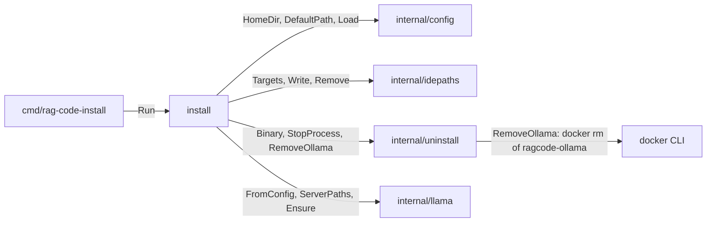
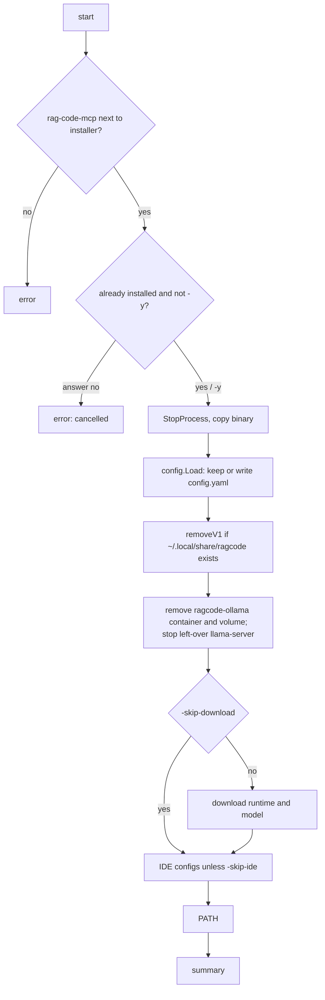

[RagCode](../../README.md) › [internal](../README.md) › install

# install

Package `install` sets RagCode up on the current machine. It is the logic
behind [`rag-code-install`](../../cmd/rag-code-install/README.md):

1. copy the `rag-code-mcp` server binary to `~/.ragcode/bin`;
2. write `~/.ragcode/config.yaml` (an existing one is kept);
3. remove a RagCode v1 install, if there is one;
4. remove the `ragcode-ollama` container of an earlier v2 installer, and stop
   left-over `llama-server` processes;
5. download the embedding runtime (llama.cpp) and the model, unless
   `-skip-download`;
6. register the server in every installed IDE;
7. put `~/.ragcode/bin` on `PATH`;
8. print a summary with an `mcp.json` snippet for any other client.

Only a few problems stop the run (the installer cannot locate its own
executable, missing server binary, the user declining to replace an install,
a failed copy, an invalid config). Everything else after the binary copy
(download, IDEs, PATH) is reported as a warning and skipped; a download that
fails is tried again by the server on first use.

## Where it sits



- **Called by:** [`cmd/rag-code-install`](../../cmd/rag-code-install/README.md).
- **Calls:** [`config`](../config/README.md), [`idepaths`](../idepaths/README.md),
  [`uninstall`](../uninstall/README.md) (`Binary` for the install path,
  `StopProcess` to stop running servers before replacing the binary and to
  stop left-over `llama-server` processes, `FindOllama`, `DropOllamaContainer` and
  `RemoveOllamaVolume` for the leftover container, through the `docker` CLI) and [`llama`](../llama/README.md)
  (the runtime and model download).

## Files

| File | Contents |
|:---|:---|
| `install.go` | `Options`, `Run`, and the helpers `copyFile`, `removeOllama`, `addPath` and the coloured `step`/`ok`/`warn` printers. |
| `v1.go` | `removeV1` (with `removeV1IDE`, `v1ConfigDir`): deletes a RagCode v1 install (`~/.local/share/ragcode`), its IDE entries, PATH line, containers and Qdrant data. |

Tests:

| File | Covers |
|:---|:---|
| `install_test.go` | Full run with a fake `docker` and a stubbed download: binary mode `0755`, config written, the runtime and model requested once, PATH line once, Cursor entry and summary snippet; a second run keeps the existing config and does not duplicate the PATH line; with both files already present (here a `llama_server` and an `embed_model` set in `config.yaml`) nothing is downloaded, the output says "already present" and the summary shows that server (`TestRunEnsureNotCalledWhenInstalled`); `-skip-download` does no download; a failed download is a warning, not an error; a leftover `ragcode-ollama` container and volume are removed (the pending file exists when `rm -f` runs and is gone after the volume is removed; a volume that cannot be removed leaves `cache/ollama-volume-pending` and takes back `cache/ollama-removed`; a left-over pending file gets its volume removed), and a missing `docker` is not an error; no Qdrant is started; errors (binary missing, user answers no); with `RAGCODE_HOME` set to the v1 directory itself, the v1 cleanup does not delete the binary just installed (`TestInstallIntoV1DirKeepsItself`); the Windows PATH hint appends to the user Path with no `setx` and no `%PATH%`, and escapes a quote in the bin dir (`TestWindowsPathHint`). |
| `v1_test.go` | A v1 install is removed (install dir, `~/.local/share/qdrant` when it holds only ragcode collections, PATH line, the `ragcode` entry in `~/.cursor/mcp.config.json`, Docker `rm -f`); answering no to "Replace?", a failed copy or an invalid config leaves v1 untouched; a collection RagCode did not create, or an unreadable collections directory, is kept; a running v1 server is stopped; `RAGCODE_HOME` reaching the v1 directory through a symlink or a relative path keeps the new install (`TestInstallIntoV1DirViaSymlinkOrRelativePathKeepsItself`); on Windows the v1 entries under `%APPDATA%` (Claude Desktop, VS Code) are removed (`TestRemoveV1IDEWindowsAppData`, runs on every OS). |
| `zz_verify_test.go` | Verification tests: a cancelled context does not hang `Run`; a reinstall replaces the binary, leaves no temp file and writes `.zshrc` when `SHELL` is zsh. |

## Key types and functions

### `Options`

```go
type Options struct {
    Yes          bool      // replace an existing installation without asking
    SkipDownload bool      // leave the runtime and model for the server's first use
    SkipIDE      bool
    In           io.Reader // default os.Stdin
    Out          io.Writer // default os.Stdout
    // srcDir (unexported): where rag-code-mcp is copied from; tests set it
    // ensure (unexported): fetches the runtime and model; tests replace it
}
```

### `Run(ctx, Options) error`

```go
err := install.Run(ctx, install.Options{Yes: true})
```

## The steps in detail



### Binary

The source is `<installer dir>/rag-code-mcp` (`.exe` on Windows); the
destination is `uninstall.Binary(HomeDir())`, i.e.
`~/.ragcode/bin/rag-code-mcp`. If the destination exists and `Yes` is false,
the user is asked `Replace it? [Y/n]` (empty answer means yes). Running
servers of that binary are stopped first (`uninstall.StopProcess`). The copy
goes to a temp file next to the destination, gets mode `0755` and is renamed
over it, so a binary an IDE still runs is replaced instead of failing with
"text file busy". On Windows, where a running
binary cannot be overwritten but can be renamed, the old one is moved to
`rag-code-mcp.exe.old` first (`update.Replace`).

### Config

`config.Load(config.DefaultPath())` writes `config.yaml` from the embedded
default when it is missing and leaves an existing file alone. The loaded
values (with environment overrides such as `RAGCODE_EMBED_RUNTIME`) decide
which llama.cpp build and model the next steps use. An invalid config stops
the run.

### Earlier Ollama install

Earlier v2 versions ran Ollama in a Docker container. `removeOllama` removes
the container named `ragcode-ollama` (`docker rm -f`) and then the volume of
that name, because the server now runs the embedding model itself and the
container (`--restart always`) would keep its memory. It follows the same
order as the server's first start after an automatic update, through the same
`uninstall` functions: `FindOllama` checks the identity (only a container
whose image is `ollama/ollama` and that mounts `/root/.ollama` is removed, the
v1 container too, so `removeV1` no longer removes it by name; any other
container with that name is left with a warning); when it mounts the named
volume, `cache/ollama-volume-pending` is written BEFORE `docker rm -f`, so an
installer that dies in between leaves the proof that the volume is RagCode's;
then `DropOllamaContainer` and `RemoveOllamaVolume` run and the pending file is
deleted once the volume is really gone. A pending file with no container (an
earlier interrupted run) gets its volume removed now. A host directory given
to the old `-models-dir` is never removed, and a volume with no container and
no pending file is left. It does nothing when `docker` is not on `PATH` or no
such container exists; if a removal fails it warns with Docker's answer and
prints the `docker rm -f ragcode-ollama` and `docker volume rm ragcode-ollama`
commands, keeps `cache/ollama-volume-pending` and deletes `cache/ollama-removed`,
so that the server's next start removes what is left. The install never fails
because of this.

### Embedding runtime

`llama.FromConfig(cfg, ...)` gives the runtime the config asks for (see
[llama](../llama/README.md)). First the installer stops any `llama-server`
running from the download path of either variant (`llama.ServerPaths`,
`uninstall.StopProcess`): a server whose RagCode process was killed would
hold the files and the memory. A `llama_server` you configured yourself is
never stopped. Then:

| State | What happens |
|:---|:---|
| `-skip-download` | Nothing is downloaded; a warning says the server fetches the runtime on first use. |
| Both files already present | One line says so. |
| Otherwise | `Ensure` downloads the pinned llama.cpp build and the model, printing a line per step and per 10% of a download. A failure is a warning ("the server tries again on first use"). |

Running the installer again therefore downloads nothing once both files are in
place.

### IDE configs

Unless `SkipIDE`, every `idepaths.Targets()` entry gets `Write(binary,
cfgPath)`. IDEs that are not installed are skipped silently; other errors
(invalid JSON, missing `codex` CLI) are warnings. See
[idepaths](../idepaths/README.md) for the file list.

### PATH

| OS | Behaviour |
|:---|:---|
| Linux, macOS | Appends `# RagCode MCP` and `export PATH="<bin dir>:$PATH"` to `~/.zshrc` when `$SHELL` is zsh, else `~/.bashrc`. Skipped when the rc file already mentions the bin directory. |
| Windows | Only prints a hint, nothing is changed (`windowsPathHint`): a `powershell -NoProfile -Command "..."` line that reads the raw user `Path` from `HKCU\Environment` (`DoNotExpandEnvironmentNames`), appends `;<bin dir>`, writes it back as `ExpandString`, and sets and clears a throwaway user variable so new windows get the change. It has no `$`, so it works pasted in cmd or PowerShell, and entries such as `%USERPROFILE%\AppData\Local\Microsoft\WindowsApps` stay expandable. Not `setx PATH "%PATH%;..."` (cmd copies machine+user PATH in and truncates at 1024 characters, PowerShell stores `%PATH%` literally) and not `[Environment]::SetEnvironmentVariable` (it writes the expanded value as plain `REG_SZ`, freezing every `%VAR%`). |

### Summary

Prints the binary, config, embedder (runtime and model), the index directory
(`~/.ragcode/index`) and a ready-to-paste `mcpServers` JSON entry.

## Removing RagCode v1 (`v1.go`)

Most users upgrade from v1, whose indexes are not compatible with v2. When
`~/.local/share/ragcode` exists and `RAGCODE_HOME` is not that directory or
inside it, `removeV1`:

1. runs `docker rm -f ragcode-qdrant` (the v1 `ragcode-ollama` container is removed afterwards by `removeOllama`, after its identity check);
2. removes the `ragcode` entry from the IDE files v1 wrote (Windsurf,
   `~/.cursor/mcp.config.json`, `~/.gemini/antigravity/mcp_config.json`,
   `~/.aitk/mcp.json`, `~/.config/mcp-servers.json`,
   `<cfg>/Claude/mcp-servers.json`, `<cfg>/Code/User/mcp.json`,
   `<cfg>/Code/User/globalStorage/mcp-servers.json`, where `<cfg>` is
   `~/.config` on Linux, `~/Library/Application Support` on macOS and
   `%APPDATA%` on Windows, as v1 wrote them);
3. stops a running v1 server (`StopProcess` on its binary) and deletes
   `~/.local/share/ragcode`;
4. removes the line `export PATH="<home>/.local/share/ragcode/bin:$PATH"`
   (absolute path, exact match) from `~/.bashrc`, `~/.zshrc` and `~/.profile`;
5. deletes v1's Qdrant collections, the directories under
   `~/.local/share/qdrant/collections` whose name starts with `ragcode`. The
   path is generic and a user's own Qdrant may keep collections there too, so
   `~/.local/share/qdrant` itself is deleted only when no other collection is
   left. A collections directory that cannot be read may hold anything, so
   `~/.local/share/qdrant` is then kept, with a warning. Qdrant wrote the data as root, so if a plain delete fails it runs
   `rm -rf` inside a throwaway `qdrant/qdrant:v1.19.1` container; if that fails
   too it prints a `sudo rm -rf` hint.

`RAGCODE_HOME` is compared after resolving it to an absolute path without
symlinks, and directories are matched by file identity (`os.SameFile`), so a
symlink, a relative path or a different letter case on a case-insensitive
disk still counts as inside. If either path cannot be resolved, v1 is kept
with the warning `RAGCODE_HOME is inside the v1 directory ...`.

Each failure is a warning; v1 removal never stops the install. It runs only
after the v2 binary is copied and its config loads, so answering no to
"Replace?", a failed copy or a broken config leaves v1 in place. Projects are
indexed again by v2 on first use.

## Testing

```bash
go test ./internal/install/
```

No build tags. The tests set a temporary `HOME`, put a fake `docker` shell
script on `PATH` and replace the download with a stub, so nothing is fetched.
They skip on Windows.

## See also

- [internal](../README.md)
- [cmd/rag-code-install](../../cmd/rag-code-install/README.md): the flags
- [uninstall](../uninstall/README.md): the reverse
- [idepaths](../idepaths/README.md): the IDE config files
- [config](../config/README.md): `config.yaml` and `HomeDir`
- [llama](../llama/README.md): the runtime and model the installer downloads
