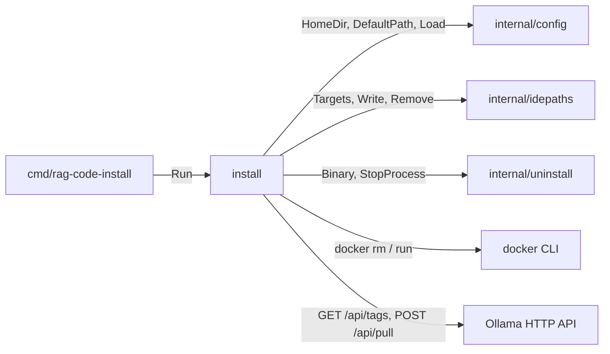
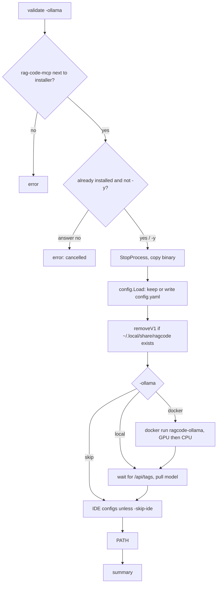

[RagCode](../../README.md) › [internal](../README.md) › install

# install

Package `install` sets RagCode up on the current machine. It is the logic
behind [`rag-code-install`](../../cmd/rag-code-install/README.md):

1. copy the `rag-code-mcp` server binary to `~/.ragcode/bin`;
2. write `~/.ragcode/config.yaml` (an existing one is kept);
3. remove a RagCode v1 install, if there is one;
4. start Ollama in Docker (or use a running one);
5. pull the embedding model;
6. register the server in every installed IDE;
7. put `~/.ragcode/bin` on `PATH`;
8. print a summary with an `mcp.json` snippet for any other client.

Only a few problems stop the run (the installer cannot locate its own
executable, bad `-ollama` value, missing server binary,
the user declining to replace an install, a failed copy, an invalid config,
a `-models-dir` that cannot be created). Everything else after the binary
copy (Docker, Ollama, model, IDEs, PATH) is
reported as a warning and skipped, so a machine without Docker still gets a
working install.

## Where it sits



- **Called by:** [`cmd/rag-code-install`](../../cmd/rag-code-install/README.md).
- **Calls:** [`config`](../config/README.md), [`idepaths`](../idepaths/README.md),
  [`uninstall`](../uninstall/README.md) (`Binary` for the install path,
  `StopProcess` to stop running servers before replacing the binary), the
  `docker` CLI and Ollama's HTTP API.

## Files

| File | Contents |
|:---|:---|
| `install.go` | `Options`, `Run`, and the helpers `copyFile`, `runContainer`, `waitHTTP`, `pullModel`, `addPath` and the coloured `step`/`ok`/`warn` printers. |
| `v1.go` | `removeV1`: deletes a RagCode v1 install (`~/.local/share/ragcode`), its IDE entries, PATH line, containers and Qdrant data. |

Tests:

| File | Covers |
|:---|:---|
| `install_test.go` | Full run with a fake `docker` (GPU start fails, CPU retry) and an `httptest` Ollama: binary mode `0755`, config written, exact Docker commands, model pulled with progress, PATH line once, Cursor entry and summary snippet; a second run with `-ollama skip` keeps the config and does no Docker or model work; `-ollama local` and `-models-dir`; errors (bad `-ollama`, binary missing, user answers no); `pullModel` errors and the 412 "Ollama too old" message; a failed container still pulls from an Ollama already on the port; no Qdrant is started. |
| `v1_test.go` | A v1 install is removed (install dir, `~/.local/share/qdrant` when it holds only ragcode collections, PATH line, the `ragcode` entry in `~/.cursor/mcp.config.json`, Docker `rm -f`); answering no to "Replace?", a failed copy or an invalid config leaves v1 untouched; a collection RagCode did not create, or an unreadable collections directory, is kept; a running v1 server is stopped. |
| `zz_verify_test.go` | Verification tests: `-ollama local` without Docker still waits and pulls; a cancelled context does not hang `Run`; `waitHTTP` on an unreachable URL returns an error; a reinstall replaces the binary, leaves no temp file and writes `.zshrc` when `SHELL` is zsh. |

## Key types and functions

### `Options`

```go
type Options struct {
    Ollama    string    // docker | local | skip
    GPU       bool      // try "--gpus all" for the container first
    Yes       bool      // replace an existing installation without asking
    ModelsDir string    // host dir mounted at /root/.ollama; "" uses a volume
    SkipIDE   bool
    In        io.Reader // default os.Stdin
    Out       io.Writer // default os.Stdout
    // srcDir (unexported): where rag-code-mcp is copied from; tests set it
}
```

### `Run(ctx, Options) error`

```go
err := install.Run(ctx, install.Options{Ollama: "docker", GPU: true, Yes: true})
```

## The steps in detail



### Binary

The source is `<installer dir>/rag-code-mcp` (`.exe` on Windows); the
destination is `uninstall.Binary(HomeDir())`, i.e.
`~/.ragcode/bin/rag-code-mcp`. If the destination exists and `Yes` is false,
the user is asked `Replace it? [Y/n]` (empty answer means yes). Running
servers of that binary are stopped first (`uninstall.StopProcess`). The copy
goes to a temp file next to the destination, gets mode `0755` and is renamed
over it, so a binary an IDE still runs is replaced instead of failing with
"text file busy".

### Config

`config.Load(config.DefaultPath())` writes `config.yaml` from the embedded
default when it is missing and leaves an existing file alone. The loaded
values (with environment overrides such as `OLLAMA_BASE_URL`) decide which
Ollama URL and model the next steps use. An invalid config stops the run.

### Ollama

| `-ollama` | What happens |
|:---|:---|
| `docker` | If `docker` is not on `PATH`, warn and continue as `local`. Otherwise remove any container named `ragcode-ollama` and run `docker run -d --name ragcode-ollama --restart always [--gpus all] -p 127.0.0.1:11434:11434 -v <volume or ModelsDir>:/root/.ollama ollama/ollama`. With `GPU`, a failed GPU start is retried on CPU. If the container still fails (for example a native Ollama holds port 11434), warn and continue: the wait below may find that Ollama. |
| `local` | No container; wait and pull. |
| `skip` | Nothing: no wait, no pull. |

The wait polls `<ollama_base_url>/api/tags` every 500 ms (3 s per request)
for up to 60 s. Then the model is pulled with streaming `POST /api/pull`,
showing progress on one line. HTTP 412 is reported as "this model needs a
newer Ollama, 0.40 or later". On any failure the installer prints
`run manually: ollama pull <model>` and carries on.

The volume is named `ragcode-ollama`; `-models-dir` mounts a host directory
instead (created with `0755`; if it cannot be created the install stops with
`install: models dir: ...`).

Running the installer again with `-ollama docker` repeats these steps: the
`ragcode-ollama` container is removed and recreated, and the model pull is
sent again. Only `-ollama skip` avoids the Docker and model work.

### IDE configs

Unless `SkipIDE`, every `idepaths.Targets()` entry gets `Write(binary,
cfgPath)`. IDEs that are not installed are skipped silently; other errors
(invalid JSON, missing `codex` CLI) are warnings. See
[idepaths](../idepaths/README.md) for the file list.

### PATH

| OS | Behaviour |
|:---|:---|
| Linux, macOS | Appends `# RagCode MCP` and `export PATH="<bin dir>:$PATH"` to `~/.zshrc` when `$SHELL` is zsh, else `~/.bashrc`. Skipped when the rc file already mentions the bin directory. |
| Windows | Only prints a `setx PATH` hint; nothing is changed. |

### Summary

Prints the binary, config, Ollama URL and model, the index directory
(`~/.ragcode/index`) and a ready-to-paste `mcpServers` JSON entry.

## Removing RagCode v1 (`v1.go`)

Most users upgrade from v1, whose indexes are not compatible with v2. When
`~/.local/share/ragcode` exists, `removeV1`:

1. runs `docker rm -f ragcode-qdrant ragcode-ollama`;
2. removes the `ragcode` entry from the IDE files v1 wrote (Windsurf,
   `~/.cursor/mcp.config.json`, `~/.gemini/antigravity/mcp_config.json`,
   `~/.aitk/mcp.json`, `~/.config/mcp-servers.json`,
   `<cfg>/Claude/mcp-servers.json`, `<cfg>/Code/User/mcp.json`,
   `<cfg>/Code/User/globalStorage/mcp-servers.json`);
3. stops a running v1 server (`StopProcess` on its binary) and deletes
   `~/.local/share/ragcode`;
4. removes the line `export PATH="<home>/.local/share/ragcode/bin:$PATH"`
   (absolute path, exact match) from `~/.bashrc`, `~/.zshrc` and `~/.profile`;
5. deletes v1's Qdrant collections, the directories under
   `~/.local/share/qdrant/collections` whose name starts with `ragcode`. The
   path is generic and a user's own Qdrant may keep collections there too, so
   `~/.local/share/qdrant` itself is deleted only when no other collection is
   left. A collections directory that cannot be read may hold anything, so
   `~/.local/share/qdrant` is then kept, with a warning. Qdrant wrote the data as root, so if a plain delete fails it runs
   `rm -rf` inside a throwaway `qdrant/qdrant:v1.19.1` container; if that fails
   too it prints a `sudo rm -rf` hint.

Each failure is a warning; v1 removal never stops the install. It runs only
after the v2 binary is copied and its config loads, so answering no to
"Replace?", a failed copy or a broken config leaves v1 in place. Projects are
indexed again by v2 on first use.

## Testing

```bash
go test ./internal/install/
```

No build tags. The tests set a temporary `HOME`, put a fake `docker` shell
script on `PATH` (it logs its arguments and fails on `--gpus`) and point
`OLLAMA_BASE_URL` at an `httptest` server. They skip on Windows.

## See also

- [internal](../README.md)
- [cmd/rag-code-install](../../cmd/rag-code-install/README.md): the flags
- [uninstall](../uninstall/README.md): the reverse
- [idepaths](../idepaths/README.md): the IDE config files
- [config](../config/README.md): `config.yaml` and `HomeDir`
