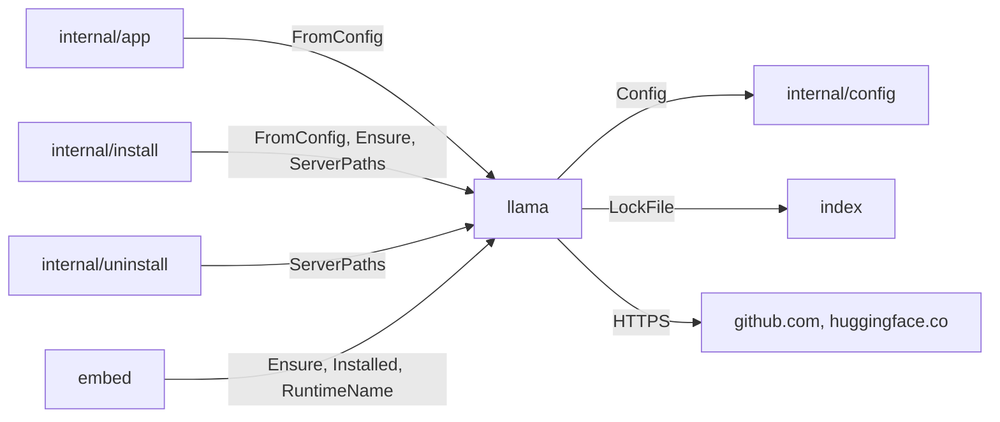

[RagCode](../../README.md) › [internal](../README.md) › llama

# llama

Package `llama` keeps the embedding runtime on disk: llama.cpp's
`llama-server` and the GGUF embedding model. Both are downloaded once into
`~/.ragcode` from pinned URLs, checked against pinned SHA-256 sums, and handed
to the [`embed`](../../embed/README.md) package, which runs the server. The
package starts nothing itself.

## Where it sits



- **Called by:** [`app`](../app/README.md) (builds the embedder),
  [`install`](../install/README.md) (downloads up front),
  [`uninstall`](../uninstall/README.md) (finds `llama-server` to stop it) and,
  through the `embed.Runtime` interface, [`embed`](../../embed/README.md).
- **Calls:** [`config`](../config/README.md) for the keys and `HomeDir`,
  [`index`](../../index/README.md) for its cross-process file lock, and the
  network for the downloads.

## What is pinned

- **llama.cpp** release `b12359` (the binaries of llama.cpp v1.0.0), one archive
  per OS and architecture with its SHA-256: Linux amd64 and arm64, macOS arm64
  and amd64, Windows amd64 and arm64.
- **Variants.** `cpu` and `vulkan` (Linux and Windows). `auto` (the default)
  picks Vulkan when an NVIDIA driver and a Vulkan loader are found (Linux:
  `/proc/driver/nvidia/version` and `libvulkan.so.1`; Windows: `nvapi64.dll` and
  `vulkan-1.dll` in System32), else CPU. Other GPUs work with
  `embed_runtime: vulkan`. macOS has one build, with Metal, so the variant does
  not matter there.
- **Model.** `embeddinggemma-2-Q8_0.gguf`: Google's EmbeddingGemma 2, 271M
  parameters, 8-bit weights, 309,855,456 bytes, from
  `huggingface.co/ggml-org/embeddinggemma-2-GGUF` at a fixed revision, with its
  SHA-256 pinned. Its name, `embeddinggemma-2-Q8_0`, is the model name the index
  stores (see "Model name and the index").

## Where files go

| Path | Contents |
|:---|:---|
| `~/.ragcode/llama/<tag>-<variant>/` | `llama-server` (`.exe` on Windows), its shared libraries (`lib*.so*`, `.dylib`, `.dll`) and `LICENSE*`. Nothing else of the release archive is unpacked. The directory appears only when complete. |
| `~/.ragcode/models/embeddinggemma-2-Q8_0.gguf` | The model. |
| `~/.ragcode/cache/llama.lock` | The cross-process lock held while downloading. |

(`~` is `RAGCODE_HOME` when set.) A download goes to a `.download-*` temporary
file and is renamed into place only when its SHA-256 (and size, when known)
match; one that fails or does not match leaves nothing behind. While it holds
the lock, `Ensure` also removes what a killed run left in the directories
RagCode owns: `.download-*` files in `~/.ragcode/models` (only when
`embed_model` is not set) and `.download-*` files and half-unpacked
`.<tag>-<variant>-*` directories in `~/.ragcode/llama` (only when
`llama_server` is not set). The directory of a `llama_server` or `embed_model`
you provide is never touched.
Archive entries are unpacked flat; a link may only name a sibling file.

## Key types and functions

```go
type Options struct {
    Home     string        // config.HomeDir()
    Variant  string        // Auto (default), CPU or Vulkan
    Server   string        // a llama-server you provide: nothing is downloaded for it
    Model    string        // a .gguf you provide: nothing is downloaded for it
    Progress func(string)  // one line per step and per 10% of a download; nil is silent
}

func FromConfig(cfg config.Config, progress func(string)) Options
func (o Options) Ensure(ctx context.Context) (server, model string, err error)
func (o Options) Installed() bool
func (o Options) RuntimeName() string // "llama.cpp b12359 (cpu)", or the path of your server
func (o Options) ModelLabel() string // read from the file each time it is called
func (o Options) ServerPath() string
func (o Options) ModelPath() string
func ServerPaths(home string) []string // the downloaded server of each variant, for stopping left-over processes
```

`FromConfig` maps `embed_runtime`, `llama_server` and `embed_model`.
`Ensure` returns the paths at once when both files exist. Otherwise it takes
`~/.ragcode/cache/llama.lock` (another process downloading makes it wait,
saying so through `Progress`), downloads what is missing and returns. A `llama_server` or `embed_model` that is not a
file is an error; there is no fallback to the download. On a platform with no
build, the error tells you to set `llama_server`. A download has no overall
clock, but a stall rule: when less than 64 KiB arrive in 2 minutes, counted
from before the request is sent (so the wait for the response headers counts,
and the time spent writing and hashing does not), it ends with an error
wrapping `ErrStalled`, and leaves nothing behind. A slow line that delivers
more than that, about half a KiB a second, still finishes. The two numbers are
package variables that the tests lower, not config keys. The wait for the lock
has no limit of its own: a process that holds it is downloading under the same
rule, so it ends or fails within minutes of making no progress, and one that
died has released it. The context passed to `Ensure` ends the wait for the
lock and the download too, with its own error, not `ErrStalled`. The installer
passes its own (Ctrl+C ends it); the embedder passes one of its own that ends
only at `Close`, so a search or index call that gives up does not cancel a
download in progress, and the next call joins it.

### Model name and the index

`ModelLabel` is the name the index stores: `embeddinggemma-2-Q8_0` for the
built-in model, or, for `embed_model`, the file name without `.gguf` followed
by `@` and a 12-character fingerprint of the file (SHA-256 over its size and
its first and last MiB), e.g. `my-embed@3fa9c01b77d2`. Vectors of two models
cannot be compared even at the same size, so another file under the same name
counts as another model and the next index run re-embeds; the same file moved
elsewhere keeps its name. A file that cannot be read has only its name. The
embedding prefixes in [`embed`](../../embed/README.md) follow the start of the
same name.
The label follows the file on disk: the embedder asks for it again each time it
starts the server, and refuses to start on a file whose label is not the one
the index was named after (see the `embed_model` row in
[`embed`](../../embed/README.md)). The built-in model is not checked again: it
is verified by its SHA-256 at download and its label is a constant. The
fingerprint does not see an edit in the middle of a file that keeps its size.
An index made with the earlier Ollama model `embeddinggemma-2:270m` has another
model name, so the next index run re-embeds that workspace; see
[`index`](../../index/README.md).

## Testing

```bash
go test ./internal/llama/
```

No build tags. A local `httptest` server stands in for GitHub and Hugging Face
(the download addresses are variables for this), so nothing is fetched from the
network.

| File | Covers |
|:---|:---|
| `llama_test.go` | The unpack of a `.tar.gz` and a `.zip` keeps only `llama-server`, its libraries and the licence, flat; a wrong checksum, a link pointing outside the directory and an archive without the server each fail and leave no runtime directory (the first two also no temporary file); an HTTP error fails with its status; `untar` and `unzip` refuse input that is not an archive; `Ensure` downloads nothing, takes no lock and creates no `cache` directory when both files are present, and a `llama_server` or `embed_model` that is not a file is an error naming the key; it downloads only the runtime when only the model is present, and nothing on a second call; it removes what a killed run left (`.download-*` in `models/`, `.download-*` and unpack directories in `llama/`), leaves other files there alone and leaves a directory alone when its `embed_model` or `llama_server` is user-provided; it waits for the lock another process holds, and a waiter whose context ends gives up with `context.DeadlineExceeded`; a download that sends its headers and then nothing, that never sends them, or that trickles less than the minimum fails with `ErrStalled` and leaves no temporary file, a slow one above the minimum finishes, a window that meets a write is not judged until the write ends (`watchStall`), and a caller that cancels gets its own error, not `ErrStalled`; the names `RuntimeName`, `ModelLabel` (with the fingerprint of a user-provided model: other bytes give another name, the same bytes the same one; the label follows the file when it is rewritten and back), `ServerPath`, `ModelPath` and `ServerPaths` give. |
