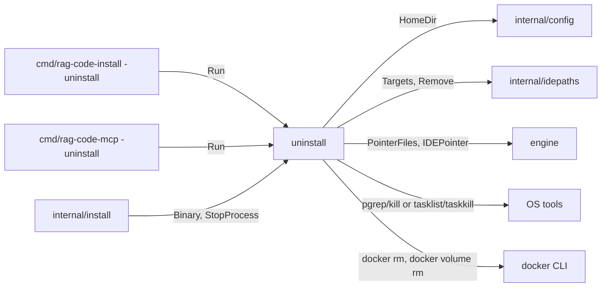
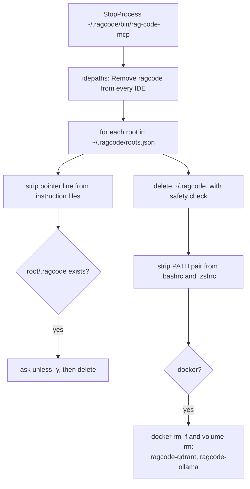

[RagCode](../../README.md) › [internal](../README.md) › uninstall

# uninstall

Package `uninstall` removes RagCode from the machine: it stops running
servers, removes the `ragcode` entry from every IDE config, cleans the files
RagCode wrote inside each known workspace, deletes `~/.ragcode` (with every
index) and the PATH line, and optionally the Docker containers.

Both binaries expose it:
[`rag-code-install -uninstall`](../../cmd/rag-code-install/README.md) (with
`-y` and `-docker`) and
[`rag-code-mcp -uninstall`](../../cmd/rag-code-mcp/README.md) (interactive,
no Docker removal). The [installer](../install/README.md) also uses two of its
exported helpers: `Binary` for the install path and `StopProcess` before it
replaces the binary.

## Where it sits



- **Called by:** [`cmd/rag-code-install`](../../cmd/rag-code-install/README.md),
  [`cmd/rag-code-mcp`](../../cmd/rag-code-mcp/README.md),
  [`install`](../install/README.md).
- **Calls:** [`config`](../config/README.md), [`idepaths`](../idepaths/README.md),
  [`engine`](../../engine/README.md) (only to know which instruction files
  carry the RagCode pointer line), OS process tools and the `docker` CLI.

## Files

| File | Contents |
|:---|:---|
| `uninstall.go` | `Options`, `Binary`, `Run`, `StopProcess`, and the helpers `roots`, `removePointer`, `stripPath` and the coloured `step`/`ok`/`warn` printers. |

Tests:

| File | Covers |
|:---|:---|
| `uninstall_test.go` | Full run with a fake `docker`: workspace `.ragcode` and `~/.ragcode` removed, other workspace files kept, the pointer line stripped from `CLAUDE.md` and `.cursor/rules/ragcode.mdc` deleted, only the installer's PATH pair removed from `.bashrc`, other Cursor servers kept, exact Docker commands; the prompt for each workspace's `.ragcode`; every file `WriteIDERules` touched gets the pointer stripped; the index under `RAGCODE_HOME/index` goes with the home and no Qdrant is called. |
| `stop_unix_test.go` | Build tag `!windows`. `StopProcess` stops the server binary but not processes that only mention its path (a shell, `tail -f`, a launcher wrapper). |
| `zz_verify_test.go` | Verification tests: garbage `roots.json` and a cancelled context neither panic nor hang, and the home is still removed; closed stdin when an answer is needed fails `Run`; a `RAGCODE_HOME` override is removed and its PATH line stripped while `~/.ragcode` stays; `RAGCODE_HOME` set to the user home or one of its parents is never deleted. |

## Key types and functions

### `Options`

```go
type Options struct {
    Yes    bool      // remove every <root>/.ragcode without asking
    Docker bool      // also remove ragcode-ollama (and a leftover v1 ragcode-qdrant)
    In     io.Reader // default os.Stdin
    Out    io.Writer // default os.Stdout
}
```

### `Run(ctx, Options) error`

Runs every step below. A step that cannot be done (IDE missing, Docker not
installed, file locked) prints a warning and the run continues. The only
error `Run` returns is a failure to read an answer from `In` (for example
stdin closed while a question is pending).

### `Binary(home string) string`

`<home>/bin/rag-code-mcp`, plus `.exe` on Windows. The single definition of
where the server is installed.

### `StopProcess(ctx, binary string)`

Stops every running instance of `binary` except the current process, best
effort. Does nothing when `binary` does not exist.

| OS | How |
|:---|:---|
| Linux, macOS | `pgrep -f '^<binary>( \|$)'` (anchored, so argv[0] must be the binary itself), `kill -TERM`, poll every 100 ms for up to 5 s, then `kill -KILL` for the survivors. |
| Windows | `tasklist` filtered by image name, then `taskkill /F` for each PID. |

## The steps



### Per-workspace data

The list of workspaces comes from `~/.ragcode/roots.json` (a JSON array of
paths, maintained by the [engine](../../engine/README.md)); read with
`engine.ReadRoots`, so a UTF-8 BOM is accepted); an invalid file prints a
warning and no per-workspace folder is removed. For each root:

- **Pointer lines.** For every path in `engine.PointerFiles(root)` (the agent
  instruction files and `.cursor/rules/ragcode.mdc`), lines equal to
  `engine.IDEPointer` are removed. `ragcode.mdc` is deleted when only its
  front matter (`---\nalwaysApply: true\n---\n`) is left. Symlinks are never
  followed, like the writer.
- **`<root>/.ragcode`** (with `RAGCODE.md`) is deleted. Without `Yes` the user
  is asked `Remove <dir>? [y/N]`; anything but `y`/`yes` keeps it.

### Global directory

`config.HomeDir()` (`$RAGCODE_HOME` or `~/.ragcode`) is removed recursively:
binary, `config.yaml`, logs, `roots.json` and every index under `index/`.
Because `RAGCODE_HOME` is user input, the directory is **not** removed when it
resolves (following symlinks) to the user's home directory or one of its
parents (`/home`), or is a filesystem root; a warning tells the user to check `RAGCODE_HOME`.

On Windows the running `rag-code-mcp.exe` cannot delete itself, so
`rag-code-mcp -uninstall` there leaves a warning for that file.

### PATH line

From `~/.bashrc` and `~/.zshrc`, only the exact two-line pair the installer
wrote is removed: `# RagCode MCP` immediately followed by
`export PATH="<home>/bin:$PATH"`. A lone `# RagCode MCP` line or a different
export is kept. On Windows the installer changed no PATH, so there is nothing
to undo.

### Docker (`-docker`)

For `ragcode-qdrant` (left by v1) and `ragcode-ollama`:
`docker rm -f <name>` then `docker volume rm <name>`. Removing the
`ragcode-ollama` volume deletes the downloaded models. A host directory given
to the installer with `-models-dir` is not touched.

## Known limitations

- Continue's dedicated file `~/.continue/mcpServers/ragcode.json` is left as
  `{"mcpServers": {}}` instead of being deleted.
- Zed's default `settings.json` is JSONC, which counts as invalid JSON here, so
  on a typical Zed setup the entry is neither written nor removed; a warning
  says so.

## Usage

```go
err := uninstall.Run(ctx, uninstall.Options{Yes: true, Docker: true})
```

```bash
rag-code-install -uninstall -y -docker
~/.ragcode/bin/rag-code-mcp -uninstall   # asks for each workspace
```

## Testing

```bash
go test ./internal/uninstall/
```

`stop_unix_test.go` has the build tag `!windows`. The other tests use shell
scripts (a fake `docker`) and skip on Windows. All tests run against a
temporary `HOME` with `RAGCODE_HOME` cleared or pointed at a temp directory.

## See also

- [internal](../README.md)
- [install](../install/README.md): what is being undone
- [idepaths](../idepaths/README.md): the IDE config files
- [engine](../../engine/README.md): `WriteIDERules`, `roots.json`
- [cmd/rag-code-install](../../cmd/rag-code-install/README.md), [cmd/rag-code-mcp](../../cmd/rag-code-mcp/README.md): the `-uninstall` flags
