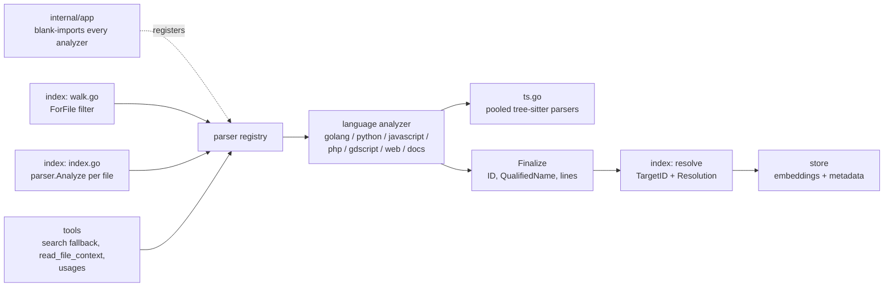

[RagCode](../README.md) › parser

# Parser

The `parser` package defines what a "symbol" is in RagCode and how a source
file becomes a list of them. It holds:

- the **symbol contract** (`Symbol`, `Relation`, `Kind`, `RelationKind`) that
  every language analyzer produces and every other package consumes;
- the **identity rules**: the canonical qualified name (`Qualify`), the
  separator-insensitive comparison (`Normalize`, `MatchQualified`) and the
  stable symbol ID (`SymbolID`, `Finalize`);
- the **registry** that maps a file extension to the analyzer for it;
- the **tree-sitter helpers** (pooled parsers, node walking) the analyzers
  share.

The language analyzers live in sub-packages. Each one registers itself from
`init()`, so a binary only supports the languages whose packages it imports.

The key design rule, stated in the package doc: tools never re-derive
identity. A symbol's `QualifiedName` and a relation's `TargetQualifiedName`
are computed here, at parse time, through the file's own import table.

## Where it sits



| Caller | What it uses |
|--------|--------------|
| [`internal/app`](../internal/app/README.md) | Blank-imports the seven analyzer packages so they register. |
| [`index`](../index/README.md) | `ForFile` to decide which files to walk, `Analyze` to parse each one, `Normalize` / `MatchQualified` to resolve relations workspace-wide, `ReleaseParsers` after a full run. |
| [`store`](../store/README.md) | Stores `parser.Symbol` values; uses `Normalize` / `MatchQualified` for the qualified-name suffix lookup. |
| [`tools`](../tools/README.md) | `Analyze` for live parsing (search fallback, `read_file_context`), `ForLanguage` / `ForFile` to filter by language, `Languages` for server info, `Normalize` / `MatchQualified` for name queries. |

The package itself depends only on the standard library and
[`github.com/odvcencio/gotreesitter`](https://github.com/odvcencio/gotreesitter)
(a pure-Go tree-sitter runtime with bundled grammars, so no CGO).

## The Analyzer interface

```go
type Analyzer interface {
	Language() string
	Extensions() []string // lower-case, with leading dot, e.g. ".py"
	Analyze(f File) ([]Symbol, error)
}

type File struct {
	Path     string // absolute
	Root     string // workspace root (absolute), used to derive Module
	Source   []byte
	Language string // set by parser.Analyze from the chosen analyzer
}
```

Implementations must be stateless and safe for concurrent use; any cache must
be keyed and concurrency-safe. All analyzers in this tree keep their
per-file state in a struct created inside `Analyze`; the only process-wide
state is three `sync.Map` caches (Go `go.mod` module lines, Python
`__init__.py` import tables, JavaScript re-export reads).

## Registry

| Function | Behaviour |
|----------|-----------|
| `Register(a)` | Stores the analyzer by `Language()` and by each extension (lower-cased). A later registration for the same extension wins, so a framework-aware analyzer can replace a plain one. |
| `ForFile(path)` | Returns the analyzer for the **longest** matching extension of the file's base name: `view.blade.php` tries `.blade.php` before `.php`. Returns `nil` when nothing matches. |
| `ForLanguage(lang)` | Analyzer by language name, or `nil`. |
| `Languages()` | Sorted list of registered language names. |
| `Analyze(f)` | Picks the analyzer for `f.Path`, sets `f.Language` and runs it. A file with no analyzer returns `(nil, nil)`. |

Registered languages and extensions (from the sub-packages):

| Sub-package | `Language()` | Extensions |
|-------------|--------------|------------|
| [`golang`](golang/README.md) | `go` | `.go` |
| [`python`](python/README.md) | `python` | `.py`, `.pyi` |
| [`javascript`](javascript/README.md) | `javascript` | `.js`, `.mjs`, `.cjs`, `.jsx`, `.ts`, `.tsx`, `.vue` |
| [`php`](php/README.md) | `php` | `.php`, `.blade.php` |
| [`gdscript`](gdscript/README.md) | `gdscript` | `.gd`, `.tscn` |
| [`web`](web/README.md) | `html` | `.html`, `.htm`, `.gohtml`, `.tmpl`, `.tpl` |
| [`docs`](docs/README.md) | `docs` | `.md`, `.mdx`, `.markdown`, `.json`, `.yaml`, `.yml`, `.toml`, `.txt`, `.rst` |

TypeScript and Vue files report the language `javascript`; Blade views report
`php`. Stylesheets (`.css`, `.scss`, ...) have no analyzer and are not indexed.

## Symbol model

```go
type Symbol struct {
	ID            string            // SymbolID(FilePath, QualifiedName, StartLine)
	QualifiedName string            // Qualify(Module, Owner, Name)
	Name          string
	Kind          Kind
	Module        string            // the language's container of the file
	Owner         string            // enclosing class/struct/interface short name
	Signature     string
	Doc           string
	Content       string            // source text that gets embedded
	FilePath      string            // absolute, as given in File.Path
	StartLine     int               // 1-based
	EndLine       int
	Language      string
	Exported      bool
	Relations     []Relation
	Metadata      map[string]string // flat, small, optional
}
```

### Kinds

| `Kind` | Value | Used for |
|--------|-------|----------|
| `KindFunction` | `function` | Free functions, module-level functions |
| `KindMethod` | `method` | Functions with an owner |
| `KindClass` | `class` | Class, struct, trait, enum |
| `KindInterface` | `interface` | Interfaces |
| `KindType` | `type` | Type aliases, typedefs, other named types |
| `KindVariable` | `variable` | Variables, properties, GDScript signals |
| `KindConstant` | `constant` | Constants, enum cases |
| `KindRoute` | `route` | Laravel and Go (Echo, Gin, Chi, `net/http`) route registrations |
| `KindHook` | `hook` | WordPress `add_action` / `add_filter` |
| `KindTemplate` | `template` | Blade views and sections, Vue `<template>`, HTML documents/elements, Go template `define`/`block` |
| `KindScene` | `scene` | Godot scene nodes |
| `KindChunk` | `chunk` | Documentation chunks (Markdown section, JSON/YAML/TOML key, text window) |

### What `Module` means per language

| Language | `Module` |
|----------|----------|
| Go | Import path: nearest `go.mod` module line plus the relative directory |
| Python | Dotted module path relative to the root (`pkg.sub.mod`) |
| PHP | Namespace, backslash separated (`App\Http\Controllers`) |
| JS / TS / Vue | Path relative to the root without extension (`src/app/main`) |
| GDScript | Godot resource path without extension (`res://actors/player`) |
| HTML, docs | Path relative to the root without extension |

`RelModule(root, p)` is the shared helper: slash-separated path of `p`
relative to `root` without extension, and `true`; for an empty root or a path
outside it, the file stem and `false`.

## Relations

```go
type Relation struct {
	Kind                RelationKind
	TargetName          string // short name as written
	TargetQualifiedName string // set by the analyzer, "" when it cannot tell
	TargetID            string // set by the indexer
	Resolution          string // set by the indexer
	Line                int    // 1-based; for a method call, the line of the method name (a chain split over lines)
	Value               bool   // a candidate usage, not a call (Go: a function or method named as a value)
}
```

| `RelationKind` | Value | Typical source |
|----------------|-------|----------------|
| `RelCall` | `call` | A call expression, a Go template `{{template}}`, a Godot signal connection, a Go function or method value (`Value`) |
| `RelImplements` | `implements` | `implements` clauses (PHP, TS) |
| `RelExtends` | `extends` | Base classes, Go embedded types and embedded interfaces |
| `RelUsesType` | `uses_type` | `new X`, composite literals, PHP trait `use`, JSX components, scene scripts |
| `RelImports` | `imports` | Blade `@extends`/`@include`, PHP `view('x.y')` and Laravel route handlers naming a view, HTML script/stylesheet links, Markdown links |

Analyzers resolve `TargetQualifiedName` only from evidence in the file (its
imports, its own declarations, `self`/`this`). They never guess the type of a
variable; an unknown receiver leaves the field empty. One exception is
the Go value use below: a local declared with a single type (`s *T`,
`var s T`, `s := &T{...}`) gives `s.m` the target `T.m`. PHP reads declared
types the same way: a parameter typed with one class (`Request $r`) and a
property typed with one class, promoted from or assigned from such a
constructor parameter (`$this->repo = $repo`), give `$r->m()` and
`$this->repo->m()` the target `<class>.m`.

`Value` marks a `RelCall` that is only a candidate: the Go analyzer cannot
tell a function or method named as a value (`mux.HandleFunc(p, s.handler)`)
from a variable, constant or field read declared in another file, so it
emits the name with the target a call on it would get. The indexer's resolve
step keeps such a relation only when it links `exact` to a function or
method, and drops every other one before storing (unresolved, ambiguous,
`unique`, or linked to a variable, constant, type or field), so it never
shows as a usage or as an unresolved name. A kept one is stored with
`value: true`.

The indexer then fills `TargetID` and `Resolution` in a workspace-wide pass
(see [index](../index/README.md)):

| `Resolution` | Meaning |
|--------------|---------|
| `exact` | `TargetQualifiedName` matched one symbol, exactly or, in Python and GDScript, as a qualified suffix (`src/` layouts, bare `class_name`); elsewhere a suffix match is `unique` |
| `unique` | Matched by name only (`TargetName`), and exactly one symbol has it; tools mark it `by_name` |
| `ambiguous` | Several symbols share the name, none matched by qualified name |

## Identity

### Qualified names

```go
parser.Qualify("github.com/acme/app/svc", "Server", "Start")
// "github.com/acme/app/svc.Server.Start"
parser.Qualify("pkg.mod", "", "helper")   // "pkg.mod.helper"
parser.Qualify("", "", "G")               // "G" (empty parts are skipped)
```

Because each language keeps its own separators inside `Module`, queries are
compared through `Normalize`, which maps `::`, `\`, `/` and `->` to `.` and
trims leading/trailing dots:

```go
parser.Normalize(`App\Models\User::find`) // "App.Models.User.find"
parser.Normalize("pkg/foo.Bar")           // "pkg.foo.Bar"
```

`MatchQualified(qualifiedName, query)` is true when both normalize to the same
string, or the query is a suffix of the name on a segment boundary:

| Qualified name | Query | Match |
|----------------|-------|-------|
| `App\Models.User.find` | `User::find` | yes |
| `App\Models.User.find` | `find` | yes |
| `App\Models.User.find` | `ser.find` | no |

### Symbol IDs

`SymbolID(filePath, qualifiedName, startLine)` is the first 16 bytes of a
SHA-256 over the slash-normalized path, the qualified name and the start line,
hex encoded (32 characters). Two symbols with the same qualified name in the
same file (overloads, redefinitions) stay distinct through the line. When they also
share the line (minified code, CR-only line endings, a PHP property and method
of one name), `Finalize` hashes the n-th one as `name#n` (n from 2, in the
order the analyzer emits them).

### Finalize

Every analyzer passes its output through `Finalize(f, syms)`, which:

1. sets `FilePath` and `Language` from the `File` when empty;
2. sets `QualifiedName = Qualify(Module, Owner, Name)` when empty;
3. clamps `StartLine` to at least 1 and `EndLine` to at least `StartLine`;
4. computes `ID`, distinct for every symbol of the file.

## Tree-sitter helpers (`ts.go`)

| Function | Purpose |
|----------|---------|
| `ParseTree(grammar, src)` | Parses with a named grammar (`go`, `python`, `php`, `javascript`, `typescript`, `tsx`, `gdscript`, `html`, ...). Returns the tree and the `*gotreesitter.Language` needed for `Node.Type`. A parse stopped by the 3 s timeout is an error (`parse stopped: timeout`), so the file counts as failed instead of being indexed without symbols; one stopped by the 128 MiB memory budget keeps the tree built so far; a file of a code grammar (`go`, `php`, `python`, `javascript`, `typescript`, `tsx`, `gdscript`) whose brackets nest more than 1000 deep is an error too (`not parsed: brackets nested N deep`) and is not parsed at all: error recovery on such a cascade takes hundreds of MB. `html` has no such limit, since brackets mean nothing to it (5000 unclosed ones parse in milliseconds). |
| `Walk(n, fn)` | Depth-first visit of named nodes; returning `false` skips the children. |
| `NamedChildren(n)` | Named children in order. For a root whose only child is an `ERROR` node (error recovery wrapped a whole broken file), the children of that node, so the declarations parsed before the broken part are still read. Use it instead of `NamedChildCount`/`NamedChild` loops, which are quadratic in gotreesitter. |
| `Field`, `Text`, `Lines` | Child by field name, source text of a node, 1-based start/end lines. |
| `ReleaseParsers()` | Drops the pooled parsers and arenas to hand memory back after a full index run. |

Parsers are pooled per grammar, so concurrent calls never share a parser. Each
parse has a 3-second timeout (`parseTimeoutMicros`), because gotreesitter's
error recovery can be quadratic on garbage input.

## Files

| File | Contents |
|------|----------|
| `parser.go` | `Kind`, `RelationKind`, resolution constants, `Symbol`, `Relation`, `File`, `Analyzer`; `Qualify`, `Normalize` (also turns a Go method expression `(*T).M` into `T.M`), `MatchQualified`, `SymbolID`, `Finalize`; the registry (`Register`, `ForFile`, `ForLanguage`, `Languages`, `Analyze`); `RelModule`; `InRoot`, the check every analyzer makes before reading a project file other than the one it parses (regular file, real path inside the root). |
| `normalize_test.go` | `TestNormalizeMethodExpression`: `Normalize` on Go method expressions and PHP separators. |
| `nesting_test.go` | The nesting guard leaves `html` alone: a page with 1001 `(` in a script string still parses. |
| `ts.go` | Pooled tree-sitter parsers with a parse timeout, `ParseTree`, `Walk`, `NamedChildren`, `Field`, `Text`, `Lines`, `ReleaseParsers`. |

The test files here are `normalize_test.go`, `nesting_test.go`, `finalize_test.go` and `broken_test.go`. The rest of the contract is
exercised by every analyzer's tests (which check IDs, qualified names and line clamping on their
output) and by the [index](../index/README.md) tests for relation resolution.

## Sub-packages

| Package | Languages | Approach |
|---------|-----------|----------|
| [golang](golang/README.md) | Go | tree-sitter `go`; module from `go.mod`; Echo, Gin, Chi and `net/http` routes |
| [python](python/README.md) | Python, stubs | tree-sitter `python`; import table, `__init__.py` re-exports |
| [javascript](javascript/README.md) | JS, TS, JSX, TSX, Vue SFC | tree-sitter `javascript` / `typescript` / `tsx`; ESM + CommonJS imports |
| [php](php/README.md) | PHP, Blade | tree-sitter `php`; Laravel routes, WordPress hooks; Blade line scanner |
| [gdscript](gdscript/README.md) | GDScript, Godot text scenes | tree-sitter `gdscript`; `.tscn` line scanner |
| [web](web/README.md) | HTML, Go templates | tree-sitter `html`; regex for `{{define}}` / `{{template}}` |
| [docs](docs/README.md) | Markdown, reST, JSON, YAML, TOML, text | line scanners, `encoding/json`, `yaml.v3` |

## Adding a language

1. Create `parser/<lang>/` with a type implementing `Analyzer`.
2. Call `parser.Register(analyzer{})` from `init()`.
3. Fill `Name`, `Kind`, `Module`, `Owner`, lines, `Content`; resolve
   `TargetQualifiedName` only from evidence in the file.
4. Return `parser.Finalize(f, syms)`.
5. Blank-import the package in [`internal/app`](../internal/app/README.md).

## Testing

```bash
go test ./parser/...
```

No build tags or external services are needed.

## See also

- [index](../index/README.md): walks the workspace, calls `parser.Analyze`, resolves relations
- [store](../store/README.md): persists symbols
- [tools](../tools/README.md): MCP tools that query symbols
- [RagCode overview](../README.md)
