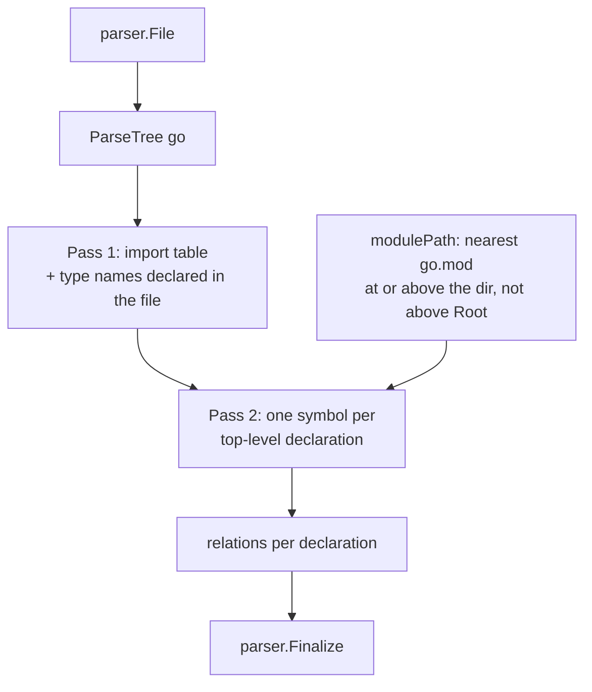

[RagCode](../../README.md) › [parser](../README.md) › golang

# Go Analyzer

The `golang` package turns one Go source file into `parser.Symbol` values: one
symbol per top-level declaration (function, method, type, var, const), with
call (including functions and methods named as values), type-use and
embedding relations resolved through the file's own import
table and the types it declares, plus one `route` symbol per HTTP route
registration in a file that imports a router ([Routes](#routes)).

It uses the tree-sitter `go` grammar (through the shared helpers in
[`parser/ts.go`](../README.md#tree-sitter-helpers-tsgo)), not `go/ast` or
`go/types`. That keeps it fast and tolerant of broken files, at the cost of
having no type information: a call on a variable whose type the file does
not declare keeps an empty `TargetQualifiedName`.

## Where it sits

- **Registered** from `init()` with `parser.Register(Analyzer{})`; the binary
  pulls it in through a blank import in
  [`internal/app`](../../internal/app/README.md).
- **Called** by [`index`](../../index/README.md) (and by
  [`tools`](../../tools/README.md) for live parsing) through `parser.Analyze`.
- **Calls** `parser.ParseTree`, `parser.Walk`, `parser.Finalize` and the other
  helpers from [parser](../README.md). It reads `go.mod` files from disk to
  compute the module path.

| Property | Value |
|----------|-------|
| Language | `go` |
| Extensions | `.go` |
| Exported type | `Analyzer` (stateless struct) |

## How a file is analyzed



1. **Pass 1** reads every `import_spec` into a map `local name -> import path`
   (an alias replaces the assumed name; dot and blank imports are skipped)
   and records every type name declared in the file. The assumed name follows
   goimports: the last path element, the one before a `/vN` major suffix,
   without a `go-` prefix and cut at the first non-identifier character, so
   `gopkg.in/yaml.v3` is `yaml` and `github.com/mattn/go-isatty` is `isatty`.
2. **Pass 2** emits symbols for `function_declaration`, `method_declaration`,
   `type_declaration`, `var_declaration` and `const_declaration`.
3. **Module** is the Go import path: the `module` line of the nearest `go.mod`
   at or above the file's directory (never above the workspace root) plus the
   relative directory. A `go.mod` that is not a regular file whose real path
   (symlinks resolved) is inside the root counts as absent. Without a `go.mod`
   it is the directory relative to the root; a file directly in the root has module `""`. A `_test.go` file of an
   external test package (`package flux_test`) gets that module plus `_test`,
   so its declarations never share qualified names with `package flux`.

## Symbols extracted

| Declaration | Kind | Owner | Notes |
|-------------|------|-------|-------|
| `func F()` | `function` | | Signature is the source up to the body. |
| `func (r *T) M()` | `method` | `T` | Owner is the receiver base type with pointer and type parameters stripped. |
| `type T struct{...}` | `class` | | |
| `type I interface{...}` | `interface` | | `Metadata["methods"]` lists the interface's method names, comma separated. |
| `type A = B`, `type N []string` | `type` | | Any other type spec, aliases included. |
| `var x, y = ...` | `variable` | | One symbol per name; `_` is skipped unless the spec has relations (`var _ = Describe(...)` in Ginkgo tests, `var _ I = (*T)(nil)`): their calls and type uses would be lost otherwise. |
| `const ...` | `constant` | | One symbol per name; `_` is skipped unless the spec has relations, as for `var`. |

- **Grouped declarations** (`type (...)`, `var (...)`, `const (...)`): each
  spec becomes its own symbol whose content is just that spec; a declaration
  with a single spec uses the whole declaration (keyword included).
- **Doc** is the comment block ending on the line right above the declaration,
  markers removed (`//`, `/* */`, leading `*`); `//go:` directives are dropped.
- **Exported** is true when the name starts with an upper-case letter, the
  owner (for methods) is exported too, and the file is not a `_test.go` file.

### Example

With `go.mod` saying `module github.com/acme/app` and the file at
`internal/svc/svc.go`:

```go
package svc

import str "strings"

// Server doc.
type Server struct {
	Base
	Name string
}

func (s *Server) Start() {
	s.Stop()
	str.ToUpper("a")
}
```

| Qualified name | Kind | Owner |
|----------------|------|-------|
| `github.com/acme/app/internal/svc.Server` | `class` | |
| `github.com/acme/app/internal/svc.Server.Start` | `method` | `Server` |

Relations: `Server` extends `Base` -> `github.com/acme/app/internal/svc.Base`
(an unqualified type is declared in the same package, in this file or
another); `Start` calls `Stop` ->
`github.com/acme/app/internal/svc.Server.Stop` and `ToUpper` ->
`strings.ToUpper`.

## Relations extracted

| Source construct | Relation | How the target is resolved |
|------------------|----------|----------------------------|
| `f(x)` | `call` | `<module>.f`. Built-ins (`len`, `append`, `make`, conversion type names, ...) and names declared as locals or parameters in the same declaration, or the method's receiver (`func (h Handler) Serve() error { return h() }`), are skipped. |
| `T(x)` with `T` declared in the file | `uses_type` | Conversion to a local type: `<module>.T`. |
| `pkg.F(x)` | `call` | Through the import table: `<import path>.F`, unless a parameter or local named `pkg` shadows the import (then `""`). |
| `recv.M()` inside a method | `call` | Receiver variable: `<module>.<Owner>.M`. |
| `T.M(...)`, `(*T).M(...)`, `T{}.M()` | `call` | Type declared in the file: `<module>.T.M`. |
| `s.M()` on a local or parameter declared with one type (`s *T`, `var s T`, `s := &T{...}`, `s := T{...}`, `c echo.Context`, `r Repo` of an interface) | `call` | `<module of T>.T.M`: this module for an unqualified type, the import path for `pkg.T`. A local set from a function call (`x := f()`), reassigned to anything but a literal of the same type (`s = &Other{}`, `s = f()`), or of a slice, map or func type has no declared type. A parameter of a func type (`fn func(s *T)`) is no local; a name only closures declare (not the function itself) has no declared type when it is also used where no closure declares it (there it is a package-level name), so `s.Get()` after `f := func(s *Server) {...}` keeps an empty target. An external type matches no workspace symbol, so the index leaves `c.JSON()` unresolved instead of linking it by name to a workspace `JSON` ([index](../../index/README.md#6-resolve)). |
| `x.M()` on anything else | `call` | Target name only, qualified name `""`. |
| `F[int](x)` / `pkg.F[T](x)` | `call` (or `uses_type` when `F` is a local type) | Generic calls parse as conversions; classified by whether `F` is a type declared here. |
| `T` in any type position (field, parameter, result, `var`, composite literal, `new(T)`, type switch) | `uses_type` | `<module>.T`: not predeclared (`int`, `error`, `any`, `comparable`, ...) and not a type parameter, so declared in the same package, in this file or another. The declared name of a type and a method's receiver type are not uses. |
| `pkg.T` in any type position | `uses_type` | `<import path>.T`, or `""` when `pkg` is not imported. |
| Embedded struct field | `extends` | Same-package type or imported type. |
| Embedded interface (`fmt.Stringer`) | `extends` | Same rule. |
| `f`, `recv.M`, `s.M`, `T.M`, `pkg.F` named as a value: a call argument, the right side of `=`, `:=` or `var`, a composite literal value (keyed or not, never the key), a `return` value | `call` with `Value: true` | The target a call on the same expression gets (rows above), plus `s.M` on a local declared with one type (the `s.M()` row): `<module of T>.T.M`. Not emitted: an operand of unknown type (no qualified target, so it could never link exactly), and what the file shows is no function (built-ins, locals, parameters and the receiver, types, top-level vars and consts declared here, a selector named like a struct field declared here and no method here). The index keeps the relation only when it links exactly to a function or method ([index](../../index/README.md#6-resolve)). |

Relations of a `var` or `const` spec are shared by every name in that spec.

## Routes

A file that imports an HTTP router gets one `route` symbol per registration
call in its functions and methods, as PHP does for Laravel. The import is the
evidence: a method named `GET` in a file that imports no router is no route.
`_test.go` files produce none (a test's router setup is not the app's).

| Framework | Import | Registration calls (path argument) | Group |
|-----------|--------|-------------------------------------|-------|
| Echo | `github.com/labstack/echo` (any `/vN`) | `GET`, `POST`, `PUT`, `DELETE`, `PATCH`, `OPTIONS`, `HEAD`, `CONNECT`, `TRACE`, `Any`, `Static`, `File` (first); `Match`, `Add` (second) | `Group(prefix, ...)` |
| Gin | `github.com/gin-gonic/gin` | `GET`, `POST`, `PUT`, `DELETE`, `PATCH`, `OPTIONS`, `HEAD`, `Any`, `Static`, `StaticFile`, `StaticFS` (first); `Match`, `Handle` (second) | `Group(prefix, ...)`; `Use(mw...)` on a router or group keeps its prefix (`g.Group("/user").Use(auth).POST("", h)` is `/user`) |
| Chi | `github.com/go-chi/chi` (any `/vN`) | `Get`, `Post`, `Put`, `Delete`, `Patch`, `Options`, `Head`, `Connect`, `Trace`, `Handle`, `HandleFunc`, `Mount` (first); `Method`, `MethodFunc` (second) | `Route(prefix, func(r chi.Router) {...})`: the closure's router parameter gets the prefix inside the closure only; `Group(func(r chi.Router) {...})` and `With(mw...)` keep the receiver's prefix; `Mount(prefix, sub)` of a `chi.NewRouter()` built in the same function gives `sub` the prefix |
| net/http | `net/http` | `Handle`, `HandleFunc` on `http`, `http.DefaultServeMux` or a `ServeMux` (first); the path may be a Go 1.22 pattern, split as `ServeMux` does: the method is the text before the first space or tab, case kept (`"GET /items/{id}"` and `"GET\t/items/{id}"` give name `/items/{id}` and method `GET`, `"get /x"` method `get`), and any text before the first `/` is a host kept in the name (`"example.com/"`, `"localhost/status"`) | none |

- The path argument must be a string literal, a string const declared at
  the top of the same file (`const uriAdmin = "/admin"`), or `path.Join` of
  such consts and literals, which gives what `path.Join` returns at run time
  (`path.Join(uriAdmin, "/lists/:id/")` is `/admin/lists/:id`). A local or
  parameter of the const's or the `path` import's name shadows it. The same
  holds for group prefixes and `Mount` paths. The value must be `""` or start with
  `/` (a net/http pattern: after its method and host; a Gin or Echo path may
  be any string, since Gin joins it to the base path `/` and Echo adds the
  missing leading slash: `GET("users")` is `/users`; Chi and net/http panic
  on such a path, so there it gives no route. A receiver whose framework the
  file does not show, a top-level var or a struct field, gets no route for it
  in a file that also imports Chi), and the argument after it must not be a string literal (except for
  `Static`, `File`, `StaticFile`, `StaticFS`, whose second argument is a
  directory or file), so
  `Header().Add("X-Key", "v")` and `time.Now().Add(d)` are no routes.
- The receiver must be a router the file shows: a local set (with `:=`, `=` or `var`) from the
  framework's constructor (`echo.New()`, `gin.New()`, `gin.Default()`,
  `chi.NewRouter()`, `chi.NewMux()`, `http.NewServeMux()`), a `Group` result,
  a chi `Route` / `Group` closure parameter, a `With(...)` call on a router, a
  parameter, top-level var or struct field of a router type (`*echo.Echo`,
  `*echo.Group`, `*gin.Engine`, `*gin.RouterGroup`, `gin.IRouter`,
  `gin.IRoutes`, `chi.Router`, `*chi.Mux`, `*http.ServeMux`), the `http`
  package itself or `http.DefaultServeMux` (also held in a local:
  `mux := http.DefaultServeMux`). So `c.File("/var/www/index.html")` on an `echo.Context` and
  `cache.Get("/docs/1", out)` are no routes; a router reached any other way
  (returned by a project function or a field of a type declared elsewhere)
  gives no route either. A receiver keeps the framework it came from (its
  constructor, its parameter type, the router it is a group of; `http` and
  `http.DefaultServeMux` are net/http), and only that framework's methods,
  path rule and join apply to it, so a Gin group and an Echo group in one file
  each join as their own router does. A top-level var or struct field tries
  every imported framework in order.
- **Name** is the full path: the group prefixes the file shows joined in front
  (`g := e.Group("/admin")`, `v1 := g.Group("/v1")`, `s.api = e.Group("/api")`,
  `e.Group("/u").Static("/", dir)`); an empty result is `/`. Gin cleans the
  joined path as its `joinPaths` does, from the base path `/` (`Group("/")` +
  `GET("/x")` is `/x`, `Group("/p/")` + `GET("/:id")` is `/p/:id`,
  `Group("api")` + `GET("ping")` is `/api/ping`, a trailing slash is kept); Echo
  concatenates prefix and path and then adds a missing leading slash, as its
  router does (`GET("users")` is `/users`, `Group("/api")` + `GET("ping")` is
  `/apiping`); Chi paths are concatenated after the prefix less its trailing
  `/`, the path chi serves (`Route("/articles")` + `Get("/")` is `/articles/`,
  `Mount("/")` + `Get("/x")` is `/x`). A sub-router a function builds with
  `chi.NewRouter()` (or `chi.NewMux()`) and mounts at one path in the same
  function (`r := chi.NewRouter(); r.Get("/", h); router.Mount("/settings", r)`)
  gets that path as its prefix, joined to the prefix of the router it is
  mounted on (nested mounts add up); a sub-router mounted at two paths keeps
  its paths as written. A group variable
  passed to a function of the same file gives that function's parameter its
  prefix when every call in the file passes the same one; otherwise, and for
  any router whose prefix the file does not show (a parameter, a field set
  elsewhere), the path stays as written.
  A group variable declared with `:=` inside a block (`if`, `for`, `switch`,
  `{...}`, a closure) ends with that block: an inner
  `api := r.Group("/internal")` does not change the outer `api` after it.
- **Owner** is the enclosing function or method name (as PHP routes take
  the enclosing symbol's name), so `admin.GET("/users", h)` in `func Load`
  of `example.com/app/routes` is `example.com/app/routes.Load./admin/users`.
  A `GET` and a `POST` of one path in one function share the qualified name
  and stay two symbols: the tools never merge routes (a lookup by that name
  is `ambiguous` and lists both).
- **Metadata**: `framework=<the Framework column, lower case>`,
  `method=<the call's method name>` (the pattern's method for a net/http
  pattern that has one). In a file that imports a router and `net/http`, a
  `Handle` / `HandleFunc` call is the router's.
  Content is the call expression, signature its first line, `Exported` true.
- **Relation**: the handler argument (Echo, Chi, net/http: the one after the path,
  the rest are middleware; Gin: the last one, middleware come first) gets the `call`
  relation with
  `Value: true` that the enclosing function already has for it (a function
  name, a method value on the receiver or on a local of known type, a
  package function), so `rag_find_usages` of the handler lists the route.
  It is the relation read from that argument itself, so `a.Handle` and
  `b.Handle` of different types registered on one line each keep their own.
  A Gin route without a handler argument (`g.OPTIONS("/*any")`, served by the
  group's middleware) is a route without a relation.
  An inline `func(c echo.Context) error {...}`, a method value on an operand
  of unknown type (`c := NewController(); e.GET(p, c.Index)`) and the static
  file calls have no handler relation.

## Known limitations visible in the code

- No type inference: calls on fields, return values and locals whose type
  the file does not declare (`s.Inner.Do()`, `a := f(); a.Do()`) keep an
  empty target qualified name. A call on an interface-typed operand targets
  the interface's method name, which is no symbol (see the interface
  limitation below).
- Function and method values: only the positions in the table count. Not
  covered: a method value on an operand of unknown type (a local from a
  function call, `s := newServer(); mux.HandleFunc(p, s.h)`, a package-level
  var, a field `a.b.h`); a method expression `T.m` / `(*T).m` whose type is
  declared in another file; a value sent on a channel, put in parentheses or
  reached through an interface; a function value stored in a variable and
  called later is a usage where it is named, not where it is called. A file
  at a workspace root without `go.mod` has an empty module, so its value
  uses have no qualified target the index can link exactly.
- A value use whose target is declared in another file is linked only when
  both files are in the same index run (or the target is already stored):
  the index drops it otherwise, so a handler file added after the file that
  registers it shows the usage only once the registering file changes or a
  full re-index runs.
- A local variable shadows a package function, an import or the method's
  receiver of the same name across the whole declaration, not only after its
  declaration (marked as a `shortcut:` in `locals`); a call on a shadowed
  receiver keeps an empty target.
- The `go.mod` lookup is cached per root + directory and re-read when that
  `go.mod` changes (mtime) or disappears; a `go.mod` read within 2 s of its
  mtime is not cached (`parser.Racy`), so a rewrite in the same timestamp
  tick is seen; a `go.mod` created later in a
  directory that had none needs a restart to show up. A `go.mod` symlinked
  out of the workspace root is ignored, so the module falls back to the
  directory path.
- Methods whose receiver type cannot be read produce no symbol.
- Routes: only the frameworks in [Routes](#routes) are read. Routes
  registered through a project's own helper or a table of structs, a router
  returned by a project's own constructor (`r := newRouter()`), a router
  held in a field of a type declared in another file and a group passed to a
  method (`s.register(g)`) produce no route or keep the path as written.
- Routes: a router passed to a function or method in another file keeps the
  path written in that function. In wakapi, `main.go` mounts
  `router.Mount("/api", apiRouter)` and calls
  `healthApiHandler.RegisterRoutes(apiRouter)` on a local built by a
  constructor of another package; the route in `RegisterRoutes` is `/health`,
  not `/api/health`, and `rag_search` for `/api/health` finds `/health` only
  as a neighbour. The `Mount` symbol `/api` itself is indexed. Joining the two
  would need the receiver's type from another file, and the many
  `RegisterRoutes` methods get routers with different prefixes.
- Routes: a path built at run time gives no route: `"/v" + n`, a path read
  from config (listmonk `srv.Static(uploadFsURI, ...)` and
  `path.Join(publicURL, "/:filepath")`), routes added in a loop
  over `r.Routes()` (wakapi `routes/api/heartbeat.go`), or `path.Join` with
  any part that is not a literal or a same-file string const. A path naming a
  const declared in another file or a `var` gives no route either.
- Interface methods are not symbols of their own: they are only listed in the
  interface's `Metadata["methods"]`. `rag_find_usages` on a method declared
  only in an interface (no implementation) answers "no indexed symbol named";
  a call through the interface (`repo.M()` with `repo Repo`) targets
  `<module>.Repo.M`, which the index, finding no such method, resolves by
  name when one implementation has that name.
- An import without an alias is known by the goimports guess of its name
  (`assumedName`), not by the imported package's `package` clause; a
  package whose real name differs from that guess gets calls with an empty
  target, because only the file being parsed is read.

## Files

| File | Contents |
|------|----------|
| `golang.go` | `Analyzer` (`Language`, `Extensions`, `Analyze`), the per-file context, symbol builders (`appendFunc`, `appendTypes`, `appendValues`), relation collection (`relations`, `callTarget`, `genericCall`, `resolveType`), doc comment extraction and the cached `go.mod` module-path lookup. |
| `routes.go` | The router table by import path (`frameworks`), `routes` / `declRoutes` (group prefixes per declaration, carried into same-file functions), `scope` (chi closures), `grp` (a router's prefix and framework), `route` (one registration call), `handlerRelation`, `static` (a literal, same-file const or `path.Join` path), `mounts` (chi sub-routers mounted in a declaration). |

### Tests

| File | Covers |
|------|--------|
| `golang_test.go` | A fixture with grouped declarations, generics, embedded types, aliased/dot/blank imports: symbol kinds, owners, lines, signatures, docs, IDs, metadata; every relation and its target; module path without `go.mod`, nested `go.mod` stopping at the root; malformed input; analyzing the real `parser.go` of this repo; registration; concurrency; generic calls; `Exported` for test files and unexported owners; calls through local function values; a parameter shadowing an import; a func-type or closure parameter typing no use outside it, while a name the function and its closures declare with one type (`t *testing.T` and `t.Run(..., func(t *testing.T))`, `w` of two handler closures) keeps it; a local shadowing the receiver; a func-typed receiver called or named as a value shadowing a package function; the line of a chained call split over lines; functions and methods named as values (arguments, assignments, literals, returns), with fields, vars, consts, type switch and select locals skipped; an external test package as its own module; a renamed module seen without a restart; same-package types declared in another file, type parameters (receiver ones too) and the receiver skipped; blank vars keeping their relations; goimports-style assumed import names; a `go.mod` symlinked out of the root ignored, one symlinked inside it read. |
| `routes_test.go` | net/http (Go 1.22 method and host patterns, a lowercase method, a tab after the method, a host without a dot, `http.HandleFunc`, `mux.Handle` with a wrapped handler, two method-value handlers of one name on one line); Chi routes (nested `Route` closures shadowing the outer router, `With`, `Group`, `Method`, `HandleFunc`, `Mount`; a sub-router mounted in the same function, nested mounts, `Mount("/", r)` giving no `//`, a sub-router mounted at two paths keeping its paths); Gin routes (nested groups in `{}` blocks, `Handle`, middleware before the handler, static files, `Use(mw)` chained or assigned keeping the group's prefix, no route from a `Use` middleware closure); Echo routes: nested and inline groups, a group in a struct field, a group passed to a function (and the prefix left out when two calls disagree), each handler form (function, method value, package function, inline closure), `Match` / `Add` / `Static` / `File`; a group variable shadowed in a block keeping the outer prefix after it; Echo and Gin paths without a leading slash (none in a file that also imports Chi for a struct-field router; Gin and Echo groups in one function each with their own join); the receiver evidence (a top-level var from a constructor, a router-typed struct field; no route on an `echo.Context`, a cache in a chi file or a parameter of another type); a router and groups declared with `var`, alone or in a `var (...)` block; no route in a file without a router import, in a test file, or for `Header().Add` / `time.Now().Add`; paths from a same-file string const and `path.Join` of consts and literals (Echo registrations and group prefixes; no route for a `var`, a run-time `path.Join` part, a local shadowing the const, or `+` on a parameter shadowing the `path` import). |
| `zz_verify_test.go` | Verification tests: resolution probes, an unclean (non-normalized) root path, robustness on garbage and edge input, a second round of edge cases, very large and deeply nested files. |

## Testing

```bash
go test ./parser/golang/
```

No build tags or external services. Tests create temporary `go.mod` files
with `t.TempDir()`.

## See also

- [parser](../README.md): symbol model, qualified names, registry
- [index](../../index/README.md): resolves `TargetQualifiedName` to symbol IDs
- Other analyzers: [python](../python/README.md), [javascript](../javascript/README.md), [php](../php/README.md)
