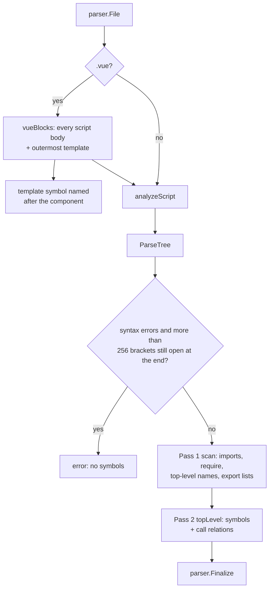

[RagCode](../../README.md) › [parser](../README.md) › javascript

# JavaScript / TypeScript / Vue Analyzer

The `javascript` package turns JavaScript, TypeScript, JSX/TSX and Vue
single-file components into `parser.Symbol` values: top-level functions,
classes and their methods, interfaces, type aliases, enums, variables and
constants, CommonJS exports, Vue options-API methods and the Vue
`<template>`.

It uses the tree-sitter `javascript`, `typescript` and `tsx` grammars. The
module of a file is its path relative to the workspace root without
extension; call targets are resolved through the file's own ES module and
`require()` import table and never guessed.

## Where it sits

- **Registered** from `init()`; the binary pulls it in through a blank import
  in [`internal/app`](../../internal/app/README.md).
- **Called** by [`index`](../../index/README.md) and
  [`tools`](../../tools/README.md) through `parser.Analyze`.
- **Calls** the tree-sitter helpers and `Finalize` from
  [parser](../README.md). It stats the file system to tell a directory import
  (`./components` -> `components/index`) from a file import. For an aliased
  specifier it reads the nearest `tsconfig.json` / `jsconfig.json` (and the
  configs it `extends`) and looks for the nearest `package.json`, once per
  script (each `<script>` block of a Vue file), on its first non-relative
  specifier; nothing is cached across files. To follow re-exports it reads
  the workspace module file an import names (see [Re-exports](#re-exports));
  that parse is cached process-wide.

| Property | Value |
|----------|-------|
| Language | `javascript` (also for TS and Vue files) |
| Extensions | `.js`, `.mjs`, `.cjs`, `.jsx`, `.ts`, `.tsx`, `.vue` |

| Extension | Grammar |
|-----------|---------|
| `.js`, `.mjs`, `.cjs`, `.jsx` | `javascript` |
| `.ts` | `typescript` |
| `.tsx` | `tsx` |
| `.vue` | each `<script>` block: `typescript` when `lang="ts"`, `lang='ts'` or `lang="tsx"`, else `javascript` |

## How a file is analyzed



1. **Bracket guard.** A file whose parse has syntax errors and that ends with
   more than 256 brackets still open (strings and comments skipped) is
   treated as garbage and refused with an error: error recovery on it
   returns a tree without the file's declarations. The parse runs first,
   bounded by `parser.ParseTree`'s 3 s timeout and memory budget (a 100 KB
   file of unclosed `(` stops at the timeout, about 330 MB of heap at peak),
   because only the parse tells an apostrophe in JSX text (`<p>Don't</p>`)
   from a string start; a file that parses clean is never refused. Deep
   nesting that closes (300 nested arrays) is valid and parsed.
   A script whose parse has syntax errors and that yields no symbol although
   error recovery swallowed a declaration (a `class` or `function` keyword,
   or a declaration node, inside an `ERROR` node) is an error too, so the
   file counts as failed instead of being indexed as empty: a class whose
   second method has unclosed brackets, a `.js` file with Flow annotations.
2. **Pass 1** records the import table, top-level declared names and what
   they are, `export { ... }` lists and re-exports (`export ... from`), the
   default export's local name, and CommonJS `module.exports` / `exports.x`
   assignments. Named and default imports are followed through the target
   module's re-exports ([Re-exports](#re-exports)).
3. **Pass 2** emits the symbols of each top-level statement.
   In a classic browser script (no `import`, `export`, `require()` or
   CommonJS export at the top level), the statements inside the function a
   top-level expression statement wraps count as top-level ones for passes 1
   and 2: an IIFE (`(function () {...})()`, `!function ($) {...}(jQuery)`,
   `(() => {...})()`) or a function argument (`$(function () {...})`,
   `document.addEventListener('DOMContentLoaded', () => {...})`), and the
   wrappers inside those, three levels deep. Only their functions, classes,
   methods and types become symbols, never their `var` / `let` / `const`
   values, nor a name of one or two letters (minified code). In a module the
   wrappers are test suites and hooks, so they are not descended. A test file
   without imports (Jest/Mocha globals) is a classic script, but the callbacks
   of `describe`, `it`, `test`, `suite`, `context` and `before*` / `after*`
   (also `it.only(...)`, `describe.each(...)(...)`) are not descended either.
4. **Vue files**: each `<script>` body is parsed separately with leading
   newlines added so line numbers match the `.vue` file; the outermost
   `<template>...</template>` becomes one `template` symbol. The blocks are
   one module: pass 1 runs on every block first, then each block also sees
   the other blocks' imports and top-level names (its own win), so a
   `helper()` in `<script setup>` resolves to a `helper` declared in the
   plain `<script>`, and the other way round.

### Import table

| Source | Local name | Maps to |
|--------|-----------|---------|
| `import React from 'react'` | `React` | `react.default` |
| `import { useState as us } from 'react'` | `us` | `react.useState` |
| `import * as ns from './util'` (in `src/app/main.js`) | `ns` | `src/app/util` |
| `import helper from '../lib/helper'` | `helper` | `src/lib/helper.default` |
| `const fs = require('fs')` | `fs` | `fs` |
| `const { a, b: c } = require('./cjs')` | `a`, `c` | `src/app/cjs.a`, `src/app/cjs.b` |

Relative specifiers are joined to the file's directory and lose a known
extension (`.js .mjs .cjs .jsx .ts .tsx .vue .json`). When the result is a
directory with no sibling source file of the same name, `/index` is appended.
Root-absolute specifiers (`/js/api.js`, as served from a web root the parser
cannot know) resolve to the nearest ancestor of the importing file's
directory that has that file: `webui/components/chat/store.js` importing
`/js/api.js` gets `webui/js/api` when `webui/js/api.js` exists. Not found,
they are kept as written.

Aliased specifiers resolve to the file they name, and only when that file
exists:

- through the `compilerOptions.paths` of the nearest `tsconfig.json` or
  `jsconfig.json` above the importing file (comments and trailing commas
  allowed; relative `extends` followed until one defines `paths`; targets
  relative to that config's `baseUrl`, else its directory; at most 4
  `extends` hops; a config whose real path, symlinks resolved, is outside the
  workspace root is not read). The longest
  matching prefix wins and, as in TypeScript, no other pattern is tried;
- when no `paths` pattern matches, through the bundler conventions, relative
  to the nearest `package.json` directory (the workspace root when there is
  none): `~/` and `@/` to `app/`, `src/` or the project
  directory (first that has the file), `~~/` and `@@/` to the project
  directory, `#shared/` to `shared/`. Nuxt writes its own mapping into
  `.nuxt/`, which is not in the repository.

With `"@/*": ["./*"]`, `components/form.tsx` importing `@/lib/utils` gets
`lib/utils`. Bare specifiers (`react`, `@scope/pkg`) and aliases whose file
does not exist are kept as written. `.` and `..` are relative (the current or
parent directory), so they resolve to that directory's `index` module.

### Re-exports

A named or default import resolves through the target module's re-exports
to the module that declares the name (`barrel.go`). With
`src/helper/ssg/index.ts` doing `export * from './ssg'`,
`import { toSSG } from './helper/ssg'` maps `toSSG` to
`src/helper/ssg/ssg.toSSG`, not `src/helper/ssg/index.toSSG`.

| In the target module | Name | Followed to |
|----------------------|------|-------------|
| A declaration of the name (`export const own`, `export default ...` for `default`) | `own` | the target module itself |
| The own name of a declaration that is also the default export (`export class X {}; export default X`) | `X` | `m.default`, the identity the declaration is indexed under |
| `export { a as b } from './x'`, `export { default as P } from './p'` | `b`, `P` | `x.a`, `p.default`, followed further |
| `export { Hono as HonoBase }` | `HonoBase` | `<module>.Hono` |
| `export { x }`, `export { x as y }`, `export default x` of an imported `x` | `x`, `y`, `default` | the import target of `x`, followed further |
| `export * from './x'` | any | the first `export *` source whose chain reaches a declaration |
| `export default { f, k: g }`, `const api = { f }` (exported, or later `export default api`) | `default.f`, `default.k`, `api.f` (both `api.f` and `default.f` when `api` is the default export) | `m.f`, `m.g` (or the import target of `g`), followed further |
| A method of the inline `export default { get() {} }` | `default.get` | `m.<Component>.get`, the symbol the method is emitted as |

Own names win, then named re-exports, then `export *` sources; chains are
cycle-safe and stop after 4096 modules tried for one name (a barrel of 125
`export *` lines is followed to its last source). The target file is read only when the workspace root
is known and the module is a regular `.ts .tsx .js .mjs .cjs .jsx` file under
it within 4 MiB (the file itself not a symlink, and its real path inside the
root: a `..` specifier or a symlinked directory leading out of the root makes
it absent); its pass 1 is cached process-wide by root and path, checked
against mtime and size (not cached when read within 2 s of its mtime,
`parser.Racy`), and does not itself follow imports. When nothing
declares the name, the import stays `<module>.<name>`. A named re-export
whose source cannot be read still maps to that source (`x.a`). A package specifier (`react`, `@scope/pkg`, or a path that resolved to
nothing) is never read as a workspace file, as an import or as an
`export ... from` source, even when the root holds a file of that name. When
it does, the package's module is `node_modules/<specifier>` (`node_modules/react.useState`),
so its imports never equal the root file's qualified names; otherwise the
specifier is the module as written (`react.useState`).

## Symbols extracted

| Construct | Kind | Owner |
|-----------|------|-------|
| `function f()`, generator functions, TS `function` signatures / `declare function` | `function` | |
| `const f = () => {}` / `= function () {}` | `function` | |
| `const K = 1` | `constant` | |
| `let v` / `var v` | `variable` | |
| `exports.x = function () {}` / `module.exports.x = ...` | `function` or `variable` | |
| `window.x = function () {}` / `window.x = value` (a browser global, also inside a wrapper of a classic script, where only functions count) | `function` or `variable`, exported | |
| `window.x = g` of a function `g` the file declares, with no declared `x` (the file's last assignment to `window.x`) | `function` `x`, exported, `global`, spanning the assignment, with one `call` relation to `g` | |
| `class A`, `abstract class A` | `class` | |
| Class methods, abstract method signatures, class fields holding a function | `method` | class name |
| TS `enum E` | `class` | |
| TS `interface I` | `interface` | |
| TS `type T = ...` | `type` | |
| `export default {...}` / `defineComponent({...})`: methods, function-valued pairs, and the contents of `methods`, `computed`, `watch` | `method` | component name |
| `export default defineX(() => {...})` (Nuxt middleware, plugins, server routes): any call other than `defineComponent({...})` | `function` when an argument is a function, else `constant`; named `default` | |
| `const model = { load() {...}, f: () => ... }` at top level, also with `let` / `var` (Alpine / Pinia store models): methods and function-valued pairs, exported only when the const is | `method` | the const name, e.g. `model` |
| `const C = defineComponent({...})`: the same options as `export default` | `method` | the const name, e.g. `C` |
| Vue `<template>` | `template` | |
| In a classic browser script: `function f()`, `const f = () => {}`, classes and object methods declared directly inside an IIFE or a callback argument of a top-level call (see pass 2) | as at the top level, qualified `<module>.f` | |
| The component of a `.vue` file with a script, which `import X from './X.vue'` names: the `<script setup>` block with the calls and type uses of its top-level expression statements (`watch(...)`, `defineProps<T>()`) and of the initializers of its top-level destructuring declarations (`const { a } = useX()`), else the first `<script>` block, without relations | `function` named `default`, exported, spanning that block; when the file already has a `default` symbol (`export default {...}`) the relations are added to it | |

- **Default export.** Importers see the default export only as `default`, so
  a default-exported declaration is qualified as `<module>.default`. An
  anonymous `export default function` / `class` is named `default`.
- **Component name** is the file stem in PascalCase:
  `todo-item.vue` -> `TodoItem`. It is the owner of options-API methods and
  the name of the `<template>` symbol.
- **Exported** is true for `export` declarations and for names listed in
  `export { }`, `module.exports = ...`, `exports.x = name` or
  `window.x = name` (a browser global). Class methods
  are exported when the class is, unless they are `#private` or have the
  `private` modifier. Methods of a top-level object literal or of
  `const C = defineComponent({...})` are exported when that variable is;
  options-API methods of `export default {...}` always are.
- **Global**: a function an inline html handler can reach, a top-level
  function of a classic browser script or a `window.f` global (in a module
  too), has `Metadata{"global": "true"}`; the index binds `onclick="f()"`
  only to those. Wrapper locals, methods, module functions and the functions
  of a `.vue` script block (a module even without imports) do not, nor a
  function `f` the file reassigns with `window.f = g` (so `onclick="f()"`
  links to nothing rather than to the replaced `f`), nor a module function
  `g` exposed under another name (`window.f = g`: the global is `f`, a
  symbol of its own that calls `g`, so `onclick="f()"` reaches `g` through
  it; `onclick="g()"` links to nothing).
- **Signature** is the declaration up to the body, whitespace collapsed;
  without a body, its first line.
- **Doc** is the JSDoc block or the run of line comments directly above.
- `require()` declarations are imports, not symbols.

### Example

File `src/components/todo-item.vue`:

```vue
<template>
  <div @click="go">{{ label }}</div>
</template>

<script>
import api from '../services/api';

export default {
  methods: {
    go() { this.stop(); api.fetch(); },
    stop: function () {},
  },
};
</script>
```

| Qualified name | Kind | Owner |
|----------------|------|-------|
| `src/components/todo-item.TodoItem` | `template` | |
| `src/components/todo-item.TodoItem.go` | `method` | `TodoItem` |
| `src/components/todo-item.TodoItem.stop` | `method` | `TodoItem` |

Relations of `go`: call `stop` -> `src/components/todo-item.TodoItem.stop`,
call `fetch` -> `src/services/api.default.fetch`.

## Relations extracted

| Source construct | Relation | Target qualified name |
|------------------|----------|-----------------------|
| `f()`, `await f<T>()` | `call` | Through the import table or a top-level name in the file; `""` otherwise. |
| `ns.g()`, `a.b.c()` | `call` | First segment through imports; for a local name only when it is a class or enum (a variable's type is never guessed). `Obj.k()` of a default or named import whose module defines `Obj` as an object literal with `{ k }` or `{ k: f }` targets the declaration of `f`, not `<module>.default.k`. |
| `this.m()` in a class or component | `call` | `<module>.<Owner>.m` |
| `window.f()` | `call` | As `f()`: `<module>.f` when this file declares `f` (also through `window.f = function`), else `""` (the index binds it by name). After `window.f = g` it resolves as `g()`; the last such assignment of the file wins, wherever the call sits. |
| `new Foo()` | `uses_type` | Same resolution as a name. |
| `<Comp />`, `<ns.Comp>` in JSX | `uses_type` | Only for capitalized or dotted tag names. |
| `<StatusCard>`, `<status-card>`, `<Ns.Comp>`, `<widgets.Button>` in a Vue `<template>` (PascalCase, dotted, or kebab-case with a dash, turned PascalCase; a dotted tag with a lowercase first part only when that part is an import of the file, such as `import * as widgets`) | `uses_type`, on the `template` symbol | Through the script blocks' imports and names (`./status-card.vue` default import -> `<dir>/status-card.default`, the `<script setup>` symbol); `""` for a global component (`<router-view>`) or a Nuxt auto-imported one: the index leaves it unresolved (only an `imports` relation may target a `template` symbol), and `rag_find_usages` of the component lists it by name. |
| The component's own name as a tag in its template (`<TreeNode>` in `TreeNode.vue`, a recursive component, no import) | `uses_type` | `<module>.default` of the same file |
| Calls in a Vue `<template>` expression (`@click="f(x)"`, `:label="format(x)"`, `v-if="isOn()"`, `{{ label(n) }}`) and a bare handler name (`@click="go"`, `v-on:keyup.enter="go"`) | `call`, on the `template` symbol, on the line of the name | Through the script blocks like a call in them; else an options-API method of the component (`<module>.<Component>.go`); `obj.m()` of a variable has `""`. |
| TypeScript type in a parameter or return annotation, a top-level `const` / `let` / `var` annotation (`const c: Foo[] = ...`), a generic argument (`useState<Plant[]>`), the body of an `interface` or a `type` alias | `uses_type` | Only types an import or this file defines; type parameters and globals are dropped. |
| `class A extends B` | `extends` | Generics (`Base<T>`) stripped. |
| `class A implements I` | `implements` | |
| `interface I extends J` | `extends` | |

Calls inside nested callbacks count toward the enclosing top-level function or
method. Calls in a top-level `const` / `let` / `var` initializer (`const at =
useFormattedDateTime(x)`) belong to that constant or variable; an object
literal's values are not walked, its methods own their calls.

## Known limitations visible in the code

- A function passed as a value (`computed(getDefault)`) is not a usage of it.
- A class field holding a non-function (`match: typeof match = match`) is not
  a symbol.
- A call to a parameter has an empty qualified target, so the index may still
  bind it by name (flagged `by_name`) to a symbol of the same name.
- Decorators (`@sealed`, `@log`) are not usages of the function they name.
- Overload signatures of a class method are not symbols; only its
  implementation is (top-level function overloads are all symbols).
- Calls in a class `static { }` block, and in a field initializer that is not
  a function (`reg = Registry.create()`), belong to no symbol.
- `module.exports = function f() {}` (a named function expression) produces
  no symbol; `module.exports = f` of a declared `f` does.
- `super.m()` is not resolved to the base class's method; it counts among the
  unresolved relations.
- A method called through a `require`d CommonJS class
  (`const C = require('./c'); C.m()`) keeps the target `<module>.m`, which
  matches no symbol, and has no by-name fallback.
- Top-level expression statements of a plain `.js`/`.ts` file (`describe()` /
  `it()` in tests, side-effect calls) belong to no symbol, so their calls are
  not usages. In a classic browser script the functions declared inside an
  IIFE or ready callback are symbols, but the calls written directly in the
  wrapper body (`initFlatpickr();` in a `DOMContentLoaded` handler) still
  belong to no symbol. A module's wrappers are not descended, and a file
  whose code is only such calls has no symbol, so `rag_search` never
  returns it; read it with `rag_read_file_context` or grep.
- Re-exports are read from the imported file when an importer is parsed:
  editing a barrel (`index.ts`) does not re-parse the files that import
  through it, so their targets stay stale until they change or are
  re-indexed (as for Python `__init__.py`). `export * as ns from './x'` is
  not followed, and CommonJS `exports.x` / `module.exports` re-exports are
  not followed.
- Members of an exported object literal are followed one level only
  (`A.b.c()` is not). They are not followed through namespace imports
  (`ns.default.f()`) or `require()`d objects, not inside the declaring file
  (`api.f()` next to `const api = { f }`), not for quoted or computed keys,
  `export default Object.freeze({...})`, TS `{...} as const` / `satisfies`,
  and not when the declaring module is a `.vue` file (the barrel does not
  read it). Editing the object does not re-parse its importers, the same
  staleness as for barrels.
- Vue `<template>` expressions are found with regular expressions over the
  template text (its `<!-- -->` comments blanked first, so commented-out
  markup is no usage, and the string literals of each expression, so
  `$t('Save (now)')` calls only `$t`; a call inside the `${...}` of a
  template literal is lost with it), not parsed: `v-for` and slot locals are not known (a call
  on one has `""`, or the target of a script name it shadows), single-quoted
  attribute values are skipped, and a component tag resolves to the
  `<script setup>` `default` symbol of its file, not to its `template` symbol:
  `rag_find_usages` and incoming `rag_call_hierarchy` of the component's name
  answer for that `default` symbol. A `.vue` file without a
  script has no `default` symbol, so a tag of it links to nothing.
- Nuxt auto-imports (no import statement) resolve by name only; an
  auto-imported component tag is listed by `rag_find_usages` of that
  component and as an incoming node of its `rag_call_hierarchy`, marked
  `by_name` (see [tools](../../tools/README.md)).
- tsconfig `paths` targets are relative to the `baseUrl` of the config that
  defines `paths` (or its directory), not to a `baseUrl` inherited through
  `extends`; package `extends` (`@tsconfig/node20`) are not followed, nor is
  a config or re-exporting module outside the workspace root (through `..` or
  a symlink): its import stays `<module>.<name>`.
- The bracket guard does not skip regex literals, so a `(` inside one counts
  as open. A script it rejects (syntax errors and more than 256 brackets left
  open) is an error, so the file counts as failed; it is not indexed as an
  empty file. A barrel it rejects exports nothing to its importers.
- `window.f = g` in a file that also declares a function `f` makes no global
  symbol `f` (it would share the declared `f`'s qualified name), so
  `onclick="f()"` links to nothing there.
- A broken script that keeps some symbols is indexed with them: a class that
  error recovery shredded is lost without an error when another declaration
  of the file survived (`class A { b() { if (x { } }` followed by a complete
  `function z() {}` gives only `z`).
- Vue blocks are found by plain string scanning (`<script`, `</script`,
  `<template`, last `</template>`).
- The `javascript` grammar's parse time grows with the square of the number
  of top-level statements (1.7 s for 20,000, measured): a `.js` file with some
  30,000 or more of them hits the 3 s parse timeout and counts as failed.
  `typescript`, `tsx` and the other languages parse 40,000 in 0.3 s.
- Only top-level statements produce symbols; functions declared inside other
  functions do not, except the wrappers of a classic browser script. Two
  wrappers of one file declaring the same name give one qualified name
  (twins: the widest is the target).
- No type inference for calls on variables or parameters. A parameter or
  `let`/`const`/`var` name shadows an import or top-level name for the whole
  function (one set per function, not scoped by declaration position), so
  `remove()` and `obj.m()` through it have an empty target.

## Files

| File | Contents |
|------|----------|
| `javascript.go` | The analyzer, grammar choice, the bracket guard, module and component naming, Vue block scanner and name sharing between blocks, Vue template usages (`templateRels`), classic-script wrappers (`wrapped`), pass 1 (imports, `require`, export lists, CommonJS exports, specifier resolution), pass 2 (functions, classes, methods, interfaces, types, enums, variables, options-API objects, `exports.x`), doc and signature extraction, call/type relation collection and resolution. |
| `barrel.go` | Re-export following: reads the imported module file (pass 1 only, cached by root+path, mtime and size) and maps an imported name to the module that declares it, and the shorthand / `key: ident` members of top-level object literals (`Obj.k` -> the name they point to). |
| `alias.go` | Aliased specifiers: nearest `tsconfig.json`/`jsconfig.json` `paths` (JSONC, relative `extends`), the Nuxt/Vite conventions, and the existence check. |

### Tests

| File | Covers |
|------|--------|
| `javascript_test.go` | ESM and CommonJS imports and exports, classes and methods, TypeScript (interfaces, types, enums, abstract classes), TSX, Vue options API, Vue `<script setup lang="ts">`, malformed and unbalanced input, files outside the root, concurrency, registration, default exports and directory (`index`) imports, root-absolute imports, TypeScript type uses, methods of an object literal bound to a const, aliased imports (tsconfig paths, Nuxt conventions), calls in top-level initializers and `export default defineX(...)`, export of object-literal methods, `const C = defineComponent(...)`, barrel re-exports (`export *`, `export { a as b } from`, local alias exports, cycles, a barrel of 130 `export *` lines, cache invalidation, package specifiers never read from disk nor named like a root file of that name, `.`/`..` specifiers), top-level calls of `<script setup>` attributed to `default`, `await f<T>()` calls, top-level variable type annotations, `<script>` and `<script setup>` sharing names, the line of a chained call split over lines, top-level destructuring calls of `<script setup>`, members of an exported object literal followed as re-exports (shorthand, `key: ident`, methods of an inline `export default {...}`, a const both named and default-exported). |
| `vue_template_test.go` | Vue `<template>` usages: imported PascalCase and kebab-case components, a dotted tag of an imported lowercase namespace (none without the import), calls in `@`/`:`/`v-if` attributes and mustaches, bare handler names resolved to `<script setup>` functions or options-API methods, `v-model` and plain tags not counted, nothing inside an HTML comment counted, a call in a multi-line attribute on its own line, words inside string literals not counted; the `default` symbol of a `<script setup>` without top-level statements and of a plain `<script>`. |
| `browser_test.go` | Classic browser scripts: functions inside an IIFE, `!function(){}()`, ready and `DOMContentLoaded` callbacks (nested) are symbols with resolved local calls; a module's `describe()` callback is not descended, nor the suite and hook callbacks of a test file without imports; `window.f = function` and `window.f = f` define an exported global, `window.f = g` a global `f` calling `g`, `window.f()` resolves to it, and to `g` after `window.f = g` (the replaced `f` then not `global`); only top-level functions of a classic script and `window.f` globals are flagged `global`. |
| `zz_verify_test.go` | Verification tests: JSX and import forms, TS enums and generics, `defineComponent` and CRLF files, robustness, nested CommonJS, component objects in plain JS, template-first `<script setup>`, statelessness, private TS members and syntax-error recovery, two script blocks, deep nesting, concurrent analysis. |
| `nul_test.go` | A raw NUL byte in a regex, a class method or a template literal keeps every declaration and the lines of the calls after it. |
| `root_test.go` | A re-exporting module reached through `..` or a symlinked directory outside the root, and a tsconfig `extends` through such a symlink, are not read; a symlink inside the root and a parent-directory `extends` still inside it keep working. |
| `fifo_unix_test.go` | A `tsconfig.json` that is a FIFO is not read (Linux only). |

## Testing

```bash
go test ./parser/javascript/
```

No build tags or external services.

## See also

- [parser](../README.md): symbol model, qualified names, registry
- [web](../web/README.md): HTML documents that reference scripts
- [index](../../index/README.md): resolves targets workspace-wide
