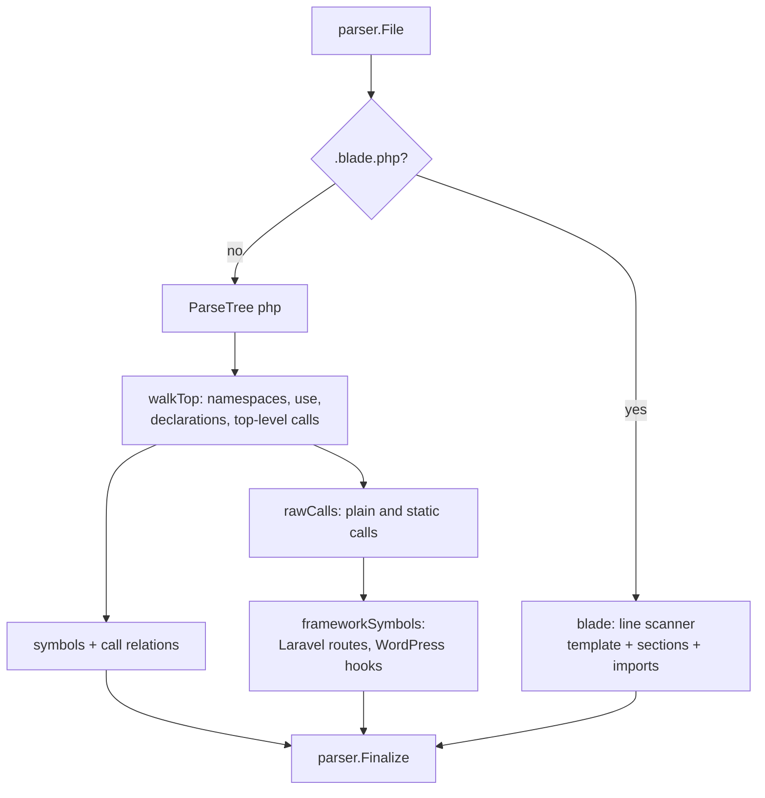

[RagCode](../../README.md) › [parser](../README.md) › php

# PHP and Blade Analyzer

The `php` package turns PHP files into `parser.Symbol` values (classes,
interfaces, traits, enums, functions, methods, constants, properties) and
derives two framework symbol kinds from call shapes: Laravel routes and
WordPress hooks. Blade views (`.blade.php`) are handled by a separate line
scanner in the same package.

PHP files use the tree-sitter `php` grammar. Every name is resolved through
the file's own namespace and `use` import table at parse time; the analyzer
keeps no state between files.

## Where it sits

- **Registered** from `init()`; the binary pulls it in through a blank import
  in [`internal/app`](../../internal/app/README.md).
- **Called** by [`index`](../../index/README.md) and
  [`tools`](../../tools/README.md) through `parser.Analyze`. The registry's
  longest-extension match sends `x.blade.php` to this analyzer as a Blade
  file.
- **Calls** the tree-sitter helpers and `Finalize` from
  [parser](../README.md). No file system access.

| Property | Value |
|----------|-------|
| Language | `php` (also for Blade views) |
| Extensions | `.php`, `.blade.php` |



## Qualified names

`Module` is the namespace with its backslashes (`App\Http\Controllers`); the
owner and name are joined with `.`. So `App\Http\Controllers\UserController::show`
is stored as `App\Http\Controllers.UserController.show`.
`parser.Normalize` makes both spellings compare equal. Files in the global
namespace have module `""`.

Both namespace forms are supported: `namespace X;` (applies until the next
namespace statement) and braced `namespace X { ... }` (scoped to its block).
Each namespace starts a fresh import table.

### Import table

| Statement | Effect |
|-----------|--------|
| `use App\Models\User;` | class alias `User` -> `App\Models\User` |
| `use Illuminate\Http\Request as Req;` | class alias `Req` |
| `use App\Services\{Mailer, Logger as Log};` | group use, one alias per clause |
| `use function App\Helpers\format_name;` | function alias |
| `use const App\Helpers\MAX_ITEMS;` | ignored (constants are never relation targets) |

Name resolution follows PHP: a leading `\` is fully qualified,
`namespace\X` is relative to the current namespace, a qualified name
(`Sub\X`) resolves its first segment through the class table, an unqualified
name goes through the class or function table and otherwise falls into the
current namespace. `self` / `static` resolve to the enclosing class;
`parent` resolves to nothing.

## Symbols extracted

| Construct | Kind | Owner | Exported |
|-----------|------|-------|----------|
| `class`, `trait`, `enum` (also a reserved-word name such as `Object`, recovered from the parse error) | `class` | | yes |
| `interface` | `interface` | | yes |
| Method | `method` | class name | no `private`/`protected` modifier |
| Constructor-promoted parameter (`private Mailer $mailer`) | `variable` | class name | by its modifier |
| Property (`$name`, stored without `$`) | `variable` | class name | by its modifier |
| Class constant | `constant` | class name | by its modifier |
| Enum `case` | `constant` | enum name | yes |
| Top-level `function` | `function` | | yes |
| Top-level `const X = ...` | `constant` | | yes |
| Top-level `define('NAME', ...)` | `constant` (module `""`: `define()` always creates a global constant, even inside a namespace) | | yes |
| `Route::get('/users', ...)` | `route` | enclosing symbol name | yes |
| `add_action('init', ...)` / `add_filter(...)` | `hook` | enclosing symbol name | yes |

- **Signature** is the declaration header after any attributes, up to the
  body, without a trailing `;`, collapsed to one line. The content keeps the
  attributes.
- **Doc** is the run of comments directly above the declaration, with
  `/**`, `/*`, `//`, `#` and `*` markers removed.
- Anonymous classes are skipped; their calls do not count toward the
  enclosing method.

### Example

```php
<?php
namespace App\Http\Controllers;

use App\Models\User;

final class UserController extends Controller
{
    public static function show(int $id)
    {
        $user = User::find($id);
        $this->validate($id);
    }
}

Route::get('/users', [UserController::class, 'index']);
add_action('init', 'my_init');
```

| Qualified name | Kind | Owner |
|----------------|------|-------|
| `App\Http\Controllers.UserController` | `class` | |
| `App\Http\Controllers.UserController.show` | `method` | `UserController` |
| `App\Http\Controllers./users` | `route` | |
| `App\Http\Controllers.init` | `hook` | |

Relations: `UserController` extends `Controller` ->
`App\Http\Controllers.Controller`; `show` calls `find` ->
`App\Models.User.find` and `validate` ->
`App\Http\Controllers.UserController.validate`.

## Relations extracted

| Source construct | Relation | Target qualified name |
|------------------|----------|-----------------------|
| `extends Base` | `extends` | Resolved through the class table. |
| `implements I, \J` | `implements` | Same. |
| `use TraitA, TraitB;` inside a class | `uses_type` | Same. |
| `new Foo()` | `uses_type` | Same; `new $cls` and `new class {}` are skipped. |
| Parameter and return type declarations (`Webpage $m`, `?\App\User`, `A\|B`, `): View`) of functions and methods | `uses_type` | Same; scalar types and `self` / `static` / `parent` are skipped. |
| A property's type (`private ?Dispatcher $d`), on the property symbol | `uses_type` | Same. |
| `Foo::class` in a function or method body or a property's default value (`$casts`, `$middleware`) | `uses_type` | Same; `self::class`, `static::class` and `parent::class` are skipped. |
| `$this->hasMany('App\Post')` and the other Eloquent relations (`hasOne`, `belongsTo`, `belongsToMany`, `morphOne`, `morphMany`, `morphToMany`, `morphedByMany`, and the second model of `hasOneThrough` / `hasManyThrough`) naming the model as a string | `uses_type` (besides the `call`) | The string, read as fully qualified as PHP does. |
| Strings naming classes in a `$listen` property (`'App\Events\E' => ['App\Listeners\L']`, Laravel's event map) | `uses_type` | Same; only strings with a `\`, single- or double-quoted. |
| `Foo::bar()`, `self::bar()`, `static::bar()` | `call` | `<class FQN>.bar`; `parent::bar()` has an empty target. |
| `$this->m()` / `$this?->m()` | `call` | `<namespace>.<Owner>.m`; when the class does not define `m`, the indexer looks in the classes and traits it declares (`extends`, `implements`, `use`), one level. |
| `$p->m()`, `$this->x->m()`, `$this->x?->m()` where `$p` is a parameter declared with one class (`Request $p`, `?Mailer $p`) or `x` a property declared with one class, a constructor-promoted parameter, or a property the constructor assigns from such a parameter (`$this->repo = $repo`) | `call` | `<class FQN>.m`; a class outside the workspace (`Illuminate\Http\Request`) leaves the call unresolved instead of matching a workspace method by name. |
| `$obj->m()` on anything else | `call` | `""` (receiver type unknown) |
| `fn()` | `call` | Through the function table. Inside a namespace, an unqualified function that is not imported gets an empty target: PHP falls back to the global function at runtime, so the namespace would only be a guess and the indexer resolves it by name instead. |
| `view('users.show', ...)`, `View::make('users.show')`, and in a class method `->view('emails.x')` / `->markdown('emails.x')` on any receiver (a Mailable's `$this->view(...)`, a `MailMessage`, `response()->view(...)`) | `imports` (besides the `call`) | The view name as written, which is the qualified name of `resources/views/users/show.blade.php`; a dynamic name or a package view (`mail::message`) gives none. |

Calls inside closures and arrow functions count toward the enclosing function
or method. For receiver types, a closure or arrow function parameter shadows
the outer variable of the same name, typed or not (`function (Sms $s)` inside
`f(Mailer $s)` calls `Sms` methods; an untyped `$s` is unknown); a closure
sees the outer variables it lists in `use (...)` and `$this` properties, an
arrow function every outer variable it does not redeclare. Dynamic calls
(`$fn()`) are skipped.

## Framework handling

Framework symbols are derived from the calls collected while walking; the
call shape is the only evidence, there is no project detection. The symbol
name is the first argument (the second for `Route::match`, after the method
list), and only when it is a plain string literal: `add_action($tag, 'cb')`,
`add_filter('p_' . $tag, 'cb')`, `"x_{$tag}"` and `Route::get($uri, 'C@m')`
produce no symbol, so the callback string never becomes a hook or route name.
A string literal is read with PHP's escapes for class names: `\\` is one
backslash (`'App\\User'` and `"App\\User"` name `App\User`), and `\'` a
quote in single quotes; other double-quoted escapes are kept as written.

| Framework | Call shape | Kind | Metadata |
|-----------|-----------|------|----------|
| Laravel | `Route::get/post/put/patch/delete/options/any/match/resource/apiResource/view/redirect/group(...)`, where the receiver is written `Route` or resolves to `Illuminate\Support\Facades\Route` | `route` | `framework=laravel`, `method=<name>` |
| WordPress | `add_action(...)` / `add_filter(...)` as plain function calls | `hook` | `framework=wordpress`, `kind=action` or `filter` |

The symbol's content is the call expression and its signature is the call's
first line. Its owner is the `Name` of the function or method the call sits
in (`""` at top level), so `add_action('init', ...)` inside `function
free_fn()` becomes `<namespace>.free_fn.init`.

### Route groups and handlers

A route inside `Route::group(['prefix' => 'admin', 'namespace' => 'Backend'], fn)`
or `Route::prefix('admin')->namespace('Backend')->...->group(fn)` (nested
groups too) is named with the group prefixes joined by `/` before its URI.
The name is the path Laravel registers: each prefix and the URI trimmed of
`/`, joined with one `/`, a leading `/` added, the root is `/`.
`Route::get('/users', ...)` and `Route::get('users', ...)` inside the `admin`
group are both the route `/admin/users`, and outside any group both are
`/users`.

The argument after the URI gives the route one relation to its handler:

| Handler | Relation | Target qualified name |
|---------|----------|-----------------------|
| `'C@m'`, `['as' => ..., 'uses' => 'C@m']` | `call` `m` | `<group namespaces>\C` + `.m`, without the application's controller namespace (`App\Http\Controllers`, set in another file), so the indexer links it as a qualified suffix (`by_name` in the tools, but only that controller). A leading `\` makes `C` fully qualified. |
| `[C::class, 'm']`, also under `'uses'` | `call` `m` | `C` resolved through the import table, `.m` (exact) |
| `C::class` or `'C'` (invokable controller, `resource`, `apiResource`) | `uses_type` `C` | the class, as above |
| `Route::view('/about', 'pages.about')` | `imports` | the view name, which is the template's qualified name |

A closure handler, `Route::redirect` and a string that is not a class name
(`'/home'`) give no relation.

## Blade views

`.blade.php` files are not parsed with tree-sitter. `blade.go` scans them line
by line with regular expressions.

| Output | Details |
|--------|---------|
| One `template` symbol for the file | Name = file name without `.blade.php`; module = the dotted directory below the last `views` folder in the path (`resources/views/users/show.blade.php` -> module `users`, qualified name `users.show`). Content is the whole file. It ends on the last line; a final newline does not add an empty line. |
| `@livewire('likes')`, `<livewire:likes>`, `<livewire:forum.post-list>` | An `imports` relation to the view `livewire.likes` and a `uses_type` relation to the class Livewire 3 maps the name to, `App\Livewire\Likes` (`App\Livewire\Forum\PostList`), so `rag_find_usages` of the component class or of its view lists the tag. A component kept elsewhere (`App\Http\Livewire` of Livewire 2, a custom namespace, a package) gets no class link. |
| One `template` symbol per `@section('x')`, `@component('x')`, `@livewire('x')` | Owner = the view name. `@section` without a second argument and `@component` stay open until a closing directive (`@endsection`, `@endcomponent`, `@stop`, `@show`, `@append`, `@overwrite`); open blocks form a stack, so a closing directive ends the innermost one and a `@component` nested in a `@section` does not take the section's end. The inline `@section('x', 'v')` form and `@livewire` are one line. |
| `imports` relation on the file symbol | For `@extends`, `@include`, `@includeIf`, `@each`, `@component`; the target qualified name is the view name as written (`layouts.app`), which matches the qualified name of `resources/views/layouts/app.blade.php`. A component tag `<x-alert>` or `<x-forms.input>` imports `components.alert` / `components.forms.input` (the anonymous component view, which is also the view of a class component); `<x-slot>`, `<x-dynamic-component>` and package components (`<x-mail::button>`) give none. |

Directives inside `{{-- --}}` comments, also over several lines, are
ignored; the symbols' content keeps them.

A view outside any `views` folder has module `""`.

## Known limitations visible in the code

- A file with syntax errors that yields no symbol while a `class` or function
  keyword sits inside the broken part (a class whose method has unclosed
  brackets) is an error (`syntax errors left no declaration`): a failed file,
  not an empty one. When some symbols survive they are kept, without an
  error, and the ones after the break may be missing.
- `X::class` and class-name strings in file-level code (`config/app.php`
  provider lists, a `database/` seeder array outside a method) are not
  usages, because a relation needs an owning symbol (see below). A class
  named in a string anywhere else (`app('App\Svc')`, a `$routeMiddleware`
  string) is not a usage either.
- A class component `<x-alert>` is linked to its view, not to its class
  (`App\View\Components\Alert`), and a component whose class renders
  another view is linked to `components.<name>` anyway.
- `define('X', ...)` becomes a constant only at file level (also in a
  namespace or a top-level closure); inside a named function or method it
  produces no symbol.
- A route group's `'as' => 'admin.'` name prefix and a route's name
  (`'as' => 'x'`, `->name('x')`) are not stored, so `route('x')` is not a
  usage of the route. Routes registered inside a method (a
  `RouteServiceProvider` mapping) are not placed in the groups of another
  file, and `Route::controller(C::class)->group(...)` does not give the
  routes inside it their controller.
- A static call to a member a class inherits from outside the workspace
  (`Authority::all()` on an Eloquent model) is not a usage of the class.
- Receiver types come only from declarations (typed parameters and
  properties, see Relations): `$x = new Foo(); $x->m()`, a local
  assigned from a call, an untyped or union-typed parameter or property,
  and a parameter reassigned in the body (it keeps its declared class) are
  not followed.
- A named function, class, interface, trait or enum declared inside a
  function or method body is not emitted as a symbol.
- Route and hook symbols inside a method take the method's name as owner,
  not the class.
- `do_action` / `apply_filters` and chained route calls (`->name(...)`,
  `->middleware(...)`) are not turned into symbols.
- `Route::group([...], fn)` has no string argument and produces no symbol
  of its own; it only prefixes the routes inside it.
- A Blade closing directive ends the innermost open block whatever its kind.
- File-level code is never a usage, because a relation needs an owning
  symbol: calls and `new X()` at the bottom of a class file, template or page
  files, and top-level closures (`add_action('plugins_loaded', function () {
  new Health_Check(); })`).
- WordPress callbacks given as `array($this, 'm')`, `array('Cls', 'm')` or a
  `'fn'` string are not usages of the method or function.
- PHP function and method names are case-insensitive, but they are matched
  case-sensitively.
- When an interface and a trait used by the class both declare `m`,
  `$this->m()` stays unresolved, although the trait body is the
  implementation.

## Files

| File | Contents |
|------|----------|
| `php.go` | The analyzer and registration, the collector (namespace, import tables, symbols, raw calls), `use` handling, PHP name resolution, declarations (classes, interfaces, traits, enums, functions, methods, properties, constants, promoted parameters, `define()`), signature and doc extraction, call relations. |
| `framework.go` | `frameworkSymbols`: Laravel route and WordPress hook symbols from the collected calls; route group prefixes and namespaces (`routeInfo`, `fluentGroup`) and the route handler relation (`route`, `handler`). |
| `blade.go` | The Blade line scanner (`blade`) and the view module rule (`viewModule`). |

### Tests

| File | Covers |
|------|--------|
| `php_test.go` | Registration of both extensions; a controller fixture with group/function/const `use`, attributes, traits, enums, promoted properties, closures, anonymous classes, routes and hooks (kinds, owners, lines, docs, signatures, metadata, relation targets); `define()` inside a namespace is global; hook and route names only from a plain string literal in the name position; a plugin with braced namespaces and parse-error recovery; malformed input; global-namespace function calls; concurrency; parameter and return type uses; a class named with a reserved word (`class Object extends Base`) keeping its name and base (`TestReservedClassName`); the line of a `->` chain call split over lines (`TestChainedCallLine`). |
| `blade_test.go` | A Blade view with sections, components and includes; `<x-...>` tag components and directives inside `{{-- --}}` comments (`TestBladeTagComponentsAndComments`); a view outside a `views` folder; the file symbol's end line with a trailing newline; a `@component` nested in a `@section`. |
| `laravel_test.go` | Laravel route groups (array and fluent, nested, namespace) and handler relations (`C@m`, `uses`, `[C::class, m]`, invokable, resource, `Route::view`); `view()` / `View::make()` importing the template, not for a dynamic or package view name; a Mailable's `$this->view()` / `->markdown()` importing it (`TestMailableViewImportsTemplate`); `X::class`, property types, Eloquent relation strings and the `$listen` map as `uses_type` (`TestLaravelClassReferences`); escaped class strings (`'App\\User'`, `'App\\Controller@show'`) in Eloquent relations and route handlers (`TestEscapedClassStrings`); a double-quoted `$listen` map (`TestDoubleQuotedListenMap`); calls on typed parameters, typed, promoted and constructor-assigned properties (`TestTypedReceivers`); closure and arrow function parameters shadowing an outer typed parameter, `use (...)` and arrow functions seeing it (`TestClosureReceiverScope`). |
| `zz_verify_test.go` | Verification tests: name resolution, global-namespace WordPress code, robustness, a routes file, multiple namespaces in one file, Blade layouts, no shared state between calls. |

## Testing

```bash
go test ./parser/php/
```

No build tags or external services.

## See also

- [parser](../README.md): symbol model, `Normalize`, registry
- [index](../../index/README.md): resolves targets workspace-wide (falls back to the method name for inherited `$this->m()` calls)
- Other analyzers: [javascript](../javascript/README.md), [web](../web/README.md)
