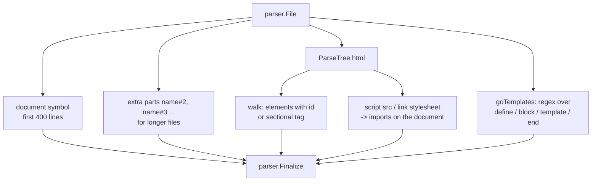

[RagCode](../../README.md) › [parser](../README.md) › web

# HTML and Go Template Analyzer

The `web` package indexes HTML pages and Go `html/template` / `text/template`
files. It produces a document symbol per file, a symbol per element that has
an `id` or is a sectional tag (`header`, `nav`, `main`, ...), a symbol per Go
template `{{define}}` / `{{block}}`, and relations for linked scripts and
stylesheets and for `{{template "x"}}` calls.

HTML is parsed with the tree-sitter `html` grammar; Go template actions are
found with a regular expression over the raw source. Every symbol has kind
`template`.

Stylesheets are deliberately **not** indexed: the package doc notes that a
large one cost hundreds of MB to parse and its selectors are of no use to code
search. Only the HTML analyzer is registered.

## Where it sits

- **Registered** from `init()`; the binary pulls it in through a blank import
  in [`internal/app`](../../internal/app/README.md).
- **Called** by [`index`](../../index/README.md) and
  [`tools`](../../tools/README.md) through `parser.Analyze`.
- **Calls** the tree-sitter helpers, `RelModule` and `Finalize` from
  [parser](../README.md). No file system access.

| Property | Value |
|----------|-------|
| Language | `html` |
| Extensions | `.html`, `.htm`, `.gohtml`, `.tmpl`, `.tpl` |

`Module` is the file path relative to the workspace root without extension
(`web/shop/cart`); a file outside the root uses its stem.

## How a file is analyzed



## Symbols extracted

| Symbol | Name | Owner | Content / signature |
|--------|------|-------|---------------------|
| Document | file stem | | First 400 lines. Signature = text of the first `<title>`; doc = a leading comment. |
| Document part | `stem#2`, `stem#3`, ... | | Each further 400-line window of a long file, so the whole text stays searchable. |
| Sectional element (`header`, `nav`, `main`, `section`, `article`, `aside`, `footer`, `form`, `dialog`, `template`) | tag, or `tag#id` when it has an id | nearest enclosing sectional element | Element source (capped at 400 lines); signature = the start tag; doc = a comment right before it. |
| Any other element with an `id` | the id | nearest enclosing sectional element | Same. |
| `{{define "x"}}` / `{{block "x" .}}` | `x` | | Source from the action to its matching `{{end}}`; signature = the opening action. Unterminated scopes run to the end of the file. |

Elements inside a sectional element are owned by it; ids on non-sectional
elements do not own their children. The owner is only the short name of the
nearest sectional element, not a full path: `<header id="top"><nav><a
id="home">` gives `<module>.header#top`, `<module>.header#top.nav` and
`<module>.nav.home`. `<style>` contents and inline `<script>`
bodies are not parsed. A file emits at most 2000 symbols.

### Example

File `/ws/web/shop/cart.html`:

```html
<head>
  <link rel="stylesheet" href="../../assets/css/shop.css">
  <script type="module" src="./cart.js"></script>
</head>
<body>
  <div id="toolbar"><button id="buy">Buy</button></div>
  <aside id="side"><nav id="menu"></nav></aside>
  <section>{{template "price" .}}{{template "missing" .}}</section>
</body>
{{define "price"}}<span id="p">{{.Price}}</span>{{end}}
```

| Qualified name | Owner |
|----------------|-------|
| `web/shop/cart.cart` (document) | |
| `web/shop/cart.toolbar` | |
| `web/shop/cart.buy` | |
| `web/shop/cart.aside#side` | |
| `web/shop/cart.aside#side.nav#menu` | `aside#side` |
| `web/shop/cart.section` | |
| `web/shop/cart.price` (define) | |
| `web/shop/cart.p` | |

Relations on the document: imports `../../assets/css/shop.css` ->
`assets/css/shop`, imports `./cart.js` -> `web/shop/cart`; call `price` ->
`web/shop/cart.price`; call `missing` -> `""` (not defined in this file).

## Relations extracted

| Source construct | Relation | Attached to | Target qualified name |
|------------------|----------|-------------|-----------------------|
| `<script src="...">` | `imports` | document | Module of the referenced file |
| `<link rel="stylesheet" href="...">` | `imports` | document | Same |
| `{{template "x" ...}}` | `call` | innermost enclosing `define`/`block`, else the document | `<module>.x` when `x` is defined or blocked in the same file, else `""` |

References are resolved relative to the file's directory, ignoring `?query`
and `#fragment`. Absolute paths (`/x`), URLs (anything with `:`) and paths
that leave the workspace root give an empty target.

## Known limitations visible in the code

- Two sectional elements without an `id` and with the same tag under the same
  owner in one file (two plain `<section>`s) get the same qualified name, so
  they are one symbol (twins: the widest is the target).
- Hugo `{{ partial "x.html" }}` is not tracked; only `{{ template }}` is.
- Inline `<script>` blocks are not parsed: their functions are not symbols and
  their calls are not usages.
- `{{template}}` calls to templates defined in other files are unresolved at
  parse time (the target name is still recorded).
- Go template actions are matched by regex on the whole file, also outside
  HTML markup; only `define`, `block`, `template`, `range`, `if`, `with` and
  `end` are tracked.
- `.css`, `.scss`, `.sass` and `.less` files are not analyzed (the tests
  assert that no analyzer is registered for them).

## Files

| File | Contents |
|------|----------|
| `web.go` | Package doc, limits (2000 symbols per file, 400 content lines), registration, shared helpers: module and reference resolution (`moduleName`, `refModule`), comment trimming, line capping, a byte-offset-to-line index. Also holds `capRunes` and `exportedName`, which nothing calls. |
| `html.go` | The HTML analyzer: document and part symbols, element walk with sectional ownership, start-tag attribute parsing, script/stylesheet imports, and the Go template action scanner (`goTemplates`). |

### Tests

| File | Covers |
|------|--------|
| `web_test.go` | An HTML page (title, imports, ids, sectional ownership, comments as doc), a Go template file (`define`, `block`, nested `range`, calls), splitting of long documents, module names and reference resolution, malformed input, the symbol cap, registration (and no analyzer for stylesheets), concurrency, a void element (`<input>`) spanning its own tag only. |
| `zz_verify_test.go` | Verification tests: a fresh HTML + Go template fixture (ownership, imports, defined and missing templates, `<style>` not indexed), and malformed or binary input that must neither panic nor hang. |

## Testing

```bash
go test ./parser/web/
```

No build tags or external services.

## See also

- [parser](../README.md): symbol model, qualified names, registry
- [javascript](../javascript/README.md): analyzes the scripts an HTML page links
- [docs](../docs/README.md): the other non-code analyzer
