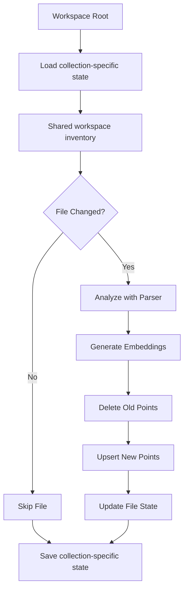

# Indexer Module

The `indexer` package providing **intelligent workspace indexing**, leveraging file-level state tracking (Embedding Cache) to perform lightning-fast incremental updates and minimize redundant LLM operations.

## 🎯 Objectives

The indexer ensures:
- **Change Detection**: Track file modification times and sizes to identify exactly what needs re-indexing.
- **Incremental Updates**: Only process new or modified files, drastically reducing token usage and processing time.
- **Batch Processing**: Optimize database performance by batching vector upsert operations.
- **Shared Workspace Scan**: Walk the tree once per full workspace run, sharing per-language file lists and progress totals across collections.
- **State Persistence**: Maintain one `.ragcode/state-<collection-hash>.json` per branch/language collection.
- **Metadata Management**: Properly tag each indexed chunk with file paths, package names, and symbol types.

Upgrade note: the former shared `.ragcode/state.json` cannot be assigned safely to a branch collection. It is removed on the first indexing run, which performs one full reindex for each collection.

---

## 📊 Data Flow



---

## 🏗️ Package Structure

*   **state.go**: Manages collection-specific file modification snapshots.
*   **service.go**: Main orchestrator that implements the high-level `IndexWorkspace` and `IndexFile` operations.

---

## 🔍 Key Types

### State (Persistent Index Metadata)
```go
type State struct {
    Files map[string]FileState // Path -> modification snapshot
}

type FileState struct {
    Path    string
    ModTime time.Time
    Size    int64
}
```

### Options
```go
type Options struct {
    ExcludePatterns []string // Directories to skip (e.g. node_modules)
    Recreate        bool     // Force a full clean index
}
```

---

## 🔄 Indexing Workflow

The engine calls `ScanWorkspace` once and passes the inventory through
`Options.Scan` to every language collection. Source languages are indexed first,
then `docs` (Markdown, JSON, YAML, etc.), then `generic` text/data. Within each
group, languages with more files go first; ties are ordered by name.

Each collection checks current file metadata before choosing changed files.
When enabled, the filesystem watcher starts before inventory collection. Events
received during indexing are queued and replayed in a follow-up incremental job
after collection states are saved, including for synchronous engine calls.
An imported directory triggers rediscovery with the usual exclusions, and its
subdirectories are watched recursively so later edits are detected too.
Without a watcher, files created after discovery are picked up by the next run.
The inventory is never reused between runs. Direct indexer `IndexWorkspace`
callers can omit `Options.Scan` to scan normally.

Directory exclusions prune traversal before entering a subtree. To skip a data
directory such as `lucrari/`, add its name to the existing
`workspace.exclude_patterns` list in the server configuration, retaining any
other exclusions you need:

```yaml
workspace:
  exclude_patterns:
    - node_modules
    - .git
    - vendor
    - target
    - build
    - dist
    - .venv
    - lucrari
```

This configuration applies to all workspaces served by that server instance.
`lucrari` is deliberately not a built-in exclusion: some projects use that name
for source code or documentation. A plain directory name also works with the
filesystem watcher; scanner exclusions additionally support relative paths and
`filepath.Match` globs, without Git ignore negation or recursive `**` semantics.

### Scenario 1: Initial Indexing
- No collection-specific state exists.
- All supported files are analyzed and embedded.
- Full collection-specific state is generated.

### Scenario 2: Incremental Run (Minor Change)
- The collection-specific state is loaded.
- 1000 files scanned, only 1 file modified.
- `Indexer` deletes only the points related to that 1 file from the database.
- Only the 1 file is analyzed and sent to Ollama/OpenAI.
- Process completes in seconds rather than minutes.

---

## 🚀 Usage Examples

### Indexing a Workspace
```go
indexerSvc := indexer.NewService(llmProvider, vectorStore)

err := indexerSvc.IndexWorkspace(
    ctx,
    "/home/user/project",
    "ragcode-myproject-go",
    indexer.Options{
        ExcludePatterns: []string{"vendor"},
        Recreate:        false,
    },
)
```

---

## ✅ Integration Points

- **Engine**: The high-level orchestrator that triggers indexing based on workspace resolution or file system events.
- **Storage**: The `VectorStore` interface used to persist and clean up code segments.
- **Parser**: Used to extract meaningful symbols and docstrings from source files.
- **LLM**: Used to generate vector embeddings for the extracted code chunks.
