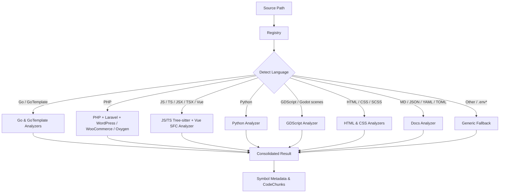

# RagCode Parser System (V2)

The `parser` package is the core engine of RagCode's code analysis capabilities. It provides a unified interface and a registry-based system to extract structured information (symbols, documentation, relationships) from programming, template, stylesheet, and documentation languages.

## 🏗️ Architecture Overview

The system is built on a modular, plug-and-play architecture where each language-specific analyzer registers itself with a central registry.



## 🛠️ Main Interface: `Analyzer`

All language parsers implement the interface defined in `parser.go`:

```go
type Analyzer interface {
	// Name returns the analyzer name (e.g., "go", "php", "javascript", "python").
	Name() string

	// CanHandle returns true if the analyzer supports the given file path/extension.
	CanHandle(filePath string) bool

	// Analyze extracts symbols and relations from a file or directory.
	Analyze(ctx context.Context, path string) (*Result, error)
}
```

## 📂 Supported Languages & Frameworks

Click on each language/framework to see the technical documentation for its analyzer:

| Language / Framework | Directory | Description | Status |
|----------------------|-----------|-------------|--------|
| **Go** | [`/go`](./go/README.md) | Native `go/ast` & `go/doc` parsing (functions, methods, structs, interfaces, generics, typed `iota` enums). | ✅ Production |
| **PHP** | [`/php`](./php/README.md) | Full PHP 8+ AST (`classes`, `interfaces`, `traits`, `enums`, attributes, union/intersection types, group `use`). | ✅ Production |
| **Laravel & Blade** | [`/php/laravel`](./php/laravel/README.md) | Eloquent models & relations, controllers, routes (`web`/`api`/fluent groups/`apiResource`), migrations, middleware, service providers, Blade templates. | ✅ Production |
| **WordPress, WooCommerce & Oxygen** | [`/php/wordpress`](./php/wordpress/README.md) | Hooks (`add_action`/`add_filter`/`do_action`/`apply_filters`), CPTs, taxonomies, shortcodes, Gutenberg blocks, widgets, admin/REST, **WooCommerce**, **Oxygen Builder**. | ✅ Production |
| **JavaScript / TypeScript / React / Vue** | [`/javascript`](./javascript/README.md) | Tree-sitter AST for `.js`/`.ts`/`.jsx`/`.tsx` (React components, classes, abstract classes, interfaces, type aliases, enums) + Vue `.vue` SFCs (Options & `<script setup>` Composition API, composables). | ✅ Production |
| **Python** | [`/python`](./python/README.md) | Classes, methods, async functions, multi-line signatures, decorators, type hints, mixins, metaclasses. | ✅ Production |
| **GDScript (Godot)** | [`/gdscript`](./gdscript/README.md) | Tree-sitter AST for `.gd` (script classes, `class_name`/`extends`, methods, signals, enums, `@export`/`@onready` vars, inner classes, `##` docs; Godot 4 & 3) + `.tscn` scene outlines (node tree, attached scripts, signal connections). | ✅ Production |
| **HTML & Go Templates** | [`/html`](./html/README.md) | Semantic HTML section/element extraction + Go `html/template` & `text/template` blocks (`define`, `block`, `template`, `range`, `with`). | ✅ Production |
| **CSS / SCSS / LESS** | [`/css`](./css/README.md) | Rulesets, selectors, `@media`, `@keyframes`, CSS custom properties (`--var`), SCSS/LESS variables and `@mixin`. | ✅ Production |
| **Docs (MD / JSON / YAML / TOML)** | [`/docs`](./docs/README.md) | Markdown heading hierarchy (with code blocks & tables) + structured JSON/YAML/TOML/XML chunking. | ✅ Production |
| **Generic & Config** | [`/generic`](./generic/README.md) | Universal fallback for Shell, SQL, Dockerfile, Makefile, `.env*` (`.env`, `.env.local`, `.env.example`, etc.), Ruby, Rust, Java, C/C++. | ✅ Production |

## 🚀 Unified Symbol Model

Every analyzer returns a `Symbol` structure, ensuring that the embedding and indexing pipeline remains language-agnostic:

| Field | Type | Description |
|-------|------|-------------|
| `Name` | `string` | Identifier name (e.g., function name, class name, hook name, route URI). |
| `QualifiedName` | `string` | Package/namespace/class-qualified symbol name. |
| `Type` | `SymbolType` | Kind of symbol (`function`, `method`, `class`, `struct`, `interface`, `trait`, `enum`, `constant`, `section`, etc.). |
| `Signature` | `string` | Complete symbol signature or header definition. |
| `Docstring` | `string` | Extracted doc comments (GoDoc, PHPDoc, JSDoc, Python docstrings, GDScript `##` comments). |
| `Metadata` | `map[string]any` | Language/framework-specific attributes (`relations`, `hook_type`, `http_method`, `props`, etc.). |
