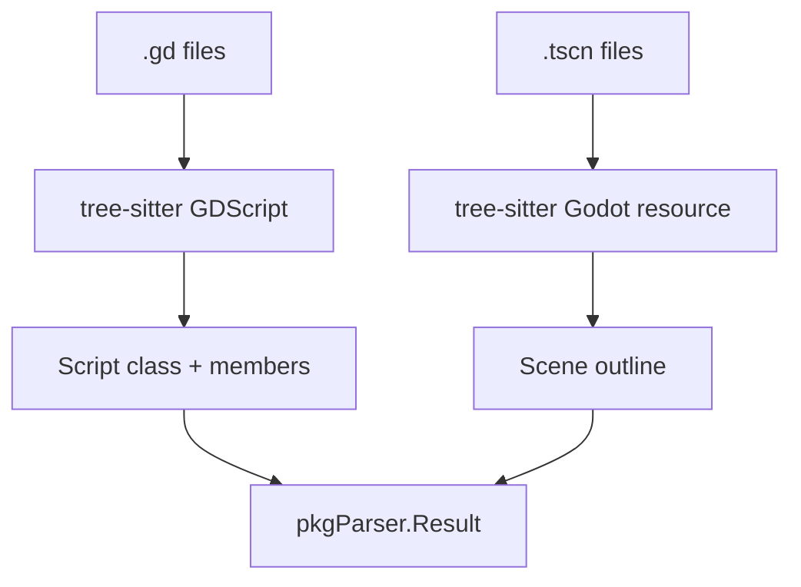

# GDScript Parser (Godot)

The `gdscript` package implements a source code analyzer for **Godot** projects. It parses **GDScript** (`.gd`) with the tree-sitter GDScript grammar and outlines text scenes (`.tscn`) with the Godot resource grammar, both bundled in `gotreesitter`. Godot 4 and Godot 3 syntax are supported.

## 🎯 Objectives

Every GDScript file is a class. The analyzer emits that class first, then its members, so semantic search, `rag_find_usages` and `rag_call_hierarchy` work on Godot code the same way they do on Python or PHP.

### Extracted Symbols:
1.  **Script class**: named by `class_name`, or by the file name when there is none. Records `extends` (a class or a `"res://..."` script path), `@tool`, and the script's `##` documentation.
2.  **Methods**: every `func`, including `static func`, with its signature, `##` doc comment, annotations (`@rpc`, ...) and the calls it makes.
3.  **Signals**: `signal` declarations (type `signal`).
4.  **Enums**: named enums (type `enum`, with their values); an unnamed `enum { A, B }` declares class constants.
5.  **Constants and variables**: `const` and class-level `var`, with `@export` / `@onready` (or Godot 3 `export` / `onready`), `static`, type, and `setget`.
6.  **Inner classes**: `class Name extends Base:` with their own members, qualified as `Outer.Inner.member`.
7.  **Scenes** (`.tscn`): one `scene` symbol per file with the node tree, attached scripts, instanced sub-scenes, groups and signal connections.

---

## 📊 Data Flow



---

## 🏗️ Package Structure

*   `analyzer.go`: Implements the `parser.Analyzer` interface, registers it, and caches one tree-sitter parser per grammar.
*   `script.go`: GDScript extraction (classes, members, doc comments, relations).
*   `scene.go`: `.tscn` extraction (nodes, scripts, instances, connections).
*   `analyzer_test.go`: Unit tests for Godot 4 and Godot 3 scripts and scenes.

---

## 🔗 Relations

| Source | Relation |
|--------|----------|
| `extends Base` / `extends "res://base.gd"` | `inheritance` to `Base` / `base` |
| `foo()` | `calls` `foo`, resolved by name (an implicit call on the script) |
| `self.foo()` | `calls` `foo` with qualified target `<Class>.foo` |
| `super.foo()` | `calls` `foo` with qualified target `<Base>.foo` |
| `Utils.foo()` | `calls` `foo` with qualified target `Utils.foo` (a `class_name`) |
| `node.foo()` | `calls` `foo` with receiver `node`, left unresolved |
| `died.emit()`, `emit_signal("died")` | `calls` the signal `died` |
| `pressed.connect(_on_pressed)`, `connect("pressed", self, "_on_pressed")` | `calls` the handler `_on_pressed` |
| Typed parameters, return types, `var x: Weapon`, `Weapon.new()` | `uses_type` (built-in types such as `int` or `Vector2` are skipped) |
| Scene node `script = ExtResource(...)`, instanced scene | `dependency` on the script / scene file name |
| Scene `[connection ... method="_on_x"]` | `calls` `_on_x`, so a handler's usages include the scenes that wire it |

---

## 🔍 Extraction Example

### GDScript Source Code:
```gdscript
class_name Player
extends CharacterBody2D

## Moves the player.
static func create() -> Player:
	return Player.new()
```

### Result (Symbol Metadata):
| Field | Value |
|------|---------|
| `Name` | `"create"` |
| `QualifiedName` | `"Player.create"` |
| `Type` | `"method"` |
| `Signature` | `"static func create() -> Player"` |
| `Docstring` | `"Moves the player."` |
| `Metadata.class` | `"Player"` |
| `Metadata.is_static` | `true` |

---

## 💻 Usage

```go
import (
    "context"
    "github.com/doITmagic/rag-code-mcp/pkg/parser"
    _ "github.com/doITmagic/rag-code-mcp/pkg/parser/gdscript"
)

func main() {
    analyzer := parser.GetByName("gdscript")
    result, err := analyzer.Analyze(context.Background(), "./game")
    // ... process result.Symbols
}
```

---

## 📋 Godot Particularities

| Element | Extraction Logic |
|---------|---------------------|
| **Workspace** | `project.godot` is a workspace root marker, so a project without VCS is still detected. |
| **Doc comments** | `##` lines directly above a member document it; the first `##` block not attached to a member documents the class. |
| **Editor cache** | `.godot/` and `.import/` are hidden directories and are never indexed. |
| **Scene data** | `.tscn` symbols hold a readable outline, not the serialized resource data, and scenes are exempt from the minified-file check that long embedded-data lines would otherwise trigger. |
| **Not indexed** | `.tres` resources, `.gdshader` and `project.godot` itself. |
