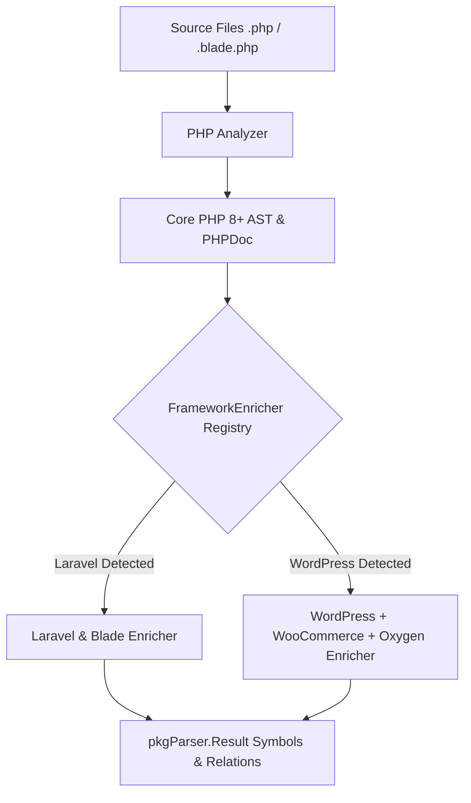

# PHP Parser (`pkg/parser/php`)

The `php` package implements a full **PHP 8+** AST analyzer (powered by `VKCOM/php-parser`) with pluggable `FrameworkEnricher` modules for **Laravel** (including **Blade**) and **WordPress** (including **WooCommerce** and **Oxygen Builder**).

## 🎯 Extracted Symbols

1. **Classes (`class`, `abstract class`, `final class`)**: Namespace, inheritance (`extends`), implemented interfaces (`implements`), trait usage, properties, constants, and methods.
2. **Interfaces (`interface`) & Traits (`trait`)**: Full method and property extraction with file paths, line spans, and PHPDoc comments.
3. **PHP 8.1 Enums (`enum`)**: Backed and unit enums (`StmtEnum`) along with enum cases (`StmtEnumCase`).
4. **Methods & Functions**: Visibility (`public`, `protected`, `private`), `static`/`abstract`/`final` modifiers, PHP 8 attributes (`#[...]`), union (`A|B`), intersection (`A&B`), and nullable (`?T`) types, plus PHPDoc annotations.
5. **Imports (`use`)**: Single and group `use Prefix\{A, B as C};` statements for accurate FQN resolution across classes and framework analyzers.
6. **Framework Enrichers**:
   - **[Laravel (`./laravel`)](./laravel/README.md)**: Eloquent models & relationships, controllers, routes (`web.php`, `api.php`, fluent `Route::...->group()`, `Route::resource`, `Route::apiResource`), migrations, middleware, service providers, and Blade templates (`.blade.php`).
   - **[WordPress (`./wordpress`)](./wordpress/README.md)**: Action & filter hooks (`add_action`, `add_filter`, `do_action`, `apply_filters`), Custom Post Types & taxonomies, shortcodes, Gutenberg blocks, widgets, admin pages & REST API endpoints, plugin headers, **WooCommerce** hooks/templates/API, and **Oxygen Builder** custom elements.

---

## 📊 Data Flow

---

## 🏗️ Package Structure

- `php_analyzer.go`: Implements `parser.Analyzer` and runs registered `FrameworkEnricher` plugins.
- `analyzer.go`: Core AST visitor (`symbolCollector`) for classes, interfaces, traits, enums, functions, constants, group `use` imports, and call graph extraction.
- `phpdoc.go`: PHPDoc parser (`@param`, `@return`, `@var`, `@property`, `@throws`).
- `types.go`: Intermediate PHP AST representations (`PackageInfo`, `ClassInfo`, `InterfaceInfo`, `TraitInfo`, `MethodInfo`, `CodeChunk`).
- [`laravel/`](./laravel/README.md): Laravel & Blade framework analyzer and enricher.
- [`wordpress/`](./wordpress/README.md): WordPress, WooCommerce, and Oxygen Builder analyzer and enricher.
