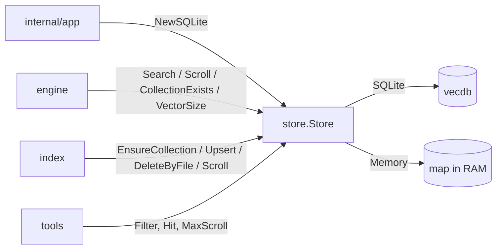

[RagCode](../README.md) › store

# store: the symbol store

`store` keeps the indexed symbols of a workspace and answers two kinds of
questions about them:

- **Search**: "which symbols are closest to this vector?" (semantic search,
  cosine similarity);
- **Scroll**: "which symbols match these exact fields?" (lookups by id, name,
  qualified name, file, directory, module, kind or relation target).

Every point in the store is one [`parser.Symbol`](../parser/README.md) plus its
embedding. The whole symbol is the payload, and the fields the tools filter on
are indexed next to it. Exact lookups are therefore payload filters: nothing is
re-parsed or re-derived at query time.

There is one **collection** per workspace root. The package defines a small
`Store` interface with two implementations: `SQLite` (on disk, used by the
server) and `Memory` (in memory, used by tests).

## Where it sits



| Who | How it uses `store` |
|---|---|
| [internal/app](../internal/app/README.md) | builds `store.NewSQLite(<RAGCODE_HOME>/index)`; tests pass `store.NewMemory()` instead |
| [engine](../engine/README.md) | holds the `Store`, names each workspace collection with `CollectionName(root)`, runs `Search` and `Scroll` for the tools, checks `CollectionExists` and `VectorSize` |
| [index](../index/README.md) | creates the collection, upserts embedded symbols, deletes the symbols of changed or removed files, scrolls to resolve relations across the workspace; `index.Dir` uses `CollectionName` for the per-root data directory |
| [tools](../tools/README.md) | builds `Filter` values and reads `Hit` results through the engine |

What it calls:

| Package | Why |
|---|---|
| [vecdb](../vecdb/README.md) | the embedded SQLite vector database behind `SQLite` |
| [parser](../parser/README.md) | the `Symbol` type, `Normalize` and `MatchQualified` for qualified-name lookups |

## Files

| File | Contents |
|---|---|
| [`store.go`](store.go) | package doc, the `Store` interface, `Item`, `Hit`, `Filter`, `MaxScroll`, `ErrNotFound` |
| [`sqlite.go`](sqlite.go) | `SQLite`, the on-disk implementation on top of `vecdb`; `Reopens` (outside the interface: how often a deleted or replaced `index.db` was reopened, read by the engine to queue a resync); `CollectionName`; the mapping from `Filter` to `vecdb.Cond` and from `Symbol` to indexed fields (`qn_suffixes`, `dir_parts`) |
| [`memory.go`](memory.go) | `Memory`, the in-memory implementation: maps, a brute-force cosine scan and `Filter.matches` |

Tests:

| File | What it covers |
|---|---|
| [`store_test.go`](store_test.go) | `TestStoreContract` runs the same behaviour checks on `Memory` and `SQLite`; `qnSuffixes` and `dirParts` |
| [`memory_test.go`](memory_test.go) | `Memory` filters, search order, collection lifecycle, delete by file, the `MaxScroll` cap and cancelled contexts |
| [`zz_verify_test.go`](zz_verify_test.go) | verification tests that pin parity between both stores: `PathPrefix` as a directory (not a string prefix), empty `QualifiedSuffix`, delete of a missing collection, search limit edges, scroll paging past 256, awkward payload strings, large result pages, mixed-separator qualified names and route paths, an empty path never being a wildcard, overwrite and relative paths; plus `Memory` under a cancelled context and the race detector |

## Key types and functions

### `Store`

```go
type Store interface {
    EnsureCollection(ctx, name string, dim int) (recreated bool, err error)
    CollectionExists(ctx, name string) (bool, error)
    VectorSize(ctx, name string) (int, error)
    DeleteCollection(ctx, name string) error

    Upsert(ctx, collection string, items []Item) error
    DeleteByFile(ctx, collection, filePath string) error

    Search(ctx, collection string, vector []float32, f Filter, limit int) ([]Hit, error)
    Scroll(ctx, collection string, f Filter, limit int) ([]Hit, error)

    Close() error
}
```

| Method | Behaviour |
|---|---|
| `EnsureCollection` | creates the collection when missing. When it exists with another vector size (the embedding model changed), its points are dropped, it is recreated, and `recreated` is `true` |
| `CollectionExists` | never creates anything |
| `VectorSize` | the collection's vector size; `ErrNotFound` when it is missing |
| `DeleteCollection` | removes the collection; `ErrNotFound` when it is missing |
| `Upsert` | inserts or replaces points by `Symbol.ID`; every vector must have the collection's size |
| `DeleteByFile` | removes every symbol whose `file_path` equals the argument. An empty path is refused with an error: it is never a wildcard |
| `Search` | the `limit` nearest symbols by cosine similarity that match `f`, best first, ties broken by id. `limit <= 0` returns no hits |
| `Scroll` | up to `limit` symbols matching `f`, ordered by id, without scores (`Score` is 0). `limit` is capped at `MaxScroll`; a negative limit means `MaxScroll` |

Collection names are opaque to the store; the engine derives them from the
root.

### `Item`, `Hit`

- `Item{Vector, Symbol}`: one point to upsert.
- `Hit{Score, Symbol}`: one result. `Score` is the cosine similarity for
  `Search` and 0 for `Scroll`.

### `Filter`

`Filter` narrows `Search` and `Scroll`. Zero fields are ignored; every set
field must match (AND).

| Field | Type | Matches when |
|---|---|---|
| `IDs` | list | the symbol id is one of these |
| `Language` | single | `language` is equal |
| `FilePath` | single | `file_path` is equal |
| `PathPrefix` | single | the directory is the file's directory or one of its ancestors (not a raw string prefix: `/w/mod` does not cover `/w/models/x.go`) |
| `Name` | single | `name` is equal |
| `QualifiedName` | single | `qualified_name` is equal |
| `QualifiedSuffix` | single | the normalized qualified name equals the value or ends with `"." + value` (the lookup `parser.MatchQualified` does) |
| `Module` | single | `module` is equal |
| `Kinds` | list | the symbol kind is one of these |
| `TargetIDs` | list | any relation of the symbol has one of these `target_id`s |
| `TargetQualifiedNames` | list | any relation has one of these `target_qualified_name`s |
| `TargetNames` | list | any relation has one of these `target_name`s |

The four list fields `IDs`, `TargetIDs`, `TargetQualifiedNames` and
`TargetNames` (plus `Kinds`) are "any of"; the rest are single values.

### `MaxScroll`

```go
const MaxScroll = 1000
```

The hard cap on one `Scroll` call. Callers must not depend on seeing every
point: a page of exactly `MaxScroll` hits may be incomplete. The
[index](../index/README.md) relation pass splits its value lists when a page
is full, and `rag_list_package_exports` in [tools](../tools/README.md) reports
`truncated` in that case.

### `ErrNotFound`

Returned when a collection does not exist. `SQLite` maps
`vecdb.ErrNotFound` to it, so callers only check `store.ErrNotFound`. The
[engine](../engine/README.md) turns it into "workspace is not indexed yet".

### `CollectionName(root)`

```go
store.CollectionName("/home/me/project") // "ragcode-" + first 16 hex digits of sha1(filepath.Clean(root))
```

## The SQLite implementation

`NewSQLite(dir)` returns a store rooted at `dir`; the server passes
`~/.ragcode/index` (or `$RAGCODE_HOME/index`). Nothing touches the disk until
a collection is created. Each collection is one SQLite file,
`<dir>/<collection>/index.db`, managed by [vecdb](../vecdb/README.md).

**Upsert.** Each `Symbol` is stored as its JSON encoding (the payload) plus a
set of indexed keyword fields:

| Indexed field | Value(s) | Used by |
|---|---|---|
| `id` | `Symbol.ID` | `IDs` |
| `language` | `Symbol.Language` | `Language` |
| `file_path` | `Symbol.FilePath` | `FilePath`, `DeleteByFile` |
| `dir_parts` | every ancestor directory of the file, nearest first | `PathPrefix` |
| `name` | `Symbol.Name` | `Name` |
| `qualified_name` | `Symbol.QualifiedName` | `QualifiedName` |
| `qn_suffixes` | every suffix of the normalized qualified name on `.` boundaries | `QualifiedSuffix` |
| `module` | `Symbol.Module` | `Module` |
| `kind` | `Symbol.Kind` | `Kinds` |
| `rel_target_id` | the `TargetID` of every relation | `TargetIDs` |
| `rel_target_qualified_name` | the `TargetQualifiedName` of every relation | `TargetQualifiedNames` |
| `rel_target_name` | the `TargetName` of every relation | `TargetNames` |
| `rel_target_owner` | `TargetOwner(TargetQualifiedName)` of every relation: the normalized name without its last segment | `TargetOwners` |

Two fields are precomputed so that prefix and suffix lookups become exact
keyword matches:

- `qn_suffixes`: `parser.Normalize` turns `::`, `\`, `/` and `->` into `.`, then
  every suffix is listed, longest first. `a.b.c` gives `a.b.c`, `b.c`, `c`.
  A route path (`pkg.Load./static/app.js`) is one segment: no suffix starts
  inside it.
  A `QualifiedSuffix` filter normalizes its value the same way and matches one
  of these. A value that normalizes to `""` matches nothing, because
  `qn_suffixes` never holds `""`.
- `dir_parts`: `/w/pkg/sub/x.go` gives `/w/pkg/sub`, `/w/pkg`, `/w`, `/`. A
  `PathPrefix` filter is cleaned with `filepath.Clean` and must equal one of
  them.

**Queries.** `Filter` is translated to a `vecdb.Cond` (one `Match` per set
field, AND between them). `Search` and `Scroll` decode each payload back into
a `Symbol`; a payload that does not decode is an error naming the point id.

**Scroll with limit 0** still reports a missing collection (`ErrNotFound`)
and otherwise returns no hits.

## The in-memory implementation

`NewMemory()` returns an empty `Memory`. It is used by the store, engine,
index and tools tests, and by `internal/app` tests through `app.Options`.

- Safe for concurrent use (one `sync.RWMutex`).
- Methods return `ctx.Err()` when the context is cancelled; `Search` with
  `limit <= 0` and `DeleteByFile` with an empty path answer before that check.
- `Search` is a brute-force cosine scan over the matching points, sorted by
  score then id; a zero vector scores 0.
- `Upsert` and `Search` check the vector size against the collection.
- `Filter.matches` applies the same rules as the SQLite fields:
  `PathPrefix` goes through the same `dirParts` list, `QualifiedSuffix`
  through `parser.MatchQualified`.
- `DeleteByFile` refuses an empty path, as `SQLite` does.

The parity between the two is what `TestStoreContract` and the
`zz_verify_test.go` probes check.

## Example

```go
ctx := context.Background()
st := store.NewSQLite(filepath.Join(os.Getenv("HOME"), ".ragcode", "index"))
defer st.Close()

col := store.CollectionName("/home/me/project")
if _, err := st.EnsureCollection(ctx, col, 768); err != nil {
    return err
}
err := st.Upsert(ctx, col, []store.Item{{Vector: vec, Symbol: sym}})

// Every symbol whose qualified name ends in ".User.find", any language.
hits, err := st.Scroll(ctx, col, store.Filter{QualifiedSuffix: "User.find"}, 20)

// Callers of a symbol, by resolved id.
callers, err := st.Scroll(ctx, col, store.Filter{TargetIDs: []string{sym.ID}}, store.MaxScroll)

// The 10 nearest methods under /home/me/project/internal.
near, err := st.Search(ctx, col, queryVec, store.Filter{
    PathPrefix: "/home/me/project/internal",
    Kinds:      []parser.Kind{parser.KindMethod},
}, 10)
```

## Testing

```bash
CGO_ENABLED=0 go test ./store/
go test -race ./store/        # the race detector needs CGO on most platforms
```

No build tags. The `SQLite` tests write to `t.TempDir()`; no server is
needed.

## See also

- [vecdb](../vecdb/README.md): the embedded database under `SQLite`
- [parser](../parser/README.md): the `Symbol` contract stored as payload
- [index](../index/README.md): writes the store
- [engine](../engine/README.md): reads it for the tools
- [tools](../tools/README.md): the MCP tools built on `Filter` and `Hit`
