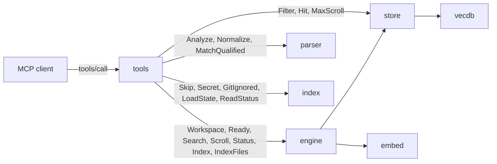
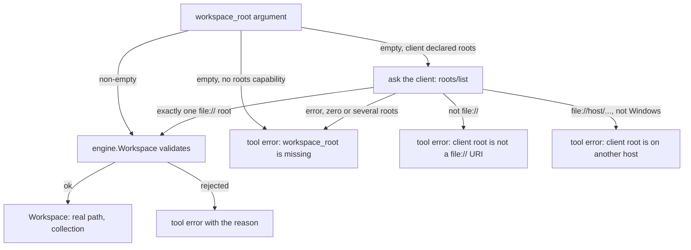

[RagCode](../README.md) › tools

# tools: the MCP tools

`tools` registers the seven `rag_*` tools on the MCP server and turns each
call into engine and store queries. It is the only layer an AI client talks
to.

Every tool:

- takes `workspace_root`, the absolute path of the project (except
  `rag_server_info`, which takes nothing);
- answers with **one JSON text block** `{status, message, data, index}`, or with
  a tool error (`IsError`) carrying one plain-text, actionable sentence;
- reports a dependency that is down (`dependency_down`) instead of hanging.

## Where it sits



| Who | How |
|---|---|
| [internal/app](../internal/app/README.md) | calls `tools.Register(server, engine, config, version, startedAt)` once at start-up |

| Calls | Why |
|---|---|
| [engine](../engine/README.md) | resolves and validates the workspace root, checks readiness, embeds the query and searches, scrolls, reads the index status, queues index runs and file purges, writes the IDE rules |
| [store](../store/README.md) | `Filter` and `Hit` types, `MaxScroll` |
| [parser](../parser/README.md) | parses files on the fly (`rag_read_file_context`, the not-indexed search fallback), normalizes qualified names, lists the registered languages |
| [index](../index/README.md) | the skip rules of its own walk (`Skip`, `Secret`, `GitIgnored`, `IsLinkedWorktree`), the per-root state (`LoadState`, `ReadStatus`, `Running`) |
| [internal/update](../internal/update/README.md) | `Latest` (the cached release check), `Less` (version order), `GitHubLatest` |
| [internal/config](../internal/config/README.md) | `Config` (Ollama URL and model, exclude patterns, `auto_create_ide_rules`) |

## Files

| File | Contents |
|---|---|
| [`tools.go`](tools.go) | package doc, `Response`, `IndexInfo`, `Register` and the tool table; shared helpers: `reply` (an `ok` answer during a run is `indexing`), `answer`, `fail`, `indexInfo`, `resolveRoot`, `open`, `notIndexed`, `storeErr`, `insideRoot`, `live`, `within` (the case-folding root comparison of `insideRoot`), `readLines`, `capLines`, `isTestFile` |
| [`search.go`](search.go) | `rag_search`: `SearchInput`, `SearchHit`, exact plus semantic search, the bounded not-indexed fallback, `nameScore`, `rank`, `isIdentifier`, `kinds` (validates the kinds filter) |
| [`grep.go`](grep.go) | the text search run beside the index lookup: `GrepHit`, `startGrep`, `grepRun.add`/`stop`, `grep` (see "The `grep` lines") |
| [`usages.go`](usages.go) | `rag_find_usages` and `rag_call_hierarchy`: `twinKey`/`twinOf`/`mergeTwins` (one entry per qualified name, file and callable or not, never for doc chunks or routes, used by every tool), `resolveSymbol` (one symbol, twins merged, an equal qualified name before suffix matches, or an `ambiguous` answer), `referrers`, `vueDefault`/`vueTags` (a Vue component's `default` symbol and its tags with no import), `keepWithin` (one limit for distinct direct and via callers), `viaInterfaces` (`phpVia`, `goVia`, and `inheritors`, the down walk both share), `exactRel` (by_name or not), `ambiguousByName`, the hierarchy `walker` (`walk` level by level, `next`), `writeTree` |
| [`exports.go`](exports.go) | `rag_list_package_exports`: `ExportsInput`, `Export`, `moduleSymbols`, `shortModule` for short package names, `dirModules` for a directory or a source file of the workspace |
| [`readfile.go`](readfile.go) | `rag_read_file_context`: `ReadInput`, `Outline`, line ranges (`lineRange` streams a file over 8 MiB and returns its first 8 KiB for the binary check), outline, one symbol; line and signature clipping |
| [`index.go`](index.go) | `rag_index_workspace` and `rag_server_info`: `IndexInput`, `Service`, `Update`, `KnownRoot`, the Ollama probe, the release check (through `update.Latest`), `knownRoots` |

Tests:

| File | What it covers |
|---|---|
| [`grep_walk_test.go`](grep_walk_test.go) | the grep file cap counts only files git keeps; an unreadable directory does not end the walk; a word without diacritics finds the text written with them, and the reverse; a file with a NUL byte past its first 8 KiB is searched; a qualified name with a wrong owner lists the symbols of its last name (`match: "name"`). |
| [`grep_marks_test.go`](grep_marks_test.go) | a symbol made only of combining marks finds no line. |
| [`go_interface_test.go`](go_interface_test.go) | with the real Go analyzer, `sqlRepo.Find` lists `UseParam`'s `r.Find()` (`r Repo`) via `Repo` in `rag_find_usages` and the incoming hierarchy, also after a files run of the implementation alone; `Repo.Find` lists it without via; a type missing one of the interface's methods gets nothing; two implementations of `Store` both list `Run` via `Store`, with no unresolved relations, and `Run`'s outgoing hierarchy shows `Store.Save`; a method promoted from an embedded struct completes the method set (`BaseTask.Name` and `SessionTask.Execute` via `Task`); an embedded method overridden by the embedder gets no via; a call matched by name alone stays `by_name` without via; gotify's `a.DB.CreateApplication()` through a field typed `ApplicationDatabase` is a via usage of `GormDatabase.CreateApplication` (another package), with no unresolved relations although a handler and a test fake share the name. |
| [`go_routes_test.go`](go_routes_test.go) | with the real Go analyzer, an Echo route is found by `rag_search` with `kinds: ["route"]` and is a usage of its handler; the function registering the route `/` (`routes.Load./`) is the one symbol named `routes.Load` in `rag_find_usages`, `rag_call_hierarchy` and `rag_search` (one `exact` hit), a function `users` is not confused with the route `/users`, and `/users` is still found by its path; `GET /users` and `DELETE /users` of one function are two exports and two search hits, an `ambiguous` lookup without the `file_path` advice, and only the GET route calls `ListUsers`. |
| [`go_value_use_test.go`](go_value_use_test.go) | with the real Go analyzer, `rag_find_usages firmaJSON` counts `mux.HandleFunc(p, s.firmaJSON)` in `main.go` for a method declared in another file of the package; `s.T()` of `struct{ suite.Suite }` is no usage of a workspace `CustomTime.T`, after a full run and after a files run of the caller alone. |
| [`js_browser_test.go`](js_browser_test.go) | with the real JavaScript and HTML analyzers, `rag_find_usages resolveError` of a function declared inside an IIFE lists the call from another script's ready callback and the `onclick` handler of a template; a helper inside the `describe` of a Jest file without imports is no symbol; `onclick="save()"` is no usage of a class method `Cart.save` nor of an ES module function; after `window.resolveError = handleResolve`, `onclick="resolveError(1)"` is a usage of the global `resolveError`, which is one of `handleResolve`; `<StatusCard />` is a usage of `src/StatusCard.default` of a `<script setup>` without top-level statements; `onclick` calls of a global two scripts declare are in `ambiguous_by_name` of each, not of a module function of that name. |
| [`js_object_members_test.go`](js_object_members_test.go) | with the real JavaScript analyzer, `rag_find_usages getToken` counts `JwtService.getToken()` calls through `export default { getToken }` in each importer. |
| [`laravel_test.go`](laravel_test.go) | with the real PHP analyzer, `rag_find_usages` of a controller action lists the route naming it by `'uses' => 'C@m'` inside a namespaced, prefixed group, and not the same action of another controller; `rag_find_usages users.show` lists the controller method returning `view('users.show')` as an exact `imports`; `rag_find_usages` of a model lists the relation method naming it as `belongsTo('App\Lawyer')` and of a listener the event provider's `$listen` property; `$this->mailer->send()` on a property assigned from a typed constructor parameter is an exact usage of that service's `send` only; a route registered inside a method (`App\Providers.map./`) does not make the method `map` ambiguous, and `/about` registered there is found by its path; a property `$items` and a method `items()` of one class: `rag_find_usages` by qualified name or by name picks the method and lists `$cart->items()` as its exact usage; a named route lists `redirect()->route('users.index')` in a controller and `route('users.index')` in a Blade view (`TestUsagesOfNamedLaravelRoute`). |
| [`roots_test.go`](roots_test.go) | an empty `workspace_root` from a client without the `roots` capability is answered at once, `roots/list` is not sent; a client root `file://<host>/path` is refused outside Windows (naming the URI), `file://localhost/` is local. |
| [`tools_test.go`](tools_test.go) | an MCP client and server over in-memory transports with a real engine on `store.NewMemory()`, `embed.Fake` and a fake `.fk` analyzer. Missing and bad roots, the root taken from client roots, every tool, the not-indexed and during-recreate fallbacks, dependency down, tool schemas, helpers, fallback skip rules, edits and deletes keeping results right, no Qdrant left in `rag_server_info`, same-name variants, lookup by declared name with `file_path` as a hard filter, `by_name` usages and hierarchy nodes, the live state of a root being indexed in `rag_server_info`, the last run's error kept after a restart, a deleted root reported as `missing`, overloads and get/set pairs resolved as one symbol, twins as one hierarchy node (both directions, every depth), one export (and count) and one search hit, `ambiguous_by_name` not counting calls that name another symbol's qualified name, the module spelling of a barrel file in `rag_list_package_exports`, an equal qualified name winning over suffix matches, a code symbol winning over a doc chunk of the same name, the no-exact-match message of an identifier query (and its not-indexed-yet variant during a run), a filtered miss during a run named by its filters when the index has the name outside them, the message of a filtered search with no hit, a qualified call bound by name only marked `by_name`, short directory names and file paths in `rag_list_package_exports` with one module per file (`.fkm` analyzer), the export-less file message, an unreadable directory reported as such, an excluded directory and file reported as not indexed, the zero-usage note not claiming imports, an unused object constant naming its called members, the text search beside the index (whole word, hidden directories skipped, none when the index knows the name, the 20-line cut), `indexing` (not `ok`, not the fallback) while a run goes over an existing index, `kinds` validation and the no-such-kinds message, `limit` respected exactly with `truncated` in usages and the hierarchy, a binary file with an unknown extension not dumped, also for a line range, a saved run warning shown as `index.warning` and in the `rag_server_info` root entry |
| [`vue_auto_import_test.go`](vue_auto_import_test.go) | with the real JavaScript analyzer, a Vue component used by tag with no import (Nuxt auto-import) and by an importer: `rag_find_usages` and incoming `rag_call_hierarchy` (by the component's name and by its `default` symbol) list both parents, the tag with no import marked `by_name`; a recursive component uses itself once |
| [`vue_limit_test.go`](vue_limit_test.go) | when the importers of a Vue component exactly fill `limit`, a parent using it by tag with no import is not dropped silently: `rag_find_usages` and incoming `rag_call_hierarchy` mark the answer truncated |
| [`zz_verify_test.go`](zz_verify_test.go) | verification tests: short package names past the scroll cap, call-hierarchy cycles and the node cap, cancelled contexts, stalled `rag_server_info` endpoints, read-file edge cases (degenerate files, symlink out of the root, ranges, minified files, long lines, secrets), the 200-file fallback cap, multi-byte usage line cut, compact/full output and path boost, the 24 h update cache, a second index call while running, huge limits, `total_lines` and negative line numbers, the breadth-first node cap, a line range of a file over 8 MiB, exports of a workspace directory and `res://` paths, a Godot scene node not making its class ambiguous, the note on zero usages of a constant |
| [`usages_test.go`](usages_test.go) | `rag_find_usages` `limit` counts live callers: deleted caller files do not shrink the answer below `limit` nor clear `truncated`; usages, incoming hierarchy nodes and `ambiguous_by_name` stay in the symbol's language, while an `html` caller (`.fkh` analyzer) is still a usage; 1000 callers in another language do not mark one real usage `truncated`, and deleted callers filling the store scroll give the grep advice, not "raise limit"; a getter's candidate id selects the merged getter/setter with the outgoing calls of both |
| [`readfile_test.go`](readfile_test.go) | a line range of a binary file over 8 MiB returns no lines (the first 8 KiB are checked although the file is streamed) |
| [`source_files_test.go`](source_files_test.go) | the not-indexed fallback and the text search skip a non-hidden `RAGCODE_HOME` inside the root, and find nothing under a `path_prefix` in an excluded, hidden or linked-worktree directory |
| [`ollama_password_test.go`](ollama_password_test.go) | the password of an `ollama_base_url` with basic auth is not in `rag_server_info` (`ollama.url`, `ollama.error`) nor in the `dependency_down` message |
| [`inside_root_test.go`](inside_root_test.go) | `within`: with case folding (Windows) a path differing from the root only in case is inside it and gets the root's spelling; without it, outside; a sibling sharing the root's name prefix is never inside |
| [`junction_windows_test.go`](junction_windows_test.go) | (Windows only) a file reached through an NTFS junction inside the root that points outside it is refused by `insideRoot` |
| [`fifo_unix_test.go`](fifo_unix_test.go) | the not-indexed fallback keeps the index skip rules: no symlink out of the root, no fifo, no secret file (Unix only) |
| [`index_unix_test.go`](index_unix_test.go) | (`//go:build unix`) a known root with no `ended_at` is `interrupted` only when nobody holds its lock |

## The response

```go
type Response struct {
    Status  string     `json:"status"`
    Message string     `json:"message,omitempty"`
    Data    any        `json:"data,omitempty"`
    Index   *IndexInfo `json:"index,omitempty"`
}

type IndexInfo struct {
    State  string `json:"state"`
    Done   int    `json:"done"`
    Total  int    `json:"total"`
    Branch string `json:"branch,omitempty"`
    Age    string `json:"age,omitempty"`   // time since the last finished run
    Error  string `json:"error,omitempty"`
    Watch  string `json:"watch,omitempty"` // set when this root is not watched
}
```

### Status values

| `status` | Returned by | Meaning |
|---|---|---|
| `ok` | every tool | the answer is in `data`. A lookup that finds nothing is still `ok`, with a message such as `no indexed symbol named "X"; try rag_search` |
| `not_indexed` | search, usages, hierarchy, exports | the workspace has no index yet. `rag_search` still returns fallback results |
| `indexing` | the same tools, and `rag_index_workspace` | an index run is running or queued; for `rag_index_workspace` it means "run queued". An answer that would be `ok` becomes `indexing`, keeps its `data` and adds `index run in progress: results may be incomplete until it ends` to the message (`rag_read_file_context` parses on the spot and stays `ok`) |
| `low_memory` | the same tools as `dependency_down` | the machine has less free memory than `min_free_memory_mb` and the embedding model is not loaded; the message gives the free and the needed megabytes. Nothing is run until memory is freed (or the model is loaded) |
| `dependency_down` | every tool except `rag_read_file_context` and `rag_server_info` | the embedder (Ollama) or the index store cannot be used; the message says what to do |
| `ambiguous` | `rag_find_usages`, `rag_call_hierarchy` | several symbols match; `data.candidates` lists them |

Input errors (empty query, bad mode, unknown `kinds` value, path outside the
root, missing root, cancelled request) are **tool errors**: `IsError` is set and the content is a
plain sentence, not JSON.

When the installed binary this server started from was replaced (an
automatic update or a reinstall), every JSON answer's `message` ends with
`RagCode was updated on disk: restart this MCP server to use the new version
(Claude Code: /mcp, then reconnect ragcode)` (`update.RestartNote`, see
[internal/update](../internal/update/README.md)).

### The `index` block

Every answer tied to a workspace carries `index`:

| `index.state` | When |
|---|---|
| `indexing` | a run is in progress, in this server or in another process on the same root |
| `queued` | a run is waiting |
| `not_indexed` | no run has ever recorded a phase |
| otherwise | the last recorded phase from the engine status, e.g. `done`, `failed` or `interrupted` |

When the state is `failed` or `interrupted` and the tool set no message, the
message becomes `last index run <state> (<error>); run rag_index_workspace
to retry`. After a restart the error comes from the saved
index status; with none, the parentheses are left out.

`index.watch` is present only when edits to the root are not indexed
automatically: `off (<reason>): run rag_index_workspace after editing files`.
The reason is the watcher's start error (a `\\wsl.localhost` root opened by
the Windows server) or `the 9p file system reports no changes` (a Windows
drive under `/mnt` in WSL).

`index.warning` is present when the last run went on with less than asked,
from the saved index status: `git refused the repository (dubious
ownership): .gitignore rules are not applied` (the server runs as another
user than the repository owner), so git-ignored files are in the index; or
`N file(s) locked by another process were not read (<path>); their symbols
may be out of date until they are indexed again` (Windows: a file held by an
antivirus scan or a sync client during the run, retried by the engine).

### The `grep` lines

`rag_search` (for an identifier query), `rag_find_usages` and
`rag_call_hierarchy` start a text search of the source files beside the index
lookup (`grep.go`, `startGrep`). It looks for the last segment of the name
(`pkg.Foo` -> `Foo`) as a whole word, case-sensitive and without regard to diacritics on
either side (`Salveaza` finds `Salvează` and the reverse; Latin letters only, `unaccent`),
in the files an analyzer handles (not one with a NUL byte in its first 8 KiB, binary to the index too), by the
index skip rules (`sourceFiles`, shared with the not-indexed fallback: no hidden,
excluded or linked-worktree directory, not RagCode's own home), under
`path_prefix` when `rag_search` has one (nothing when that directory is itself one the index skips). It is bounded by work, not by a
clock: 5000 files (counted after git dropped the ignored ones) or 20 lines,
so a slow disk only takes longer; the request being cancelled ends it. Files
are read in parallel (GOMAXPROCS at a time) and the lines are joined in file
order; an unreadable directory is skipped, the walk goes on. On 9p
(`\\wsl.localhost`, `/mnt/c`) every call still pays one open per file.

The search is cancelled when the index knows the name. Otherwise (no symbol
of that name, or a symbol with zero usages) `data` gains
`grep: [{file_path, line, text, match: "grep"}]` and `grep_truncated`
(true when it stopped early), and the message says how many lines were found
and that they do not come from the index. When it stopped early with
no line yet (a cancelled request, a tree over the file cap), `grep` is empty, `grep_truncated` is
true and the message says the search was cut short, not that the name is absent. This covers what the index has no
symbol for: struct fields, locals, object members used by name, files not
indexed yet.

## Workspace root resolution



1. A non-empty `workspace_root` is used as given.
2. An empty one falls back to the client's `roots/list`, but only when the
   client declared the `roots` capability at initialize (otherwise the
   missing-root error comes at once, nothing is asked; an unanswered
   `roots/list` waits until the client cancels the call) and lists
   **exactly one** root and it is a `file://` URI (on Windows,
   `/c:/x` becomes `c:/x`). A URI with a host other than `localhost`
   (`file://wsl.localhost/Ubuntu/x`) is the UNC path `\\wsl.localhost\Ubuntu\x`
   on Windows; elsewhere it names another machine and is a tool error that
   names the URI and asks for `workspace_root`.
3. [engine](../engine/README.md) then validates it and resolves symlinks. It
   rejects a root that is empty, not absolute, missing, not a directory, a
   filesystem root (also `/mnt` and a drive mount `/mnt/c` in WSL), the home
   directory or a parent of it (also the Windows user home
   `/mnt/c/Users/<name>` in WSL), the temp directory,
   under `/proc`, `/sys` or `/dev`, exactly one of the broad system directories
   (`/etc`, `/usr`, `/var`, ...; list in the engine README), a Windows system
   directory (`%SystemRoot%` and below, exactly `%ProgramFiles%`,
   `%ProgramFiles(x86)%`, `%ProgramData%`; also under `/mnt/<drive>` in WSL), or outside
   `allowed_workspace_paths` when that is set.
4. A root no server has opened before is also refused when it does not look
   like the top of one project (a subdirectory of a git repository or of a
   known root, or a directory without a project file that holds several
   projects): the tool error names the candidates and tells the model to
   ask the user, then to call again with the chosen path, or with
   `rag_index_workspace` `confirm: true` for exactly this directory (engine
   README, root validation).

Resolving a root through `engine.Workspace` also registers it: the first call
for a root adds it to `~/.ragcode/roots.json` and, when `watch_enabled` and
`auto_index` are both on, starts its file watcher. This happens for every
tool that takes a root, `rag_read_file_context` included.

After the root is resolved, every tool except `rag_read_file_context` and
`rag_server_info` calls `open`, which also runs `Workspace.Ready`: when the
embedder or the store is unavailable the answer is `dependency_down`; a
missing index is let through so each tool can answer `not_indexed` (or fall
back). With `auto_index` on (the default), a store call that finds the
collection missing, or built with another embedding model, also queues an
index run, so the next answers report `indexing` without an explicit
`rag_index_workspace`.

Paths inside the workspace (`file_path`, `path_prefix`, a directory passed
as `package`) may be absolute, relative to the root, or start with Godot's
`res://` (relative to the root). `insideRoot` cleans them, follows symlinks and refuses
anything that ends up outside the root. On Windows the comparison ignores case
(`within`), so `c:\proj\x` is inside the root `C:\proj` even when `x` does not
exist, and the path is given back with the root's spelling. NTFS junctions
(`mklink /J`) are followed like symlinks: Go 1.23+ resolves them in
`filepath.EvalSymlinks` only with `godebug winsymlink=0`, which `go.mod` sets
for the binaries and tests, so `linkout\outside.go` through a junction to a
directory outside the root is refused.

**Deleted files.** `live` drops every hit whose file no longer exists on disk
(deleted with the watcher off, while the server was down, or within the
debounce) and queues those files for purge from the index.

## The tools

### `rag_search`

Searches the indexed code: exact match by (qualified) name when the query
looks like an identifier, semantic search otherwise.

| Input | Type | Description |
|---|---|---|
| `workspace_root` | string | absolute project path |
| `query` | string, required | an identifier or qualified name, or a natural-language description |
| `limit` | int | default 10, at most 100 |
| `file_path` | string | the file being edited; results near it rank higher |
| `language` | string | only this language, as `rag_server_info` lists them (`go`, `python`, `php`, `javascript` for JS/TS/Vue, ...); any other is an input error |
| `path_prefix` | string | only files under this directory; a file is an error (pass its directory) |
| `kinds` | []string | only these kinds: `function`, `method`, `class`, `interface`, `type`, `variable`, `constant`, `route`, `hook`, `template`, `scene`, `chunk`; any other value is an input error listing them |
| `full` | bool | always include the symbol content |

How it works:

1. **Exact.** When the query has no whitespace, only letters, digits and
   `_ . : / \ $ -`, and at least one letter, it scrolls up to 20 symbols whose
   normalized qualified name equals the query or ends with `.query`, plus,
   for a plain name, up to 20 named the query (a JS default export is named
   after its declaration but qualified `<module>.default`). They get score 1
   and `match: "exact"`. Twins (same qualified name and file, as in
   `rag_find_usages`) are one hit, here and in the semantic step. With no
   exact hit the message says `no symbol named "<query>"` (struct fields,
   and locals are not symbols), so semantic neighbours
   are not taken for that name; with `language`, `path_prefix` or `kinds` set
   it says instead that no symbol of that name matches them (the name may
   exist outside the filters). While a run is indexing or queued it says
   instead that the name may be in a file not indexed yet (grep finds it now), unless the index
   already has the name outside the filters given: then the filters stay the reason. A search with `language`, `path_prefix` or
   `kinds` that finds nothing says the filters left nothing.
   A qualified query with no exact match is then looked up by its last
   segment alone (`Base.Data` -> `Data`): the caller guessed the owner. The
   symbols of that name come first with `match: "name"`, score 1, and the
   message says `no symbol named "Base.Data"; 2 symbols are named "Data"
   under another owner`; no text search is added then.
2. **Semantic.** The query is embedded and the `2 × limit` nearest symbols
   are fetched; those scoring at least 0.55 and not already found are added
   with `match: "semantic"`.
3. **Rank.** With `file_path`, a hit in the same directory is scored ×1.15,
   one in the same top-level directory ×1.05, and a test file ×0.9 when the
   current file is not a test. Hits are sorted by score, then qualified name,
   and cut to `limit`.
4. **Trim.** With more than 4 results, `content` is dropped unless
   `full=true`; otherwise it is capped at 200 lines.

**Not indexed yet.** When the collection is missing or was built with
another embedding model, or the search finds
nothing while an index run is in progress or queued and the collection is
still empty (a first run, a recreate or a model change refilling it), the tool
parses up to 200 files under the root (or
`path_prefix`; the file cap bounds it, not a clock), applying the index skip rules, and scores
symbols by name: exact name 1.0, qualified suffix 0.9, substring 0.7,
otherwise 0.6 × the share of query words found in the name. These hits have
`match: "fallback"` and the status is `not_indexed` or `indexing`.

Output `data`: `{query, results: [SearchHit], count}`; each `SearchHit` has
`id, qualified_name, name, kind, language, file_path, start_line, end_line,
signature, score, match, content`.

```json
{"name": "rag_search", "arguments": {
  "workspace_root": "/home/me/project",
  "query": "where are JWT tokens validated",
  "file_path": "internal/auth/handler.go",
  "kinds": ["function", "method"]
}}
```

### `rag_find_usages`

Every indexed reference to a symbol (calls, extends, implements, uses),
grouped by file, with the referencing symbol and the line.

| Input | Type | Description |
|---|---|---|
| `workspace_root` | string | absolute project path |
| `symbol` | string, required | name or qualified name, e.g. `User.find` or `App\Models\User::find`, or the `id` of a candidate from an `ambiguous` answer (the only way to pick one of several routes of one URI in one file) |
| `file_path` | string | the file that defines the symbol, to pick it when several share the name |
| `limit` | int | maximum referencing symbols, default 100, at most 999 (one store scroll); when it cut, `data.truncated` is `true` and the message says to raise it, or, at 999, to grep the name for the rest; callers in files deleted from disk are not counted (the store is scrolled again up to its cap when they took rows), and when they still fill that scroll the answer is `truncated` with fewer than `limit` callers and the message says to grep, not to raise `limit` |

A Vue component's name resolves to the `template` symbol of its `.vue`
file; its usages (`import X from './X.vue'`, `<X />`) are those of the file's
`default` symbol, so `rag_find_usages` answers for that one. A tag of the
component with no import (a Nuxt auto-import or a globally registered
component) stays an unresolved bare name in the index; the tags of `.vue`
files naming the component (the `template` symbol's name, PascalCase) with
no target are added as its usages, marked `by_name` (another component of
that name, in another folder, may be the one registered). They count toward
`limit`. A `.vue` file without a script has no `default` symbol, so its
tags are not listed.

The symbol is resolved first (`resolveSymbol`): up to 50 symbols whose
qualified name ends with the query, plus, for a plain name, up to 50 named
the query. None gives `ok` with a "try rag_search" message. `file_path` keeps
only the symbols defined in that file; none there gives `ok` with a message
naming the file, never a symbol from elsewhere. Symbols sharing both the
qualified name and the file (TypeScript overload signatures and their
implementation, a getter/setter pair, a merged declaration) are twins, one
symbol (`mergeTwins`): the one with the widest line span (the
implementation) is kept, then the first line, then the lowest id, the rule
the index uses to pick a call's target, carrying the relations of all, so
the outgoing hierarchy covers every twin and usages (matched by qualified
name) cover them all. Doc chunks and routes (`GET` and `DELETE` of one path
registered in one function) are never twins, nor a function or method
and a symbol of another kind of one name (a PHP property `$items` and its
method `items()`); of those two the method is taken, since reads of a
property are not tracked. When several are left and
exactly one has a normalized qualified name equal to the query, it is taken
over those that only end with it (`components.zzalert` against
`zzprobe.card.components.zzalert`). Several left give `ambiguous`
with `data.candidates` (`id, qualified_name, kind, file_path, start_line`), and the message says a candidate's `id` can be passed as `symbol` (32 hex digits, taken as an id only when no symbol has that name; its twins join it, so a getter's id carries the setter's relations as its qualified name does);
when all of them share the qualified name and the file, the message says so
instead of advising a fuller name or `file_path`.

The references are the symbols with a relation whose resolved `target_id` is
the symbol's id or whose `target_qualified_name` is its qualified name. A
relation naming the qualified name counts only from the symbol's own language,
or from `html` and `docs` files, as the index resolves: a Python `utils.parse`
and a JavaScript `utils.parse` do not share callers; each of those languages
is scrolled on its own, so another language's callers never fill the scroll
and mark the answer `truncated`. The
source line of each reference is read from disk and cut at 200 bytes.

Output `data`: `{symbol, files: [{file_path, usages: [{caller, kind, line,
text, caller_id, caller_start_line, by_name?, via?}]}], total, ambiguous_by_name,
by_name, truncated}`. A usage with `by_name: true` was matched by name only: the index
did not resolve it by qualified name (its `resolution` is not `exact`) and it
does not name the symbol's qualified name itself. Either the call has no
import, qualified name or known type linking it (`x.Close()` on a local or
parameter), or the qualified name it names does not exist and the index fell
back to the one symbol with that name (`User::backWithError()` when `User`
has no such method), so it may be another symbol of that name (a stdlib
cursor, a file). `data.by_name` counts them and the message says so.
When several symbols match and one is a Godot scene node sharing the
qualified name of its script's class, the class is taken; when code symbols
and documentation chunks match (a README heading `### CleanupTask`), the code
symbols are kept. Zero usages of a
constant or variable add a note: reads of values are not tracked, only calls,
type uses and inheritance (an import is not a usage). A Go function or
method named as a value (`mux.HandleFunc(p, s.firmaJSON)`) is a usage of
kind `call` when the index linked it exactly; it also shows as an outgoing
call in `rag_call_hierarchy`. When the constant is an
object whose members are symbols (`export const api = { list: ... }`) and
something calls them through an exact link (not by name only), the note names the called members instead (at most
10), so the object is not taken for dead code (`usedMembers`).
`ambiguous_by_name` counts relations of the symbol's language that name the symbol but were left
unresolved because several symbols share the name, and that cannot be
attributed elsewhere: they name no qualified name, or one no indexed symbol
has; the message mentions them. Calls naming the symbol's own qualified name
(its twins, build-tagged variants such as `lock_unix.go` / `lock_windows.go`)
are listed as usages, and calls naming another indexed symbol's qualified
name are that symbol's; neither is counted here. For a JavaScript browser
global it also counts the html inline handlers (`onclick="f()"`) that call a
name several globals share: they bind to none, and each of those globals
reports them.

A Laravel route with a name (`->name('users.index')`) lists the PHP and
Blade code that calls `route('users.index')` (also `to_route`,
`redirect()->route`, `URL::route`), as `imports` usages: the index links
those by the route's name, not its URI.

A PHP method of a class that implements a workspace interface (directly,
through a parent class, or through an interface extending it) also lists the
callers of that interface's method of the same name (`viaInterfaces`); a
method of a trait counts for every class that uses the trait (`use T;`), and
an inherited method for every subclass that implements an interface with it
(`Repo extends BaseRepo implements Finder` lists `Finder::find`'s callers for
`BaseRepo::find`), unless that class declares its own method of that name,
which overrides it: a call
on a variable typed with the interface (`UserRepositoryInterface $repo;
$repo->find()`) targets only the interface's method. Those usages carry
`via` (the interface's qualified name) and the message counts them; the object
may be another implementation. The interface's own method answers as before,
and an interface outside the workspace adds nothing.

A Go method gets the same `via` usages from method sets, worked out at query
time: for each workspace interface declaring a method of its name (metadata
`interface`; none, the common case, costs one scroll), the interface's method
names plus those of the workspace interfaces it embeds must all be methods of
the method's type, declared or promoted from a type it embeds, or of a type
embedding it that does not declare its own method of that name
(`SessionTask{BaseTask}` makes `BaseTask.Name` reach `Task.Name`'s callers).
Matching is by names, not signatures, so a small interface with a common name
(`Close`) may give a false `via`; a call on an operand typed with an
interface that embeds another (`s Store`, `s.Find()` with `Find` declared in
the embedded `Finder`) is a `via` usage of every type that satisfies `Finder`,
also one that is no `Store`; the methods of an embedded external
interface (`io.Closer`) are not required; at most `MaxScroll` methods of the
name are read. Other languages are not
walked; `limit` counts the direct and the via referencing symbols together
(direct ones first, a symbol calling both ways counted once), and a cut through the via ones is reported like any
other (`truncated`, raise `limit`).

```json
{"name": "rag_find_usages", "arguments": {
  "workspace_root": "/home/me/project",
  "symbol": "Engine.Workspace"
}}
```

### `rag_call_hierarchy`

Callers (incoming) and callees (outgoing) of a function as a tree.

| Input | Type | Description |
|---|---|---|
| `workspace_root` | string | absolute project path |
| `symbol` | string, required | name or qualified name of the function or method, or a candidate `id` from an `ambiguous` answer |
| `direction` | string | `incoming` (default), `outgoing` or `both` |
| `depth` | int | levels to expand, default 2, at most 4 |
| `file_path` | string | the defining file, to pick the symbol when several share the name |

- The symbol is resolved as in `rag_find_usages`, overloads and get/set
  pairs included.
- Incoming uses the same reference lookup as `rag_find_usages` (up to 50 per
  node), at every level: a Vue component's `template` symbol answers for the
  file's `default` symbol, and the tags with no import (Nuxt auto-import) are
  callers marked `by_name` (`vueDefault`, `vueTags`). Outgoing follows `call` relations that have a resolved target id; an
  ambiguous call naming a qualified name lists every symbol with that name.
- Twins (as in `rag_find_usages`) are one node in both directions and at
  every depth, whether calls target one representative id or name the twins'
  qualified name; the node carries the relations of all twins.
- The tree is filled level by level and capped at 100 nodes per direction,
  so the cap drops the deepest levels first (incoming lists at most 50
  direct callers, so never one of them);
  `data.<direction>_truncated` is then `true`. It is also `true`, with the
  text line `… some nodes list only their first 50 callers`, when a node had
  more than 50 callers. A symbol already expanded
  elsewhere is listed again but not re-walked, so cycles end.
- Resolution errors are the same `ok` / `ambiguous` answers as above.

Output `data`: `{symbol, direction, depth, incoming?, outgoing?, text}`. Each
tree node has `id, qualified_name, kind, file_path, start_line, by_name?,
via?, children`; `via` marks an incoming node that calls an interface's
method its parent implements, as in `rag_find_usages`; `by_name` marks a node linked to its parent only by name, as in
`rag_find_usages` (outgoing: a call the index resolved by name only; a
call naming a qualified name shared by several symbols is exact). `text` is the same tree as lines: a
`<direction>:` header, then one `qualified_name (file_path:start_line)` line
per node indented two spaces per level, with ` [by name only]` and
` [via <interface>]` on those nodes, and `… capped at 100 nodes` when the cap was hit.

```json
{"name": "rag_call_hierarchy", "arguments": {
  "workspace_root": "/home/me/project",
  "symbol": "index.Run",
  "direction": "both",
  "depth": 3
}}
```

### `rag_list_package_exports`

The exported symbols of a package or module, grouped by kind.

| Input | Type | Description |
|---|---|---|
| `workspace_root` | string | absolute project path |
| `package` | string, required | full module path (`github.com/x/y/pkg`, `App\Models`, `app.models`) or a short package name |
| `kinds` | []string | only these kinds (same values as `rag_search`; any other is an input error) |

- First it scrolls symbols whose `module` equals `package` (one page of
  `MaxScroll`).
- When nothing matches and the name has no `/`, `\` or `.`, `shortModule`
  looks for modules ending in `/name`, `.name` or `\name`: symbols named
  `name`, plus the indexed directories and files called `name` (from the
  index state), each read with one filtered scroll, at most 50 scrolls. The
  workspace root itself is never such a directory, even when it is called
  `name`. Each module found this way is then read whole (one `module`
  scroll), so a package spread over files not named `name` (Go's root package
  found through `cobra.go`) lists all its files. A
  directory called `name` contributes the files directly in it whatever
  their module (a JS module such as `components/ui/button` is a file of
  `ui`).
- Only `exported` symbols are kept, at most 300; twins (overload
  signatures, a get/set pair, a merged `interface`) are one export, as in
  `rag_find_usages`, and count once.

Output `data`: `{package, modules, exports: {<kind>: [{name, qualified_name,
signature, file_path, start_line}]}, truncated}`. `truncated` is true when a
scroll hit `MaxScroll` or there were more than 300 exports. No match gives `ok`
with `no indexed module or directory matches "X"; pass the full module path or
a directory of the workspace`. When no module matches, a directory inside the
workspace (relative, `./x`, or Godot `res://x`) lists the exports of the files
directly in it, since a JS, Vue or GDScript module is one file. A source file
of the workspace (one a parser handles), also spelled as a module (the
root-relative path without its extension, `src/index` for `src/index.ts`,
matched against the indexed files), lists its own exports; with none the
message is `<file> has no exported symbols of its own (it may only re-export
others)`, as for a barrel file. A module whose indexed symbols are all
unexported (a Python module of `_private` functions, `pkg.priv`) answers
`"X" has no exported symbols (only unexported ones)`, not the no-match
message. When `kinds` leaves nothing but the module,
directory or file has exported symbols of other kinds, the message is `"X" has
no exported symbols of kinds [..]; drop kinds to list them all`. A directory
of the workspace whose files export nothing (Laravel `config/`) answers
`directory X has no exported symbols in the files directly in it`, not the
no-match message. A directory the server cannot read answers `directory X is
unreadable (<error>), so its files are not indexed`. When the index has files (state.json is
not empty) but none of them is that file, or none lies directly in that
directory although source files lie directly in it, because `.gitignore`,
`exclude_patterns` or the skip rules leave them out, the answer is `<file> is not indexed (...)` or `directory X has no
indexed files directly in it (...)` instead of the no-exports messages.

```json
{"name": "rag_list_package_exports", "arguments": {
  "workspace_root": "/home/me/project",
  "package": "store",
  "kinds": ["function", "type"]
}}
```

### `rag_read_file_context`

Reads a file of the workspace. It parses the file on the spot, so it needs
neither the index nor Ollama.

| Input | Type | Description |
|---|---|---|
| `workspace_root` | string | absolute project path |
| `file_path` | string | file to read, absolute or relative to the root |
| `symbol` | string | return only this symbol (name or qualified name) with its relations |
| `start_line` | int | first line (1-based) |
| `end_line` | int | last line; default `start_line + 119` |

Modes:

| Arguments | Returns |
|---|---|
| `start_line` and/or `end_line` | the numbered line range (end clamped to the file; start past the end, end before start, or a negative number is an error) |
| `symbol` | every symbol in the file whose name equals it or whose qualified name matches it, with content and relations (`data.symbols`); function overload signatures and get/set pairs are all returned (class method overload signatures are not symbols, see the JavaScript parser README) |
| neither | the outline (`name, qualified_name, kind, start_line, end_line, signature, exported`) plus the first 120 numbered lines |

Refused with a tool error: paths outside the root, non-regular files, files
over 8 MiB without a line range (with one, the file is streamed and only the
range is kept), and files the index treats as secrets (keys, tokens,
credentials). A file the index would skip (minified, binary, over the index
size cap) is not parsed: without `symbol` it returns the first 120 lines and
the message `no outline: the file is not parsed (<reason>)`; with `symbol` it
is a tool error that asks for `start_line` and `end_line`. A binary file (a NUL
byte in the first 8 KiB), whatever its extension, returns no lines: the
message is `no outline: the file is not parsed (binary); its content is not
returned`; a line range of it returns none either (`the file is binary; its
content is not returned`). A `symbol` not
found in the file is a tool error too. Each returned
line is cut at 2000 bytes (`… (+N more bytes)`), signatures at 200 bytes.

`total_lines` does not count the newline that ends the last line, as `wc -l`.
A `file_path` starting with Godot's `res://` is relative to the root.

Output `data`: `{file_path, total_lines}` plus, depending on the mode,
`start_line, end_line, lines` (range and outline modes), `outline`,
`symbols`, and `language` when the file was parsed into at least one symbol.

```json
{"name": "rag_read_file_context", "arguments": {
  "workspace_root": "/home/me/project",
  "file_path": "engine/workspace.go",
  "symbol": "Workspace.Ready"
}}
```

### `rag_index_workspace`

Indexes the workspace.

| Input | Type | Description |
|---|---|---|
| `workspace_root` | string | absolute project path |
| `mode` | string | `incremental` (default, changed files only) or `recreate` (drop the collection and re-embed everything) |
| `confirm` | bool | records `workspace_root` as confirmed by the user (`engine.ConfirmRoot`); set only after a tool answered that the root is doubtful and the user chose exactly this directory |

- When `auto_create_ide_rules` is on, writes the IDE rules
  (`<root>/.ragcode/RAGCODE.md` and the pointers, see
  [engine](../engine/README.md)); a failure there is added to the message, not
  fatal. Then it queues the run and answers `indexing` right away; no
  confirmation step. When the existing index has another `Format`, an
  `incremental` request also carries `data.full_reindex`: every file is
  re-indexed anyway. Progress is visible in the `index` block of any later
  call, or in `rag_server_info`.

Output `data`: `{root, collection, mode, full_reindex?}`.

```json
{"name": "rag_index_workspace", "arguments": {
  "workspace_root": "/home/me/project",
  "mode": "incremental"
}}
```

### `rag_server_info`

Server version, uptime, Ollama reachability, update availability, registered
languages and known workspaces. It takes no input and has no `index` block.

Output `data`:

| Key | Content |
|---|---|
| `version`, `pid`, `uptime` | this server process |
| `ollama` | `{url, model, reachable, error}`: `GET <ollama_base_url>/api/tags` (the password of a `user:password@` URL shows as `xxxxx` in `url` and `error`); a probe that times out says Ollama did not answer in time (overloaded or low on memory), any other failure says to start Ollama; reachable but without the model (with or without `:latest`) sets `error` to `model X not pulled: run ollama pull X` |
| `update` | `{current, latest, available}` (see below) |
| `languages` | the languages of the registered parsers |
| `roots` | every root in `~/.ragcode/roots.json` with `{root, state, last_run_files, total?, ended_at, warning?}` from its saved index status (`warning` as `index.warning`). A root that no longer exists on disk (its status outlives it under `~/.ragcode`) is reported as `missing`. A status without `ended_at` whose lock nobody holds is reported as `interrupted`. A root this process is indexing or has queued shows its live state instead, as the `index` block does: `queued` or `indexing`, with `last_run_files` the files done so far and `total` the files of the run |

**Update check.** `update.Latest` gives the latest release tag: from
`$RAGCODE_HOME/cache/update.json` when it was checked in the last 24 hours,
otherwise from the GitHub API
(`/repos/doITmagic/rag-code-mcp/releases/latest`), written back to the cache.
When the check fails, `latest` is `"unknown"` and `available` is `false`; the
failure is cached for one hour, so an offline machine does not wait on GitHub
at every call (a request canceled by the client is not cached). `available`
is `update.Less(version, latest)`: `vMAJOR.MINOR.PATCH` tags, a pre-release
older than its final release, a dev build never outdated (see
[internal/update](../internal/update/README.md)). The automatic update of the
server shares this cache.

No clock decides how long a probe may take. `rag_server_info` never waits for
GitHub: it answers from the cache (`update.Cached`), and a missing or old
cache is refreshed in the background for the next answer, so the first
answer after a day says the old tag, or `unknown` when there is none. The
Ollama probe is waited for as long as the caller waits.

```json
{"name": "rag_server_info", "arguments": {}}
```

## Known limitations

- `rag_list_package_exports` never lists the workspace root as a directory
  (`.`, `./` or the absolute root path answer "no indexed module or directory
  matches"): the root's own files are reached through their module path (a
  Go module path, a Python module name) or file by file.
- A short directory name resolves only through indexed files: an unreadable
  directory, or one whose files export nothing, answers "no match" by its
  short name; its path gives the precise message.
- After a crash, `rag_find_usages` leaves out the "interrupted" hint when it
  already returns its own message.
- `rag_server_info` lists a `roots.json` entry that the engine now refuses (for
  example one inside RagCode's own home) as `not_indexed`, without the reason,
  and a `missing` root with `last_run_files: 0`, without reading its saved
  status.
- `rag_read_file_context` reads any workspace file except secrets, including
  files under a non-hidden `RAGCODE_HOME` inside the root, which the index
  skips.

## Adding a tool

Follow the pattern of the existing handlers:

1. An input struct with `json` and `jsonschema` tags; include
   `WorkspaceRoot`.
2. A handler `func (t *tools) x(ctx, req, in) (*mcp.CallToolResult, any, error)`
   registered in `register` with `mcp.AddTool`.
3. Validate the input first and return `fail(...)` with one actionable
   sentence.
4. Call `t.open` (or `t.resolveRoot` when no dependency is needed).
5. Map store errors with `storeErr`, filter hits through `live`, and answer
   with `reply(status, message, data, w)`.

## Testing

```bash
CGO_ENABLED=0 go test ./tools/
CGO_ENABLED=0 go test -short ./tools/   # skips the ~9 s stalled-endpoint test
```

`index_unix_test.go` has the `unix` build tag. `TestMain` points
`RAGCODE_HOME` at a temporary directory so no test writes to the real
`~/.ragcode`; no Ollama or network is needed (the release URL points at a
closed local port).

## See also

- [engine](../engine/README.md): workspaces, readiness, the index queue
- [store](../store/README.md): `Filter` and `Hit`
- [parser](../parser/README.md): the symbol and relation contract
- [index](../index/README.md): walk, skip rules and index status
- [internal/app](../internal/app/README.md): where `Register` is called
- [RagCode](../README.md)
