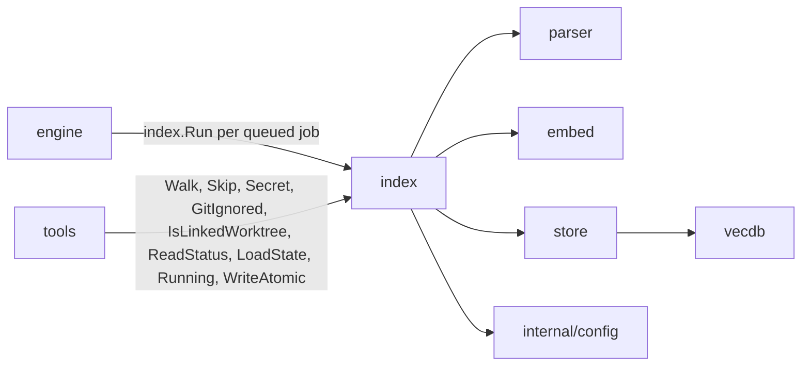
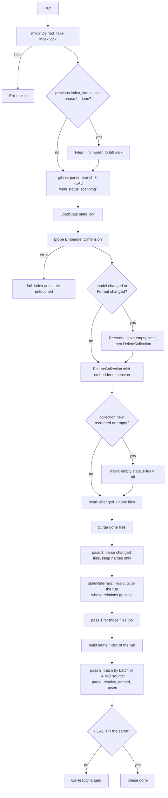

[RagCode v3](../README.md) › index

# Index Package

The `index` package runs the **indexing pipeline for one workspace root**:
walk the tree, apply the skip rules, parse every file into symbols, resolve
the relations between symbols across the whole workspace, embed the symbols
and upsert them into the vector store. It also keeps the per-file snapshot
(`state.json`) that makes later runs incremental, and the progress file
(`index_status.json`) that other processes read.

Nothing is written into the project for indexing: every file this package
owns lives under `~/.ragcode/index/<collection>/`.

## Objectives

- **Incremental runs**: only files whose mtime or size changed since the last
  run are parsed and embedded again.
- **Correct relations**: a caller keeps pointing at the right callee even when
  only the callee's file changed, moved or disappeared.
- **Bounded memory**: parsing is capped by source bytes in flight, and the
  symbols of the workspace are never all held at once.
- **Crash safety**: a run that is killed, cancelled or fails is detected on the
  next run, which widens to a full walk so the index is completed. A run
  cancelled or failed before it changed the index, or one that found nothing
  to do, leaves the previous status (and its counters) in
  `index_status.json`, with the branch of the run that found nothing to do;
  the caller still gets the run's own status.
- **One writer per root**: an exclusive file lock keeps two processes from
  indexing the same root at the same time.

---

## Where it sits



| Direction | Package | What for |
|-----------|---------|----------|
| Called by | [engine](../engine/README.md) | Runs `index.Run` for each queued job; uses `ReadStatus`, `IsLinkedWorktree`, `LinkedWorktreeOf`, `WriteAtomic`, `LockFile` (for `roots.json.lock`), `StateModel` (model check before a search), `ErrLocked`, `ErrHeadChanged`. |
| Called by | [tools](../tools/README.md) | `Walk` for the file estimate of `rag_index_workspace`, `Skip`/`Secret` before reading a file, `ReadStatus`/`Running` for server info, `WriteAtomic` for the update-check cache, `LoadState` for package exports; the fallback text search of `rag_search` walks with `IsLinkedWorktree`, `Skip` and `GitIgnored`. |
| Calls | [parser](../parser/README.md) | `parser.ForFile`, `parser.Analyze`, `parser.Normalize`, `parser.MatchQualified`, `parser.ReleaseParsers`. |
| Calls | [embed](../embed/README.md) | `Embedder.Embed`, `Dimension`, `Model`, and `embed.DocText` for the per-model document prefix. |
| Calls | [store](../store/README.md) | Collection lifecycle, `Upsert`, `DeleteByFile`, `Scroll` (lookups), `CollectionName`. |
| Calls | [internal/config](../internal/config/README.md) | `config.HomeDir()` for the index directory. |
| External | `git` binary | `git rev-parse` for branch/HEAD, `git check-ignore` for `.gitignore` rules. |
| External | `golang.org/x/sync/semaphore` | The parse byte budget. |

---

## Files

| File | Contents |
|------|----------|
| `index.go` | Package doc, `ErrLocked`, `ErrHeadChanged`, `Options`, `Status`, `ReadStatus`, `Run` and the whole run: scan, two-pass parse, `staleReferrers`, the name index and `resolve`, `embedUpsert`, `record`, progress ticks, `gitHead`, `embedText`. |
| `state.go` | `Entry`, `Format`, `State`, `LoadState`, `StateModel`, `State.Save`, `WriteAtomic`, and `readIndexFile` (the guarded reader for index files). |
| `walk.go` | Size and batch constants, `Walk`, `GitIgnored`, `IsLinkedWorktree`, `LinkedWorktreeOf`, `Skip`, `Secret`, the lockfile list and `readHead`. |
| `dir.go` | `Dir(root)`: the per-root index directory under the global home. |
| `running.go` | `Running(root)`: non-blocking probe of the run lock; `LockFile(path)`: the same cross-process lock on any path (the engine uses it for `roots.json`). |
| `lock_unix.go` | `lock` on Unix: exclusive, non-blocking `flock`; returns `ErrLocked` when held. Build tag `unix`. |
| `lock_windows.go` | `lock` on Windows: exclusive, non-blocking `LockFileEx`; returns `ErrLocked` when held. Build tag `windows`. |
| `lock_other.go` | `lock` elsewhere: a no-op. Build tag `!unix && !windows`. |

### Tests

| File | Covers |
|------|--------|
| `index_test.go` | The main suite, with a line-based fake analyzer and a hook embedder: full, incremental, delete, recreate, model and `Format` change, embed failure, parse failures and panics, cancel, `ErrHeadChanged`, relation resolution, `Skip`, `Walk`, `.gitignore`, linked worktrees, symlinks in `Files`, byte-budgeted upsert batches, empty collection with stale state, a crash between a recreate's state save and its drop, moved targets, vanished referrers, a file that changed between the two passes, deleted paths counted only when they were indexed, relation target kinds (`TestResolutionTargetKinds`) and inherited members through the owner's bases (`TestResolutionThroughBases`), in full and files runs, Go bases limited to embeddings (`TestResolutionThroughBasesGoEmbeddingOnly`), a run cancelled before it changed anything keeping the previous `done` status (`TestRunCancelledKeepsDoneStatus`), and a run with nothing to do keeping the last run's counters on disk (`TestRunWithoutChangesKeepsLastCounters`), and a model the embedder cannot serve leaving the old index and state untouched (`TestRunModelChangeUnavailableKeepsIndex`), the WARN for an unreadable directory (`TestWalkWarnsUnreadableDir`), RagCode's own home pruned (`TestWalkSkipsOwnHome`), a failed run that changed nothing keeping the last real counters under its error (`TestRunFailedUnchangedKeepsCounters`), a files run skipping a file inside a linked worktree (`TestRunFilesSkipsLinkedWorktree`), a run with nothing to do recording the current branch (`TestRunWithoutChangesRecordsBranch`), a run with nothing to do after one stopped by `ErrHeadChanged` keeping that run's counters (`TestRunAfterHeadChangedKeepsCounters`), and a file deleted between the scan and the parse purged, not counted as failed (`TestRunFileVanishedDuringRun`). Its `TestMain` points `RAGCODE_HOME` at a temp dir. |
| `budget_test.go` | The parse byte budget is respected, and batches still resolve forward references. |
| `resolve_test.go` | A non-fresh run resolves more than 500 targets through the store; a JS `import { n }` of a default-exported declaration resolves by module and name, in a full run and from the store. |
| `twins_test.go` | Twins in one file resolve to the widest (then first) by qualified name and by name, in a full run and from the store; a qualified name in two files stays ambiguous; a wider twin added later re-resolves the unchanged caller in a files run; `..delta` resolves by name (unique, then ambiguous), never exact. |
| `resolve_files_test.go` | A files run sees the stored candidates too: a target ambiguous in a full run stays ambiguous by exact and suffix match; removing one of two candidates (file deleted or symbol edited away) makes the unchanged caller unique. |
| `resolve_fix_test.go` | Name and qualified resolution stay within one language (html may cross), targets defined later, inherited-member fallback, a files run after a failed run widens to a full walk, symlinked `.ragcode` directories and device files are refused, an exact suffix match (Python) turned ambiguous by a new symbol with that suffix, a PHP suffix match only `unique`, a Python suffix never cut inside a package (`json.dumps` vs `src.flask.json.dumps`). |
| `gdscript_test.go` | `extends "res://x.gd"` resolves to the script's class, named by `class_name` or after the file, in full and files runs; `super.run()` in a `class_name` hierarchy (`BaseTrigger.run`, defined in the base's base `Cutscene`) resolves exactly through the bases, and by name when the owner is only in the store; a scene node's attached script resolves to the script's class. |
| `prefix_test.go` | `Run` adds the model's document prefix before embedding. |
| `lock_unix_test.go` | A second run on a locked root gets `ErrLocked`. Build tag `unix`. |
| `lock_test.go` | Two holders of `index.lock` exclude each other, on every platform. |
| `fifo_unix_test.go` | A binary file and a fifo in `Files` are skipped without blocking. Build tag `unix`. |
| `walk_unix_test.go` | `IsLinkedWorktree` refuses a `.git` that is a FIFO, device or oversized file. Build tag `linux`. |
| `zz_verify_test.go` | Verification tests: edge inputs, unreachable store, wrong vector count, pre-cancelled context, explicit files and directory rules, progress cadence, lock release, batch sizes and purge order, lookups stopping on a store error, repos without commits. |

---

## Key types and functions

### Options

```go
type Options struct {
    Root       string
    Collection string
    Store      store.Store
    Embedder   embed.Embedder
    Exclude    []string     // directory names pruned at any depth
    Files      []string     // nil = full walk; otherwise only these files are checked
    Deleted    []string     // files to purge from the index
    Recreate   bool         // drop the collection under the lock first
    Log        *slog.Logger // nil discards
    Progress   func(Status) // called at most every 500 ms, from the run goroutine
}
```

`Files == nil` means a full walk. A non-nil (even empty) `Files` makes a
"files run" that only checks the listed files plus `Deleted`.

### Status

The progress of a run, returned by `Run`, passed to `Progress` and persisted
to `index_status.json`:

| Field | Meaning |
|-------|---------|
| `Root`, `Branch` | Absolute root and the git branch at the start of the run. |
| `StartedAt`, `EndedAt` | Run times. |
| `Total` | Files to (re)index, including stale referrers added later. |
| `Done` | Files whose symbols are all in the store. |
| `Failed` | Files that did not parse. |
| `Deleted` | Files purged. |
| `Phase` | `scanning`, `parsing`, `embedding`, `done`, `failed`, or `interrupted` (cancelled). |
| `Error` | The error of a failed run. |
| `Recreated` | This run dropped the collection. |

### Functions

| Function | Purpose |
|----------|---------|
| `Run(ctx, Options) (Status, error)` | Index one root. The returned error is also in `Status.Error`. |
| `Walk(root, exclude)` | List indexable files, sorted. Used by `Run` and by the index tool's estimate. |
| `Skip(path, info, head)` | Why a file is left out, or `""` when indexed. |
| `Secret(path)` | Whether a file name marks credentials. |
| `IsLinkedWorktree(dir)` | Whether `dir` is a linked git worktree (pruned everywhere). |
| `LinkedWorktreeOf(root, path, known)` | The linked worktree below `root` that contains `path`, or `""`; `known` caches `IsLinkedWorktree` per directory (nil: no cache). Used by files runs and the watcher. |
| `Dir(root)` | `config.HomeDir()/index/<store.CollectionName(root)>`. |
| `ReadStatus(root)` | The last persisted `Status`, `false` when missing or unreadable. |
| `LoadState(root)` | The persisted `State`; a missing file is an empty state. |
| `Running(root)` | Whether a run holds the lock right now. |
| `LockFile(path)` | Takes the same cross-process lock as `index.lock` on any path; returns `unlock`, or `ErrLocked` when held. |
| `StateModel(root)` | The embedding model recorded in `state.json`, `""` when there is none. |
| `GitIgnored(root, files)` | The subset of `files` git ignores (tracked files never are; a nested repository follows its own rules). |
| `WriteAtomic(path, data)` | Temp file plus rename; also used by the engine for `roots.json` and `RAGCODE.md`. |
| `ErrLocked` | Another run holds `index.lock`. |
| `ErrHeadChanged` | Git HEAD moved during the run; the caller should queue a full run. |

### State and Format

```go
type Entry struct {
    ModTime int64    `json:"mtime"` // unix nanoseconds
    Size    int64    `json:"size"`
    IDs     []string `json:"ids,omitempty"`
}

type State struct {
    Model  string           `json:"model,omitempty"`  // embedding model of the points
    Format int              `json:"format,omitempty"` // Format of the points
    Files  map[string]Entry `json:"files"`            // absolute path -> entry
}

const Format = 11
```

`Format` is the version of what parsers and the indexer store. It is bumped
when a change must reach files that did not change; a state with another
`Format` is re-indexed from scratch. Version 2: Go `Exported` means package
API, and calls through locals are not package calls. Version 3: Go types of
the same package declared in another file, Python function-local imports and
class-body calls. Version 4: JS root-absolute imports and TypeScript type
uses, Go blank vars keeping their relations, Python signatures stopping at the
def's colon. Version 5: JS methods of an object literal bound to a top-level
const. Version 6: JS aliased imports (tsconfig/jsconfig `paths`, Nuxt/Vite
`~/` and `@/` conventions), calls in top-level initializers and
`export default defineX(...)`; Go goimports-style import names; Python imports
under `if` / `try` / `with`; PHP parameter and return types; GDScript `super`
calls; the Blade end line; relation target kinds and inherited members.
Version 7: JS barrel re-exports followed and `<script setup>` top-level calls
owned by `default`; GDScript `class_name` bases; Go bases limited to embedded
types; a qualified-suffix match is `exact` and a name fallback `unique`.
Version 8: twins (one qualified name in one file) resolve as one target, and a
qualified name that normalizes to a bare name resolves by name; a
qualified-suffix match is `exact` only in Python and GDScript, `unique`
elsewhere. Version 9: JS `await f<T>()` calls, top-level `const`/`let` type
annotations as `uses_type`, one module per `.vue` with two scripts; GDScript
calls in property `set`/`get` bodies; a Go local named like the receiver
shadows it. Version 10: a JS package specifier named like a root file is the
module `node_modules/<specifier>`, never that file's module; a JS chained call
split over lines is on the line of its method name; a PHP class named with a
reserved word (`Object`) keeps its name; Python module-level assignments carry
the calls of their right-hand side. Version 11: a chained call split over
lines is on the line of its method name in PHP, Go and Python too; a Go
external test package (`p_test`) is its own module; an HTML void element
(`<input>`) spans its own tag only; calls in a JS top-level destructuring
declaration belong to the `<script setup>` component; a GDScript scene's
attached script resolves to the script's class; a Python qualified suffix is
never cut inside a package.

---

## A run end to end



### 1. Lock and the previous run

`Run` resolves `Root` with `filepath.Abs`, creates `Dir(root)` and takes an
exclusive, non-blocking lock (`flock` on Unix, `LockFileEx` on Windows) on
`Dir(root)/index.lock`. If another process or run holds it, `Run` returns
`ErrLocked` without touching the status file. On other platforms the lock is
a no-op.

If the persisted status of the last run is not `done` (it failed, was
interrupted, or the process was killed mid-run), `Files` is reset to `nil`:
a files-only request is widened to a full walk, because the index is partial.
This is how a run **resumes after a kill**: the mtime/size diff then only
re-does the files that were not recorded.

### 2. Model, Format and recreate

First the embedder is probed for its dimension (`Embedder.Dimension`). A model
it cannot serve (a typo in `ollama_embed`, a model not pulled) fails the run
here, before the state or the collection change, so the index of the previous
model survives.

The state's `Model` is compared with `Embedder.Model()`. Vectors of two
models must never share a collection, so a different model forces a
recreate, whatever the vector dimension. A non-empty state with another
`Format` forces one too.

On recreate the empty state is saved **before** the collection is dropped:
after a crash in between, a stale `state.json` would otherwise match every
file and no incremental run would re-embed them.

Then `EnsureCollection` creates the collection with the embedder's dimension
(when the collection exists with another vector size, the store drops and recreates it and reports `recreated`). The run is
**fresh** when the collection did not exist, was recreated, or holds no
points although the state lists some (an interrupted first run, a failed
recreate, a manual delete). When the collection holds points but the state
lists no file (a crash between a recreate's state save and its drop, an
unreadable `state.json`), the collection is dropped and the run is fresh too:
otherwise the points of files deleted or ignored meanwhile would stay
searchable forever. A fresh run starts from an empty state and walks
everything, since a files-only run on an empty store would leave a partial
index nothing ever completes. A fresh run also skips every store lookup.

### 3. Scan

- Full run (`Files == nil`): `Walk` lists the files; every state entry not
  seen on disk is **gone**.
- Files run: each listed path is made absolute, checked with `os.Lstat`,
  filtered by `GitIgnored` and by `skipExplicit` (must lie under the root,
  outside hidden or excluded directories and linked worktrees, checked with
  `LinkedWorktreeOf` and a per-directory cache, and pass `Skip`). A listed file that
  fails these checks but is in the state is gone. Every `Deleted` path not
  seen is gone, even one the state never recorded, because an interrupted run
  may have left its points.
- A file is **changed** when it is not in the state or its mtime (ns) or size
  differs.

Gone files are purged with `DeleteByFile` and removed from the state; their
symbol IDs are remembered for `staleReferrers`.

### 4. Two-pass parse

Parsing runs on 2 workers with at most 256 KiB of source being parsed at once
(a weighted semaphore), whatever the CPU count: tree-sitter needs hundreds of
times a file's size while it parses, and a laptop needs its CPU for Ollama.
A panic in an analyzer is recovered and counted as a parse failure. The file
is `stat`ed before it is read, so a write in between leaves a newer mtime on
disk than in the state and the next run picks it up again. A file that grew
past 256 KiB since the walk is indexed as empty. A file that no longer exists
when it is parsed (git deleted it during a checkout or rebase) is not a parse
failure: it is logged at debug level, left out of `Total`, and purged as gone
when that happens in pass 1 (see 7. for pass 2).

- **Pass 1** parses every changed file but keeps only `ID`, `QualifiedName`,
  `Name`, `Language`, `Kind`, `Module` and `Owner` of each symbol, plus the
  `extends` / `implements` / `uses_type` targets of a class or interface:
  enough for `staleReferrers` and the name index.
- **Pass 2** parses again, in batches of about 4 MiB of source, and each batch
  is resolved, embedded and upserted before the next is parsed. The memory of
  a run does not grow with the size of the workspace.

When a full run ends, `parser.ReleaseParsers()` frees the parser buffers.

### 5. staleReferrers

Symbol IDs hash the start line, so a symbol that moves gets a new ID. Files
**outside** the run may hold relations whose target ID the run removes, or may
name a symbol the run adds (they hold no target ID, or a unique one the new
symbol makes ambiguous). `staleReferrers` finds those files so they are
re-parsed and re-resolved in the same run:

1. Collect the IDs that vanish: those of gone files, plus old IDs of re-parsed
   files that are no longer produced.
2. Look up the old points of files that gained an ID, to tell a symbol that
   only moved (same file and qualified name) from a truly new one. They are
   counted: one more symbol of a qualified name in a file than before (a new
   overload or accessor, a twin) is new, since it may become the target.
3. Query the store for points whose `TargetIDs` contain a vanished ID.
4. For each language, query for points targeting the new symbols'
   `TargetQualifiedNames`, and for points with a matching `TargetName` whose
   relation was resolved by name or not at all, or by a qualified suffix that
   a new symbol also has (`pkg.Svc` with a new `lib.pkg.Svc`: no longer unique).
5. Read the names of the vanished IDs; for a `(language, name)` no symbol of
   the run still has, query for points with that `TargetName` whose relation
   is ambiguous: one candidate fewer may make it unique. The points of gone
   files are purged only after this step, so their names can still be read.

Lookups are batched: 500 values per query, and a batch whose hits reach
`store.MaxScroll` is halved until nothing is cut off. At most 500 lookups are
made per run; past the cap (or after one store error) a warning is logged and
the remaining callers keep stale target IDs. A referrer that no longer exists
on disk is purged instead of parsed. Fresh runs skip this step.

### 6. Resolve

A name index of every symbol in the run maps normalized qualified names,
every dot-boundary suffix of them, and `(language, name)` pairs to IDs. For
each relation:

- With a `TargetQualifiedName`: an exact match (run and store candidates
  together, so a files run sees what a full run sees) is
  `ResolutionExact`. Otherwise a unique qualified-suffix match is taken:
  `ResolutionExact` in Python (`src/` layouts) and GDScript (the short
  `<Class>.m`), whose qualified names are legitimately written relative. In
  Python the cut-off part must be a source root, not a package: a candidate
  whose cut-off directory holds an `__init__.py` is dropped, so the stdlib
  `json.dumps` never matches `src.flask.json.dumps`;
  `ResolutionUnique` in every other language, where it is a guess (a PHP file
  without a namespace calling `Status::run()` of a global `\Status` would
  otherwise bind as exact to `HealthCheck\WP_CLI\Status::run`). If the owner (`a.b` of `a.b.m`,
  matched exactly or by suffix) does not define the member (inherited through
  a parent class, trait or embedded type), the bases the owner declares in
  this run (one level) are tried as `<base>.m`, exactly or by suffix
  (`ResolutionExact`). A base is the qualified name of an `extends`,
  `implements` or `uses_type` relation, or its bare name when it has none
  (GDScript `class_name Pickup extends BaseTrigger`). In Go only `extends` (an
  embedded type) counts: a named field's methods are not promoted. If no base
  has it and the owner exists, it falls back to the bare name
  (`ResolutionUnique`: only `unique` means matched by name). Bases of bases,
  and an owner whose class is only in the store (not in this run), are not
  followed: their call resolves by name, when the name is unique. An `extends` whose target is a whole module (GDScript
  `extends "res://x/y.gd"`), or a GDScript `uses_type` of one (a scene node's
  attached script), takes that module's one top-level class
  (`ResolutionUnique`). In JavaScript, `m.n` with no match takes module `m`'s
  top-level symbol named `n`: a declaration both named and default-exported
  is qualified `m.default`, while `import { n }` names `m.n`.
- A `TargetQualifiedName` that normalizes to a bare name (`..delta`) has no
  qualifier: without an exact match it skips the suffix lookup and is matched
  by name (`ResolutionUnique` or ambiguous), so a name-only guess is never
  `exact`.
- Twins, the symbols sharing a qualified name in one file (TypeScript overload
  signatures and their implementation, getter/setter pairs, merged
  declarations, Python redefinitions), are one candidate in every lookup: the
  widest line span, then the lowest start line. The pick depends on that file
  only, so a full and a files run agree. The same qualified name in two files
  (Go build-tagged variants) stays ambiguous.
- With only a `TargetName`: matched by `(language, name)`.
- Code never resolves into another language, by name or qualified name; only
  relations from `docs` and `html` (links, scripts, `onclick` handlers) cross
  into code on purpose.
- Only `imports` relations may target a template, scene node, doc chunk,
  route or hook; a `call` matched by name alone binds only to something
  callable, never a variable or constant (an exact match may: a variable can
  hold a function). So a Godot scene node sharing its class's qualified name
  does not make an `extends` ambiguous, and `->default(0)` does not bind to a
  Blade view named `default`.
- One ID sets `TargetID`; several set `ResolutionAmbiguous`.

Store lookups take up to 20 hits, are cached per key, ignore points of files
in the run (stale until their upsert) and stop for the rest of the run after
one store error. There is no lookup cap here.

### 7. Embed and upsert

Symbols are embedded 16 at a time and upserted in batches of 64 items or
8 MiB of `Content`, whichever comes first (a whole file can be one symbol).
Each embed text is `kind qualifiedName\nsignature\ndoc\ncontent`, cut to 2000
bytes on a rune boundary, then wrapped with `embed.DocText` for the model.
Transport retries are the embedder's job; a vector count that does not match
the text count fails the run.

A file's old points are deleted right before its first new points land, and
the file is **recorded** in the state only once every one of its symbols is
in the store. A file with no symbols is purged and recorded at once. If a
file's IDs in pass 2 differ from pass 1 (a checkout in progress), the entry
keeps both sets of IDs and a zero mtime, so the next run re-parses it and sees
the pass-1 IDs vanish. A file that disappeared between the passes keeps its
pass-1 IDs in the state for the same reason.

### 8. Progress and the end of the run

`Progress` is called at most every 500 ms; `state.json` and
`index_status.json` are written at most every 2 s, and always when
parsing starts and when the run ends (the status alone is also written at
the start, in phase `scanning`). After the last batch, `Run` reads HEAD again; if it
moved, the run ends with `ErrHeadChanged` (the engine queues a full run). A
cancelled context ends with phase `interrupted`; any other error with
`failed`. A run cancelled before it changed the index (no file purged or
upserted, no recreate, not a fresh collection; typically the catch-up run of
a session that ends right away) returns `interrupted` to its caller but writes
the previous status back when that one was `done`, so the next session does
not report a complete index as interrupted. A run that found nothing to do
writes the previous counters back too, as `done` and with its own branch (a
`git checkout -b` that changes no file). A previous run stopped by
`ErrHeadChanged` counts as a previous `done` here: it changed the index, so
its counters are the last real ones. A run that fails before it changes the
index (Ollama down at catch-up, an unknown model) writes the previous counters
back under its own `failed` phase and error, and the next run with nothing to
do turns them into `done` again instead of showing 0/0. A failed run that did
change the index writes its own status.

---

## Walk and Skip rules

`Walk(root, exclude)` uses `filepath.WalkDir`, keeps going past unreadable
entries and returns a lexically sorted list. An unreadable directory is logged
as a WARN (`index: unreadable directory skipped, its files are not indexed`)
through the default logger, since its indexed files leave the index on that
run. A directory deleted while the walk runs (`fs.ErrNotExist`) is not
logged: it is gone, not unreadable, and its files leave the index silently.

Pruned directories, at any depth below the root:
- hidden directories (name starts with `.`), so `.git`, `.venv`, `.ragcode`;
- directories whose **name** is in `exclude` (`exclude_patterns`);
- linked git worktrees: a `.git` that is a small regular file (at most 4 KiB)
  of the form `gitdir: <path>`, where `<path>/commondir` exists. A submodule's
  gitdir has no `commondir`, so submodules are kept;
- RagCode's own home (`OwnHome`: `RAGCODE_HOME` or `~/.ragcode`, absolute and
  symlink-resolved), so a non-hidden `RAGCODE_HOME` inside a root never
  indexes its own state files. The engine's watcher skips it too, since every
  run writes there and would queue the next run. Files named in
  `Options.Files` under it are skipped the same way.

Files must have an analyzer (`parser.ForFile`) and pass `Skip`:

| Reason | Rule |
|--------|------|
| `not a regular file` | Symlinks, FIFOs, devices. FIFOs and devices are never opened. |
| `over 256 KiB` | Bundles and generated code; also tree-sitter memory. |
| `minified` | `*.min.js`, `*.min.css`, `*.map`. |
| `lockfile` | `package-lock.json`, `yarn.lock`, `pnpm-lock.yaml`, `composer.lock`, `go.sum`, `cargo.lock`, `poetry.lock`. |
| `secret` | `Secret(path)`: `.env`, `.env.*`, `id_rsa*`, `.npmrc`, `.pypirc`, `.netrc`, `*.pem`, `*.key`, `*.p12`, `*.pfx`, and `credentials`/`secrets` with no extension or a data extension (`.json`, `.yaml`, `.yml`, `.toml`, `.ini`, `.xml`, `.properties`, `.conf`, `.cfg`, `.txt`). `credentials.go` is code and is kept. A secret inside an ordinarily named file is not caught. |
| `no analyzer` | No registered parser for the extension. |
| `binary` | A NUL byte in the first 8 KiB. |

### .gitignore handling

After the walk, `GitIgnored` pipes the file list to
`git -C <repo> check-ignore --stdin -z`, so every `.gitignore` and the user's
excludes apply, and tracked files are
never ignored. A directory with its own `.git` below the root is a separate
repository and is checked against its own rules, not its parent's. Files
outside any git work tree (or with no `git` installed) are never ignored.
Files runs apply the same check to the listed files.

---

## On-disk layout

All under `config.HomeDir()`: `$RAGCODE_HOME` or `~/.ragcode`.

```text
~/.ragcode/
└── index/
    └── ragcode-<16 hex of sha1(root)>/   # Dir(root), one per workspace root
        ├── index.db             # the vector store (store.SQLite via vecdb)
        ├── index.db-wal, -shm   # SQLite WAL files
        ├── state.json           # State: model, format, per-file entries
        ├── index_status.json    # Status of the current or last run
        └── index.lock           # flock target for one run at a time
```

`index.db` is written by [store](../store/README.md) /
[vecdb](../vecdb/README.md); the other three files belong to this package.
`state.json` and `index_status.json` are written with `WriteAtomic` (temp
file in the same directory, `chmod 0644`, rename), so readers never see a
truncated file and a symlink at the path is replaced, not followed. They are
read with `readIndexFile`, which refuses a parent that is not a real
directory, anything that is not a regular file, and files over 1 GiB.

---

## Configuration

The package takes no config struct; the [engine](../engine/README.md) maps
these keys from [internal/config](../internal/config/README.md) into `Options`:

| Key | Effect here |
|-----|-------------|
| `exclude_patterns` | `Options.Exclude`: directory names pruned at any depth. |
| `ollama_embed` | The embedder's `Model()`; a change recreates the collection. |
| `RAGCODE_HOME` (env) | Moves `Dir(root)` with the rest of the home. |

---

## Testing

```bash
cd v3
go test ./index/
go test -race ./index/
```

No build tags are needed to run the suite; `lock_unix_test.go` and
`fifo_unix_test.go` only build on Unix and `walk_unix_test.go` only on Linux. The tests use `store.NewMemory()`
and `embed.Fake`, need the `git` binary, and never touch the real
`~/.ragcode` (`TestMain` sets `RAGCODE_HOME` to a temp directory).

---

## See also

- [engine](../engine/README.md): queues and retries runs, watches files.
- [parser](../parser/README.md): the analyzers that produce symbols and relations.
- [embed](../embed/README.md): the embedder and the document prefixes.
- [store](../store/README.md) and [vecdb](../vecdb/README.md): where points live.
- [tools](../tools/README.md): `rag_index_workspace` and the readers of the status.
