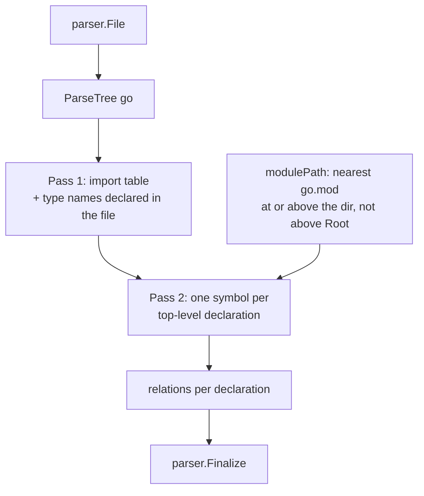

[RagCode v3](../../README.md) › [parser](../README.md) › golang

# Go Analyzer

The `golang` package turns one Go source file into `parser.Symbol` values: one
symbol per top-level declaration (function, method, type, var, const), with
call, type-use and embedding relations resolved through the file's own import
table and the types it declares.

It uses the tree-sitter `go` grammar (through the shared helpers in
[`parser/ts.go`](../README.md#tree-sitter-helpers-tsgo)), not `go/ast` or
`go/types`. That keeps it fast and tolerant of broken files, at the cost of
having no type information: a call on a variable whose type is unknown keeps
an empty `TargetQualifiedName`.

## Where it sits

- **Registered** from `init()` with `parser.Register(Analyzer{})`; the binary
  pulls it in through a blank import in
  [`internal/app`](../../internal/app/README.md).
- **Called** by [`index`](../../index/README.md) (and by
  [`tools`](../../tools/README.md) for live parsing) through `parser.Analyze`.
- **Calls** `parser.ParseTree`, `parser.Walk`, `parser.Finalize` and the other
  helpers from [parser](../README.md). It reads `go.mod` files from disk to
  compute the module path.

| Property | Value |
|----------|-------|
| Language | `go` |
| Extensions | `.go` |
| Exported type | `Analyzer` (stateless struct) |

## How a file is analyzed



1. **Pass 1** reads every `import_spec` into a map `local name -> import path`
   (an alias replaces the last path segment; dot and blank imports are
   skipped) and records every type name declared in the file.
2. **Pass 2** emits symbols for `function_declaration`, `method_declaration`,
   `type_declaration`, `var_declaration` and `const_declaration`.
3. **Module** is the Go import path: the `module` line of the nearest `go.mod`
   at or above the file's directory (never above the workspace root) plus the
   relative directory. Without a `go.mod` it is the directory relative to the
   root; a file directly in the root has module `""`.

## Symbols extracted

| Declaration | Kind | Owner | Notes |
|-------------|------|-------|-------|
| `func F()` | `function` | | Signature is the source up to the body. |
| `func (r *T) M()` | `method` | `T` | Owner is the receiver base type with pointer and type parameters stripped. |
| `type T struct{...}` | `class` | | |
| `type I interface{...}` | `interface` | | `Metadata["methods"]` lists the interface's method names, comma separated. |
| `type A = B`, `type N []string` | `type` | | Any other type spec, aliases included. |
| `var x, y = ...` | `variable` | | One symbol per name; `_` is skipped. |
| `const ...` | `constant` | | One symbol per name; `_` is skipped. |

- **Grouped declarations** (`type (...)`, `var (...)`, `const (...)`): each
  spec becomes its own symbol whose content is just that spec; a declaration
  with a single spec uses the whole declaration (keyword included).
- **Doc** is the comment block ending on the line right above the declaration,
  markers removed (`//`, `/* */`, leading `*`); `//go:` directives are dropped.
- **Exported** is true when the name starts with an upper-case letter, the
  owner (for methods) is exported too, and the file is not a `_test.go` file.

### Example

With `go.mod` saying `module github.com/acme/app` and the file at
`internal/svc/svc.go`:

```go
package svc

import str "strings"

// Server doc.
type Server struct {
	Base
	Name string
}

func (s *Server) Start() {
	s.Stop()
	str.ToUpper("a")
}
```

| Qualified name | Kind | Owner |
|----------------|------|-------|
| `github.com/acme/app/internal/svc.Server` | `class` | |
| `github.com/acme/app/internal/svc.Server.Start` | `method` | `Server` |

Relations: `Server` extends `Base` (target qualified name `""`, because `Base`
is not declared in this file); `Start` calls `Stop` ->
`github.com/acme/app/internal/svc.Server.Stop` and `ToUpper` ->
`strings.ToUpper`.

## Relations extracted

| Source construct | Relation | How the target is resolved |
|------------------|----------|----------------------------|
| `f(x)` | `call` | `<module>.f`. Built-ins (`len`, `append`, `make`, conversion type names, ...) and names declared as locals or parameters in the same declaration are skipped. |
| `T(x)` with `T` declared in the file | `uses_type` | Conversion to a local type: `<module>.T`. |
| `pkg.F(x)` | `call` | Through the import table: `<import path>.F`, unless a parameter or local named `pkg` shadows the import (then `""`). |
| `recv.M()` inside a method | `call` | Receiver variable: `<module>.<Owner>.M`. |
| `T.M(...)`, `(*T).M(...)`, `T{}.M()` | `call` | Type declared in the file: `<module>.T.M`. |
| `x.M()` on anything else | `call` | Target name only, qualified name `""`. |
| `F[int](x)` / `pkg.F[T](x)` | `call` (or `uses_type` when `F` is a local type) | Generic calls parse as conversions; classified by whether `F` is a type declared here. |
| `T{...}` composite literal | `uses_type` | Local type or `pkg.T` through imports; unknown types are dropped. |
| `pkg.T` in any type position | `uses_type` | `<import path>.T`, or `""` when `pkg` is not imported. |
| Embedded struct field | `extends` | Local type or imported type. |
| Embedded interface (`fmt.Stringer`) | `extends` | Same rule. |

Relations of a `var` or `const` spec are shared by every name in that spec.

## Known limitations visible in the code

- No type inference: calls on variables, fields or return values
  (`s.Inner.Do()`, `a.Do()`) keep an empty target qualified name.
- A local variable shadows a package function or an import of the same name
  across the whole declaration, not only after its declaration (marked as a `shortcut:`
  in `locals`).
- The `go.mod` lookup is cached per root + directory and re-read when that
  `go.mod` changes (mtime) or disappears; a `go.mod` created later in a
  directory that had none needs a restart to show up.
- Methods whose receiver type cannot be read produce no symbol.

## Files

| File | Contents |
|------|----------|
| `golang.go` | `Analyzer` (`Language`, `Extensions`, `Analyze`), the per-file context, symbol builders (`appendFunc`, `appendTypes`, `appendValues`), relation collection (`relations`, `callTarget`, `genericCall`, `resolveType`), doc comment extraction and the cached `go.mod` module-path lookup. |

### Tests

| File | Covers |
|------|--------|
| `golang_test.go` | A fixture with grouped declarations, generics, embedded types, aliased/dot/blank imports: symbol kinds, owners, lines, signatures, docs, IDs, metadata; every relation and its target; module path without `go.mod`, nested `go.mod` stopping at the root; malformed input; analyzing the real `parser.go` of this repo; registration; concurrency; generic calls; `Exported` for test files and unexported owners; calls through local function values; a parameter shadowing an import; a renamed module seen without a restart. |
| `zz_verify_test.go` | Verification tests: resolution probes, an unclean (non-normalized) root path, robustness on garbage and edge input, a second round of edge cases, very large and deeply nested files. |

## Testing

```bash
cd v3
go test ./parser/golang/
```

No build tags or external services. Tests create temporary `go.mod` files
with `t.TempDir()`.

## See also

- [parser](../README.md): symbol model, qualified names, registry
- [index](../../index/README.md): resolves `TargetQualifiedName` to symbol IDs
- Other analyzers: [python](../python/README.md), [javascript](../javascript/README.md), [php](../php/README.md)
