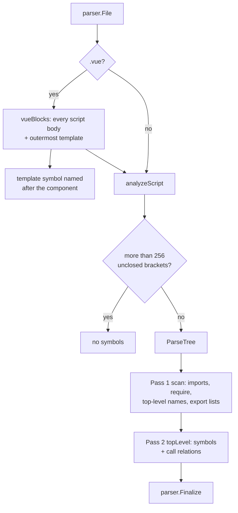

[RagCode v3](../../README.md) › [parser](../README.md) › javascript

# JavaScript / TypeScript / Vue Analyzer

The `javascript` package turns JavaScript, TypeScript, JSX/TSX and Vue
single-file components into `parser.Symbol` values: top-level functions,
classes and their methods, interfaces, type aliases, enums, variables and
constants, CommonJS exports, Vue options-API methods and the Vue
`<template>`.

It uses the tree-sitter `javascript`, `typescript` and `tsx` grammars. The
module of a file is its path relative to the workspace root without
extension; call targets are resolved through the file's own ES module and
`require()` import table and never guessed.

## Where it sits

- **Registered** from `init()`; the binary pulls it in through a blank import
  in [`internal/app`](../../internal/app/README.md).
- **Called** by [`index`](../../index/README.md) and
  [`tools`](../../tools/README.md) through `parser.Analyze`.
- **Calls** the tree-sitter helpers and `Finalize` from
  [parser](../README.md). It stats the file system to tell a directory import
  (`./components` -> `components/index`) from a file import.

| Property | Value |
|----------|-------|
| Language | `javascript` (also for TS and Vue files) |
| Extensions | `.js`, `.mjs`, `.cjs`, `.jsx`, `.ts`, `.tsx`, `.vue` |

| Extension | Grammar |
|-----------|---------|
| `.js`, `.mjs`, `.cjs`, `.jsx` | `javascript` |
| `.ts` | `typescript` |
| `.tsx` | `tsx` |
| `.vue` | each `<script>` block: `typescript` when `lang="ts"`, `lang='ts'` or `lang="tsx"`, else `javascript` |

## How a file is analyzed



1. **Bracket guard.** A file that leaves more than 256 brackets open (strings
   and comments skipped) is treated as garbage and yields no symbols, because
   tree-sitter error recovery is quadratic on it.
2. **Pass 1** records the import table, top-level declared names and what
   they are, `export { ... }` lists, the default export's local name, and
   CommonJS `module.exports` / `exports.x` assignments.
3. **Pass 2** emits the symbols of each top-level statement.
4. **Vue files**: each `<script>` body is parsed separately with leading
   newlines added so line numbers match the `.vue` file; the outermost
   `<template>...</template>` becomes one `template` symbol.

### Import table

| Source | Local name | Maps to |
|--------|-----------|---------|
| `import React from 'react'` | `React` | `react.default` |
| `import { useState as us } from 'react'` | `us` | `react.useState` |
| `import * as ns from './util'` (in `src/app/main.js`) | `ns` | `src/app/util` |
| `import helper from '../lib/helper'` | `helper` | `src/lib/helper.default` |
| `const fs = require('fs')` | `fs` | `fs` |
| `const { a, b: c } = require('./cjs')` | `a`, `c` | `src/app/cjs.a`, `src/app/cjs.b` |

Relative specifiers are joined to the file's directory and lose a known
extension (`.js .mjs .cjs .jsx .ts .tsx .vue .json`). When the result is a
directory with no sibling source file of the same name, `/index` is appended.
Root-absolute specifiers (`/js/api.js`, as served from a web root the parser
cannot know) resolve to the nearest ancestor of the importing file's
directory that has that file: `webui/components/chat/store.js` importing
`/js/api.js` gets `webui/js/api` when `webui/js/api.js` exists. Not found,
they are kept as written. Bare specifiers (`react`, `@scope/pkg`) are kept as
written.

## Symbols extracted

| Construct | Kind | Owner |
|-----------|------|-------|
| `function f()`, generator functions, TS `function` signatures / `declare function` | `function` | |
| `const f = () => {}` / `= function () {}` | `function` | |
| `const K = 1` | `constant` | |
| `let v` / `var v` | `variable` | |
| `exports.x = function () {}` / `module.exports.x = ...` | `function` or `variable` | |
| `class A`, `abstract class A` | `class` | |
| Class methods, abstract method signatures, class fields holding a function | `method` | class name |
| TS `enum E` | `class` | |
| TS `interface I` | `interface` | |
| TS `type T = ...` | `type` | |
| `export default {...}` / `defineComponent({...})`: methods, function-valued pairs, and the contents of `methods`, `computed`, `watch` | `method` | component name |
| Vue `<template>` | `template` | |

- **Default export.** Importers see the default export only as `default`, so
  a default-exported declaration is qualified as `<module>.default`. An
  anonymous `export default function` / `class` is named `default`.
- **Component name** is the file stem in PascalCase:
  `todo-item.vue` -> `TodoItem`. It is the owner of options-API methods and
  the name of the `<template>` symbol.
- **Exported** is true for `export` declarations and for names listed in
  `export { }`, `module.exports = ...` or `exports.x = name`. Class methods
  are exported when the class is, unless they are `#private` or have the
  `private` modifier.
- **Signature** is the declaration up to the body, whitespace collapsed;
  without a body, its first line.
- **Doc** is the JSDoc block or the run of line comments directly above.
- `require()` declarations are imports, not symbols.

### Example

File `src/components/todo-item.vue`:

```vue
<template>
  <div @click="go">{{ label }}</div>
</template>

<script>
import api from '../services/api';

export default {
  methods: {
    go() { this.stop(); api.fetch(); },
    stop: function () {},
  },
};
</script>
```

| Qualified name | Kind | Owner |
|----------------|------|-------|
| `src/components/todo-item.TodoItem` | `template` | |
| `src/components/todo-item.TodoItem.go` | `method` | `TodoItem` |
| `src/components/todo-item.TodoItem.stop` | `method` | `TodoItem` |

Relations of `go`: call `stop` -> `src/components/todo-item.TodoItem.stop`,
call `fetch` -> `src/services/api.default.fetch`.

## Relations extracted

| Source construct | Relation | Target qualified name |
|------------------|----------|-----------------------|
| `f()` | `call` | Through the import table or a top-level name in the file; `""` otherwise. |
| `ns.g()`, `a.b.c()` | `call` | First segment through imports; for a local name only when it is a class or enum (a variable's type is never guessed). |
| `this.m()` in a class or component | `call` | `<module>.<Owner>.m` |
| `new Foo()` | `uses_type` | Same resolution as a name. |
| `<Comp />`, `<ns.Comp>` in JSX | `uses_type` | Only for capitalized or dotted tag names. |
| TypeScript type in a parameter or return annotation, a generic argument (`useState<Plant[]>`), the body of an `interface` or a `type` alias | `uses_type` | Only types an import or this file defines; type parameters and globals are dropped. |
| `class A extends B` | `extends` | Generics (`Base<T>`) stripped. |
| `class A implements I` | `implements` | |
| `interface I extends J` | `extends` | |

Calls inside nested callbacks count toward the enclosing top-level function or
method.

## Known limitations visible in the code

- The bracket guard does not skip regex literals, so a `(` inside one counts
  as open.
- Vue blocks are found by plain string scanning (`<script`, `</script`,
  `<template`, last `</template>`).
- Only top-level statements produce symbols; functions declared inside other
  functions do not.
- No type inference for calls on variables or parameters. A parameter or
  `let`/`const`/`var` name shadows an import or top-level name for the whole
  function (one set per function, not scoped by declaration position), so
  `remove()` and `obj.m()` through it have an empty target.

## Files

| File | Contents |
|------|----------|
| `javascript.go` | The analyzer, grammar choice, the bracket guard, module and component naming, Vue block scanner, pass 1 (imports, `require`, export lists, CommonJS exports, specifier resolution), pass 2 (functions, classes, methods, interfaces, types, enums, variables, options-API objects, `exports.x`), doc and signature extraction, call/type relation collection and resolution. |

### Tests

| File | Covers |
|------|--------|
| `javascript_test.go` | ESM and CommonJS imports and exports, classes and methods, TypeScript (interfaces, types, enums, abstract classes), TSX, Vue options API, Vue `<script setup lang="ts">`, malformed and unbalanced input, files outside the root, concurrency, registration, default exports and directory (`index`) imports, root-absolute imports, TypeScript type uses. |
| `zz_verify_test.go` | Verification tests: JSX and import forms, TS enums and generics, `defineComponent` and CRLF files, robustness, nested CommonJS, component objects in plain JS, template-first `<script setup>`, statelessness, private TS members and syntax-error recovery, two script blocks, deep nesting, concurrent analysis. |

## Testing

```bash
cd v3
go test ./parser/javascript/
```

No build tags or external services.

## See also

- [parser](../README.md): symbol model, qualified names, registry
- [web](../web/README.md): HTML documents that reference scripts
- [index](../../index/README.md): resolves targets workspace-wide
