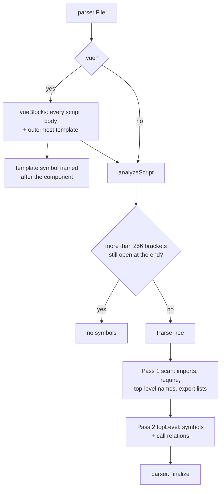

[RagCode v3](../../README.md) › [parser](../README.md) › javascript

# JavaScript / TypeScript / Vue Analyzer

The `javascript` package turns JavaScript, TypeScript, JSX/TSX and Vue
single-file components into `parser.Symbol` values: top-level functions,
classes and their methods, interfaces, type aliases, enums, variables and
constants, CommonJS exports, Vue options-API methods and the Vue
`<template>`.

It uses the tree-sitter `javascript`, `typescript` and `tsx` grammars. The
module of a file is its path relative to the workspace root without
extension; call targets are resolved through the file's own ES module and
`require()` import table and never guessed.

## Where it sits

- **Registered** from `init()`; the binary pulls it in through a blank import
  in [`internal/app`](../../internal/app/README.md).
- **Called** by [`index`](../../index/README.md) and
  [`tools`](../../tools/README.md) through `parser.Analyze`.
- **Calls** the tree-sitter helpers and `Finalize` from
  [parser](../README.md). It stats the file system to tell a directory import
  (`./components` -> `components/index`) from a file import. For an aliased
  specifier it reads the nearest `tsconfig.json` / `jsconfig.json` (and the
  configs it `extends`) and looks for the nearest `package.json`, once per
  script (each `<script>` block of a Vue file), on its first non-relative
  specifier; nothing is cached across files. To follow re-exports it reads
  the workspace module file an import names (see [Re-exports](#re-exports));
  that parse is cached process-wide.

| Property | Value |
|----------|-------|
| Language | `javascript` (also for TS and Vue files) |
| Extensions | `.js`, `.mjs`, `.cjs`, `.jsx`, `.ts`, `.tsx`, `.vue` |

| Extension | Grammar |
|-----------|---------|
| `.js`, `.mjs`, `.cjs`, `.jsx` | `javascript` |
| `.ts` | `typescript` |
| `.tsx` | `tsx` |
| `.vue` | each `<script>` block: `typescript` when `lang="ts"`, `lang='ts'` or `lang="tsx"`, else `javascript` |

## How a file is analyzed



1. **Bracket guard.** A file that ends with more than 256 brackets still open
   (strings and comments skipped) is treated as garbage and yields no
   symbols, because tree-sitter error recovery is quadratic on it. Deep
   nesting that closes (300 nested arrays) is valid and parsed.
2. **Pass 1** records the import table, top-level declared names and what
   they are, `export { ... }` lists and re-exports (`export ... from`), the
   default export's local name, and CommonJS `module.exports` / `exports.x`
   assignments. Named and default imports are followed through the target
   module's re-exports ([Re-exports](#re-exports)).
3. **Pass 2** emits the symbols of each top-level statement.
4. **Vue files**: each `<script>` body is parsed separately with leading
   newlines added so line numbers match the `.vue` file; the outermost
   `<template>...</template>` becomes one `template` symbol. The blocks are
   one module: pass 1 runs on every block first, then each block also sees
   the other blocks' imports and top-level names (its own win), so a
   `helper()` in `<script setup>` resolves to a `helper` declared in the
   plain `<script>`, and the other way round.

### Import table

| Source | Local name | Maps to |
|--------|-----------|---------|
| `import React from 'react'` | `React` | `react.default` |
| `import { useState as us } from 'react'` | `us` | `react.useState` |
| `import * as ns from './util'` (in `src/app/main.js`) | `ns` | `src/app/util` |
| `import helper from '../lib/helper'` | `helper` | `src/lib/helper.default` |
| `const fs = require('fs')` | `fs` | `fs` |
| `const { a, b: c } = require('./cjs')` | `a`, `c` | `src/app/cjs.a`, `src/app/cjs.b` |

Relative specifiers are joined to the file's directory and lose a known
extension (`.js .mjs .cjs .jsx .ts .tsx .vue .json`). When the result is a
directory with no sibling source file of the same name, `/index` is appended.
Root-absolute specifiers (`/js/api.js`, as served from a web root the parser
cannot know) resolve to the nearest ancestor of the importing file's
directory that has that file: `webui/components/chat/store.js` importing
`/js/api.js` gets `webui/js/api` when `webui/js/api.js` exists. Not found,
they are kept as written.

Aliased specifiers resolve to the file they name, and only when that file
exists:

- through the `compilerOptions.paths` of the nearest `tsconfig.json` or
  `jsconfig.json` above the importing file (comments and trailing commas
  allowed; relative `extends` followed until one defines `paths`; targets
  relative to that config's `baseUrl`, else its directory; at most 4
  `extends` hops). The longest
  matching prefix wins and, as in TypeScript, no other pattern is tried;
- when no `paths` pattern matches, through the bundler conventions, relative
  to the nearest `package.json` directory (the workspace root when there is
  none): `~/` and `@/` to `app/`, `src/` or the project
  directory (first that has the file), `~~/` and `@@/` to the project
  directory, `#shared/` to `shared/`. Nuxt writes its own mapping into
  `.nuxt/`, which is not in the repository.

With `"@/*": ["./*"]`, `components/form.tsx` importing `@/lib/utils` gets
`lib/utils`. Bare specifiers (`react`, `@scope/pkg`) and aliases whose file
does not exist are kept as written. `.` and `..` are relative (the current or
parent directory), so they resolve to that directory's `index` module.

### Re-exports

A named or default import resolves through the target module's re-exports
to the module that declares the name (`barrel.go`). With
`src/helper/ssg/index.ts` doing `export * from './ssg'`,
`import { toSSG } from './helper/ssg'` maps `toSSG` to
`src/helper/ssg/ssg.toSSG`, not `src/helper/ssg/index.toSSG`.

| In the target module | Name | Followed to |
|----------------------|------|-------------|
| A declaration of the name (`export const own`, `export default ...` for `default`) | `own` | the target module itself |
| `export { a as b } from './x'`, `export { default as P } from './p'` | `b`, `P` | `x.a`, `p.default`, followed further |
| `export { Hono as HonoBase }` | `HonoBase` | `<module>.Hono` |
| `export { x }`, `export { x as y }`, `export default x` of an imported `x` | `x`, `y`, `default` | the import target of `x`, followed further |
| `export * from './x'` | any | the first `export *` source whose chain reaches a declaration |

Own names win, then named re-exports, then `export *` sources; chains are
cycle-safe and capped. The target file is read only when the workspace root
is known and the module is a regular `.ts .tsx .js .mjs .cjs .jsx` file under
it within 4 MiB; its pass 1 is cached process-wide by root and path, checked
against mtime and size, and does not itself follow imports. When nothing
declares the name, the import stays `<module>.<name>`. A named re-export
whose source cannot be read still maps to that source (`x.a`). A package specifier (`react`, `@scope/pkg`, or a path that resolved to
nothing) is never read as a workspace file, as an import or as an
`export ... from` source, even when the root holds a file of that name. When
it does, the package's module is `node_modules/<specifier>` (`node_modules/react.useState`),
so its imports never equal the root file's qualified names; otherwise the
specifier is the module as written (`react.useState`).

## Symbols extracted

| Construct | Kind | Owner |
|-----------|------|-------|
| `function f()`, generator functions, TS `function` signatures / `declare function` | `function` | |
| `const f = () => {}` / `= function () {}` | `function` | |
| `const K = 1` | `constant` | |
| `let v` / `var v` | `variable` | |
| `exports.x = function () {}` / `module.exports.x = ...` | `function` or `variable` | |
| `class A`, `abstract class A` | `class` | |
| Class methods, abstract method signatures, class fields holding a function | `method` | class name |
| TS `enum E` | `class` | |
| TS `interface I` | `interface` | |
| TS `type T = ...` | `type` | |
| `export default {...}` / `defineComponent({...})`: methods, function-valued pairs, and the contents of `methods`, `computed`, `watch` | `method` | component name |
| `export default defineX(() => {...})` (Nuxt middleware, plugins, server routes): any call other than `defineComponent({...})` | `function` when an argument is a function, else `constant`; named `default` | |
| `const model = { load() {...}, f: () => ... }` at top level, also with `let` / `var` (Alpine / Pinia store models): methods and function-valued pairs, exported only when the const is | `method` | the const name, e.g. `model` |
| `const C = defineComponent({...})`: the same options as `export default` | `method` | the const name, e.g. `C` |
| Vue `<template>` | `template` | |
| Top-level expression statements of a Vue `<script setup>` (`watch(...)`, `defineProps<T>()`): their calls and type uses | `function` named `default`, exported, spanning the `<script setup>` block; when the file already has a `default` symbol the relations are added to it | |

- **Default export.** Importers see the default export only as `default`, so
  a default-exported declaration is qualified as `<module>.default`. An
  anonymous `export default function` / `class` is named `default`.
- **Component name** is the file stem in PascalCase:
  `todo-item.vue` -> `TodoItem`. It is the owner of options-API methods and
  the name of the `<template>` symbol.
- **Exported** is true for `export` declarations and for names listed in
  `export { }`, `module.exports = ...` or `exports.x = name`. Class methods
  are exported when the class is, unless they are `#private` or have the
  `private` modifier. Methods of a top-level object literal or of
  `const C = defineComponent({...})` are exported when that variable is;
  options-API methods of `export default {...}` always are.
- **Signature** is the declaration up to the body, whitespace collapsed;
  without a body, its first line.
- **Doc** is the JSDoc block or the run of line comments directly above.
- `require()` declarations are imports, not symbols.

### Example

File `src/components/todo-item.vue`:

```vue
<template>
  <div @click="go">{{ label }}</div>
</template>

<script>
import api from '../services/api';

export default {
  methods: {
    go() { this.stop(); api.fetch(); },
    stop: function () {},
  },
};
</script>
```

| Qualified name | Kind | Owner |
|----------------|------|-------|
| `src/components/todo-item.TodoItem` | `template` | |
| `src/components/todo-item.TodoItem.go` | `method` | `TodoItem` |
| `src/components/todo-item.TodoItem.stop` | `method` | `TodoItem` |

Relations of `go`: call `stop` -> `src/components/todo-item.TodoItem.stop`,
call `fetch` -> `src/services/api.default.fetch`.

## Relations extracted

| Source construct | Relation | Target qualified name |
|------------------|----------|-----------------------|
| `f()`, `await f<T>()` | `call` | Through the import table or a top-level name in the file; `""` otherwise. |
| `ns.g()`, `a.b.c()` | `call` | First segment through imports; for a local name only when it is a class or enum (a variable's type is never guessed). |
| `this.m()` in a class or component | `call` | `<module>.<Owner>.m` |
| `new Foo()` | `uses_type` | Same resolution as a name. |
| `<Comp />`, `<ns.Comp>` in JSX | `uses_type` | Only for capitalized or dotted tag names. |
| TypeScript type in a parameter or return annotation, a top-level `const` / `let` / `var` annotation (`const c: Foo[] = ...`), a generic argument (`useState<Plant[]>`), the body of an `interface` or a `type` alias | `uses_type` | Only types an import or this file defines; type parameters and globals are dropped. |
| `class A extends B` | `extends` | Generics (`Base<T>`) stripped. |
| `class A implements I` | `implements` | |
| `interface I extends J` | `extends` | |

Calls inside nested callbacks count toward the enclosing top-level function or
method. Calls in a top-level `const` / `let` / `var` initializer (`const at =
useFormattedDateTime(x)`) belong to that constant or variable; an object
literal's values are not walked, its methods own their calls.

## Known limitations visible in the code

- Top-level expression statements of a plain `.js`/`.ts` file (`describe()` /
  `it()` in tests, side-effect calls) belong to no symbol, so their calls are
  not usages.
- Re-exports are read from the imported file when an importer is parsed:
  editing a barrel (`index.ts`) does not re-parse the files that import
  through it, so their targets stay stale until they change or are
  re-indexed (as for Python `__init__.py`). `export * as ns from './x'` is
  not followed, and CommonJS `exports.x` / `module.exports` re-exports are
  not followed.
- Vue `<template>` markup is not parsed: a component used as `<StatusCard/>` or a
  handler in `@click="f()"` is not a usage.
- Nuxt auto-imports (no import statement) resolve by name only.
- tsconfig `paths` targets are relative to the `baseUrl` of the config that
  defines `paths` (or its directory), not to a `baseUrl` inherited through
  `extends`; package `extends` (`@tsconfig/node20`) are not followed.
- The bracket guard does not skip regex literals, so a `(` inside one counts
  as open.
- Vue blocks are found by plain string scanning (`<script`, `</script`,
  `<template`, last `</template>`).
- Only top-level statements produce symbols; functions declared inside other
  functions do not.
- No type inference for calls on variables or parameters. A parameter or
  `let`/`const`/`var` name shadows an import or top-level name for the whole
  function (one set per function, not scoped by declaration position), so
  `remove()` and `obj.m()` through it have an empty target.

## Files

| File | Contents |
|------|----------|
| `javascript.go` | The analyzer, grammar choice, the bracket guard, module and component naming, Vue block scanner and name sharing between blocks, pass 1 (imports, `require`, export lists, CommonJS exports, specifier resolution), pass 2 (functions, classes, methods, interfaces, types, enums, variables, options-API objects, `exports.x`), doc and signature extraction, call/type relation collection and resolution. |
| `barrel.go` | Re-export following: reads the imported module file (pass 1 only, cached by root+path, mtime and size) and maps an imported name to the module that declares it. |
| `alias.go` | Aliased specifiers: nearest `tsconfig.json`/`jsconfig.json` `paths` (JSONC, relative `extends`), the Nuxt/Vite conventions, and the existence check. |

### Tests

| File | Covers |
|------|--------|
| `javascript_test.go` | ESM and CommonJS imports and exports, classes and methods, TypeScript (interfaces, types, enums, abstract classes), TSX, Vue options API, Vue `<script setup lang="ts">`, malformed and unbalanced input, files outside the root, concurrency, registration, default exports and directory (`index`) imports, root-absolute imports, TypeScript type uses, methods of an object literal bound to a const, aliased imports (tsconfig paths, Nuxt conventions), calls in top-level initializers and `export default defineX(...)`, export of object-literal methods, `const C = defineComponent(...)`, barrel re-exports (`export *`, `export { a as b } from`, local alias exports, cycles, cache invalidation, package specifiers never read from disk nor named like a root file of that name, `.`/`..` specifiers), top-level calls of `<script setup>` attributed to `default`, `await f<T>()` calls, top-level variable type annotations, `<script>` and `<script setup>` sharing names, the line of a chained call split over lines. |
| `zz_verify_test.go` | Verification tests: JSX and import forms, TS enums and generics, `defineComponent` and CRLF files, robustness, nested CommonJS, component objects in plain JS, template-first `<script setup>`, statelessness, private TS members and syntax-error recovery, two script blocks, deep nesting, concurrent analysis. |

## Testing

```bash
cd v3
go test ./parser/javascript/
```

No build tags or external services.

## See also

- [parser](../README.md): symbol model, qualified names, registry
- [web](../web/README.md): HTML documents that reference scripts
- [index](../../index/README.md): resolves targets workspace-wide
