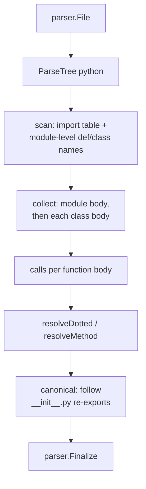

[RagCode v3](../../README.md) › [parser](../README.md) › python

# Python Analyzer

The `python` package turns one Python source or stub file into
`parser.Symbol` values: functions, classes, methods (including those of nested
classes) and module-level assignments, with call and base-class relations.

It uses the tree-sitter `python` grammar. Qualified names use the dotted module
path relative to the workspace root, and call targets are resolved through the
file's own import table, following package `__init__.py` re-exports. Targets
are never guessed: an unknown receiver leaves `TargetQualifiedName` empty.

## Where it sits

- **Registered** from `init()`; the binary pulls it in through a blank import
  in [`internal/app`](../../internal/app/README.md).
- **Called** by [`index`](../../index/README.md) and
  [`tools`](../../tools/README.md) through `parser.Analyze`.
- **Calls** the tree-sitter helpers and `Finalize` from
  [parser](../README.md). To follow re-exports it reads other packages'
  `__init__.py` files from disk.

| Property | Value |
|----------|-------|
| Language | `python` |
| Extensions | `.py`, `.pyi` |

## Module names

| File (root `/ws`) | Module |
|-------------------|--------|
| `/ws/pkg/mod.py` | `pkg.mod` |
| `/ws/pkg/__init__.py` | `pkg` (the file names its package) |
| `/ws/__init__.py` | `""` |
| `/ws/top.pyi` | `top` |
| a file outside the root, or no root | the file stem |

## How a file is analyzed



1. **scan** reads the top-level statements: `import` / `from ... import`
   build the import table (`local name -> qualified module or symbol`), and
   every top-level `def` / `class` name is recorded so forward references
   resolve.
2. **collect** walks the module body and, recursively, every class body.
3. Each function body is walked for calls, including calls inside nested
   functions, lambdas and comprehensions; they all count toward the enclosing
   symbol. Calls in a class body outside its methods and nested classes
   (field defaults such as `Field(default_factory=lambda: guids.new())`,
   class-level assignments) count toward the class. An `import` inside a
   function (or class body) resolves the calls of that scope only, wherever
   it stands in it.

### Import table

| Statement | Local name | Maps to |
|-----------|-----------|---------|
| `import os.path` | `os` | `os` (so `os.path.join` resolves to `os.path.join`) |
| `import a.b as c` | `c` | `a.b` |
| `from x.y import z` | `z` | `x.y.z` |
| `from x.y import w as v` | `v` | `x.y.w` |
| `from . import sib` (in `pkg/sub/mod.py`) | `sib` | `pkg.sub.sib` |
| `from ..up import far` | `far` | `pkg.up.far` |
| `from .k import *` | | not recorded |

Relative imports walk up from the file's package; in an `__init__.py` one
level fewer is dropped, because the module already names the package.

## Symbols extracted

| Construct | Kind | Owner |
|-----------|------|-------|
| `def` / `async def` at module level | `function` | |
| `def` inside a class body | `method` | dotted class path, e.g. `Outer.Inner` |
| `class` (module level or nested) | `class` | enclosing class path, `""` at top level |
| Module-level `NAME = ...` / `a, b = ...` | `constant` for UPPER_SNAKE names, else `variable` | |

- **Signature** is the header up to the body with whitespace collapsed and
  the colon removed: `async def fetch(url: str, *args, timeout=2, **kw) -> str`.
  For assignments it is the text before `=`.
- **Doc** is the dedented docstring (first statement of the body).
- **Decorators** are stored in `Metadata["decorators"]`, comma separated,
  without `@`. The symbol's lines and content include the decorators.
- **Exported** is false for names starting with `_`.
- Functions nested inside functions and class-level assignments are not
  symbols (their calls still count toward the enclosing function or class).

### Example

File `/ws/pkg/sub/mod.py`:

```python
from x.y import z

class Base(z):
    """Base class."""
    def _m(self):
        self.n()
        Base.q()

def helper():
    z()
```

| Qualified name | Kind | Owner | Exported |
|----------------|------|-------|----------|
| `pkg.sub.mod.Base` | `class` | | yes |
| `pkg.sub.mod.Base._m` | `method` | `Base` | no |
| `pkg.sub.mod.helper` | `function` | | yes |

Relations: `Base` extends `z` -> `x.y.z`; `_m` calls `n` ->
`pkg.sub.mod.Base.n` and `q` -> `pkg.sub.mod.Base.q`; `helper` calls `z` ->
`x.y.z`.

## Relations extracted

| Source construct | Relation | Target qualified name |
|------------------|----------|-----------------------|
| `f()` | `call` | Through the import table or a module-level name; `""` for builtins and unknown names. |
| `super()` | | Not reported itself; `super().m()` is reported as a call to `m` with an empty target. |
| `self.m()` / `cls.m()` | `call` | `<module>.<Owner>.m` (empty outside a class). |
| `mod.f()`, `a.b.f()` | `call` | First segment through the import table or a module-level name. |
| `obj.m()` on an unknown name | `call` | `""` |
| `class C(Base, pkg.Other, Generic[T])` | `extends` | Same resolution; `Generic[T]` is reduced to `Generic`; keyword arguments such as `metaclass=` are skipped. |

### `__init__.py` re-exports

When a resolved name passes through a package whose `__init__.py` imports it
from a submodule, the name is rewritten to where the symbol is defined:

```
app/models/__init__.py:  from .user import User
call site:               from app.models import User; User.find()
target:                  app.models.user.User.find   (not app.models.User.find)
```

The package's `__init__.py` is looked up under the workspace root, then under
each directory down to the analyzed file's directory (for `src/` layouts and
monorepo subprojects). Only regular files up to 4 MiB are read. Re-exports are
followed up to 8 levels deep. The parsed import table is cached process-wide,
keyed by root + path and invalidated by mtime and size.

## Known limitations visible in the code

- `from m import *` is not recorded, so names it brings in stay unresolved,
  and a star re-export in an `__init__.py` is not followed.
- No type inference: `obj.method()` on a local variable has an empty target.
- A parameter or assignment / `for` / `with ... as` target name shadows an
  import or module-level name for the whole function (one set per function,
  not scoped by position), so `remove()` and `os.remove()` through it have an
  empty target. `self` and `cls` are exempt.
- Calls to `super()` methods are not resolved to the parent class.

## Files

| File | Contents |
|------|----------|
| `python.go` | The analyzer, module-name derivation, import table (`addImport`, `addImportFrom`, relative imports), symbol collection (functions, classes, assignments, docstrings, headers, decorators), call collection and resolution, and the `__init__.py` re-export lookup with its process-wide cache. |

### Tests

| File | Covers |
|------|--------|
| `python_test.go` | Symbols (kinds, owners, signatures, docstrings, decorators, overloads), call targets for every import form, base classes, module names, relative imports from `__init__.py`, malformed input, registration, concurrency, package re-exports (also under a `src/` root and with the cache), function-local imports and class-body calls. |
| `zz_verify_test.go` | Verification tests: a fresh fixture exercising every import form, symbols, `from` not importing the module itself, `.pyi` files and the root module, robustness. |

## Testing

```bash
cd v3
go test ./parser/python/
```

No build tags or external services.

## See also

- [parser](../README.md): symbol model, qualified names, registry
- [index](../../index/README.md): resolves targets workspace-wide, including suffix matches for `src/` layouts
- Other analyzers: [golang](../golang/README.md), [javascript](../javascript/README.md)
