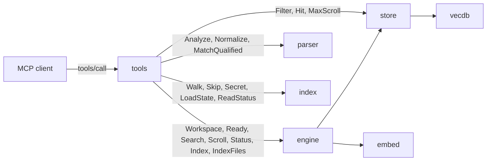
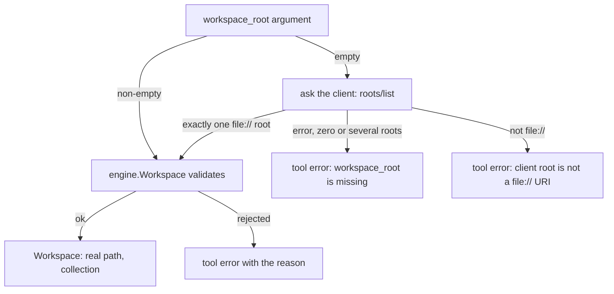

[RagCode v3](../README.md) › tools

# tools: the MCP tools

`tools` registers the seven `rag_*` tools on the MCP server and turns each
call into engine and store queries. It is the only layer an AI client talks
to.

Every tool:

- takes `workspace_root`, the absolute path of the project (except
  `rag_server_info`, which takes nothing);
- answers with **one JSON text block** `{status, message, data, index}`, or with
  a tool error (`IsError`) carrying one plain-text, actionable sentence;
- reports a dependency that is down (`dependency_down`) instead of hanging.

## Where it sits



| Who | How |
|---|---|
| [internal/app](../internal/app/README.md) | calls `tools.Register(server, engine, config, version, startedAt)` once at start-up |

| Calls | Why |
|---|---|
| [engine](../engine/README.md) | resolves and validates the workspace root, checks readiness, embeds the query and searches, scrolls, reads the index status, queues index runs and file purges, writes the IDE rules |
| [store](../store/README.md) | `Filter` and `Hit` types, `MaxScroll` |
| [parser](../parser/README.md) | parses files on the fly (`rag_read_file_context`, the not-indexed search fallback), normalizes qualified names, lists the registered languages |
| [index](../index/README.md) | the walk and skip rules (`Walk`, `Skip`, `Secret`, `IsLinkedWorktree`), the per-root state (`LoadState`, `ReadStatus`, `Running`), `WriteAtomic` for the update cache |
| [internal/config](../internal/config/README.md) | `Config` (Ollama URL and model, exclude patterns, `auto_create_ide_rules`) and `HomeDir()` |

## Files

| File | Contents |
|---|---|
| [`tools.go`](tools.go) | package doc, `Response`, `IndexInfo`, `Register` and the tool table; shared helpers: `reply` (an `ok` answer during a run is `indexing`), `answer`, `fail`, `indexInfo`, `resolveRoot`, `open`, `notIndexed`, `storeErr`, `insideRoot`, `live`, `readLines`, `capLines`, `isTestFile` |
| [`search.go`](search.go) | `rag_search`: `SearchInput`, `SearchHit`, exact plus semantic search, the bounded not-indexed fallback, `nameScore`, `rank`, `isIdentifier`, `kinds` (validates the kinds filter) |
| [`usages.go`](usages.go) | `rag_find_usages` and `rag_call_hierarchy`: `resolveSymbol` (one symbol, overload twins merged, or an `ambiguous` answer), `referrers`, `exactRel` (by_name or not), `ambiguousByName`, the hierarchy `walker` (`walk` level by level, `next`), `writeTree` |
| [`exports.go`](exports.go) | `rag_list_package_exports`: `ExportsInput`, `Export`, `moduleSymbols`, `shortModule` for short package names, `dirModules` for a directory or a source file of the workspace |
| [`readfile.go`](readfile.go) | `rag_read_file_context`: `ReadInput`, `Outline`, line ranges (`lineRange` streams a file over 8 MiB), outline, one symbol; line and signature clipping |
| [`index.go`](index.go) | `rag_index_workspace` and `rag_server_info`: `IndexInput`, `Service`, `Update`, `KnownRoot`, the Ollama probe, the release check with its cache, `semverLess`, `knownRoots` |

Tests:

| File | What it covers |
|---|---|
| [`tools_test.go`](tools_test.go) | an MCP client and server over in-memory transports with a real engine on `store.NewMemory()`, `embed.Fake` and a fake `.fk` analyzer. Missing and bad roots, the root taken from client roots, every tool, the not-indexed and during-recreate fallbacks, dependency down, tool schemas, helpers, fallback skip rules, edits and deletes keeping results right, no Qdrant left in `rag_server_info`, same-name variants, lookup by declared name with `file_path` as a hard filter, `by_name` usages and hierarchy nodes, the live state of a root being indexed in `rag_server_info`, the last run's error kept after a restart, a deleted root reported as `missing`, overloads and get/set pairs resolved as one symbol, a qualified call bound by name only marked `by_name`, short directory names and file paths in `rag_list_package_exports` with one module per file (`.fkm` analyzer), the export-less file message, the zero-usage note not claiming imports, `indexing` (not `ok`, not the fallback) while a run goes over an existing index, `kinds` validation and the no-such-kinds message, `limit` respected exactly with `truncated` in usages and the hierarchy, a binary file with an unknown extension not dumped, also for a line range |
| [`zz_verify_test.go`](zz_verify_test.go) | verification tests: short package names past the scroll cap, call-hierarchy cycles and the node cap, cancelled contexts, stalled `rag_server_info` endpoints, read-file edge cases (degenerate files, symlink out of the root, ranges, minified files, long lines, secrets), the 200-file fallback cap, multi-byte usage line cut, compact/full output and path boost, the 24 h update cache, a second index confirm while running, huge limits, `total_lines` and negative line numbers, the breadth-first node cap, a line range of a file over 8 MiB, exports of a workspace directory and `res://` paths, a Godot scene node not making its class ambiguous, the note on zero usages of a constant |
| [`fifo_unix_test.go`](fifo_unix_test.go) | the not-indexed fallback keeps the index skip rules: no symlink out of the root, no fifo, no secret file (Unix only) |
| [`index_unix_test.go`](index_unix_test.go) | (`//go:build unix`) a known root with no `ended_at` is `interrupted` only when nobody holds its lock |

## The response

```go
type Response struct {
    Status  string     `json:"status"`
    Message string     `json:"message,omitempty"`
    Data    any        `json:"data,omitempty"`
    Index   *IndexInfo `json:"index,omitempty"`
}

type IndexInfo struct {
    State  string `json:"state"`
    Done   int    `json:"done"`
    Total  int    `json:"total"`
    Branch string `json:"branch,omitempty"`
    Age    string `json:"age,omitempty"`   // time since the last finished run
    Error  string `json:"error,omitempty"`
}
```

### Status values

| `status` | Returned by | Meaning |
|---|---|---|
| `ok` | every tool | the answer is in `data`. A lookup that finds nothing is still `ok`, with a message such as `no indexed symbol named "X"; try rag_search` |
| `not_indexed` | search, usages, hierarchy, exports | the workspace has no index yet. `rag_search` still returns fallback results |
| `indexing` | the same tools, and `rag_index_workspace` with `confirm=true` | an index run is running or queued; for `rag_index_workspace` it means "run queued". An answer that would be `ok` becomes `indexing`, keeps its `data` and adds `index run in progress: results may be incomplete until it ends` to the message (`rag_read_file_context` parses on the spot and stays `ok`) |
| `dependency_down` | every tool except `rag_read_file_context` and `rag_server_info` | the embedder (Ollama) or the index store cannot be used; the message says what to do |
| `ambiguous` | `rag_find_usages`, `rag_call_hierarchy` | several symbols match; `data.candidates` lists them |
| `confirmation_required` | `rag_index_workspace` without `confirm=true` | nothing was started; `data` holds the plan |

Input errors (empty query, bad mode, unknown `kinds` value, path outside the
root, missing root, cancelled request) are **tool errors**: `IsError` is set and the content is a
plain sentence, not JSON.

### The `index` block

Every answer tied to a workspace carries `index`:

| `index.state` | When |
|---|---|
| `indexing` | a run is in progress |
| `queued` | a run is waiting |
| `not_indexed` | no run has ever recorded a phase |
| otherwise | the last recorded phase from the engine status, e.g. `done`, `failed` or `interrupted` |

When the state is `failed` or `interrupted` and the tool set no message, the
message becomes `last index run <state> (<error>); run rag_index_workspace
with confirm=true to retry`. After a restart the error comes from the saved
index status; with none, the parentheses are left out.

## Workspace root resolution



1. A non-empty `workspace_root` is used as given.
2. An empty one falls back to the client's `roots/list`, but only when the
   client lists **exactly one** root and it is a `file://` URI (on Windows,
   `/c:/x` becomes `c:/x`).
3. [engine](../engine/README.md) then validates it and resolves symlinks. It
   rejects a root that is empty, not absolute, missing, not a directory, a
   filesystem root, the home directory, the temp directory, under `/proc`,
   `/sys` or `/dev`, or outside `allowed_workspace_paths` when that is set.

Resolving a root through `engine.Workspace` also registers it: the first call
for a root adds it to `~/.ragcode/roots.json` and, when `watch_enabled` and
`auto_index` are both on, starts its file watcher. This happens for every
tool that takes a root, `rag_read_file_context` included.

After the root is resolved, every tool except `rag_read_file_context` and
`rag_server_info` calls `open`, which also runs `Workspace.Ready`: when the
embedder or the store is unavailable the answer is `dependency_down`; a
missing index is let through so each tool can answer `not_indexed` (or fall
back). With `auto_index` on (the default), a store call that finds the
collection missing, or built with another embedding model, also queues an
index run, so the next answers report `indexing` without an explicit
`rag_index_workspace`.

Paths inside the workspace (`file_path`, `path_prefix`, a directory passed
as `package`) may be absolute, relative to the root, or start with Godot's
`res://` (relative to the root). `insideRoot` cleans them, follows symlinks and refuses
anything that ends up outside the root.

**Deleted files.** `live` drops every hit whose file no longer exists on disk
(deleted with the watcher off, while the server was down, or within the
debounce) and queues those files for purge from the index.

## The tools

### `rag_search`

Searches the indexed code: exact match by (qualified) name when the query
looks like an identifier, semantic search otherwise.

| Input | Type | Description |
|---|---|---|
| `workspace_root` | string | absolute project path |
| `query` | string, required | an identifier or qualified name, or a natural-language description |
| `limit` | int | default 10, at most 100 |
| `file_path` | string | the file being edited; results near it rank higher |
| `language` | string | only this language (`go`, `python`, `php`, ...) |
| `path_prefix` | string | only files under this directory; a file is an error (pass its directory) |
| `kinds` | []string | only these kinds: `function`, `method`, `class`, `interface`, `type`, `variable`, `constant`, `route`, `hook`, `template`, `scene`, `chunk`; any other value is an input error listing them |
| `full` | bool | always include the symbol content |

How it works:

1. **Exact.** When the query has no whitespace, only letters, digits and
   `_ . : / \ $ -`, and at least one letter, it scrolls up to 20 symbols whose
   normalized qualified name equals the query or ends with `.query`, plus,
   for a plain name, up to 20 named the query (a JS default export is named
   after its declaration but qualified `<module>.default`). They get score 1
   and `match: "exact"`.
2. **Semantic.** The query is embedded and the `2 × limit` nearest symbols
   are fetched; those scoring at least 0.55 and not already found are added
   with `match: "semantic"`.
3. **Rank.** With `file_path`, a hit in the same directory is scored ×1.15,
   one in the same top-level directory ×1.05, and a test file ×0.9 when the
   current file is not a test. Hits are sorted by score, then qualified name,
   and cut to `limit`.
4. **Trim.** With more than 4 results, `content` is dropped unless
   `full=true`; otherwise it is capped at 200 lines.

**Not indexed yet.** When the collection is missing or was built with
another embedding model, or the search finds
nothing while an index run is in progress or queued and the collection is
still empty (a first run, a recreate or a model change refilling it), the tool
parses up to 200 files under the root (or
`path_prefix`) within 5 seconds, applying the index skip rules, and scores
symbols by name: exact name 1.0, qualified suffix 0.9, substring 0.7,
otherwise 0.6 × the share of query words found in the name. These hits have
`match: "fallback"` and the status is `not_indexed` or `indexing`.

Output `data`: `{query, results: [SearchHit], count}`; each `SearchHit` has
`id, qualified_name, name, kind, language, file_path, start_line, end_line,
signature, score, match, content`.

```json
{"name": "rag_search", "arguments": {
  "workspace_root": "/home/me/project",
  "query": "where are JWT tokens validated",
  "file_path": "internal/auth/handler.go",
  "kinds": ["function", "method"]
}}
```

### `rag_find_usages`

Every indexed reference to a symbol (calls, extends, implements, uses),
grouped by file, with the referencing symbol and the line.

| Input | Type | Description |
|---|---|---|
| `workspace_root` | string | absolute project path |
| `symbol` | string, required | name or qualified name, e.g. `User.find` or `App\Models\User::find` |
| `file_path` | string | the file that defines the symbol, to pick it when several share the name |
| `limit` | int | maximum referencing symbols, default 100; when it cut, `data.truncated` is `true` and the message says to raise it |

The symbol is resolved first (`resolveSymbol`): up to 50 symbols whose
qualified name ends with the query, plus, for a plain name, up to 50 named
the query. None gives `ok` with a "try rag_search" message. `file_path` keeps
only the symbols defined in that file; none there gives `ok` with a message
naming the file, never a symbol from elsewhere. Symbols sharing both the
qualified name and the file (TypeScript overload signatures and their
implementation, a getter/setter pair) are one symbol: the one with the widest
line span (the implementation) is kept, carrying the relations of all, so the
outgoing hierarchy covers every twin and usages (matched by qualified name)
cover them all. Several left give `ambiguous`
with `data.candidates` (`id, qualified_name, kind, file_path, start_line`).

The references are the symbols with a relation whose resolved `target_id` is
the symbol's id or whose `target_qualified_name` is its qualified name. The
source line of each reference is read from disk and cut at 200 bytes.

Output `data`: `{symbol, files: [{file_path, usages: [{caller, kind, line,
text, caller_id, caller_start_line, by_name?}]}], total, ambiguous_by_name,
by_name, truncated}`. A usage with `by_name: true` was matched by name only: the index
did not resolve it by qualified name (its `resolution` is not `exact`) and it
does not name the symbol's qualified name itself. Either the call has no
import, qualified name or known type linking it (`x.Close()` on a local or
parameter), or the qualified name it names does not exist and the index fell
back to the one symbol with that name (`User::backWithError()` when `User`
has no such method), so it may be another symbol of that name (a stdlib
cursor, a file). `data.by_name` counts them and the message says so.
When several symbols match and one is a Godot scene node sharing the
qualified name of its script's class, the class is taken. Zero usages of a
constant or variable add a note: reads of values are not tracked, only calls,
type uses and inheritance (an import is not a usage).
`ambiguous_by_name` counts relations that name the symbol but were left
unresolved because several symbols share the name; the message mentions them.
Calls to symbols sharing one qualified name (build-tagged variants such as
`lock_unix.go` / `lock_windows.go`) are listed as usages, not counted here.

```json
{"name": "rag_find_usages", "arguments": {
  "workspace_root": "/home/me/project",
  "symbol": "Engine.Workspace"
}}
```

### `rag_call_hierarchy`

Callers (incoming) and callees (outgoing) of a function as a tree.

| Input | Type | Description |
|---|---|---|
| `workspace_root` | string | absolute project path |
| `symbol` | string, required | name or qualified name of the function or method |
| `direction` | string | `incoming` (default), `outgoing` or `both` |
| `depth` | int | levels to expand, default 2, at most 4 |
| `file_path` | string | the defining file, to pick the symbol when several share the name |

- The symbol is resolved as in `rag_find_usages`, overloads and get/set
  pairs included.
- Incoming uses the same reference lookup as `rag_find_usages` (up to 50 per
  node). Outgoing follows `call` relations that have a resolved target id; an
  ambiguous call naming a qualified name lists every symbol with that name.
- The tree is filled level by level and capped at 100 nodes per direction,
  so the cap drops the deepest levels first (incoming lists at most 50
  direct callers, so never one of them);
  `data.<direction>_truncated` is then `true`. It is also `true`, with the
  text line `… some nodes list only their first 50 callers`, when a node had
  more than 50 callers. A symbol already expanded
  elsewhere is listed again but not re-walked, so cycles end.
- Resolution errors are the same `ok` / `ambiguous` answers as above.

Output `data`: `{symbol, direction, depth, incoming?, outgoing?, text}`. Each
tree node has `id, qualified_name, kind, file_path, start_line, by_name?,
children`; `by_name` marks a node linked to its parent only by name, as in
`rag_find_usages` (outgoing: a call the index resolved by name only; a
call naming a qualified name shared by several symbols is exact). `text` is the same tree as lines: a
`<direction>:` header, then one `qualified_name (file_path:start_line)` line
per node indented two spaces per level, with ` [by name only]` on those
nodes, and `… capped at 100 nodes` when the cap was hit.

```json
{"name": "rag_call_hierarchy", "arguments": {
  "workspace_root": "/home/me/project",
  "symbol": "index.Run",
  "direction": "both",
  "depth": 3
}}
```

### `rag_list_package_exports`

The exported symbols of a package or module, grouped by kind.

| Input | Type | Description |
|---|---|---|
| `workspace_root` | string | absolute project path |
| `package` | string, required | full module path (`github.com/x/y/pkg`, `App\Models`, `app.models`) or a short package name |
| `kinds` | []string | only these kinds (same values as `rag_search`; any other is an input error) |

- First it scrolls symbols whose `module` equals `package` (one page of
  `MaxScroll`).
- When nothing matches and the name has no `/`, `\` or `.`, `shortModule`
  looks for modules ending in `/name`, `.name` or `\name`: symbols named
  `name`, plus the indexed directories and files called `name` (from the
  index state), each read with one filtered scroll, at most 50 scrolls. A
  directory called `name` contributes the files directly in it whatever
  their module (a JS module such as `components/ui/button` is a file of
  `ui`).
- Only `exported` symbols are kept, at most 300.

Output `data`: `{package, modules, exports: {<kind>: [{name, qualified_name,
signature, file_path, start_line}]}, truncated}`. `truncated` is true when a
scroll hit `MaxScroll` or there were more than 300 exports. No match gives `ok`
with `no indexed module or directory matches "X"; pass the full module path or
a directory of the workspace`. When no module matches, a directory inside the
workspace (relative, `./x`, or Godot `res://x`) lists the exports of the files
directly in it, since a JS, Vue or GDScript module is one file. A source file
of the workspace (one a parser handles) lists its own exports; with none the
message is `<file> has no exported symbols of its own (it may only re-export
others)`, as for a barrel file. When `kinds` leaves nothing but the module,
directory or file has exported symbols of other kinds, the message is `"X" has
no exported symbols of kinds [..]; drop kinds to list them all`.

```json
{"name": "rag_list_package_exports", "arguments": {
  "workspace_root": "/home/me/project",
  "package": "store",
  "kinds": ["function", "type"]
}}
```

### `rag_read_file_context`

Reads a file of the workspace. It parses the file on the spot, so it needs
neither the index nor Ollama.

| Input | Type | Description |
|---|---|---|
| `workspace_root` | string | absolute project path |
| `file_path` | string | file to read, absolute or relative to the root |
| `symbol` | string | return only this symbol (name or qualified name) with its relations |
| `start_line` | int | first line (1-based) |
| `end_line` | int | last line; default `start_line + 119` |

Modes:

| Arguments | Returns |
|---|---|
| `start_line` and/or `end_line` | the numbered line range (end clamped to the file; start past the end, end before start, or a negative number is an error) |
| `symbol` | every symbol in the file whose name equals it or whose qualified name matches it, with content and relations (`data.symbols`); overload signatures and get/set pairs are all returned |
| neither | the outline (`name, qualified_name, kind, start_line, end_line, signature, exported`) plus the first 120 numbered lines |

Refused with a tool error: paths outside the root, non-regular files, files
over 8 MiB without a line range (with one, the file is streamed and only the
range is kept), and files the index treats as secrets (keys, tokens,
credentials). A file the index would skip (minified, binary, over the index
size cap) is not parsed: without `symbol` it returns the first 120 lines and
the message `no outline: the file is not parsed (<reason>)`; with `symbol` it
is a tool error that asks for `start_line` and `end_line`. A binary file (a NUL
byte in the first 8 KiB), whatever its extension, returns no lines: the
message is `no outline: the file is not parsed (binary); its content is not
returned`; a line range of it returns none either (`the file is binary; its
content is not returned`). A `symbol` not
found in the file is a tool error too. Each returned
line is cut at 2000 bytes (`… (+N more bytes)`), signatures at 200 bytes.

`total_lines` does not count the newline that ends the last line, as `wc -l`.
A `file_path` starting with Godot's `res://` is relative to the root.

Output `data`: `{file_path, total_lines}` plus, depending on the mode,
`start_line, end_line, lines` (range and outline modes), `outline`,
`symbols`, and `language` when the file was parsed into at least one symbol.

```json
{"name": "rag_read_file_context", "arguments": {
  "workspace_root": "/home/me/project",
  "file_path": "engine/workspace.go",
  "symbol": "Workspace.Ready"
}}
```

### `rag_index_workspace`

Indexes the workspace.

| Input | Type | Description |
|---|---|---|
| `workspace_root` | string | absolute project path |
| `mode` | string | `incremental` (default, changed files only) or `recreate` (drop the collection and re-embed everything) |
| `confirm` | bool | `true` starts the run; `false` only reports the plan |

- Without `confirm`: walks the root with the configured exclude patterns and
  answers `confirmation_required` with `data.estimated_files`.
- With `confirm=true`: when `auto_create_ide_rules` is on, writes the IDE rules
  (`<root>/.ragcode/RAGCODE.md` and the pointers, see
  [engine](../engine/README.md)); a failure there is added to the message, not
  fatal. Then it queues the run and answers `indexing` right away. Progress is
  visible in the `index` block of any later call, or in `rag_server_info`.

Output `data`: `{root, collection, mode, estimated_files?}`.

```json
{"name": "rag_index_workspace", "arguments": {
  "workspace_root": "/home/me/project",
  "mode": "incremental",
  "confirm": true
}}
```

### `rag_server_info`

Server version, uptime, Ollama reachability, update availability, registered
languages and known workspaces. It takes no input and has no `index` block.

Output `data`:

| Key | Content |
|---|---|
| `version`, `pid`, `uptime` | this server process |
| `ollama` | `{url, model, reachable, error}`: `GET <ollama_base_url>/api/tags`; reachable but without the model (with or without `:latest`) sets `error` to `model X not pulled: run ollama pull X` |
| `update` | `{current, latest, available}` (see below) |
| `languages` | the languages of the registered parsers |
| `roots` | every root in `~/.ragcode/roots.json` with `{root, state, last_run_files, total?, ended_at}` from its saved index status. A root that no longer exists on disk (its status outlives it under `~/.ragcode`) is reported as `missing`. A status without `ended_at` whose lock nobody holds is reported as `interrupted`. A root this process is indexing or has queued shows its live state instead, as the `index` block does: `queued` or `indexing`, with `last_run_files` the files done so far and `total` the files of the run |

**Update check.** The latest release tag comes from
`$RAGCODE_HOME/cache/update.json` when it was checked in the last 24 hours,
otherwise from the GitHub API
(`/repos/doITmagic/rag-code-mcp/releases/latest`); the answer is written back
to the cache. When the check fails, `latest` is `"unknown"` and `available` is
`false`; the failure is cached for one hour, so an offline machine does not
wait on GitHub at every call (a request canceled by the client is not cached). `available` compares `vMAJOR.MINOR.PATCH` tags (a
`-suffix` is ignored); a version that does not parse, such as a dev build, is
never reported as outdated. Every HTTP request uses a 3-second client timeout,
and the Ollama probe and the update check run in parallel, so two stalled
endpoints cost one timeout, not two.

```json
{"name": "rag_server_info", "arguments": {}}
```

## Adding a tool

Follow the pattern of the existing handlers:

1. An input struct with `json` and `jsonschema` tags; include
   `WorkspaceRoot`.
2. A handler `func (t *tools) x(ctx, req, in) (*mcp.CallToolResult, any, error)`
   registered in `register` with `mcp.AddTool`.
3. Validate the input first and return `fail(...)` with one actionable
   sentence.
4. Call `t.open` (or `t.resolveRoot` when no dependency is needed).
5. Map store errors with `storeErr`, filter hits through `live`, and answer
   with `reply(status, message, data, w)`.

## Testing

```bash
cd v3
CGO_ENABLED=0 go test ./tools/
CGO_ENABLED=0 go test -short ./tools/   # skips the ~9 s stalled-endpoint test
```

`index_unix_test.go` has the `unix` build tag. `TestMain` points
`RAGCODE_HOME` at a temporary directory so no test writes to the real
`~/.ragcode`; no Ollama or network is needed (the release URL points at a
closed local port).

## See also

- [engine](../engine/README.md): workspaces, readiness, the index queue
- [store](../store/README.md): `Filter` and `Hit`
- [parser](../parser/README.md): the symbol and relation contract
- [index](../index/README.md): walk, skip rules and index status
- [internal/app](../internal/app/README.md): where `Register` is called
- [RagCode v3](../README.md)
