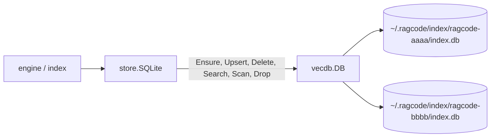

[RagCode](../README.md) › vecdb

# vecdb: the embedded vector database

`vecdb` is a small embedded vector database. It stores named **collections**
of **points**; a point is an id, a vector, an opaque payload (bytes) and a set
of indexed keyword fields. It answers exact cosine-similarity searches and
keyword-filtered scans.

It exists so that RagCode needs no database server: each workspace index is
one SQLite file on the local disk. It is written with
[`modernc.org/sqlite`](https://pkg.go.dev/modernc.org/sqlite) and
`modernc.org/sqlite/vec` (sqlite-vec transpiled to Go), so the whole server
builds with `CGO_ENABLED=0` on every platform Go supports there.

The package imports nothing from the rest of this module, so it could move to
its own repository unchanged. It knows nothing about symbols, languages or
workspaces; [store](../store/README.md) adds that meaning on top.

## Where it sits



| Who | How |
|---|---|
| [store](../store/README.md) | `store.SQLite` is the only caller. It turns each `parser.Symbol` into a `Point` (JSON payload plus indexed fields) and each `store.Filter` into a `Cond` |

`vecdb` calls only the standard library and the two modernc packages.

## Files

| File | Contents |
|---|---|
| [`doc.go`](doc.go) | package documentation: guarantees and limits |
| [`vecdb.go`](vecdb.go) | `DB`, `New`, `Path`, the schema, connection handling (URI, pragmas, name checks), `Ensure`, `Exists`, `Dim`, `Drop`, `Close`, `ErrNotFound` |
| [`query.go`](query.go) | `Point`, `Match`, `Cond`, `Hit`; `Upsert`, `Delete`, `Search`, `Scan`; vector encoding and the cosine score expression |

Tests:

| File | What it covers |
|---|---|
| [`vecdb_test.go`](vecdb_test.go) | search order, scores and filters; scan conditions; upsert replacing payload, vector and fields; delete; zero vectors; collection lifecycle; vector size mismatch; invalid names and dimensions; cancelled context; payload bytes round trip; two handles writing and reading the same directory like two processes; a drop seen by the other handle; a deleted collection file reopened, not written through the stale handle (`TestReopensDeletedFile`, also counted by `Reopens`); `BenchmarkSearch15k` (15,000 points of 768 dimensions, with and without a kind filter) |
| [`concurrency_test.go`](concurrency_test.go) | hooks around real SQLite operations make interleavings deterministic: `Upsert` checks the dimension inside its write transaction, reads keep one snapshot across a concurrent `Drop`, a read-only transaction does not block a writer |
| [`path_test.go`](path_test.go) | directories and collection names with `#`, `%`, `?` and spaces open the exact file (URI escaping); a collection name containing `%` is refused |
| [`vecdb_unix_test.go`](vecdb_unix_test.go) | (`//go:build unix`) `Ensure` in a read-only directory fails with an error that names the directory and is not `ErrNotFound` |

## On disk

```
<dir>/                          e.g. ~/.ragcode/index (or $RAGCODE_HOME/index)
└── <collection>/               e.g. ragcode-1a2b3c4d5e6f7a8b
    ├── index.db                the SQLite database (FileName)
    ├── index.db-wal            SQLite write-ahead log
    └── index.db-shm            SQLite shared memory for WAL
```

`New(dir)` touches nothing. The collection directory and `index.db` are
created only by `Ensure`; every other call on a missing file returns
`ErrNotFound` and creates nothing. Other files in the collection directory
(`state.json`, `index_status.json`, `index.lock`) belong to
[index](../index/README.md), not to `vecdb`.

### Schema

```sql
CREATE TABLE meta(key TEXT PRIMARY KEY, value TEXT NOT NULL);
CREATE TABLE points(
    pk      INTEGER PRIMARY KEY,
    id      TEXT NOT NULL UNIQUE,
    payload BLOB NOT NULL,
    vector  BLOB NOT NULL,
    zero    INTEGER NOT NULL      -- 1 for the zero vector, which cosine cannot score
);
CREATE TABLE fields(
    pk    INTEGER NOT NULL REFERENCES points(pk) ON DELETE CASCADE,
    name  TEXT NOT NULL,
    value TEXT NOT NULL
);
CREATE INDEX fields_lookup ON fields(name, value, pk);
CREATE INDEX fields_pk ON fields(pk);
```

| Table | Role |
|---|---|
| `meta` | `dim` holds the vector dimension. A collection **exists** exactly when this row exists |
| `points` | one row per point. `vector` is little-endian `float32` bytes; `zero` marks the all-zero vector |
| `fields` | the indexed keyword values; one row per (point, field, value), so a field can hold several values. Deleting a point removes its fields (`ON DELETE CASCADE`, `foreign_keys` is on) |

## Key types and functions

### `DB`

```go
d := vecdb.New(dir)     // nothing on disk yet
defer d.Close()
d.Path("ragcode-x")     // <dir>/ragcode-x/index.db
```

A `DB` is a directory of collections. It is safe for concurrent use, and other
processes may use the same directory at the same time. It keeps one
`*sql.DB` per open collection. `Close` closes them all; the `DB` stays usable
and reopens what a later call needs.

| Method | Behaviour |
|---|---|
| `Ensure(ctx, coll, n)` | creates the collection when missing. When it exists with another dimension, its points are deleted, the new dimension is stored and `recreated` is `true`. `n <= 0` is an error |
| `Exists(ctx, coll)` | `true` when the `dim` row is there; never creates anything |
| `Dim(ctx, coll)` | the vector dimension; `ErrNotFound` when missing |
| `Drop(ctx, coll)` | deletes the `dim` row, every field and every point in one transaction. The file stays (another process may hold it open, and Windows cannot delete it then); `Exists` is `false` afterwards. A missing collection, or one dropped meanwhile by another process, is `ErrNotFound` |
| `Upsert(ctx, coll, pts)` | inserts or replaces points by id in one transaction; the fields of each replaced point are rewritten |
| `Delete(ctx, coll, c)` | removes the points matching `c`. An empty `c` is refused: it would wipe the collection |
| `Search(ctx, coll, vec, c, limit)` | the `limit` points matching `c` nearest to `vec`, best first, ties by id. `limit <= 0` returns no hits and only `ctx.Err()`, without opening the collection, so a missing one is not `ErrNotFound` |
| `Scan(ctx, coll, c, limit)` | up to `limit` points matching `c`, ordered by id, `Score` 0. `limit <= 0` behaves as for `Search` |
| `Close()` | closes every open collection |

### `Point`, `Match`, `Cond`, `Hit`

```go
type Point struct {
    ID      string
    Vector  []float32
    Payload []byte              // opaque; nil is stored as empty
    Fields  map[string][]string // indexed keyword values
}

type Match struct{ Field string; Values []string } // any stored value of Field is in Values
type Cond []Match                                  // AND of matches; empty matches every point
type Hit struct{ ID string; Score float32; Payload []byte }
```

- A `Match` is true when **any** value stored under `Field` is one of
  `Values`. A `Match` with no `Values` matches nothing.
- Each `Match` becomes
  `points.pk IN (SELECT pk FROM fields WHERE name = ? AND value IN (...))`, so
  SQLite starts from the `fields_lookup` index instead of checking every
  point. Filters are exact keyword matches only.

### `ErrNotFound`

```go
var ErrNotFound = errors.New("vecdb: collection not found")
```

Returned for a missing collection file, or a file without the `dim` row
(never created, or dropped). [store](../store/README.md) maps it to
`store.ErrNotFound`.

## Behaviour details

### Cosine search

Search is **exact**: every candidate that passes the filter is scored, there
is no approximate index. The score is

```sql
CASE WHEN <query is zero> OR zero THEN 0 ELSE 1 - vec_distance_cosine(vector, ?) END
```

so it is the cosine similarity (1 is identical direction). sqlite-vec cannot
score a zero vector on either side, so those pairs score 0, as the exact
formula defines it. Results are ordered by score descending, then id.

The package documentation puts this in the tens of milliseconds up to about
100,000 points of 768 dimensions; `BenchmarkSearch15k` measures 15,000.

### Size and dimension checks

- `Ensure` refuses a dimension `<= 0`.
- `Upsert` checks every vector against the stored dimension **inside its write
  transaction**, before writing anything, so a concurrent `Ensure` that
  changed the dimension cannot slip in between. A mismatch fails the whole
  batch: `vecdb: vector size 3, collection "c" has 4`.
- `Search` checks the query vector the same way.

### Transactions and WAL

Every connection opens with:

| Setting | Effect |
|---|---|
| `journal_mode(WAL)` | readers do not block the writer and see every committed write |
| `busy_timeout(10000)` | a writer waits up to 10 s for another writer instead of failing |
| `synchronous(NORMAL)` | the usual WAL durability setting |
| `foreign_keys(1)` | enables the `fields` cascade |
| `_txlock=immediate` | a write transaction takes the write lock at `BEGIN`, so it waits on the busy timeout instead of failing on a lock upgrade |

From the package documentation: a crash or kill mid-write leaves the last
committed state; several processes may open the same collection (readers see
every committed write, writers wait for each other); nothing is cached in the
process beyond SQLite's page cache.

Each collection's handle stays open between calls. Before reusing it, `conn`
checks with `os.Stat` that `index.db` is still the file the handle opened
(`os.SameFile`). When the file was deleted (the collection directory removed
by hand or by another process) or replaced, the handle is closed and the file
on disk is opened again, so writes never go to an unlinked file no other
process can see, and reads see the collection as gone. `Reopens(coll)` counts
these reopens: the file now open may hold any state (an older copy restored by
hand), so the engine queues an incremental run when the count changes.

`Ensure`, `Upsert` and `Drop` each run in one write transaction. `Delete` is a
single `DELETE` statement.

### Snapshot reads across Drop

`Search` and `Scan` run inside a read-only transaction that reads the `dim`
row and the points in **one snapshot**. A concurrent `Drop` from another
handle or process therefore either happens before the read (the read returns
`ErrNotFound`) or after it (the read sees the full old data); a read never
sees half a drop. modernc uses a deferred `BEGIN` for read-only transactions
even with `_txlock=immediate`, so readers do not block writers.

### Collection names and URI escaping

- `validName` refuses `""`, `.`, `..` and names containing `/`, `\`, `%` or a
  NUL byte, so a name can never leave the directory.
- The database is opened through a `file:` URI built with `net/url`, so `#`,
  `?`, `%` and spaces in the directory are escaped and the exact path is
  opened. On Windows a drive path gets a leading `/` so the drive is read as
  a path, not a host.
- Database errors are wrapped with the file path (`vecdb: <path>: ...`),
  except context cancellation and deadline errors, which are returned as they
  are. Argument and state errors are not: an invalid collection name, an
  invalid dimension, a vector size mismatch (`vecdb: vector size N,
  collection "x" has M`), an empty `Cond` on `Delete`, and `ErrNotFound`
  itself. A failed `MkdirAll` is `vecdb: <os error>`.

### Contexts

Every call returns `ctx.Err()` before touching the database when the context
is already cancelled.

## Example

```go
d := vecdb.New(t.TempDir())
defer d.Close()

if _, err := d.Ensure(ctx, "c", 3); err != nil {
    return err
}
err := d.Upsert(ctx, "c", []vecdb.Point{
    {ID: "a", Vector: []float32{1, 0, 0}, Payload: []byte(`{"name":"a"}`),
        Fields: map[string][]string{"kind": {"function"}, "dir_parts": {"/w/pkg", "/w", "/"}}},
    {ID: "b", Vector: []float32{0, 1, 0}, Fields: map[string][]string{"kind": {"method"}}},
})

hits, err := d.Search(ctx, "c", []float32{1, 0.1, 0},
    vecdb.Cond{{Field: "kind", Values: []string{"function", "method"}}}, 10)

err = d.Delete(ctx, "c", vecdb.Cond{{Field: "kind", Values: []string{"method"}}})
```

## Testing

```bash
CGO_ENABLED=0 go test ./vecdb/
CGO_ENABLED=0 go test -run '^$' -bench BenchmarkSearch15k ./vecdb/
```

`vecdb_unix_test.go` has the `unix` build tag and is skipped when run as
root. Tests use `t.TempDir()`; nothing else is needed.

## See also

- [store](../store/README.md): the `Store` interface built on `vecdb`
- [index](../index/README.md): owns the other files in each collection directory
- [RagCode](../README.md): where data lives
